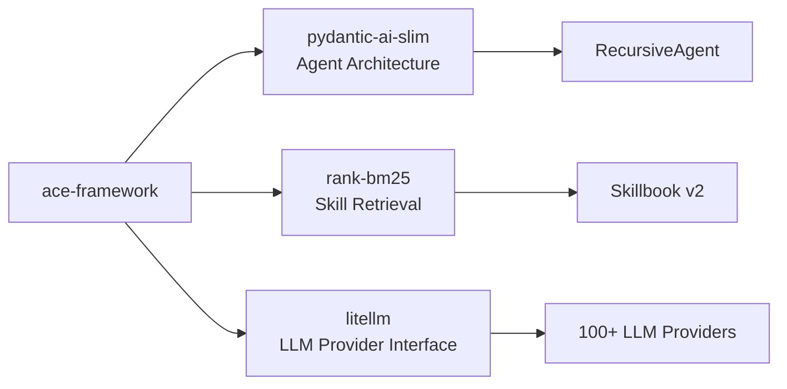

<!-- source: DeepWiki mcp.deepwiki.com · repo kayba-ai/agentic-context-engine · page 11.2 Dependency Management with UV · fetched 2026-10-27 -->

# Dependency Management with UV

<details>
<summary>Relevant source files</summary>

The following files were used as context for generating this wiki page:

- [.claude/commands/checkout-branch.md](.claude/commands/checkout-branch.md)
- [.claude/commands/create-branch.md](.claude/commands/create-branch.md)
- [.claude/commands/list-branches.md](.claude/commands/list-branches.md)
- [.claude/commands/remove-branch.md](.claude/commands/remove-branch.md)
- [CHANGELOG.md](CHANGELOG.md)
- [CONTRIBUTING.md](CONTRIBUTING.md)
- [LICENSE](LICENSE)
- [examples/agentic-system-prompting/README.md](examples/agentic-system-prompting/README.md)
- [pyproject.toml](pyproject.toml)
- [uv.lock](uv.lock)

</details>


## Purpose and Scope

This page documents how the ACE Framework utilizes `uv` for dependency management, including core dependencies, optional extras, development tooling, and deterministic lock file management. It covers the transition to the `v2` schema and the consolidated repository structure.

---

## Overview

The ACE Framework uses `uv` as its primary package manager and environment orchestrator. `uv` provides a fast, Rust-based alternative to `pip` and `poetry`, ensuring reproducible builds through a detailed lock file.

**Key Benefits:**
- **Reproducible Builds**: via `uv.lock` [uv.lock:1-14]()
- **Speed**: 10-100x faster resolution and installation compared to legacy tools.
- **Unified Configuration**: Centralized management in `pyproject.toml` [pyproject.toml:1-154]()
- **Managed Environments**: Automatic virtual environment synchronization with `uv sync`.

Sources: [pyproject.toml:1-154](), [uv.lock:1-14]()

---

## Project Configuration Structure

All dependency configuration is centralized in `pyproject.toml` following PEP 621 standards. The architecture supports a core library with modular "extras" for specific integrations.

```mermaid
graph TB
    pyproject["pyproject.toml"]
    
    subgraph "Project Metadata"
        meta_name["name: ace-framework"]
        meta_version["version: 0.12.0"]
        meta_python["requires-python: >=3.12"]
    end
    
    subgraph "Core Dependencies"
        litellm["litellm>=1.83.0"]
        pydantic["pydantic>=2.0.0"]
        pydantic_ai["pydantic-ai-slim[litellm]>=0.0.36"]
        rank_bm25["rank-bm25>=0.2.2"]
    end
    
    subgraph "Optional Extras"
        extra_claude["claude-sdk"]
        extra_dedup["deduplication"]
        extra_browser["browser-use"]
        extra_logfire["logfire"]
        extra_tracing["tracing"]
        extra_langchain["langchain"]
        extra_mcp["mcp"]
    end
    
    subgraph "Development Groups"
        dev_group["dev"]
        tau_bench["tau-bench"]
        demos["demos"]
    end
    
    subgraph "Scripts"
        ace_cmd["ace (CLI setup)"]
        kayba_cmd["kayba (CLI)"]
        mcp_cmd["ace-mcp (Server)"]
    end
    
    pyproject --> meta_name
    pyproject --> meta_version
    pyproject --> meta_python
    
    pyproject --> litellm
    pyproject --> pydantic
    pyproject --> pydantic_ai
    pyproject --> rank_bm25
    
    pyproject --> extra_claude
    pyproject --> extra_dedup
    pyproject --> extra_browser
    pyproject --> extra_logfire
    pyproject --> extra_tracing
    pyproject --> extra_langchain
    pyproject --> extra_mcp
    
    pyproject --> dev_group
    pyproject --> tau_bench
    pyproject --> demos
    
    pyproject --> ace_cmd
    pyproject --> kayba_cmd
    pyproject --> mcp_cmd
```



Sources: [pyproject.toml:5-122]()

---

## Core Dependencies

The framework requires a specific set of core dependencies for the `v2` learning loop and the `RecursiveAgent` architecture.

| Package | Version | Purpose |
|---------|---------|---------|
| `litellm` | >=1.83.0 | Universal LLM provider interface [pyproject.toml:43]() |
| `pydantic-ai-slim` | >=0.0.36 | Core agentic framework for `RecursiveAgent` [pyproject.toml:45]() |
| `rank-bm25` | >=0.2.2 | BM25-backed retrieval for `Skillbook` v2 [pyproject.toml:46]() |
| `pydantic` | >=2.0.0 | Data validation and structured output parsing [pyproject.toml:44]() |
| `tenacity` | >=9.1.4 | Retry logic for LLM calls and tools [pyproject.toml:48]() |



Sources: [pyproject.toml:41-49](), [CHANGELOG.md:58-60]()

---

## Optional Dependency Extras

Optional functionality is organized into extras to minimize the installation footprint.

### Available Extras

| Extra | Dependencies | Use Case |
|-------|--------------|----------|
| `claude-sdk` | `anthropic` | Native Anthropic SDK integration [pyproject.toml:52-54]() |
| `deduplication` | `numpy`, `sentence-transformers` | Embedding-based skill consolidation [pyproject.toml:62-65]() |
| `browser-use` | `browser-use` | Web automation agents [pyproject.toml:66-68]() |
| `logfire` | `logfire[pydantic-ai]` | Observability and tracing [pyproject.toml:69-71]() |
| `tracing` | `kayba-tracing` | Kayba-specific MLflow tracing [pyproject.toml:72-74]() |
| `langchain` | `langchain-*`, `langgraph` | LangChain/LangGraph integration [pyproject.toml:78-83]() |
| `mcp` | `mcp`, `pydantic-settings` | Model Context Protocol server [pyproject.toml:112-116]() |

**Installation Examples:**
```bash
# Core + browser automation
uv pip install ace-framework[browser-use]

# Core + all observability tools
uv pip install ace-framework[logfire,tracing]

# Full suite for development
uv sync --all-extras
```

Sources: [pyproject.toml:51-116]()

---

## Development Dependency Groups

Development tools are managed via PEP 735 dependency groups.

| Group | Purpose | Key Dependencies |
|-------|---------|------------------|
| `dev` | Core dev & CI | `pytest`, `black`, `mypy`, `pre-commit` [pyproject.toml:130-141]() |
| `tau-bench` | Benchmarking | `tau2` (Git source) [pyproject.toml:142-144]() |
| `demos` | Example scripts | `rich`, `datasets`, `playwright` [pyproject.toml:145-153]() |

**Special Sources:**
`uv` allows referencing non-PyPI sources directly in `pyproject.toml`:
- `tau2`: Pulled from `github.com/sierra-research/tau2-bench.git` [pyproject.toml:208]()
- `kayba-tracing`: Referenced as a local editable path `sdk/python` [pyproject.toml:209]()

Sources: [pyproject.toml:129-153](), [pyproject.toml:207-210]()

---

## Lock File Management

The `uv.lock` file ensures deterministic environments across all platforms.

### Platform Resolution Markers
The lock file handles 9 distinct resolution markers to manage platform-specific versioning (e.g., Windows vs Linux vs Emscripten) and Python version shifts (3.12 through 3.14) [uv.lock:4-14]().

### Local Path Overrides
`uv` tracks the local `ace-framework` as an editable package within the lock file [uv.lock:34-47]():
```toml
[[package]]
name = "ace-framework"
version = "0.12.0"
source = { editable = "." }
```

Sources: [uv.lock:1-47]()

---

## Entry Point Scripts

The project defines several CLI entry points that are automatically available in the `uv` environment:

| Command | Module | Description |
|---------|--------|-------------|
| `ace` | `ace.cli.setup:main` | Framework setup and config [pyproject.toml:119]() |
| `kayba` | `ace.cli:main` | Main Kayba CLI for traces and runs [pyproject.toml:120]() |
| `ace-mcp` | `ace.integrations.mcp.server:main` | ACE MCP tool server [pyproject.toml:121]() |

Sources: [pyproject.toml:118-122]()

---

## Common UV Workflow

### Development Environment Setup
```bash
# Clone and sync
git clone https://github.com/kayba-ai/agentic-context-engine
cd agentic-context-engine
uv sync --all-extras --all-groups

# Run tests
uv run pytest -m unit
```

### Dependency Updates
- **Update Lockfile**: `uv lock`
- **Upgrade Package**: `uv lock --upgrade-package litellm`
- **Sync Environment**: `uv sync`

### Tooling Integration
The project uses `black` for formatting and `mypy` for type checking, configured to target Python 3.12 [pyproject.toml:161-186]().

Sources: [pyproject.toml:161-186](), [CONTRIBUTING.md:120-134]()

---

