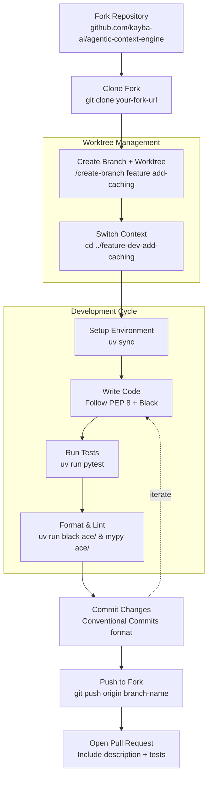
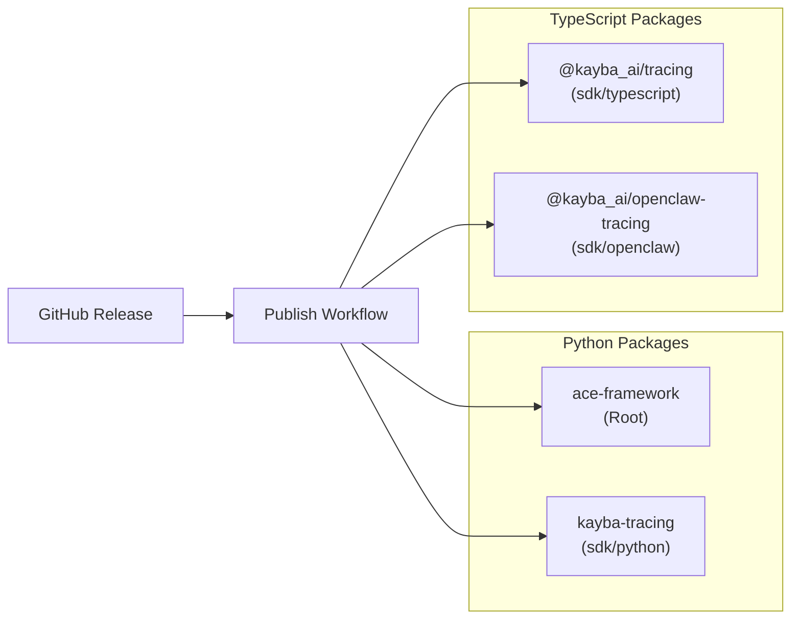

<!-- source: DeepWiki mcp.deepwiki.com · repo kayba-ai/agentic-context-engine · page 11.5 Contributing · fetched 2026-10-27 -->

# Contributing

<details>
<summary>Relevant source files</summary>

The following files were used as context for generating this wiki page:

- [.claude/commands/checkout-branch.md](.claude/commands/checkout-branch.md)
- [.claude/commands/create-branch.md](.claude/commands/create-branch.md)
- [.claude/commands/list-branches.md](.claude/commands/list-branches.md)
- [.claude/commands/remove-branch.md](.claude/commands/remove-branch.md)
- [.github/workflows/publish.yml](.github/workflows/publish.yml)
- [CONTRIBUTING.md](CONTRIBUTING.md)
- [LICENSE](LICENSE)
- [examples/agentic-system-prompting/README.md](examples/agentic-system-prompting/README.md)
- [sdk/openclaw/.gitignore](sdk/openclaw/.gitignore)
- [sdk/openclaw/README.md](sdk/openclaw/README.md)
- [sdk/openclaw/build.mjs](sdk/openclaw/build.mjs)
- [sdk/openclaw/openclaw.plugin.json](sdk/openclaw/openclaw.plugin.json)
- [sdk/openclaw/package-lock.json](sdk/openclaw/package-lock.json)
- [sdk/openclaw/package.json](sdk/openclaw/package.json)
- [sdk/openclaw/src/index.ts](sdk/openclaw/src/index.ts)
- [sdk/openclaw/tsconfig.json](sdk/openclaw/tsconfig.json)

</details>


This page describes the contribution workflow, development setup, coding standards, and review process for contributing to the ACE Framework. It covers the tools, commands, and conventions required to develop, test, and submit changes to the codebase.

## Contribution Workflow

The ACE Framework follows a standard fork-and-pull-request workflow. We emphasize a "Worktree Workflow" to manage multiple features in parallel without constant branch switching.



**Sources:** [CONTRIBUTING.md:37-45](), [CONTRIBUTING.md:68-80]()

---

## Development Setup

### Prerequisites
- **Python 3.12**: Required for all core logic and type safety [CONTRIBUTING.md:129]().
- **UV**: We use `uv` for dependency management. It is significantly faster than standard `pip` [CONTRIBUTING.md:121]().
- **Node.js 20/22**: Required if contributing to the TypeScript SDKs [sdk/openclaw/package.json:32]().

### Initial Setup
```bash
# Clone your fork
git clone https://github.com/your-username/agentic-context-engine.git
cd agentic-context-engine

# Install all dependencies (core + extras)
uv sync

# Run initial test suite to verify environment
uv run pytest -m unit
```
**Sources:** [CONTRIBUTING.md:113-134]()

### Branch Naming Convention
Branches must follow the format: `<type>/<developer>/<description>`
- **Types**: `feature/`, `fix/`, `docs/`, `refactor/`, `test/`, `chore/`
- **Example**: `feature/john/recursive-reflector-optimization`

**Sources:** [CONTRIBUTING.md:46-67]()

---

## Worktree Workflow

We recommend using `git worktree` to maintain separate directories for different branches. This avoids the need to rebuild dependencies or stash changes when switching tasks.

### Automation with Claude Code
If using Claude Code, the following custom commands are available:
- `/create-branch <type> <description>`: Creates a new branch and a sibling directory worktree [.claude/commands/create-branch.md:1-22]().
- `/checkout-branch <branch>`: Switches to a branch, creating the worktree if it doesn't exist [.claude/commands/checkout-branch.md:1-28]().
- `/list-branches`: Lists all branches and their worktree paths.
- `/remove-branch <branch>`: Safely removes the worktree and the branch.

**Sources:** [CONTRIBUTING.md:72-86](), [.claude/commands/create-branch.md:1-40](), [.claude/commands/checkout-branch.md:1-65]()

---

## Coding Standards

### Style and Type Safety
- **Formatting**: Use **Black** for all Python code. Keep line lengths under 100 characters [CONTRIBUTING.md:163-164]().
- **Type Hints**: Mandatory for all public APIs. We use **mypy** for static analysis [CONTRIBUTING.md:161]().
- **Docstrings**: Required for all public functions and classes following standard PEP 257 [CONTRIBUTING.md:162]().

### Conventional Commits
All commits must follow the [Conventional Commits](https://www.conventionalcommits.org/) specification:
`type(scope): subject`

| Type | Description |
| :--- | :--- |
| `feat` | A new feature for the user |
| `fix` | A bug fix |
| `docs` | Documentation only changes |
| `style` | Changes that do not affect the meaning of the code (formatting) |
| `refactor` | A code change that neither fixes a bug nor adds a feature |
| `test` | Adding missing tests or correcting existing tests |
| `chore` | Changes to the build process or auxiliary tools |

**Sources:** [CONTRIBUTING.md:136-156]()

---

## Testing Requirements

We use `pytest` for our test suite. Contributions will not be merged unless all tests pass.

### Test Markers
- `unit`: Fast tests that do not require network access or LLM calls [CONTRIBUTING.md:132]().
- `integration`: Tests that interact with LLM providers or external services [CONTRIBUTING.md:133]().

### Running Tests
```bash
# Run all tests
uv run pytest

# Run only unit tests
uv run pytest -m unit

# Check coverage for a specific module
uv run pytest --cov=ace tests/test_skillbook.py
```
**Sources:** [CONTRIBUTING.md:124-134]()

---

## CI/CD and Publishing

The repository uses GitHub Actions for automated building and publishing of multiple packages.

### Package Mapping



**Publishing Rules:**
1. **Releases**: Publishing to PyPI and npm is triggered by a GitHub Release event [.github/workflows/publish.yml:4-5]().
2. **Manual**: Use `workflow_dispatch` to publish to **TestPyPI** for verification [.github/workflows/publish.yml:6-15]().
3. **OpenClaw**: The OpenClaw plugin requires a specific build step using `esbuild` before publishing [.github/workflows/publish.yml:120-123]().

**Sources:** [.github/workflows/publish.yml:1-223](), [sdk/openclaw/package.json:17-20]()

---

## Contributor Terms

By submitting a Pull Request, you agree to the following:
- The contribution is your original work [CONTRIBUTING.md:5]().
- You license the work under **Apache-2.0** [CONTRIBUTING.md:6]().
- You grant maintainers the right to relicense the contribution in the future [CONTRIBUTING.md:7]().

**Sources:** [CONTRIBUTING.md:1-8](), [LICENSE:1-131]()

---

