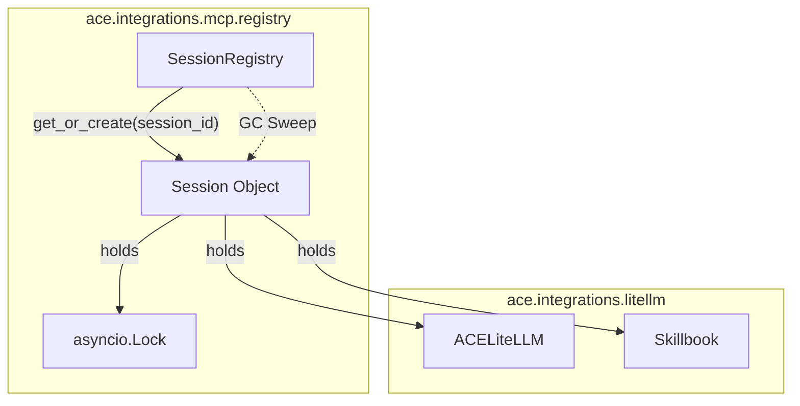
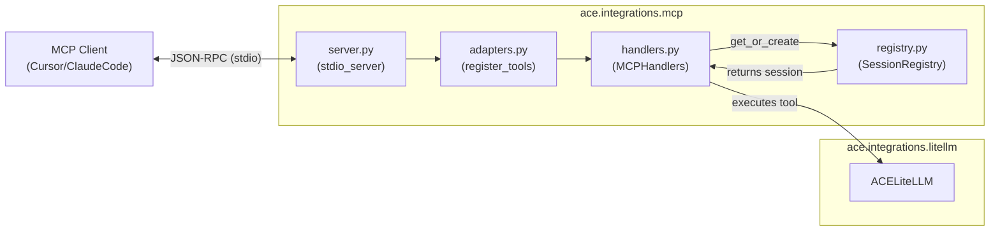

<!-- source: DeepWiki mcp.deepwiki.com · repo kayba-ai/agentic-context-engine · page 12.10 MCP Server APIs · fetched 2026-10-27 -->

# MCP Server APIs

Relevant source files

The following files were used as context for generating this wiki page:

- [ace/integrations/mcp/models.py](ace/integrations/mcp/models.py)
- [ace/integrations/mcp/server.py](ace/integrations/mcp/server.py)
- [docs/integrations/index.md](docs/integrations/index.md)
- [docs/integrations/mcp-client-setup.md](docs/integrations/mcp-client-setup.md)
- [docs/integrations/mcp.md](docs/integrations/mcp.md)
- [mkdocs.yml](mkdocs.yml)
- [specs/002-ace-mcp-server/contracts/tool-schemas.md](specs/002-ace-mcp-server/contracts/tool-schemas.md)
- [specs/002-ace-mcp-server/spec.md](specs/002-ace-mcp-server/spec.md)
- [tests/test_ace_mcp_compatibility.py](tests/test_ace_mcp_compatibility.py)

## Purpose and Scope

This document specifies the programmatic API surface exposed by the ACE MCP Server: tool request/call schemas, session management interfaces, configuration parameters, and error codes. It covers the contract-level details required to call ACE via the Model Context Protocol (MCP).

The MCP server allows external clients (IDEs like Cursor/Windsurf, or CLIs like Claude Code) to use ACE skills at runtime. For installation and client-specific setup, see [MCP Server Integration]().

---

## Tool Catalog

The MCP server exposes six tools under the `ace.*` namespace. All tools use JSON request/response payloads validated by Pydantic models defined in [ace/integrations/mcp/models.py:5-144]().

| Tool Name | Category | Mutates Skillbook | Description |
|-----------|----------|-------------------|-------------|
| `ace.ask` | Query | No | Ask a question using the current skillbook; returns answer and skill count. |
| `ace.learn.sample` | Learning | Yes | Provide question/answer samples for ACE to learn from; runs the full pipeline. |
| `ace.learn.feedback` | Learning | Yes | Provide feedback on a previous answer to update the skillbook. |
| `ace.skillbook.get` | Inspection | No | Retrieve skills and statistics from the active skillbook. |
| `ace.skillbook.save` | Persistence | No | Save the session's skillbook to a file on disk. |
| `ace.skillbook.load` | Persistence | Yes | Load a skillbook from disk into the session, replacing the current one. |

**Sources:** [ace/integrations/mcp/models.py:5-144](), [docs/integrations/mcp.md:47-131]()

---

## Tool Request/Response Schemas

### Shared Types

#### SessionConfig
Optional configuration object for overriding model parameters when creating or using a session.

| Field | Type | Required | Constraints | Description |
|-------|------|----------|-------------|-------------|
| `model` | string | No | `minLength: 1` | LiteLLM model identifier (e.g., `gpt-4o-mini`, `anthropic/...`). |
| `temperature` | number | No | `0 ≤ value ≤ 2` | Sampling temperature. |
| `max_tokens` | integer | No | `≥ 1` | Maximum tokens in model response. |

**Sources:** [ace/integrations/mcp/models.py:5-11](), [specs/002-ace-mcp-server/contracts/tool-schemas.md:11-23]()

---

### ace.ask
Query the agent without mutating the skillbook.

#### Request: AskRequest
| Field | Type | Required | Constraints | Description |
|-------|------|----------|-------------|-------------|
| `session_id` | string | Yes | `minLength: 1` | Session identifier for state isolation. |
| `question` | string | Yes | `1 ≤ length ≤ 100000` | The question to answer. |
| `context` | string | No | default: `""` | Background context for the question. |
| `session_config` | SessionConfig | No | — | Model overrides (applies only on session creation). |
| `metadata` | object | No | — | Arbitrary metadata. |

#### Response: AskResponse
| Field | Type | Description |
|-------|------|-------------|
| `session_id` | string | Echo of request `session_id`. |
| `answer` | string | Agent-generated answer. |
| `skill_count` | integer | Total skills in session skillbook (≥ 0). |

**Sources:** [ace/integrations/mcp/models.py:21-37](), [specs/002-ace-mcp-server/contracts/tool-schemas.md:42-85]()

---

### ace.learn.sample
Batch learning from question/answer samples. Runs the full ACE pipeline (Agent → Evaluate → Reflect → Update → Apply).

**Blocked by:** `ACE_MCP_SAFE_MODE=true`.

#### Request: LearnSampleRequest
| Field | Type | Required | Constraints | Description |
|-------|------|----------|-------------|-------------|
| `session_id` | string | Yes | `minLength: 1` | Session identifier. |
| `samples` | array[SampleItem] | Yes | `1 ≤ length ≤ 25` | List of `{question, context?, ground_truth?, metadata?}`. |
| `epochs` | integer | No | `1 ≤ value ≤ 20`, default: 1 | Number of learning passes. |
| `session_config` | SessionConfig | No | — | Model overrides. |

#### Response: LearnSampleResponse
| Field | Type | Description |
|-------|------|-------------|
| `session_id` | string | Echo of request `session_id`. |
| `processed` | integer | Number of successfully processed samples. |
| `failed` | integer | Number of failed samples. |
| `skill_count_before` | integer | Skill count before learning. |
| `skill_count_after` | integer | Skill count after learning. |
| `new_skill_count` | integer | Skills added during learning. |

**Sources:** [ace/integrations/mcp/models.py:39-66](), [specs/002-ace-mcp-server/contracts/tool-schemas.md:89-149]()

---

### ace.learn.feedback
Learn from feedback on a previous answer.

**Blocked by:** `ACE_MCP_SAFE_MODE=true`.

#### Request: LearnFeedbackRequest
| Field | Type | Required | Description |
|-------|------|----------|-------------|
| `session_id` | string | Yes | Session identifier. |
| `question` | string | Yes | The original question. |
| `answer` | string | Yes | The answer being evaluated. |
| `feedback` | string | Yes | Feedback about answer quality. |
| `context` | string | No | Original context. |
| `ground_truth` | string | No | The correct answer. |

#### Response: LearnFeedbackResponse
| Field | Type | Description |
|-------|------|-------------|
| `session_id` | string | Echo of request `session_id`. |
| `learned` | boolean | `true` if the learning path executed. |
| `skill_count_before` | integer | Skill count before learning. |
| `skill_count_after` | integer | Skill count after learning. |
| `new_skill_count` | integer | Skills added/modified. |

**Sources:** [ace/integrations/mcp/models.py:68-88](), [specs/002-ace-mcp-server/contracts/tool-schemas.md:153-201]()

---

## Session Management

The MCP server uses a `SessionRegistry` to isolate state by `session_id`. Each session maintains an independent `ACELiteLLM` runner and `Skillbook`.

### Session Lifecycle Diagram

**Key Behaviors:**
- **Isolation:** All state is isolated by `session_id` [ace/integrations/mcp/registry.py:27-46]().
- **Persistence:** Sessions are held in memory. Use `ace.skillbook.save` to persist skills to disk.
- **Concurrency:** Per-session locks ensure concurrent requests to the same `session_id` are serialized [ace/integrations/mcp/registry.py:18-19]().
- **Garbage Collection:** Sessions are removed after `ACE_MCP_SESSION_TTL_SECONDS` (default 3600s) of inactivity [ace/integrations/mcp/registry.py:72-84]().

**Sources:** [ace/integrations/mcp/registry.py:1-96](), [docs/integrations/mcp.md:133-140]()

---

## Configuration and Safety

The server is configured via environment variables with the `ACE_MCP_` prefix.

| Variable | Default | Description |
|----------|---------|-------------|
| `ACE_MCP_DEFAULT_MODEL` | `gpt-4o-mini` | Default model for new sessions. |
| `ACE_MCP_SAFE_MODE` | `false` | If `true`, blocks all mutating tools (learn/save/load). |
| `ACE_MCP_ALLOW_SAVE_LOAD` | `true` | Specifically controls access to `save` and `load` tools. |
| `ACE_MCP_SKILLBOOK_ROOT` | unset | If set, restricts `save`/`load` to this directory. |

### Security Path Enforcement
When `ACE_MCP_SKILLBOOK_ROOT` is set, the server resolves all user-provided paths to canonical absolute paths using `Path.resolve()` to prevent directory traversal attacks [specs/002-ace-mcp-server/contracts/tool-schemas.md:269-284]().

**Sources:** [ace/integrations/mcp/config.py:4-20](), [docs/integrations/mcp.md:31-45]()

---

## Error Handling

Internal exceptions are mapped to stable MCP error codes.

| Error Code | HTTP-Equivalent | Description |
|------------|-----------------|-------------|
| `ACE_MCP_VALIDATION_ERROR` | 400 | Invalid request schema or prompt too long. |
| `ACE_MCP_SESSION_NOT_FOUND` | 404 | Session ID not recognized. |
| `ACE_MCP_FORBIDDEN_IN_SAFE_MODE` | 403 | Mutating tool called while safe mode is active. |
| `ACE_MCP_SAVE_LOAD_DISABLED` | 403 | Disk persistence tools are disabled by config. |
| `ACE_MCP_TIMEOUT` | 504 | Learning operation exceeded `LEARN_TIMEOUT_SECONDS`. |
| `ACE_MCP_INTERNAL_ERROR` | 500 | Unexpected failure in the ACE engine. |

**Sources:** [ace/integrations/mcp/errors.py:1-49](), [specs/002-ace-mcp-server/spec.md:169-181]()

---

## Runtime Architecture

The following diagram illustrates the data flow from an MCP Client through the server adapters to the core ACE components.

**Implementation Details:**
- **Entrypoint:** The server is started via the `ace-mcp` CLI command, which invokes `ace.integrations.mcp.server:main` [ace/integrations/mcp/server.py:79-85]().
- **Schema Inlining:** To support clients that do not handle Pydantic `$defs` correctly, the server recursively inlines all JSON schema definitions before publishing them to the client [tests/test_ace_mcp_compatibility.py:41-58]().
- **Thread Safety:** While the MCP server is async, the underlying ACE runners often perform sync I/O. Handlers use `asyncio.to_thread` where appropriate to maintain event loop responsiveness.

**Sources:** [ace/integrations/mcp/server.py:1-85](), [ace/integrations/mcp/adapters.py:1-130](), [tests/test_ace_mcp_compatibility.py:1-172]()

---

