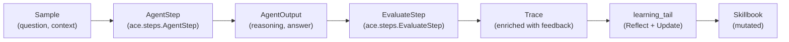
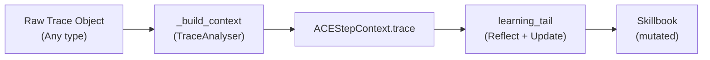

<!-- source: DeepWiki mcp.deepwiki.com · repo kayba-ai/agentic-context-engine · page 12.2 Adaptation APIs · fetched 2026-10-27 -->

# Adaptation APIs

<details>
<summary>Relevant source files</summary>

The following files were used as context for generating this wiki page:

- [ace/runners/ace.py](ace/runners/ace.py)
- [ace/runners/base.py](ace/runners/base.py)
- [ace/runners/trace_analyser.py](ace/runners/trace_analyser.py)
- [ace/steps/agent.py](ace/steps/agent.py)
- [agent-guides/plan-sm-rewrite-v3.md](agent-guides/plan-sm-rewrite-v3.md)

</details>


This page documents the modern `ACERunner` system and the specialized `ACE` and `TraceAnalyser` subclasses. These runners orchestrate the adaptation pipeline, managing data flow between roles, execution modes (online/offline), and persistence via checkpointing.

**Related Documentation:**
- Pipeline Primitives: [Pipeline APIs](#12.7)
- Role Definitions: [Core Role APIs](#12.1)
- Skillbook Management: [Skillbook APIs](#12.3)

---

## Runner Architecture

The `ACERunner` base class provides shared infrastructure for managing the epoch loop, error isolation, and the foreground/background execution split. It composes a `Pipeline` instance rather than extending it, delegating sample iteration and concurrency to the underlying engine.

### Class Hierarchy

```mermaid
graph TD
    ACERunner["ACERunner<br/>ace.runners.base.ACERunner"]
    ACE["ACE (Live Loop)<br/>ace.runners.ace.ACE"]
    TraceAnalyser["TraceAnalyser (Batch Analysis)<br/>ace.runners.trace_analyser.TraceAnalyser"]

    ACERunner --> ACE
    ACERunner --> TraceAnalyser

    Pipeline["Pipeline<br/>pipeline.Pipeline"]
    Skillbook["Skillbook<br/>ace.core.skillbook.Skillbook"]

    ACERunner o-- Pipeline
    ACERunner o-- Skillbook
```
Sources: [ace/runners/base.py:19-43](), [ace/runners/ace.py:27-38](), [ace/runners/trace_analyser.py:26-41]()

---

## ACE: The Live Adaptive Runner

The `ACE` runner implements the full closed-loop adaptation cycle: **Execute → Evaluate → Reflect → Update**. It is used when building an agent from scratch that should improve in real-time as it interacts with an environment.

### Pipeline Composition

The `ACE` runner builds a pipeline consisting of an execution phase followed by the "learning tail."

| Step | Implementation | Role | Purpose |
| :--- | :--- | :--- | :--- |
| **Agent** | `AgentStep` | `AgentLike` | Generates response to a `Sample` |
| **Evaluate** | `EvaluateStep` | `TaskEnvironment` | Scores the agent output |
| **Reflect** | `ReflectStep` | `ReflectorLike` | Analyzes the trace for insights |
| **Update** | `UpdateStep` | `SkillManagerLike` | Mutates the `Skillbook` |

**Data Flow in ACE:**


Sources: [ace/runners/ace.py:79-91](), [ace/steps/agent.py:11-19](), [ace/runners/ace.py:180-192]()

### Configuration (from_roles)

```python
runner = ACE.from_roles(
    agent=my_agent,
    reflector=my_reflector,
    skill_manager=my_sm,
    environment=my_env,
    skillbook=my_sb,
    checkpoint_dir="./checkpoints",
    checkpoint_interval=10
)
```
Sources: [ace/runners/ace.py:97-128]()

---

## TraceAnalyser: Offline Batch Learning

`TraceAnalyser` is designed for learning from pre-recorded execution logs (e.g., LangChain traces, Browser-use history, or Claude Code transcripts). It skips the `AgentStep` and `EvaluateStep`, running only the "learning tail."

### Execution Logic

Unlike the live `ACE` runner, `TraceAnalyser` accepts raw trace objects of any type. These are placed directly onto the `ACEStepContext.trace` field for the `Reflector` to interpret.

**Data Flow in TraceAnalyser:**


Sources: [ace/runners/trace_analyser.py:132-139](), [ace/runners/trace_analyser.py:155-187]()

### Usage

```python
runner = TraceAnalyser.from_roles(
    reflector=my_reflector,
    skill_manager=my_sm,
    skillbook=my_sb
)

# Process a list of historical traces
runner.run(traces=historical_logs, epochs=2)
```
Sources: [ace/runners/trace_analyser.py:92-130]()

---

## Core Adaptation Methods

### The Run Method

The `run()` method handles the epoch loop and delegates per-sample execution to the `Pipeline`.

- **Online Mode**: Set `epochs=1`. Can accept an `Iterable` of samples.
- **Offline/Batch Mode**: Set `epochs > 1`. Requires a `Sequence` (to allow multiple passes).
- **Background Learning**: By default, `run()` blocks until learning is complete (`wait=True`). If `wait=False`, foreground steps (Agent/Evaluate) finish, and the method returns while the background "learning tail" continues.

Sources: [ace/runners/base.py:86-145](), [ace/runners/ace.py:144-167]()

### Checkpointing and Persistence

Runners support automatic checkpointing via `CheckpointStep` (injected by `learning_tail`).

- **checkpoint_dir**: The directory where `.json` skillbook snapshots are saved.
- **checkpoint_interval**: The number of samples processed between saves.
- **Save/Load**: Manual persistence is available via `runner.save(path)` and `runner.load(path)`.

Sources: [ace/runners/base.py:57-63](), [ace/runners/ace.py:51-53](), [ace/runners/trace_analyser.py:52-53]()

---

## Background Learning & Concurrency

The runners leverage the pipeline's `async_boundary` to decouple execution from reflection.

1. **Foreground**: `AgentStep` and `EvaluateStep` run sequentially.
2. **Boundary**: The trace and context are handed off to a background queue.
3. **Background**: `ReflectStep` and `UpdateStep` run in a separate thread pool.

### Monitoring Progress

Users can monitor the background learning queue using the following `ACERunner` properties:

- **wait_for_background(timeout)**: Blocks until the background queue is empty.
- **learning_stats**: Returns a dictionary containing `queued`, `active`, and `completed` task counts.

Sources: [ace/runners/base.py:65-80](), [ace/steps/__init__.py:learning_tail]()

---

## Comparison Table

| Feature | ACE Runner | TraceAnalyser |
| :--- | :--- | :--- |
| **Primary Input** | `Sample` (Question/Context) | Raw Trace Objects (Any) |
| **Steps** | Agent → Eval → Reflect → Update | Reflect → Update |
| **Environment** | Required for `EvaluateStep` | Not Required |
| **Use Case** | Real-time agent improvement | Learning from logs/history |
| **Context Mapping** | Maps `Sample` to `ctx.sample` | Maps raw object to `ctx.trace` |

Sources: [ace/runners/ace.py:27-38](), [ace/runners/trace_analyser.py:26-41]()

---

