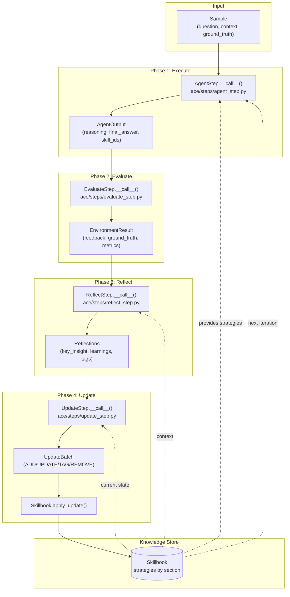
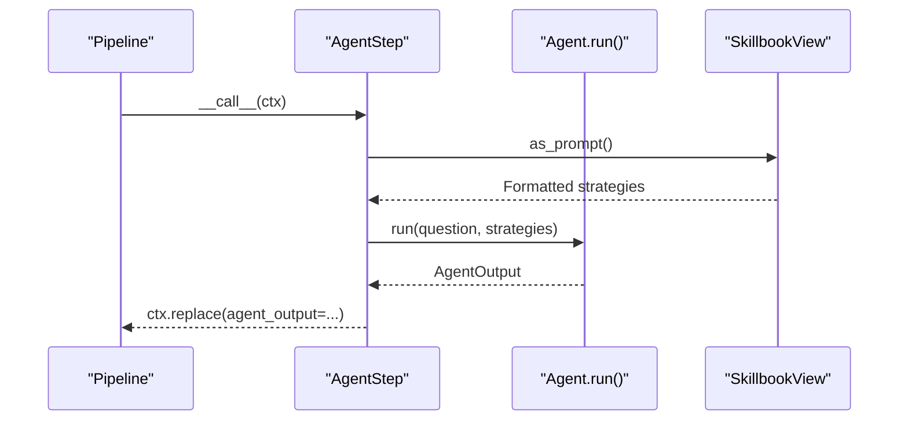
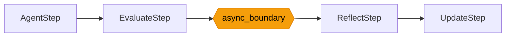

<!-- source: DeepWiki mcp.deepwiki.com · repo kayba-ai/agentic-context-engine · page 2.1 The ACE Learning Loop · fetched 2026-10-27 -->

# The ACE Learning Loop

<details>
<summary>Relevant source files</summary>

The following files were used as context for generating this wiki page:

- [CLAUDE.md](CLAUDE.md)
- [README.md](README.md)
- [ace/__init__.py](ace/__init__.py)
- [ace/runners/litellm.py](ace/runners/litellm.py)
- [assets/kayba-banner.png](assets/kayba-banner.png)
- [docs/guides/full-pipeline.md](docs/guides/full-pipeline.md)
- [docs/index.md](docs/index.md)
- [docs/integrations/litellm.md](docs/integrations/litellm.md)
- [docs/integrations/opik.md](docs/integrations/opik.md)
- [docs/pipeline/index.md](docs/pipeline/index.md)
- [examples/ace/ace_demo.py](examples/ace/ace_demo.py)
- [examples/pipeline_composition/compose_custom_pipeline.py](examples/pipeline_composition/compose_custom_pipeline.py)
- [tests/test_pipeline_exports.py](tests/test_pipeline_exports.py)

</details>


## Purpose and Scope

This document describes the core learning loop that enables ACE agents to self-improve through execution feedback. The loop implements a continuous cycle of **Execute → Evaluate → Reflect → Update** that transforms task experiences into refined strategies stored in the skillbook.

The ACE framework implements this loop using a **Pipeline Engine**, where each phase of the loop is encapsulated in a discrete, composable `Step`. This architecture ensures that data flow is immutable and that learning can occur either synchronously or in the background.

For details on the skillbook data structure, see [Skillbook System (2.2)](). For deep dives into the individual roles, see [Three-Role Architecture (2.3)](). For information about the underlying pipeline primitives, see [Pipeline Primitives (3.2.1)]().

---

## Loop Architecture Overview

The ACE learning loop is composed of several specialized steps orchestrated by a `Pipeline`. In the standard configuration, these steps are: `AgentStep` → `EvaluateStep` → `ReflectStep` → `UpdateStep`.



**Diagram: ACE Learning Loop with Code Entity Mapping**

Sources: [ace/runners/ace.py:86-118](), [ace/steps/__init__.py:1-25](), [docs/index.md:9-17]()

---

## Phase 1: Execute (Agent Generation)

The `AgentStep` consumes the current `Skillbook` and generates a reasoned answer to the task question.

### Key Components

| Component | Type | Location | Purpose |
|-----------|------|----------|---------|
| `Agent` | Class | [ace/implementations/agent.py]() | Logic for task execution using PydanticAI |
| `AgentStep` | Step | [ace/steps/agent_step.py]() | Pipeline wrapper for the Agent role |
| `AgentOutput` | Dataclass | [ace/core/outputs.py:14-17]() | Contains reasoning and final_answer |

### Execution Flow

The `Agent` uses a `SkillbookView` to retrieve relevant strategies. It injects these into its system prompt to guide its reasoning.



**Diagram: Agent Execution Sequence**

The agent extracts which strategies were cited in its reasoning trace. These citations (e.g., `[section-001]`) allow the system to track which skills are effectively contributing to performance.

Sources: [ace/steps/agent_step.py:1-30](), [ace/implementations/agent.py:1-50](), [examples/pipeline_composition/compose_custom_pipeline.py:67-67]()

---

## Phase 2: Evaluate (Environment Feedback)

The `EvaluateStep` uses a `TaskEnvironment` to score the agent's output and provide feedback.

### Key Components

| Component | Type | Location | Purpose |
|-----------|------|----------|---------|
| `TaskEnvironment` | Protocol | [ace/core/environment.py]() | Interface for evaluation logic |
| `EvaluateStep` | Step | [ace/steps/evaluate_step.py]() | Pipeline wrapper for evaluation |
| `SimpleEnvironment` | Class | [ace/core/environment.py]() | Substring matching evaluator |

### Evaluation Contract

The environment receives the `Sample` and `AgentOutput` and returns an `EnvironmentResult`:

- **feedback**: Text describing the correctness (e.g., "Correct!" or "Incorrect. Expected: Paris").
- **ground_truth**: The reference answer used for reflection.
- **metrics**: Numerical scores (e.g., `{"accuracy": 1.0}`).

```python
# Example of custom environment usage
class ExactMatchEnvironment(TaskEnvironment):
    def evaluate(self, sample, agent_output):
        correct = sample.ground_truth.lower() == agent_output.final_answer.lower()
        return EnvironmentResult(
            feedback="Correct!" if correct else "Wrong",
            metrics={"accuracy": 1.0 if correct else 0.0}
        )
```

Sources: [ace/steps/evaluate_step.py:1-20](), [ace/core/environment.py:1-50](), [examples/ace/ace_demo.py:170-184]()

---

## Phase 3: Reflect (Trace Analysis)

The `ReflectStep` (or the advanced `RRStep`) analyzes the execution trace to extract actionable insights.

### Key Components

| Component | Type | Location | Purpose |
|-----------|------|----------|---------|
| `Reflector` | Class | [ace/implementations/reflector.py]() | Standard single-pass analyzer |
| `RRStep` | Step | [ace/steps/rr_step.py]() | **Recursive Reflector**: Iterative code-based analysis |
| `ReflectorOutput` | Dataclass | [ace/core/outputs.py:15-16]() | Key insights and extracted learnings |

### Reflection Modes

1.  **Standard Reflection**: A single LLM call that looks at the `AgentOutput` and `EnvironmentResult` to find the root cause of errors.
2.  **Recursive Reflector (RR)**: The system's most advanced analysis mode. It writes and executes Python code in a `TraceSandbox` to programmatically inspect the trace, test hypotheses, and synthesize multi-step strategies.

The `ReflectStep` identifies which skills were "helpful" or "harmful" based on the evaluation result, which is used to update skill metadata.

Sources: [ace/steps/reflect_step.py:1-25](), [ace/steps/rr_step.py:1-50](), [ace/implementations/reflector.py:1-40]()

---

## Phase 4: Update (Skillbook Curation)

The `UpdateStep` invokes the `SkillManager` to translate reflections into concrete `Skillbook` modifications.

### Key Components

| Component | Type | Location | Purpose |
|-----------|------|----------|---------|
| `SkillManager` | Class | [ace/implementations/skill_manager.py]() | Curates the skillbook state |
| `UpdateStep` | Step | [ace/steps/update_step.py]() | Pipeline wrapper for updates |
| `UpdateBatch` | Dataclass | [ace/core/skillbook.py:27-28]() | List of `UpdateOperation` objects |

### Update Operations

The `SkillManager` generates an `UpdateBatch` containing operations like:
- **ADD**: Create a new strategy.
- **UPDATE**: Refine an existing strategy.
- **TAG**: Mark a skill as helpful/harmful based on the current trace.
- **REMOVE**: Prune redundant or ineffective strategies.

These operations are applied to the `Skillbook` at the end of the step, making the new knowledge available for the next `Sample` or epoch.

Sources: [ace/steps/update_step.py:1-25](), [ace/implementations/skill_manager.py:1-50](), [ace/core/skillbook.py:77-78]()

---

## The Learning Tail (Async Learning)

A critical architectural pattern in ACE is the `learning_tail`. This is a factory function that creates the "learning" portion of the pipeline (Reflect → Update).

```python
# From ace/steps/__init__.py
def learning_tail(reflector, skill_manager, skillbook):
    return [
        ReflectStep(reflector),
        UpdateStep(skill_manager, skillbook)
    ]
```

### Async Boundaries

To prevent the slow learning process (Reflection/Update) from blocking the fast Agent execution, ACE uses the `async_boundary` feature of the Pipeline Engine.



When `async_boundary` is set to `True` on the `ReflectStep`, the pipeline returns the agent's answer immediately after evaluation. The reflection and skillbook update continue in background threads. This allows for high-throughput execution while maintaining a continuous background learning loop.

Sources: [ace/steps/__init__.py:115-115](), [docs/pipeline/index.md:112-129](), [examples/pipeline_composition/compose_custom_pipeline.py:70-70]()

---

## Complete Pipeline Composition

The `ACE` runner automates the construction of this loop. Users can also manually compose it for full control over the steps.

```python
from ace import Pipeline, AgentStep, EvaluateStep, learning_tail

# Manual composition
pipe = Pipeline([
    AgentStep(agent, skillbook),
    EvaluateStep(environment),
    # Custom step can be injected here
    *learning_tail(reflector, skill_manager, skillbook)
])

# Or using the runner preset
runner = ACE.from_roles(agent, reflector, skill_manager, environment)
results = runner.run(samples, epochs=3)
```

The loop iterates over the provided `samples` for the specified number of `epochs`. Each epoch allows the agent to revisit tasks with a more mature `Skillbook`, leading to progressive performance improvement.

Sources: [ace/runners/ace.py:102-115](), [examples/pipeline_composition/compose_custom_pipeline.py:65-72](), [docs/guides/full-pipeline.md:71-84]()

---

