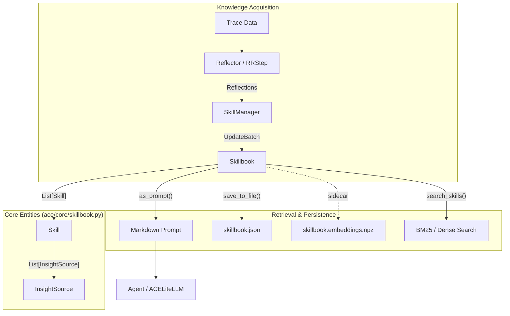
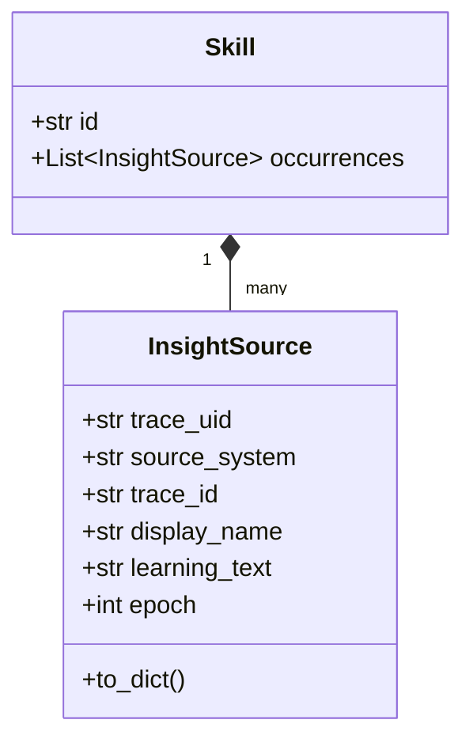

<!-- source: DeepWiki mcp.deepwiki.com · repo kayba-ai/agentic-context-engine · page 2.2 Skillbook System · fetched 2026-10-27 -->

# Skillbook System

Relevant source files

The following files were used as context for generating this wiki page:

- [ace/core/__init__.py](ace/core/__init__.py)
- [ace/core/insight_source.py](ace/core/insight_source.py)
- [ace/core/skillbook.py](ace/core/skillbook.py)
- [docs/api/index.md](docs/api/index.md)
- [docs/concepts/skillbook.md](docs/concepts/skillbook.md)
- [docs/concepts/updates.md](docs/concepts/updates.md)
- [docs/design/SKILLBOOK_V2_PLAN.md](docs/design/SKILLBOOK_V2_PLAN.md)
- [docs/guides/composing-pipelines.md](docs/guides/composing-pipelines.md)
- [docs/guides/prompts.md](docs/guides/prompts.md)
- [tests/test_ace_core.py](tests/test_ace_core.py)

## Purpose and Scope

The **Skillbook** is the central knowledge store for the ACE Framework, maintaining a structured collection of learned strategies called **Skills**. This page details the Skill data structure (v2 schema), the Skillbook class interface, the `InsightSource` provenance system, and the hybrid BM25 retrieval and persistence mechanisms.

For the three-phase learning cycle that populates the Skillbook, see [The ACE Learning Loop](2.1). For details on the mutation instructions, see [Update Operations](9.1).

---

## Overview

The Skillbook acts as the agent's "long-term memory," evolving from a blank slate into a repository of domain-specific expertise. Unlike static system prompts, the Skillbook is dynamically curated by the `SkillManager` based on execution traces and environment feedback.

**Key characteristics:**
- **V2 Schema**: Organized by binary sections (`context` vs `harness`) with structured `keywords`.
- **Provenance**: Every skill tracks its origin via `InsightSource` records linked to specific traces.
- **Hybrid Retrieval**: Supports BM25 and dense embedding-based search for relevant strategies.
- **Persistence**: Saved as human-readable JSON with a binary `.npz` sidecar for embeddings.

Sources: [ace/core/skillbook.py:1-23](), [docs/concepts/skillbook.md:1-5](), [docs/design/SKILLBOOK_V2_PLAN.md:1-15]()

---

## Architecture and Data Flow

The following diagram bridges the natural language strategies learned by the agent to the specific code entities in `ace/core/`.

### Skillbook Data Flow

Sources: [ace/core/skillbook.py:207-220](), [ace/core/context.py:12-15](), [docs/guides/composing-pipelines.md:18-29]()

---

## Skill Structure (v2 Schema)

ACE uses a standardized schema (Version 2) to ensure skills are both human-readable and machine-parsable.

### The `Skill` Class
Defined in `ace/core/skillbook.py`, a Skill represents a single learned entry.

| Field | Type | Description |
|-------|------|-------------|
| `id` | `str` | Unique identifier (e.g., `context-00001`). |
| `section` | `Literal` | Either `context` (agent guidance) or `harness` (environment/runtime). |
| `keywords` | `list[str]` | Normalized topic labels (e.g., `["math", "api_limit"]`). |
| `issue` | `str` | Prose description of the problem and its scope. |
| `insight` | `str | None` | Imperative action (Required for `context` section). |
| `occurrences` | `list[InsightSource]` | Audit chain linking the skill to supporting traces. |
| `active` | `bool` | Soft-delete flag; `False` excludes skill from prompts. |
| `helpful_count` | `int` | Counter for successful applications. |
| `harmful_count` | `int` | Counter for applications leading to failure. |

Sources: [ace/core/skillbook.py:254-282](), [docs/concepts/skillbook.md:7-35](), [docs/design/SKILLBOOK_V2_PLAN.md:21-37]()

---

## InsightSource Provenance

The `InsightSource` class provides the "paper trail" for learned knowledge. Each time a skill is created or updated, a source record is appended to its `occurrences` list.

### Provenance Tracking

Sources: [ace/core/insight_source.py:108-121](), [docs/concepts/skillbook.md:135-152]()

---

## Retrieval and Skillbook Operations

The `Skillbook` class manages the lifecycle of these entries through several key methods.

### Key Functions
- **`add_skill`**: Validates the section (must be `context` or `harness`) and enforces that `context` skills have insights. [ace/core/skillbook.py:657-670]()
- **`apply_update`**: Processes an `UpdateBatch` containing `ADD`, `UPDATE`, `TAG`, or `REMOVE` operations. [ace/core/skillbook.py:906-915]()
- **`as_prompt`**: Renders the active skills into a Markdown format optimized for LLM consumption, grouped by section. [ace/core/skillbook.py:843-855]()
- **`search_skills`**: Performs retrieval using BM25 (text-based) or hybrid search if embeddings are present. [ace/core/skillbook.py:1120-1135]()

### Scoring and Effectiveness
Effectiveness is tracked via `helpful_count`, `harmful_count`, and `neutral_count`. These are updated by the `Reflector` using `TAG` operations with a `delta` of `1`, `-1`, or `0`.
Sources: [ace/core/skillbook.py:273-276](), [docs/concepts/updates.md:100-109]()

---

## Persistence and Storage

Skillbooks are stored using a dual-file approach to keep the primary data human-editable and version-control friendly.

### File Formats
1.  **`skillbook.json`**: Contains all Skill metadata, prose, and provenance. It uses `SCHEMA_VERSION = "2"`. [ace/core/skillbook.py:21]()
2.  **`skillbook.embeddings.npz`**: A binary sidecar file storing float32 embeddings keyed by `skill_id`. This file is treated as a cache and can be recomputed. [ace/core/skillbook.py:86-91]()

### Save/Load Logic
- **`save_to_file(path)`**: Writes the JSON and automatically exports the `.npz` sidecar if embeddings exist. [ace/core/skillbook.py:1081-1100]()
- **`load_from_file(path)`**: Loads the JSON and attempts to find a matching `.npz` file in the same directory. [ace/core/skillbook.py:1034-1055]()

Sources: [docs/design/SKILLBOOK_V2_PLAN.md:51-58](), [docs/concepts/skillbook.md:91-100]()

---

## Summary Table: Skillbook Sections

| Section | Purpose | Invariants |
| :--- | :--- | :--- |
| `context` | Strategies for the agent to follow during task execution. | `insight` is **Required**. |
| `harness` | Observations about the runtime, environment, or tools. | `insight` is **Optional**. |

Sources: [ace/core/skillbook.py:22-23](), [docs/design/SKILLBOOK_V2_PLAN.md:41-47]()

---

