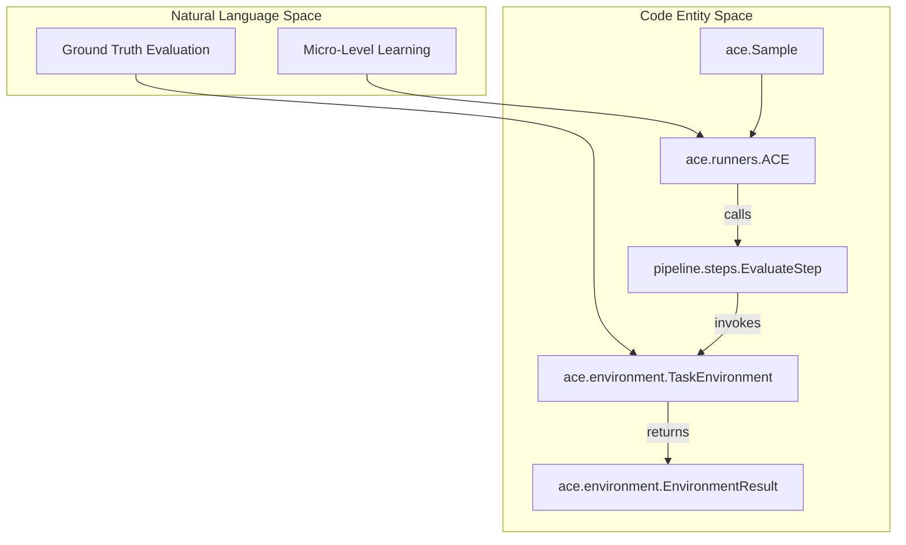
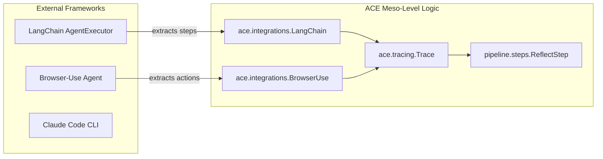
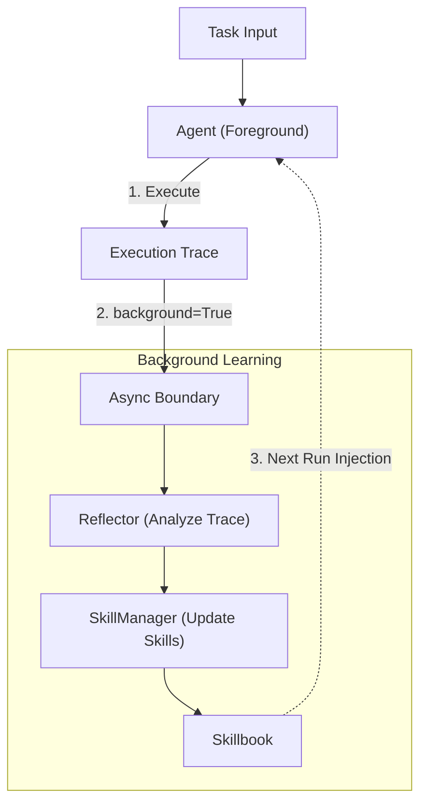

<!-- source: DeepWiki mcp.deepwiki.com · repo kayba-ai/agentic-context-engine · page 2.5 Insight Levels · fetched 2026-10-27 -->

# Insight Levels

Relevant source files

The following files were used as context for generating this wiki page:

- [docs/concepts/insight-levels.md](docs/concepts/insight-levels.md)
- [docs/guides/async-learning.md](docs/guides/async-learning.md)
- [docs/integrations/index.md](docs/integrations/index.md)
- [docs/integrations/mcp-client-setup.md](docs/integrations/mcp-client-setup.md)
- [docs/integrations/mcp.md](docs/integrations/mcp.md)
- [mkdocs.yml](mkdocs.yml)
- [specs/002-ace-mcp-server/contracts/tool-schemas.md](specs/002-ace-mcp-server/contracts/tool-schemas.md)
- [specs/002-ace-mcp-server/spec.md](specs/002-ace-mcp-server/spec.md)
- [tests/test_ace_mcp_compatibility.py](tests/test_ace_mcp_compatibility.py)

## Purpose and Scope

This document explains the three insight levels in the ACE Framework: micro, meso, and macro. Insight levels determine the scope and depth of analysis performed by the Reflector when extracting learnings from agent executions. Each level provides different types of knowledge extraction depending on what information is available and what learning objectives are prioritized.

For information about how these insights feed into the overall learning loop, see [The ACE Learning Loop](2.1). For details on which adaptation mode uses which insight level, see [Adaptation Strategies](2.4). For the role that performs this analysis, see [Three-Role Architecture](2.3).

## Overview

The ACE Framework operates at three insight levels based on what scope the Reflector analyzes:

| Level | Reflector Scope | What's Analyzed | Learning Source | Implementation |
|-------|-----------------|-----------------|-----------------|----------------|
| **Micro** | Single interaction | Request → response → evaluation | Ground truth and correctness feedback | `ACE` runner with `TaskEnvironment` |
| **Meso** | Full agent execution trace | Thoughts → tool calls → observations → answer | Execution patterns and reasoning chains | Integration runners (`BrowserUse`, `LangChain`, `ClaudeCode`) |
| **Macro** | Cross-run analysis | Patterns across multiple executions | Systemic trends and meta-learning | Future enhancement |

**Sources:** [docs/integrations/index.md:7-21](), [docs/concepts/insight-levels.md:7-11]()

---

## Micro-Level Insights

### What Are Micro-Level Insights?

Micro-level insights are generated from single task executions evaluated against ground truth or environment feedback. The Reflector analyzes the task provided, the agent's response, the evaluation result (correct/incorrect), and optional feedback from the environment.

This is the foundational insight level used when you have labeled data or an evaluation function that can determine correctness. It is the primary mode for the `ACELiteLLM` and `MCP Server` integrations.

### Implementation

Micro-level learning is implemented in the core `ACE` runner through the full three-role pipeline with a `TaskEnvironment`.

#### Code Entity Mapping: Micro-Level Learning
The following diagram bridges the natural language concept of "Micro-Level" to the specific code entities in the `ace/` library and `pipeline/` engine.

**Sources:** [docs/concepts/insight-levels.md:13-23](), [docs/integrations/mcp.md:62-64]()

### Code Implementation References

**ACE Runner with TaskEnvironment:**
The `ACE` runner implements micro-level learning by evaluating each sample against the environment. This is often used in Q&A scenarios.

[docs/concepts/insight-levels.md:27-41]() - Example of micro-level setup using `ACE.from_roles` and `SimpleEnvironment`.

**MCP Server (ace.learn.sample):**
The MCP server exposes micro-level learning as a tool. It takes samples (question + ground_truth) and runs them through the pipeline.

[docs/integrations/mcp.md:62-73]() - Definition of the `ace.learn.sample` tool which accepts `ground_truth` for micro-level analysis.

**Sources:** [docs/integrations/mcp.md](), [docs/concepts/insight-levels.md]()

---

## Meso-Level Insights

### What Are Meso-Level Insights?

Meso-level insights are generated from full agent execution traces without requiring ground truth. The Reflector analyzes the agent's step-by-step reasoning process, tool calls, results, and intermediate observations.

This insight level learns from execution patterns rather than correctness evaluation, making it valuable when ground truth is unavailable or when process matters as much as outcome. It is the default for complex integrations like `BrowserUse`, `LangChain`, and `ClaudeCode`.

### Implementation

Meso-level learning is implemented in integration runners. These runners capture the external agent's full execution trace and pass it to the Reflector.

#### Code Entity Mapping: Meso-Level Trace Analysis
This diagram shows how execution traces from external frameworks are mapped into the ACE `Reflector` for meso-level analysis.

**Sources:** [docs/integrations/index.md:9-16](), [docs/concepts/insight-levels.md:43-51]()

### Code Implementation References

**Integration Base Pattern:**
All meso-level integrations follow a three-step pattern: Inject, Execute, and Learn.

[docs/integrations/index.md:25-31]() - The "Inject-Execute-Learn" pattern used by all integration runners.

**BrowserUse Integration:**
Captures rich traces of browser actions (clicks, navigation) for analysis.

[docs/integrations/index.md:38-41]() - Factory for creating a meso-level `BrowserUse` runner.

**Claude SDK Step-based Composition:**
For custom pipelines, developers can compose steps like `ClaudeSDKToTrace` to enable meso-level learning without a full runner.

[docs/integrations/index.md:50-61]() - Example of manual pipeline composition for meso-level trace analysis.

**Sources:** [docs/integrations/index.md](), [docs/concepts/insight-levels.md]()

---

## Macro-Level Insights

### What Are Macro-Level Insights?

Macro-level insights (currently a future enhancement) analyze patterns across multiple agent executions to identify systemic improvements and meta-patterns. Rather than learning from individual task outcomes or single-run traces, macro-level analysis compares strategies across different task types and domains.

**Sources:** [docs/concepts/insight-levels.md:73-75]()

---

## Comparison: Micro vs Meso Learning

| Aspect | Micro-Level | Meso-Level |
|--------|-------------|------------|
| **Input Required** | Ground truth or evaluation function | Full execution trace |
| **Learns From** | Correctness (right/wrong) | Execution patterns (how it reasoned) |
| **Implementation** | `ACE` runner, `ACELiteLLM`, `MCP Server` | `BrowserUse`, `LangChain`, `ClaudeCode`, `Claude SDK` |
| **Best For** | Labeled datasets, Q&A tasks, MCP tools | Complex agents, browser automation, multi-step coding |

### Async Meso-Level Data Flow

When running meso-level learning asynchronously, the execution trace is processed in the background to avoid blocking the main agent loop.

**Sources:** [docs/guides/async-learning.md:7-21](), [docs/integrations/index.md:66-72]()

### Summary Table: Integration Level Mapping

| Integration | Insight Level | Input Type | Primary Source |
|-------------|---------------|------------|----------------|
| `ACELiteLLM` | Micro | Questions | [docs/integrations/index.md:11]() |
| `MCP Server` | Micro | Tool calls | [docs/integrations/index.md:17]() |
| `LangChain` | Meso | Chain inputs | [docs/integrations/index.md:12]() |
| `BrowserUse` | Meso | Task strings | [docs/integrations/index.md:13]() |
| `ClaudeCode` | Meso | Task strings | [docs/integrations/index.md:14]() |

**Sources:** [docs/integrations/index.md:9-17]()

---

