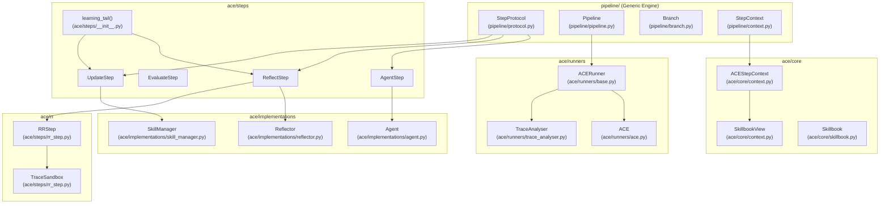
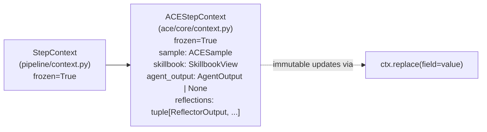
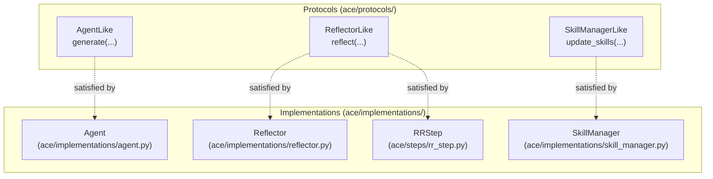
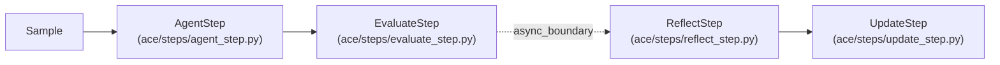

<!-- source: DeepWiki mcp.deepwiki.com · repo kayba-ai/agentic-context-engine · page 3 Architecture · fetched 2026-10-27 -->

# Architecture

Relevant source files

The following files were used as context for generating this wiki page:

- [CLAUDE.md](CLAUDE.md)
- [README.md](README.md)
- [ace/__init__.py](ace/__init__.py)
- [ace/runners/litellm.py](ace/runners/litellm.py)
- [assets/kayba-banner.png](assets/kayba-banner.png)
- [docs/design/ACE_ARCHITECTURE.md](docs/design/ACE_ARCHITECTURE.md)
- [docs/design/ACE_DECISIONS.md](docs/design/ACE_DECISIONS.md)
- [docs/design/ACE_REFERENCE.md](docs/design/ACE_REFERENCE.md)
- [docs/design/RR_DESIGN.md](docs/design/RR_DESIGN.md)
- [examples/ace/ace_demo.py](examples/ace/ace_demo.py)
- [tests/test_pipeline_exports.py](tests/test_pipeline_exports.py)

## Purpose and Scope

This page provides a technical overview of the ACE Framework's architecture, covering the core implementation in `ace/`, the generic pipeline engine, and the key subsystems that enable self-improving AI agents.

For detailed information about specific subsystems:
- **Core Library (ace/)**: [Core Library (ace/)](#3.1) — Roles, adapters, and async learning orchestration.
- **Pipeline Engine (pipeline/)**: [Pipeline Engine (pipeline/)](#3.2) — The foundation of `StepProtocol`, `Pipeline`, and `Branch` primitives.
- **Recursive Reflector System**: [Recursive Reflector System](#3.3) — Iterative code-based trace analysis in sandboxed REPL environments.
- **RecursiveAgent Abstraction**: [RecursiveAgent Abstraction](#3.4) — The base class for budget management and depth-based recursion.
- **Prompt Engineering System**: [Prompt Engineering System](#3.5) — Versioning, atomicity, and domain-specific variants.
- **Deduplication System**: [Deduplication System](#3.6) — Hybrid retrieval and skill consolidation strategies.

## High-Level Component Map

The ACE architecture is built on a "Roles and Steps" pattern. Roles implement the business logic (LLM interactions), while Steps adapt that logic into the pipeline engine's context-based data flow.

**Key characteristics:**
- **Composable steps:** Each step does one focused task, validated by `requires`/`provides` contracts [CLAUDE.md:11-13]().
- **Configurable boundaries:** `async_boundary` declared on steps enables background learning [docs/ACE_ARCHITECTURE.md:71-72]().
- **Protocol-based roles:** Steps depend on `AgentLike`, `ReflectorLike` protocols, not concrete classes [docs/ACE_ARCHITECTURE.md:54-56]().
- **Pluggable reflectors:** `Reflector` or `RRStep` (Recursive Reflector) are drop-in replacements [docs/RR_DESIGN.md:108-120]().

**Sources:** [docs/ACE_ARCHITECTURE.md:43-58](), [docs/PIPELINE_DESIGN.md:1-114](), [ace/__init__.py:62-121]().

## Pipeline Engine Foundation

The `pipeline/` module provides a generic execution engine that ACE is built on. It manages typed step contracts, concurrent execution, and structured error handling [docs/ACE_ARCHITECTURE.md:15-16]().

### Core Primitives

| Primitive | Description | Implementation |
|-----------|-------------|----------------|
| **Step** | Smallest unit of work; receives context, returns context | `StepProtocol` [ace/__init__.py:67]() |
| **Pipeline** | Sequential step list; runs one input through N steps | `Pipeline` [ace/__init__.py:64]() |
| **Branch** | Parallel fork-join; runs N sub-pipelines on same input | `Branch` [ace/__init__.py:65]() |

**Composability:** All primitives satisfy `StepProtocol`, so they nest arbitrarily. A `Pipeline` can contain `Branch` steps, and a `SubRunner` (like the one powering `RRStep`) can be placed in any pipeline as a black-box step [docs/RR_DESIGN.md:13-14]().

**Sources:** [docs/PIPELINE_DESIGN.md:6-263](), [ace/__init__.py:62-68]().

### Context and Immutability

ACE uses an immutable context pattern to ensure thread safety and explicit data flow [docs/ACE_ARCHITECTURE.md:93-95]().

**SkillbookView:** To prevent accidental mutation of the `Skillbook` during concurrent execution, the context carries a `SkillbookView`—a read-only projection. Steps that need to write to the skillbook receive the real `Skillbook` via constructor injection [docs/ACE_ARCHITECTURE.md:80-91]().

**Sources:** [docs/ACE_ARCHITECTURE.md:93-128](), [docs/ACE_REFERENCE.md:112-134](), [ace/core/context.py:1-164]().

## Core Abstractions

### Protocols vs Implementations

The architecture separates interface contracts from business logic. Roles are backed by **PydanticAI** agents for structured LLM interactions [docs/ACE_ARCHITECTURE.md:16-17]().

**Sources:** [docs/ACE_ARCHITECTURE.md:43-58](), [docs/ACE_REFERENCE.md:143-159](), [ace/protocols/]()

## Data Flow Patterns

### ACE Pipeline (Full Execution)

The `ACE` runner orchestrates the full closed-loop pipeline: **Agent → Evaluate → Reflect → Update → Apply** [examples/ace/ace_demo.py:121-124]().

**Async Boundary:** The `ReflectStep` typically marks an `async_boundary`, allowing the foreground execution to return results to the user while learning happens in the background [docs/ACE_REFERENCE.md:225-230]().

**Sources:** [docs/ACE_ARCHITECTURE.md:105-111](), [docs/ACE_REFERENCE.md:165-240](), [ace/runners/ace.py]().

## Runner Architecture

Runners are the primary entry points for the framework. They compose steps into pipelines and manage the iteration over input samples [docs/ACE_ARCHITECTURE.md:54-55]().

| Runner | Purpose | Key Method |
|--------|---------|------------|
| `ACE` | Live execution + feedback loop | `run(samples, epochs)` [ace/runners/ace.py]() |
| `TraceAnalyser` | Learn from pre-recorded traces | `run(traces, epochs)` [ace/runners/trace_analyser.py]() |
| `ACELiteLLM` | Simple conversational interface | `ask(question)`, `learn()` [ace/runners/litellm.py:50-54]() |

**Sources:** [docs/ACE_ARCHITECTURE.md:32-40](), [ace/runners/]()

## Summary

The ACE Framework architecture leverages a generic pipeline engine to compose PydanticAI-backed roles into adaptive learning loops. By enforcing immutability and protocol-based decoupling, the system achieves high concurrency and pluggable intelligence (e.g., swapping a standard `Reflector` for a `Recursive Reflector`).

For deeper technical details, proceed to the specific architecture child pages.

**Sources:** [README.md:78-100](), [docs/ACE_ARCHITECTURE.md:1-30](), [CLAUDE.md:45-57]().

---

