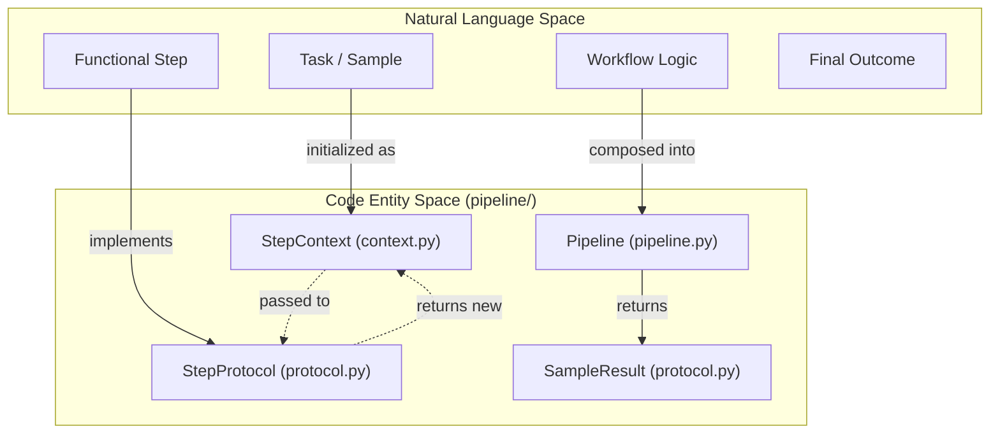
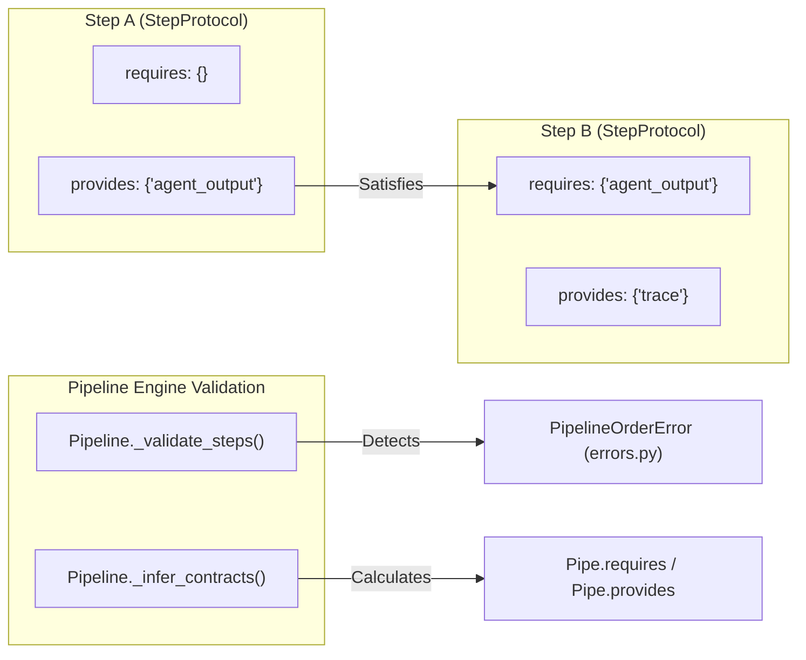

<!-- source: DeepWiki mcp.deepwiki.com · repo kayba-ai/agentic-context-engine · page 3.2 Pipeline Engine (pipeline/) · fetched 2026-10-27 -->

# Pipeline Engine (pipeline/)

Relevant source files

The following files were used as context for generating this wiki page:

- [examples/pipeline_ex/pipeline_demo.ipynb](examples/pipeline_ex/pipeline_demo.ipynb)
- [examples/pipeline_ex/pipeline_demo.py](examples/pipeline_ex/pipeline_demo.py)
- [pipeline/__init__.py](pipeline/__init__.py)
- [pipeline/branch.py](pipeline/branch.py)
- [pipeline/context.py](pipeline/context.py)
- [pipeline/errors.py](pipeline/errors.py)
- [pipeline/pipeline.py](pipeline/pipeline.py)
- [pipeline/protocol.py](pipeline/protocol.py)
- [tests/pipeline_engine/__init__.py](tests/pipeline_engine/__init__.py)
- [tests/pipeline_engine/conftest.py](tests/pipeline_engine/conftest.py)
- [tests/pipeline_engine/test_branch.py](tests/pipeline_engine/test_branch.py)
- [tests/pipeline_engine/test_context.py](tests/pipeline_engine/test_context.py)
- [tests/pipeline_engine/test_pipeline.py](tests/pipeline_engine/test_pipeline.py)
- [tests/pipeline_engine/test_pipeline_e2e.py](tests/pipeline_engine/test_pipeline_e2e.py)
- [tests/pipeline_engine/test_protocol.py](tests/pipeline_engine/test_protocol.py)
- [tests/test_pipeline_hooks.py](tests/test_pipeline_hooks.py)

## Purpose and Scope

The `pipeline/` module provides a generic, framework-agnostic engine for building and executing complex AI workflows. It is built on the principles of **structural typing**, **immutability**, and **declarative concurrency**. While it serves as the foundation for the `ace_next/` architecture, it contains no domain-specific knowledge of ACE, agents, or reflectors.

This is a **PARENT** page providing a high-level overview of the engine's primitives and composition patterns. For technical details, see the child pages:
- [Pipeline Primitives](#3.2.1) — `StepProtocol`, `Pipeline`, `Branch`, and `StepContext`.
- [Step System](#3.2.2) — Implementation of functional units and contract validation.
- [Runner System](#3.2.3) — Orchestration layers like `ACERunner` and integration-specific runners.
- [Context and Data Flow](#3.2.4) — Immutable data propagation via `StepContext`.
- [Async Boundaries and Concurrency](#3.2.5) — Background execution and thread-pool management.

**Sources:** [pipeline/__init__.py:1-20](), [pipeline/pipeline.py:49-74]()

---

## Core Primitives

The engine is built around four primary entities that define how data moves and how logic is executed.

### 1. StepContext
The single object that flows through every step. It is a **frozen dataclass**, meaning it cannot be mutated. Steps must return a new instance using the `.replace()` method.
- **`sample`**: The input data for the current execution (e.g., a task description or query).
- **`metadata`**: A `MappingProxyType` (read-only dict) for auxiliary data and inter-step communication.

**Sources:** [pipeline/context.py:11-38](), [tests/pipeline_engine/test_context.py:58-77]()

### 2. StepProtocol
A structural protocol (interface) that any functional unit must satisfy. A step is simply any object that defines:
- **`requires`**: A `frozenset` of field names it expects to find in the context.
- **`provides`**: A `frozenset` of field names it promises to populate.
- **`__call__`**: The execution logic that transforms one `StepContext` into another.

**Sources:** [pipeline/protocol.py:33-48](), [tests/pipeline_engine/test_protocol.py:14-20]()

### 3. Pipeline
An ordered sequence of steps. It validates that the `provides` of earlier steps satisfy the `requires` of later steps at construction time. It supports both synchronous execution via `__call__` and parallel execution across multiple samples via `.run()`.

**Sources:** [pipeline/pipeline.py:53-84](), [pipeline/pipeline.py:137-152]()

### 4. Branch
A primitive for parallel fork/join operations. It runs multiple sub-pipelines in parallel and merges their resulting contexts based on a `MergeStrategy` (e.g., `RAISE_ON_CONFLICT`, `LAST_WRITE_WINS`, or `NAMESPACED`).

**Sources:** [pipeline/branch.py:114-133](), [pipeline/branch.py:16-22]()

---

## System Architecture Diagrams

### From Natural Language to Code Entities: Execution Flow
This diagram maps the conceptual "Pipeline Execution" to the specific code entities in the `pipeline/` module.

**Sources:** [pipeline/context.py:12-29](), [pipeline/protocol.py:33-48](), [pipeline/pipeline.py:53-74](), [pipeline/protocol.py:50-72]()

### Data Flow and Contract Validation
This diagram illustrates how the `Pipeline` ensures data integrity between steps using the `requires` and `provides` attributes.

**Sources:** [pipeline/pipeline.py:116-131](), [pipeline/pipeline.py:137-152](), [pipeline/errors.py:9-10]()

---

## Composition Patterns

The engine supports advanced composition patterns to handle complex AI agent requirements:

| Pattern | Code Entity | Purpose |
| :--- | :--- | :--- |
| **Sequential** | `Pipeline.then()` | Fluent API for chaining steps linearly. |
| **Parallel Fork** | `Branch` | Executing multiple analysis paths (e.g., different Reflectors) simultaneously. |
| **Async Hand-off** | `async_boundary` | Splitting a pipeline into "Foreground" (user-facing) and "Background" (learning/optimization) segments. |
| **Resource Limits** | `max_workers` | Controlling concurrency per step class (e.g., serializing database writes). |
| **Nesting** | `Pipeline` | A `Pipeline` satisfies `StepProtocol`, allowing it to be used as a single step inside another `Pipeline`. |

**Sources:** [pipeline/pipeline.py:56-73](), [pipeline/branch.py:114-127](), [pipeline/pipeline.py:176-184](), [pipeline/pipeline.py:27-45]()

---

## Error Handling and Observability

The engine provides robust error tracking to ensure no sample is lost during execution.
- **`SampleResult`**: Every sample processed by `Pipeline.run()` returns a `SampleResult` containing the final `output` (context) or the `error` and `failed_at` step name. [pipeline/protocol.py:50-72]()
- **`PipelineHook`**: An observation-only interface that allows users to attach logging, tracing, or telemetry (like Logfire) to the pipeline without modifying step logic. [pipeline/protocol.py:14-26]()
- **`CancellationToken`**: A thread-safe primitive to stop long-running pipelines across all active threads/tasks. [pipeline/errors.py:46-68]()

**Sources:** [pipeline/protocol.py:50-72](), [pipeline/protocol.py:14-26](), [pipeline/errors.py:46-68]()

---

