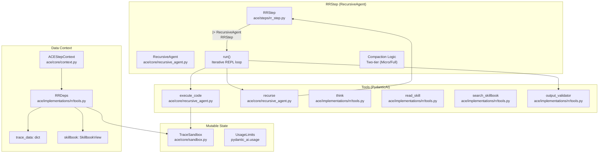
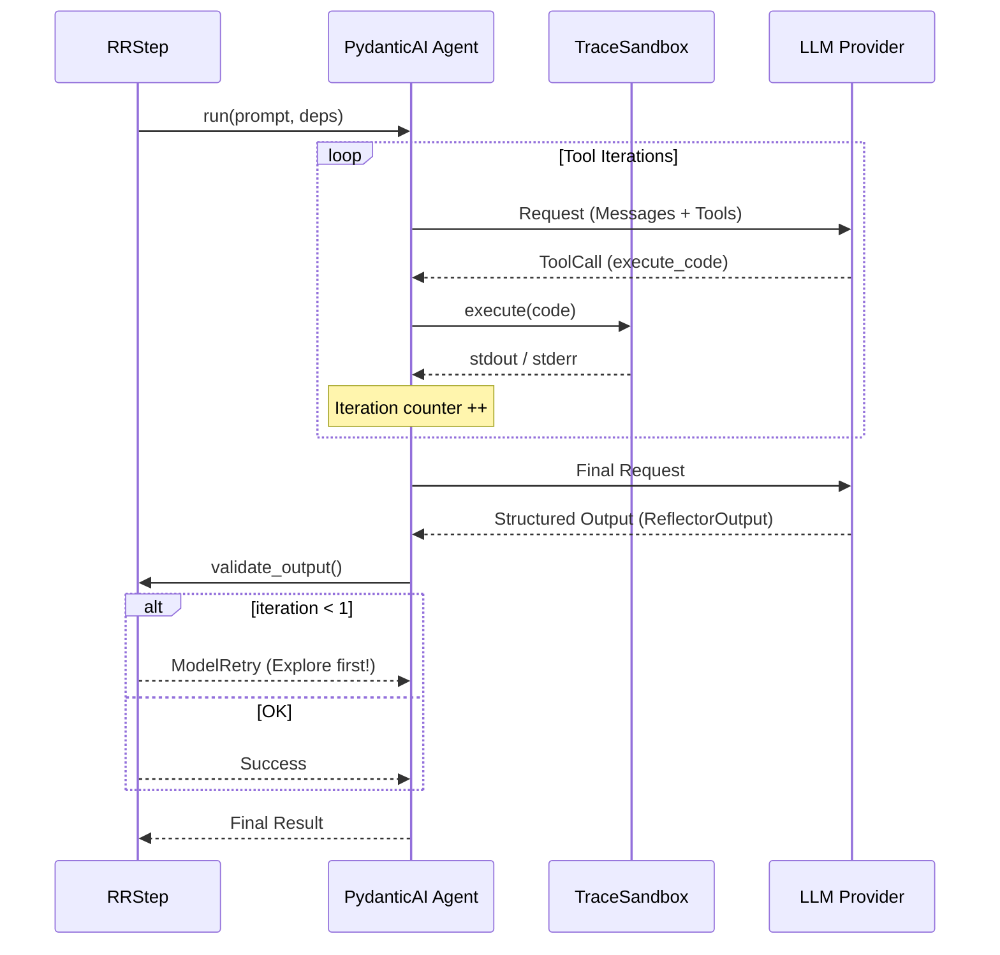
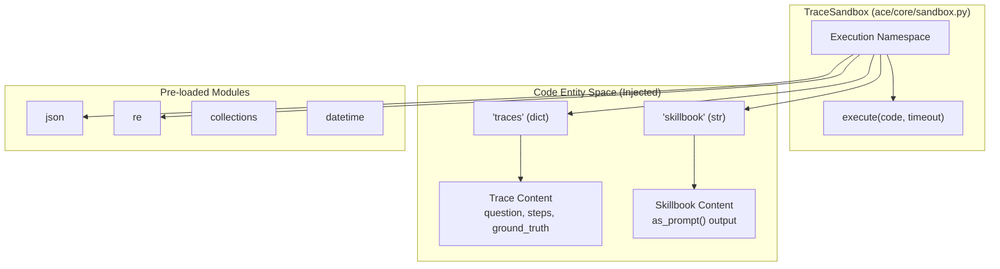

<!-- source: DeepWiki mcp.deepwiki.com · repo kayba-ai/agentic-context-engine · page 3.3 Recursive Reflector System · fetched 2026-10-27 -->

# Recursive Reflector System

<details>
<summary>Relevant source files</summary>

The following files were used as context for generating this wiki page:

- [ace/core/recursive_agent.py](ace/core/recursive_agent.py)
- [ace/implementations/rr/__init__.py](ace/implementations/rr/__init__.py)
- [ace/implementations/rr/config.py](ace/implementations/rr/config.py)
- [ace/implementations/rr/prompts.py](ace/implementations/rr/prompts.py)
- [ace/implementations/rr/tools.py](ace/implementations/rr/tools.py)
- [ace/steps/rr_step.py](ace/steps/rr_step.py)
- [docs/design/ACE_ARCHITECTURE.md](docs/design/ACE_ARCHITECTURE.md)
- [docs/design/ACE_DECISIONS.md](docs/design/ACE_DECISIONS.md)
- [docs/design/ACE_REFERENCE.md](docs/design/ACE_REFERENCE.md)
- [docs/design/RR_DESIGN.md](docs/design/RR_DESIGN.md)
- [examples/ace/rr_benchmark.py](examples/ace/rr_benchmark.py)
- [examples/agentic-system-prompting/recursive_agentic_system_prompting.py](examples/agentic-system-prompting/recursive_agentic_system_prompting.py)
- [test_rr_live.py](test_rr_live.py)
- [tests/test_rr_pipeline/test_rr_stress.py](tests/test_rr_pipeline/test_rr_stress.py)
- [tests/test_rr_pipeline/test_runner.py](tests/test_rr_pipeline/test_runner.py)

</details>


## Overview

The Recursive Reflector (RR) is ACE's key innovation for deep trace analysis, built on the `RecursiveAgent` [ace/core/recursive_agent.py:16-25]() abstraction. Instead of a single-pass LLM analysis, RR writes and executes Python code in a sandboxed REPL environment to programmatically explore agent execution traces. This enables multi-iteration pattern discovery, evidence-based analysis, and delegation to sub-agents for specialized queries.

**Key Capabilities:**
- **Iterative Code Execution** - LLM writes Python, sees output, and refines analysis over multiple iterations [ace/steps/rr_step.py:167-212]().
- **Sandboxed Environment** - Restricted builtins, timeout enforcement, and read-only trace access via `TraceSandbox` [ace/core/sandbox.py:22-50]().
- **Sub-Agent Delegation** - `recurse` tool for delegating analysis to isolated sub-sessions [ace/core/recursive_agent.py:143-174]().
- **Six-Phase Strategy** - Discover → Adapt → Survey → Categorize → Deep-dive → Synthesize [ace/implementations/rr/prompts.py:86-100]().
- **Evidence-Based Guards** - Rejects premature `ReflectorOutput` calls until data exploration occurs [ace/implementations/rr/tools.py:52-64]().

**Architecture:** RR is implemented as `RRStep`, a subclass of `RecursiveAgent` that satisfies both `StepProtocol` (for pipeline composition) and `ReflectorLike` (for drop-in replacement of standard `Reflector`) [ace/steps/rr_step.py:51-58]().

---

## RRStep Architecture

`RRStep` encapsulates an iterative REPL loop, managing budget, compaction, and recursion depth.

**Diagram: RRStep Component Structure**



**Sources:** [ace/steps/rr_step.py:51-120](), [ace/core/recursive_agent.py:1-25](), [ace/implementations/rr/tools.py:29-45]()

### Dual Protocol Implementation

`RRStep` satisfies two protocols for maximum flexibility:

**StepProtocol** - Pipeline composition [ace/steps/rr_step.py:167-172]():
```python
# RRStep as a pipeline step
from ace.steps.rr_step import RRStep, RRConfig
from pipeline import Pipeline

rr = RRStep("claude-3-5-sonnet", config=RRConfig(max_requests=30))
pipe = Pipeline([
    rr,  # ← StepProtocol: requires trace+skillbook, provides reflections
    UpdateStep(skill_manager),
])
```

**ReflectorLike** - Drop-in replacement [ace/steps/rr_step.py:214-232]():
```python
# RRStep as reflector replacement
from ace.steps.rr_step import RRStep

rr = RRStep("claude-3-5-sonnet")
reflection = rr.reflect(
    question="What is 2+2?",
    agent_output=agent_output,
    skillbook=skillbook,
    ground_truth="4"
)  # ← ReflectorLike protocol
```

**Sources:** [ace/steps/rr_step.py:71-72](), [ace/steps/rr_step.py:167-212](), [tests/test_rr_pipeline/test_runner.py:199-204]()

---

## Inner Pipeline and REPL Loop

RR operates through a tool-calling loop where each turn allows the model to gather evidence before producing a final structured `ReflectorOutput` [ace/implementations/rr/prompts.py:55-62]().

**Diagram: Recursive Agent Loop Flow**



**Sources:** [ace/core/recursive_agent.py:214-260](), [ace/implementations/rr/tools.py:52-64](), [ace/implementations/rr/prompts.py:86-100]()

### Key Tools

- **`execute_code`**: Primary evidence-gathering tool. Variables persist across calls. Prints should be compact and factual [ace/core/recursive_agent.py:82-106]().
- **`think`**: Prose channel for mid-run narration. Keeps reasoning out of the Python workbench [ace/implementations/rr/tools.py:97-123]().
- **`recurse`**: Decomposes sub-problems into isolated child sessions with their own context windows [ace/core/recursive_agent.py:143-174]().
- **`search_skillbook` / `read_skill`**: Programmatic inspection of existing strategies [ace/implementations/rr/tools.py:66-95](), [ace/implementations/rr/tools.py:140-176]().

**Sources:** [ace/implementations/rr/prompts.py:46-54](), [ace/core/recursive_agent.py:82-174]()

---

## TraceSandbox Environment

`TraceSandbox` provides a persistent, restricted Python execution environment [ace/core/sandbox.py:22-50]().

**Diagram: Sandbox Namespace and Data Association**



**Sources:** [ace/core/sandbox.py:52-110](), [ace/steps/rr_step.py:169-185](), [ace/core/recursive_agent.py:93-95]()

### Sandbox Safety and Persistence

- **Persistence**: Variables defined in one `execute_code` call are available in subsequent calls [tests/test_rr_pipeline/test_rr_stress.py:194-199]().
- **Safety**: Uses a restricted `SAFE_BUILTINS` set and blocks dunder attribute access [ace/core/sandbox.py:74-170]().
- **Timeouts**: Enforced via `signal.alarm` on Unix or `multiprocessing` on Windows [ace/core/sandbox.py:259-315]().

**Sources:** [ace/core/sandbox.py:52-110](), [ace/core/sandbox.py:259-315]()

---

## Sub-agent System (`recurse`)

The `recurse` tool allows RR to fan-out analysis tasks. Children inherit a copy of the parent's sandbox values and any helpers registered via `register_helper` [ace/core/recursive_agent.py:151-174]().

- **Depth-Bounded**: Recursion is limited by `max_depth` (default 2) to prevent infinite loops [ace/core/recursive_agent.py:211-213]().
- **Parallel Dispatch**: Multiple `recurse` calls in a single assistant turn are executed in parallel [ace/implementations/rr/prompts.py:62-62]().
- **Budget Management**: Children share the overall token and request budget of the root agent [ace/implementations/rr/prompts.py:51-51]().

**Sources:** [ace/core/recursive_agent.py:143-213](), [ace/implementations/rr/prompts.py:15-23]()

---

## Compaction and Budgeting

RR handles large traces and long conversations through a two-tier compaction system managed by `RecursiveAgent` [ace/core/recursive_agent.py:262-310]().

- **Microcompaction**: Clears tool outputs from history while keeping sandbox state intact [ace/core/recursive_agent.py:284-288]().
- **Full Summarization**: Summarizes the entire conversation into a single block when the context window is nearly full [ace/core/recursive_agent.py:291-310]().
- **Usage Limits**: PydanticAI `UsageLimits` enforce `max_tokens` and `max_requests` [ace/core/recursive_agent.py:214-232]().

**Sources:** [ace/core/recursive_agent.py:262-310](), [ace/implementations/rr/config.py:10-20]()

---

## Child Pages

For more technical depth, see the following child pages:
- **[RR Architecture and Pipeline](#3.3.1)** — Detailed implementation of the tool-calling loop and PydanticAI integration.
- **[Sandbox Environment](#3.3.2)** — Deep dive into `TraceSandbox` security, persistence, and injected helpers.
- **[Six-Phase Analysis Strategy](#3.3.3)** — Explanation of the recommended prompt strategy for trace analysis.
- **[Sub-agent System](#3.3.4)** — How `recurse` enables parallel task decomposition and budget sharing.
- **[RR Configuration](#3.3.5)** — Comprehensive reference for `RRConfig` and `AgenticConfig` options.

---

