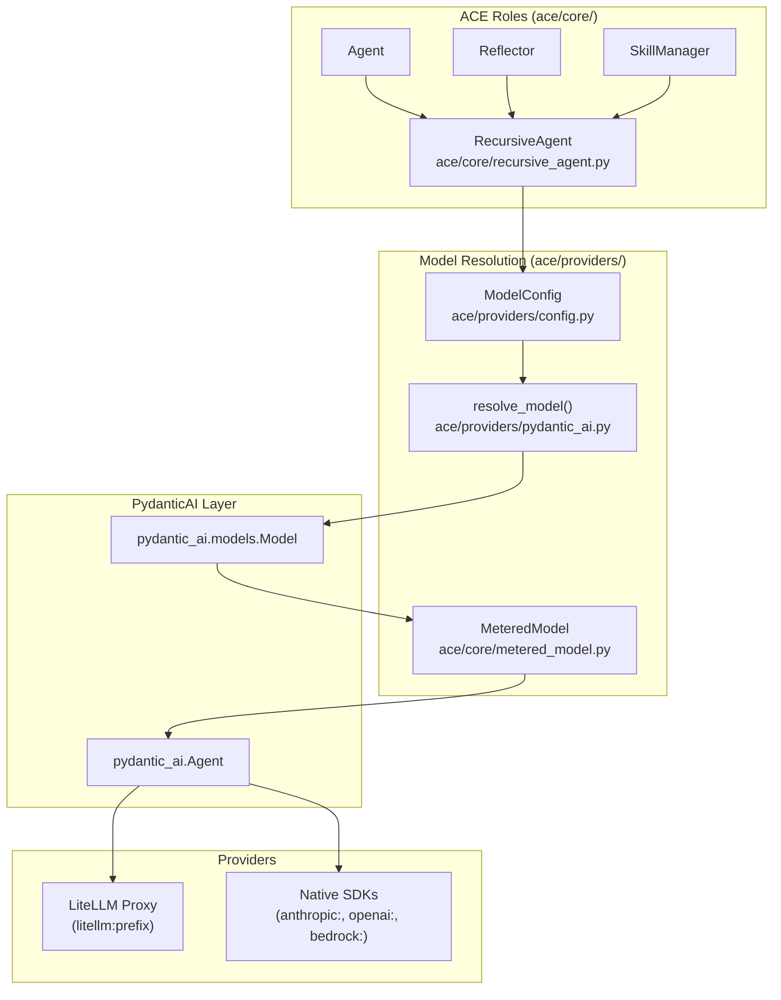

<!-- source: DeepWiki mcp.deepwiki.com · repo kayba-ai/agentic-context-engine · page 4 LLM Provider Integration · fetched 2026-10-27 -->

# LLM Provider Integration

<details>
<summary>Relevant source files</summary>

The following files were used as context for generating this wiki page:

- [CHANGELOG.md](CHANGELOG.md)
- [ace/providers/config.py](ace/providers/config.py)
- [ace/providers/pydantic_ai.py](ace/providers/pydantic_ai.py)
- [pyproject.toml](pyproject.toml)
- [uv.lock](uv.lock)

</details>


## Overview

The ACE Framework supports 100+ LLM providers through a unified integration layer built on **PydanticAI** and **LiteLLM**. This architecture allows the Agent, Reflector, and SkillManager roles to remain model-agnostic while benefiting from provider-specific optimizations like prompt caching and cost-equivalent token accounting.

ACE handles model resolution through `resolve_model` [ace/providers/pydantic_ai.py:107-179](), which converts LiteLLM-style identifiers into PydanticAI-compatible model objects or strings. Configuration is managed via `ModelConfig` [ace/providers/config.py:33-56](), allowing per-role model selection (e.g., using a high-reasoning model for Reflection and a faster model for execution).

**Child Pages:**
- [PydanticAI Model Layer](#4.1) — Core LLM integration, `resolve_model`, and parameter resolution.
- [Provider-Specific Features](#4.2) — Handling Anthropic prompt caching, Bedrock endpoints, and cost tracking.
- [LangChain Client Integration](#4.3) — Integrating with LangChain ecosystems.
- [Testing and Mock Clients](#4.4) — Mock LLM implementations and `MeteredModel` for usage tracking.

---

## Architecture

### LLM Integration Architecture

The diagram below shows how ACE bridges the gap between high-level Role requirements and low-level Provider SDKs using PydanticAI as the primary orchestrator.


**Sources:** [ace/providers/pydantic_ai.py:107-179](), [ace/providers/config.py:33-56](), [ace/core/recursive_agent.py:15-100](), [CHANGELOG.md:58-64]()

### Component Responsibilities

| Component | File | Responsibility |
|-----------|------|----------------|
| `resolve_model` | [ace/providers/pydantic_ai.py:107-179]() | Converts ACE/LiteLLM strings (e.g., `bedrock/model`) to PydanticAI native prefixes (`bedrock:model`). |
| `ModelConfig` | [ace/providers/config.py:33-56]() | Secrets-free dataclass for model ID, temperature, and max tokens. |
| `ACEModelConfig` | [ace/providers/config.py:64-102]() | Maps specific models to ACE roles (`agent`, `reflector`, `skill_manager`). |
| `RecursiveAgent` | [ace/core/recursive_agent.py:15-100]() | Base class that wraps PydanticAI agents with depth-aware recursion and usage metering. |
| `MeteredModel` | [ace/core/metered_model.py:10-50]() | A `WrapperModel` that captures `RequestUsage` and fires callbacks for cost/token tracking. |

**Sources:** [ace/providers/pydantic_ai.py](), [ace/providers/config.py](), [ace/core/recursive_agent.py](), [CHANGELOG.md:87-90]()

---

## Model Resolution and Configuration

### resolve_model Logic
ACE follows a multi-path resolution strategy to ensure compatibility between LiteLLM naming conventions and PydanticAI requirements [ace/providers/pydantic_ai.py:6-18]():
1. **PydanticAI-native**: If a prefix like `openai:` is present, it is passed through [ace/providers/pydantic_ai.py:151-154]().
2. **Bedrock Auth**: If `AWS_BEARER_TOKEN_BEDROCK` is set, it creates a `BedrockModel` with bearer token auth [ace/providers/pydantic_ai.py:157-162]().
3. **LiteLLM Mapping**: Common LiteLLM prefixes (e.g., `vertex_ai/`) are rewritten to native PydanticAI equivalents (`google-vertex:`) [ace/providers/pydantic_ai.py:165-175]().
4. **Fallback**: All other models are prefixed with `litellm:` to use the LiteLLM proxy provider [ace/providers/pydantic_ai.py:178]().

### Configuration Persistence
Model settings are stored in `ace.toml` [ace/providers/config.py:23](), which is intended to be committed to version control. API keys and secrets are loaded from `.env` files [ace/providers/config.py:24]().

```toml
# Example ace.toml
[default]
model = "openai:gpt-4o-mini"
temperature = 0.0

[reflector]
model = "anthropic:claude-3-5-sonnet-latest"
extra_params = { cache_control = "ephemeral" }
```
**Sources:** [ace/providers/config.py:110-127](), [ace/providers/pydantic_ai.py:107-179]()

---

## Provider Support

ACE supports a vast array of models by leveraging PydanticAI's native providers and LiteLLM's proxy capabilities.

| Provider | Prefix Example | Required Extra |
|----------|----------------|----------------|
| **Anthropic** | `anthropic:claude-3-5-sonnet` | `pydantic-ai-slim[anthropic]` |
| **OpenAI** | `openai:gpt-4o` | `pydantic-ai-slim[openai]` |
| **AWS Bedrock** | `bedrock:anthropic.claude-v2` | `pydantic-ai-slim[bedrock]` |
| **Google** | `google-vertex:gemini-1.5-pro` | `pydantic-ai-slim[google]` |
| **Other** | `litellm:ollama/llama3` | `pydantic-ai-slim[litellm]` |

**Sources:** [ace/providers/pydantic_ai.py:29-42](), [pyproject.toml:41-49](), [pyproject.toml:75-77]()

---

## Usage and Metering

All LLM interactions in the next-gen architecture go through `MeteredModel` [CHANGELOG.md:87-90](). This allows ACE to track:
- **Token Usage**: Prompt, completion, and total tokens.
- **Prompt Caching**: Specifically for Anthropic, tracking `cache_read_tokens` and `cache_write_tokens` [CHANGELOG.md:30-31]().
- **Cost Attribution**: Associating costs with specific roles (e.g., how much the Reflector spent versus the Agent).

For details on how usage is tracked and reported, see [Testing and Mock Clients](#4.4).

**Sources:** [CHANGELOG.md:87-90](), [CHANGELOG.md:30-31]()

---

