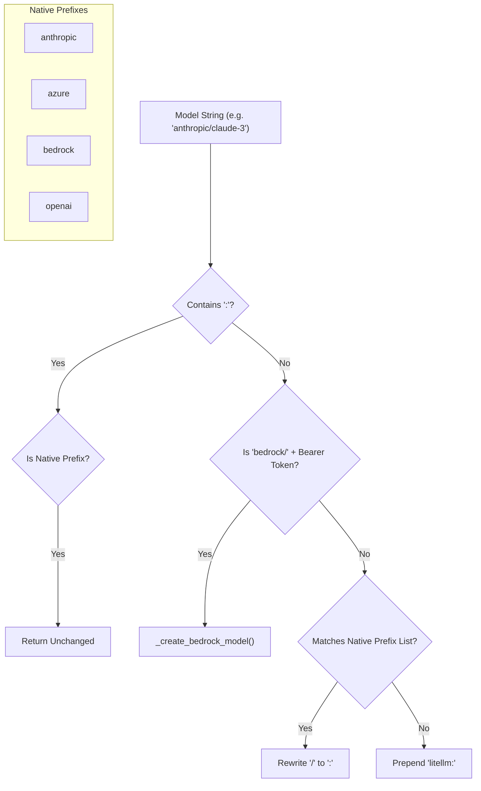
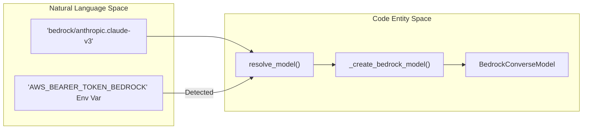

<!-- source: DeepWiki mcp.deepwiki.com · repo kayba-ai/agentic-context-engine · page 4.2 Provider-Specific Features · fetched 2026-10-27 -->

# Provider-Specific Features

Relevant source files

The following files were used as context for generating this wiki page:

- [CHANGELOG.md](CHANGELOG.md)
- [ace/providers/pydantic_ai.py](ace/providers/pydantic_ai.py)
- [pyproject.toml](pyproject.toml)
- [uv.lock](uv.lock)

This page describes how the ACE Framework handles provider-specific quirks, custom configurations, and advanced features. ACE leverages a dual-layer approach: **PydanticAI** for native provider interactions (Anthropic, Bedrock, OpenAI) and **LiteLLM** as a fallback/proxy for the remaining 100+ providers.

**Scope**: This page focuses on the technical implementation of provider-specific handling, including Anthropic prompt caching, Bedrock authentication, and cost-equivalent token accounting.

---

## Model Resolution Strategy

The `resolve_model` function in `ace/providers/pydantic_ai.py` acts as the primary dispatcher. It converts ACE model identifiers (which follow LiteLLM conventions) into PydanticAI model strings or provider objects.

### Resolution Paths

| Path | Condition | Result |
| :--- | :--- | :--- |
| **PydanticAI-Native** | Starts with `<provider>:` (e.g., `openai:gpt-4o`) | Passed through unchanged [ace/providers/pydantic_ai.py:151-154](). |
| **Bedrock Bearer** | Starts with `bedrock/` and `AWS_BEARER_TOKEN_BEDROCK` is set | Returns a `BedrockModel` with bearer auth [ace/providers/pydantic_ai.py:157-162](). |
| **Native Rewrite** | LiteLLM prefix has a native equivalent (e.g., `anthropic/`) | Rewrites `/` to `:` (e.g., `anthropic:claude-3-5-sonnet`) [ace/providers/pydantic_ai.py:165-175](). |
| **Fallback** | No recognized prefix | Prepends `litellm:` for the LiteLLM proxy [ace/providers/pydantic_ai.py:178](). |

Sources: [ace/providers/pydantic_ai.py:107-178]()

---

## Anthropic-Specific Features

### Prompt Caching
ACE enables Anthropic prompt caching by default for recursive agents (Recursive Reflector and SkillManager) to reduce latency and costs during iterative analysis [CHANGELOG.md:62-62]().

- **Implementation**: Uses `CachePoint(ttl="5m")` in the SkillManager and RR prompts [CHANGELOG.md:30-31]().
- **Accounting**: `cache_read_tokens` and `cache_write_tokens` are extracted from metadata and forwarded to the usage accounting system [CHANGELOG.md:62-62]().

### Parameter Conflict Resolution
Anthropic APIs prohibit specifying both `temperature` and `top_p`. The framework handles this via `_resolve_sampling_params` which prioritizes parameters based on `sampling_priority` (defaulting to `"temperature"`) [ace/llm_providers/litellm_client.py:289-390]().

---

## AWS Bedrock Integration

ACE supports multiple authentication methods for AWS Bedrock, including standard IAM/SigV4 and specialized bearer tokens.

### Bedrock Bearer Token Auth
When the environment variable `AWS_BEARER_TOKEN_BEDROCK` is detected, ACE bypasses standard `boto3` SigV4 logic and configures a `BedrockConverseModel` with the provided key [ace/providers/pydantic_ai.py:181-196]().

Sources: [ace/providers/pydantic_ai.py:157-162](), [ace/providers/pydantic_ai.py:181-196]()

---

## Usage Metering and Accounting

The `MeteredModel` class (subclass of `pydantic_ai.models.wrapper.WrapperModel`) provides a centralized hook for usage tracking across all providers [CHANGELOG.md:87-87]().

### Metering Logic
1. **Hook**: `RecursiveConfig.usage_callback` fires after every request (orchestrator turns, sub-agent runs, or tool-call follow-ups) [CHANGELOG.md:87-87]().
2. **Data**: It captures `RequestUsage` objects containing prompt, completion, and cached token counts [CHANGELOG.md:87-87]().
3. **Safety**: Callback exceptions are caught and logged to ensure metering logic never crashes the primary agent loop [CHANGELOG.md:87-87]().

### Cost-Equivalent Accounting
For providers that support caching (like Anthropic), ACE tracks specific cache metrics:
- `cache_read_tokens`: Tokens retrieved from the provider's cache.
- `cache_write_tokens`: Tokens written to the provider's cache.

These are surfaced in the run metadata for precise cost calculation [CHANGELOG.md:30-31]().

---

## Router and Fallback System

ACE utilizes the LiteLLM `Router` for advanced reliability patterns when using the `litellm:` provider prefix.

### Failover and Redundancy
When `fallbacks` are defined in the configuration, the `LiteLLMClient` initializes a `litellm.Router` [ace/llm_providers/litellm_client.py:196-198]().

- **Model List**: The router is initialized with a `model_list` containing the primary model and all fallback candidates [ace/llm_providers/litellm_client.py:203-244]().
- **Strategy**: It automatically attempts fallbacks in order upon primary model failure (e.g., rate limits, downtime) [ace/llm_providers/litellm_client.py:203-244]().

### Custom Parameters
The `extra_params` field in `LiteLLMConfig` allows passing provider-specific parameters like `reasoning_effort` (for OpenAI o1) or `budget_tokens` without requiring framework-level changes [ace/llm_providers/litellm_client.py:71-72]().

| Parameter Source | Priority | Handling |
| :--- | :--- | :--- |
| **Standard Params** | High | `temperature`, `max_tokens` are normalized [ace/llm_providers/litellm_client.py:392-488](). |
| **Extra Params** | Medium | Merged directly into the call payload [ace/llm_providers/litellm_client.py:460-486](). |
| **ACE Internal** | Filtered | `refinement_round` and others are stripped before sending to provider [ace/llm_providers/litellm_client.py:465-469](). |

Sources: [ace/llm_providers/litellm_client.py:392-488](), [ace/llm_providers/litellm_client.py:460-486]()

---

