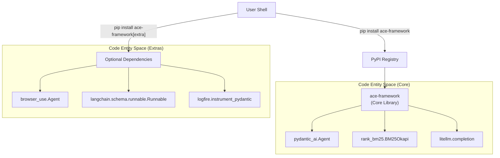
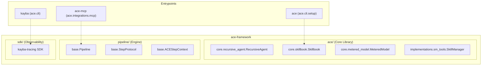

<!-- source: DeepWiki mcp.deepwiki.com · repo kayba-ai/agentic-context-engine · page 5.1 Installation · fetched 2026-10-27 -->

# Installation

<details>
<summary>Relevant source files</summary>

The following files were used as context for generating this wiki page:

- [CHANGELOG.md](CHANGELOG.md)
- [docs/getting-started/installation.md](docs/getting-started/installation.md)
- [docs/integrations/browser-use.md](docs/integrations/browser-use.md)
- [docs/integrations/claude-code.md](docs/integrations/claude-code.md)
- [docs/integrations/langchain.md](docs/integrations/langchain.md)
- [pyproject.toml](pyproject.toml)
- [uv.lock](uv.lock)

</details>


This document covers installing the `ace-framework` package and its optional dependencies. For API key setup and configuration, see [Configuration](5.2). For a working example after installation, see [Quick Start Example](5.3).

---

## Prerequisites

**Python Version**: ACE Framework requires Python 3.12 or higher. [pyproject.toml:10]()

Check your Python version:
```bash
python --version  # Should display 3.12.x or higher
```

**Package Manager**: The framework can be installed using either `pip` (standard) or `uv` (recommended for development). [pyproject.toml:207-210]()

---

## Basic Installation

Install the core ACE Framework package from PyPI:

```bash
pip install ace-framework
```

This installs the minimum dependencies required for core functionality:
- `litellm>=1.83.0` - LLM provider integration [pyproject.toml:43]()
- `pydantic>=2.0.0` - Data validation [pyproject.toml:44]()
- `pydantic-ai-slim[litellm]>=0.0.36` - Core agent framework [pyproject.toml:45]()
- `rank-bm25>=0.2.2` - Skill retrieval [pyproject.toml:46]()
- `tenacity>=9.1.4` - Retry logic [pyproject.toml:48]()

The core package includes:
- Core Library (`ace/` module) [pyproject.toml:156]()
- Pipeline Engine (`pipeline/` module) [pyproject.toml:156]()
- Recursive Reflector System (`ace/core/recursive_agent.py`) [CHANGELOG.md:58]()
- Skillbook v2 management [CHANGELOG.md:59]()

Sources: [pyproject.toml:6-7, 41-49](), [CHANGELOG.md:58-60]()

---

## Installation Flow Diagram

This diagram maps the installation process from user request to the resulting code entities in the environment.



Sources: [pyproject.toml:41-49, 51-116](), [uv.lock:35-46]()

---

## Optional Dependencies

ACE Framework provides modular optional dependencies for specific use cases. Install them using the `[extra]` syntax: [pyproject.toml:51]()

```bash
# All optional features
pip install 'ace-framework[all]'

# Specific features
pip install 'ace-framework[browser-use,tracing]'
```

### Available Extras

| Extra | Packages | Use Case |
|-------|----------|----------|
| `claude-code` | `python-dotenv`, `tenacity` | Claude Code CLI integration [pyproject.toml:55-58]() |
| `instructor` | `instructor` | Structured outputs [pyproject.toml:59-61]() |
| `deduplication` | `numpy`, `sentence-transformers` | Vector-based skill deduplication [pyproject.toml:62-65]() |
| `browser-use` | `browser-use` | Web automation [pyproject.toml:66-68]() |
| `logfire` | `logfire[pydantic-ai]` | Enterprise-grade tracing [pyproject.toml:69-71]() |
| `tracing` | `kayba-tracing` | Kayba-native tracing SDK [pyproject.toml:72-74]() |
| `bedrock` | `boto3` | AWS Bedrock support [pyproject.toml:75-77]() |
| `langchain` | `langchain-openai`, `langgraph` | LangChain/LangGraph integration [pyproject.toml:78-83]() |
| `cloud` | `requests`, `questionary` | Kayba Hosted API CLI [pyproject.toml:108-111]() |
| `mcp` | `mcp`, `pydantic-settings` | Model Context Protocol server [pyproject.toml:112-116]() |

Sources: [pyproject.toml:51-116](), [uv.lock:48-122]()

---

## Development Installation

For contributors, use `uv` for dependency management. [pyproject.toml:129-141]()

```bash
git clone https://github.com/kayba-ai/agentic-context-engine
cd agentic-context-engine

# Install all dependencies including dev tools
uv sync
```

### Development Dependency Groups
- **dev**: `pytest`, `mypy`, `black`, `pre-commit` [pyproject.toml:130-136]()
- **demos**: `playwright`, `datasets`, `rich`, `pandas` [pyproject.toml:145-153]()
- **tau-bench**: `tau2` (benchmarking suite) [pyproject.toml:142-144]()

Sources: [pyproject.toml:129-153](), [uv.lock:124-145]()

---

## CLI Tools

ACE Framework installs several CLI entrypoints: [pyproject.toml:118-121]()

| Command | Entrypoint | Purpose |
|---------|------------|---------|
| `ace` | `ace.cli.setup:main` | Interactive configuration wizard |
| `kayba` | `ace.cli:main` | Cloud CLI for traces, insights, and prompts |
| `ace-mcp` | `ace.integrations.mcp.server:main` | Starts the MCP server |

Sources: [pyproject.toml:118-121](), [docs/getting-started/installation.md:53-56]()

---

## Package Architecture and Import Map

This diagram associates system components with their corresponding Python modules and classes.



Sources: [pyproject.toml:118-121, 156](), [CHANGELOG.md:58-61](), [uv.lock:209-210]()

---

## Verifying Installation

Verify the installation and versioning:

```python
import ace
from ace import ACELiteLLM
from ace.core.skillbook import Skillbook

# Check version (should match 0.12.0)
print(f"ACE Version: {ace.__version__}")

# Verify core entities
sb = Skillbook()
print("✅ Skillbook v2 initialized")

agent = ACELiteLLM.from_model("gpt-4o-mini")
print("✅ LiteLLM agent initialized")
```

Sources: [pyproject.toml:7](), [docs/getting-started/installation.md:74-87](), [CHANGELOG.md:59]()

---

