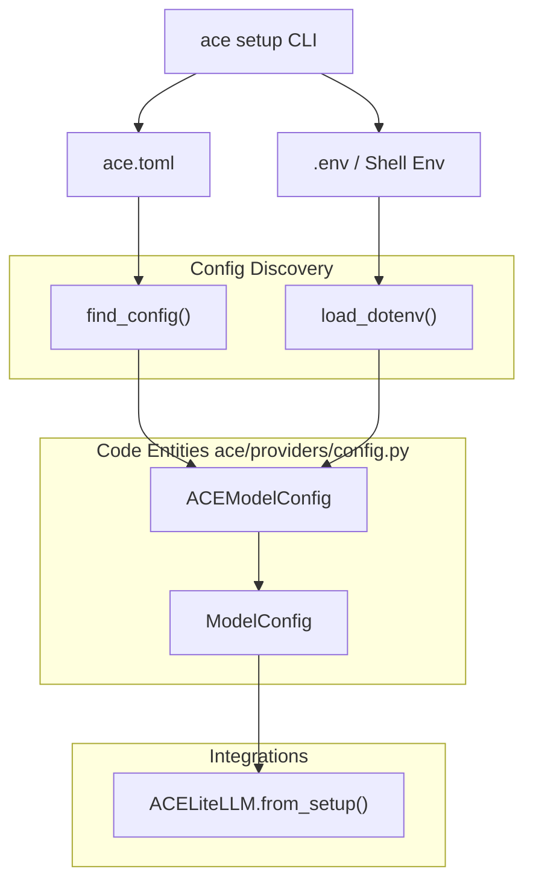
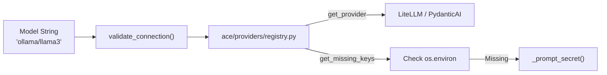

<!-- source: DeepWiki mcp.deepwiki.com · repo kayba-ai/agentic-context-engine · page 5.2 Configuration · fetched 2026-10-27 -->

# Configuration

<details>
<summary>Relevant source files</summary>

The following files were used as context for generating this wiki page:

- [.env.example](.env.example)
- [ace.toml](ace.toml)
- [ace/cli/setup.py](ace/cli/setup.py)
- [docs/concepts/overview.md](docs/concepts/overview.md)
- [docs/concepts/roles.md](docs/concepts/roles.md)
- [docs/getting-started/quick-start.md](docs/getting-started/quick-start.md)
- [docs/getting-started/setup.md](docs/getting-started/setup.md)

</details>


This page documents the configuration system for the ACE Framework. ACE supports over 100 LLM providers via LiteLLM and PydanticAI, offering both interactive CLI setup and manual configuration through environment variables and configuration files.

## Guided Setup (Recommended)

The `ace setup` command provides an interactive wizard to configure the framework. It validates connections in real-time and only prompts for credentials if they are missing from the environment.

```bash
ace setup
```

The wizard performs the following steps:
1. **Model Selection**: Choose a default model string (e.g., `gpt-4o-mini`, `claude-3-5-sonnet-20241022`). [ace/cli/setup.py:16-34]()
2. **Connection Validation**: Attempts a tiny test call (3 tokens) to verify the key, model, and network. [docs/getting-started/setup.md:158-162]()
3. **Role Assignment**: Optionally assign different models to the **Agent**, **Reflector**, and **Skill Manager** roles. [docs/getting-started/setup.md:106-115]()
4. **Persistence**: Saves API keys to `.env` and model assignments to `ace.toml`. [docs/getting-started/setup.md:50-56]()

**Sources:** [ace/cli/setup.py:1-8](), [docs/getting-started/setup.md:5-46]()

## Configuration Files

ACE utilizes two primary files for persistence.

### `ace.toml`
This file stores non-sensitive model configurations and role assignments. It should be committed to version control.

```toml
[default]
model = "gpt-4o-mini"

[agent]
model = "claude-3-5-sonnet-20241022"
max_tokens = 4096

[reflector]
model = "gpt-4o-mini"
```
**Sources:** [docs/getting-started/setup.md:116-130](), [ace.toml:1-3]()

### `.env`
Used for sensitive API keys. This file should be added to `.gitignore`.

```bash
OPENAI_API_KEY=sk-...
ANTHROPIC_API_KEY=sk-ant-...
AWS_ACCESS_KEY_ID=...
AWS_SECRET_ACCESS_KEY=...
AWS_REGION_NAME=us-east-1
```
**Sources:** [.env.example:1-43](), [docs/getting-started/setup.md:79-85]()

## Environment Variables

### API Keys and Provider Resolution
ACE uses `LiteLLM` for model access. The framework automatically maps model prefixes to the required environment variables.

| Provider | Model Prefix Example | Environment Variable |
|----------|----------------------|----------------------|
| OpenAI | `gpt-4o` | `OPENAI_API_KEY` |
| Anthropic | `claude-3-5-sonnet` | `ANTHROPIC_API_KEY` |
| AWS Bedrock | `us.anthropic...` | `AWS_ACCESS_KEY_ID`, `AWS_SECRET_ACCESS_KEY` |
| Google | `gemini/gemini-2.0` | `GOOGLE_API_KEY` |
| DeepSeek | `deepseek/deepseek-chat` | `DEEPSEEK_API_KEY` |
| Azure | `azure/gpt-4` | `AZURE_API_KEY`, `AZURE_API_BASE` |

**Sources:** [docs/getting-started/setup.md:168-179](), [.env.example:1-43]()

### Observability and Benchmarking
| Variable | Purpose |
|----------|---------|
| `TRACK_COSTS` | Enable/disable token cost tracking (default: `true`). |
| `MAX_BUDGET` | Set a hard dollar limit for LLM calls. |
| `OPIK_ENABLED` | Toggle Opik tracing (default: `false`). |
| `APPWORLD_ROOT` | Path to data for AppWorld benchmarks. |

**Sources:** [.env.example:49-66]()

## Per-Role Configuration

ACE architecture relies on three specialized roles. You can optimize cost and performance by assigning different models to each role via `ACEModelConfig`.

| Role | Responsibility | Requirement |
|------|----------------|-------------|
| **Agent** | Executes tasks and produces answers. | High reasoning (e.g., Claude 3.5 Sonnet). |
| **Reflector** | Analyzes traces and identifies errors. | Good analysis, lower cost (e.g., GPT-4o-mini). |
| **Skill Manager** | Updates the skillbook strategies. | Reliable structured output. |

**Sources:** [docs/getting-started/setup.md:106-115](), [docs/concepts/roles.md:1-11]()

### Configuration Data Flow

The following diagram illustrates how configuration is resolved from files and environment variables into the runtime `ACEModelConfig` object used by the `ACELiteLLM` integration.

**Configuration Resolution Diagram**

**Sources:** [ace/cli/setup.py:17-34](), [docs/getting-started/setup.md:97-104](), [docs/getting-started/setup.md:57-64]()

## Programmatic Configuration

For developers, configuration can be passed directly to the `ACELiteLLM` or `ACE.from_roles` constructors.

### Using `ACELiteLLM`
```python
from ace import ACELiteLLM, ACEModelConfig, ModelConfig

# Option 1: Load from ace.toml and .env
ace = ACELiteLLM.from_setup()

# Option 2: Explicit per-role config
ace = ACELiteLLM.from_config(ACEModelConfig(
    default=ModelConfig(model="gpt-4o-mini"),
    agent=ModelConfig(model="claude-3-5-sonnet-20241022", max_tokens=4096)
))
```
**Sources:** [docs/getting-started/setup.md:96-104](), [docs/getting-started/quick-start.md:7-12]()

### Using Core Roles
When building a custom pipeline, roles are initialized with model strings directly.

```python
from ace import Agent, Reflector, SkillManager, ACE

agent = Agent("gpt-4o-mini")
reflector = Reflector("gpt-4o-mini")
skill_manager = SkillManager("gpt-4o-mini")

runner = ACE.from_roles(
    agent=agent,
    reflector=reflector,
    skill_manager=skill_manager,
    environment=SimpleEnvironment()
)
```
**Sources:** [docs/getting-started/quick-start.md:86-105](), [docs/concepts/roles.md:108-118]()

## Model Discovery and Validation

The ACE CLI provides tools to explore the 100+ supported models and verify credentials without running a full pipeline.

### Searching Models
The `ace models` command searches the LiteLLM catalog. It displays pricing and whether your local environment has the required API key configured.
```bash
ace models claude
ace models gpt 4o --provider openai
```
**Sources:** [docs/getting-started/setup.md:132-154]()

### Validating Connections
Use `ace validate` to perform a smoke test on a specific model string.
```bash
ace validate gpt-4o-mini
```
**Sources:** [docs/getting-started/setup.md:158-162]()

### Runtime Model Resolution
The diagram below shows how a model string is processed by the internal registry to identify the provider and validate credentials.

**Model Validation Flow**

**Sources:** [ace/cli/setup.py:116-145](), [docs/getting-started/setup.md:198-208]()

---

