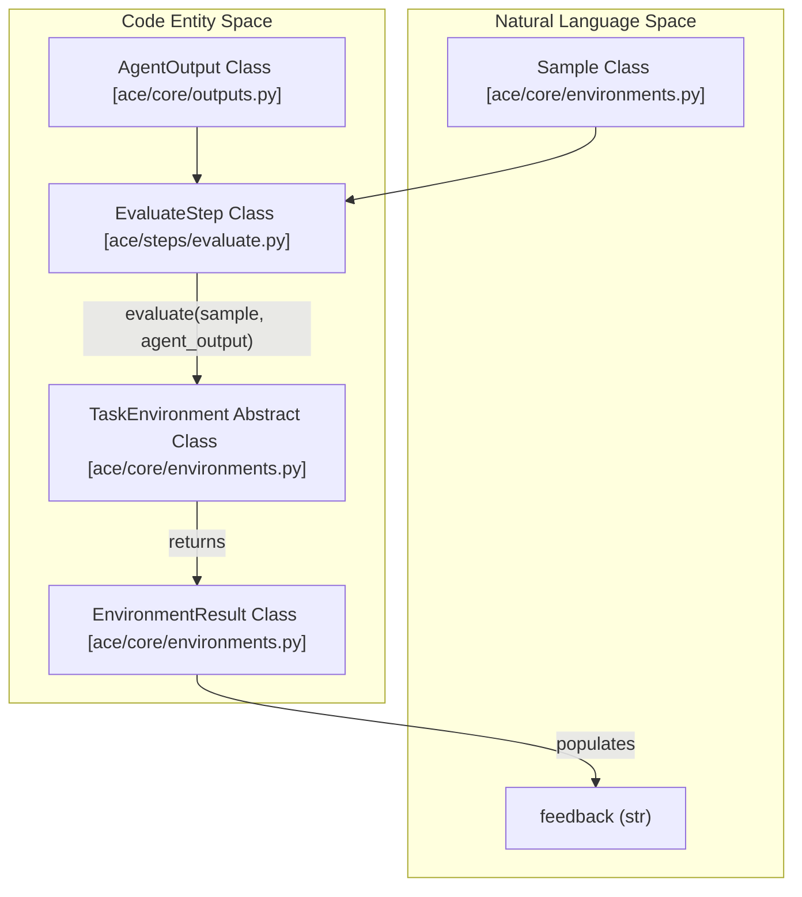
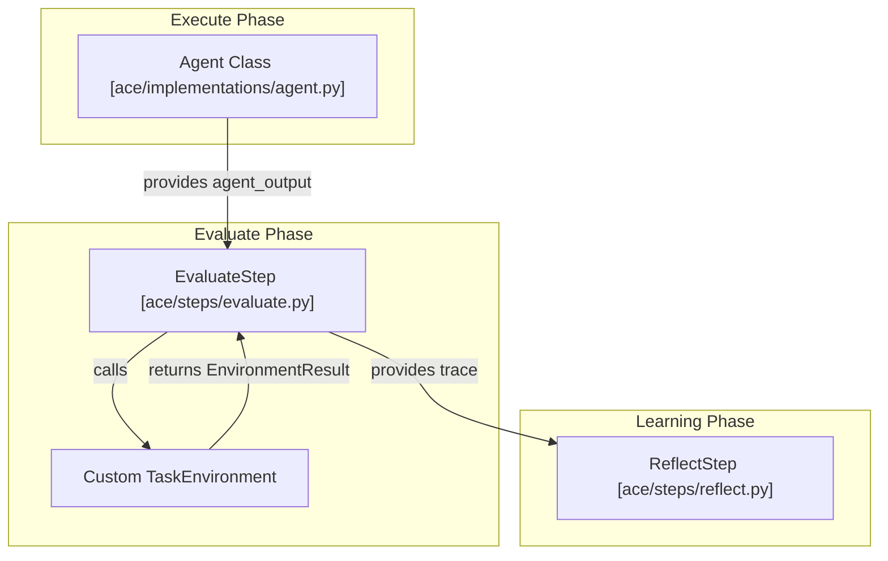

<!-- source: DeepWiki mcp.deepwiki.com · repo kayba-ai/agentic-context-engine · page 6.2 Creating Custom Task Environments · fetched 2026-10-27 -->

# Creating Custom Task Environments

<details>
<summary>Relevant source files</summary>

The following files were used as context for generating this wiki page:

- [CLAUDE.md](CLAUDE.md)
- [README.md](README.md)
- [ace/runners/litellm.py](ace/runners/litellm.py)
- [ace/steps/evaluate.py](ace/steps/evaluate.py)
- [assets/kayba-banner.png](assets/kayba-banner.png)
- [examples/ace/ace_demo.py](examples/ace/ace_demo.py)

</details>


This page explains how to implement custom `TaskEnvironment` classes to evaluate agent outputs and provide feedback for ACE learning. Task environments define how your specific use case measures success and generates the feedback that drives skill acquisition.

For information about the overall learning loop, see [The ACE Learning Loop](2.1). For integration examples using pre-built environments, see [Integration Guide](7).

---

## Overview

The `TaskEnvironment` abstract class defines a single method that evaluates an agent's output and returns structured feedback. This feedback is consumed by the `EvaluateStep` to populate the execution trace, which is then analyzed by the `Reflector` to identify what worked and what didn't.

**Key Concept**: Environments translate domain-specific success criteria into feedback that ACE can learn from. They are the bridge between your task domain and the ACE learning system.

Sources: [ace/core/environments.py:53-70](), [ace/steps/evaluate.py:9-18]()

---

## TaskEnvironment Interface

### Class Definition and Data Flow

The environment interaction occurs within the `EvaluateStep` of the ACE pipeline.

Title: Task Environment Data Flow


**Required Method**:
- `evaluate(sample: Sample, agent_output: AgentOutput) -> EnvironmentResult` [ace/core/environments.py:69-70]()

The method must:
1. Receive the input `Sample` (question, context, ground truth) [ace/core/environments.py:33-41]()
2. Receive the `AgentOutput` (reasoning, final answer, skill IDs used) [ace/core/outputs.py:11-23]()
3. Determine if the output is correct/acceptable.
4. Return an `EnvironmentResult` containing a feedback string and optional metrics [ace/core/environments.py:44-51]().

Sources: [ace/core/environments.py:33-70](), [ace/core/outputs.py:11-23](), [ace/steps/evaluate.py:40-45]()

---

## EnvironmentResult Structure

The `EnvironmentResult` class contains the following fields:

| Field | Type | Purpose | Required |
|-------|------|---------|----------|
| `feedback` | `str` | Human-readable feedback describing what happened | Yes |
| `ground_truth` | `Optional[str]` | The correct answer for comparison | No |
| `metrics` | `Dict[str, float]` | Numeric metrics (accuracy, timing, etc.) | No |

**Feedback Guidelines**:
- Be specific about what was correct or incorrect.
- Include details that help the `Reflector` understand the outcome.
- For failures, explain what went wrong (not just "incorrect").
- For successes, mention why it worked.

Sources: [ace/core/environments.py:44-51](), [ace/steps/evaluate.py:32-46]()

---

## Built-in SimpleEnvironment

ACE provides `SimpleEnvironment` as a minimal working example:

```python
class SimpleEnvironment(TaskEnvironment):
    """Checks if ground truth appears in the answer (case-insensitive)."""
    
    def evaluate(self, sample: Sample, agent_output: AgentOutput) -> EnvironmentResult:
        if not sample.ground_truth:
            return EnvironmentResult(
                feedback="No ground truth provided",
                ground_truth=None,
                metrics={"correct": 0.0}
            )
        
        answer = agent_output.final_answer.lower()
        truth = sample.ground_truth.lower()
        is_correct = truth in answer
        
        return EnvironmentResult(
            feedback="Correct!" if is_correct else f"Incorrect. Expected: {sample.ground_truth}",
            ground_truth=sample.ground_truth,
            metrics={"correct": 1.0 if is_correct else 0.0}
        )
```

**When to use**: Quick testing, demos, or tasks where substring matching is sufficient.

Sources: [ace/core/environments.py:73-108]()

---

## Custom Environment Patterns

### Pattern 1: Exact Match Environment
For tasks requiring precise answers, typically used in structured data or math tasks.

```python
class ExactMatchEnvironment(TaskEnvironment):
    """Strict evaluation: answer must exactly match ground truth."""

    def evaluate(self, sample: Sample, agent_output: AgentOutput) -> EnvironmentResult:
        expected = (sample.ground_truth or "").strip().lower()
        predicted = agent_output.final_answer.strip().lower()
        correct = expected == predicted

        return EnvironmentResult(
            feedback=(
                "Correct!" if correct else f"Wrong. Expected: {sample.ground_truth}"
            ),
            ground_truth=sample.ground_truth,
            metrics={"accuracy": 1.0 if correct else 0.0},
        )
```
Sources: [examples/ace/ace_demo.py:170-184]()

### Pattern 2: Code Execution Environment
For programming tasks where the agent's output is code that must pass test cases.

```python
class CodeEnvironment(TaskEnvironment):
    """Executes code and validates against test cases."""
    
    def evaluate(self, sample: Sample, agent_output: AgentOutput) -> EnvironmentResult:
        code = agent_output.final_answer
        # Logic to execute code in a sandbox (similar to TraceSandbox)
        # and compare against sample.metadata['test_cases']
        ...
```

---

## Environment Integration in ACE Loop

The environment is utilized by the `EvaluateStep` class. This step bridges the execution phase (Agent) to the learning phase (Reflector).

Title: Evaluation in the Pipeline


**Execution Flow**:
1. **Agent Execution**: The `Agent` generates an `AgentOutput` [ace/implementations/agent.py:14-40]().
2. **Evaluation**: `EvaluateStep` calls `TaskEnvironment.evaluate()`. It bundles the `AgentOutput` and `Sample` into a `trace` dictionary [ace/steps/evaluate.py:32-46]().
3. **Reflection**: The `ReflectStep` (or `RRStep` in next-gen ACE) uses this `trace` to generate insights [ace/steps/reflect.py:10-30]().

Sources: [ace/steps/evaluate.py:9-46](), [ace/core/context.py:34-55]()

---

## Integration with Runners

### ACELiteLLM Usage
`ACELiteLLM` allows passing an environment during initialization for a "batteries-included" experience.

```python
from ace import ACELiteLLM, SimpleEnvironment

agent = ACELiteLLM(
    model="gpt-4o",
    environment=SimpleEnvironment()
)
# The environment will be used during agent.learn() calls
```
Sources: [ace/runners/litellm.py:57-93]()

### ACE Runner Usage
The `ACE` runner (next-gen pipeline) uses the environment to build the `EvaluateStep`.

```python
from ace import ACE, Agent, Reflector, SkillManager

ace = ACE.from_roles(
    agent=Agent(MODEL),
    reflector=Reflector(MODEL),
    skill_manager=SkillManager(MODEL),
    environment=MyCustomEnvironment(),
    skillbook=skillbook,
)
```
Sources: [examples/ace/ace_demo.py:137-143](), [ace/runners/ace.py:65-95]()

---

## Best Practices

### 1. Informative Feedback
The `Reflector` relies on the feedback string to understand failure modes.
- **Poor**: `feedback="Incorrect"`
- **Good**: `feedback="Incorrect. The agent calculated 42 but the expected value was 45. The error likely occurred during the integration step."`

### 2. Metric Consistency
While ACE is flexible, using consistent keys in the `metrics` dictionary (e.g., `accuracy`, `success`, `cost`) helps when analyzing the performance of the learning loop over multiple epochs.

### 3. Graceful No-Op
If no environment is provided to `EvaluateStep`, it still produces a `trace` containing the agent's answer and reasoning, but without the `feedback` field. This allows the `Reflector` to perform "unsupervised" or ground-truth-only reflection.

Sources: [ace/steps/evaluate.py:40-46](), [examples/ace/ace_demo.py:212-226]()

---

