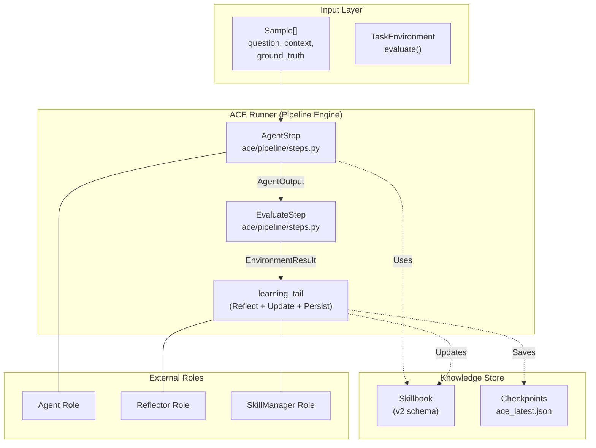
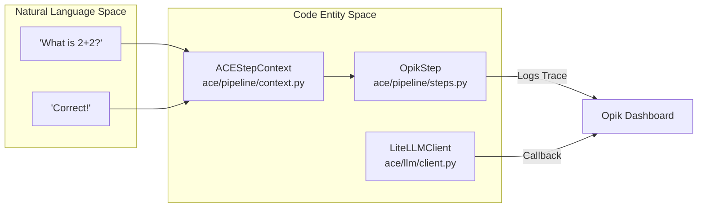

<!-- source: DeepWiki mcp.deepwiki.com · repo kayba-ai/agentic-context-engine · page 6.3 Offline Training · fetched 2026-10-27 -->

# Offline Training

<details>
<summary>Relevant source files</summary>

The following files were used as context for generating this wiki page:

- [docs/guides/full-pipeline.md](docs/guides/full-pipeline.md)
- [docs/index.md](docs/index.md)
- [docs/integrations/litellm.md](docs/integrations/litellm.md)
- [docs/integrations/opik.md](docs/integrations/opik.md)
- [docs/pipeline/index.md](docs/pipeline/index.md)
- [examples/pipeline_composition/compose_custom_pipeline.py](examples/pipeline_composition/compose_custom_pipeline.py)

</details>


## Purpose and Scope

This page describes how to use the ACE runner in offline mode for batch training. Offline training processes a fixed dataset of samples over multiple epochs to build a robust initial skillbook before deployment. This approach is ideal for establishing foundational knowledge from historical data or curated training sets.

In the next-gen architecture, offline training is orchestrated by the `ACE` runner (and its underlying `Pipeline` engine) which executes a sequence of steps including execution, evaluation, and the learning tail.

**Sources:** [docs/guides/full-pipeline.md:1-13](), [docs/pipeline/index.md:1-9]()

---

## What is Offline Training

Offline training uses the `ACE` runner to process a batch of `Sample` instances over multiple epochs. Each pass through the loop allows the `Reflector` and `SkillManager` to refine strategies through repeated exposure to the same examples.

**Key characteristics:**
- **Batch Processing**: A fixed training set is processed multiple times.
- **Epochs**: Controls the number of times the runner iterates over the entire sample set [docs/guides/full-pipeline.md:83-83]().
- **Checkpointing**: Automatic saving of the skillbook during long runs [docs/guides/full-pipeline.md:125-138]().
- **Async Learning**: Background processing of the learning tail to speed up execution [docs/pipeline/index.md:112-129]().

**When to use offline training:**
- Building an initial skillbook from curated datasets.
- Training from historical execution logs (see `TraceAnalyser`).
- Establishing domain-specific expertise before production use.

**Sources:** [docs/guides/full-pipeline.md:71-91](), [docs/index.md:88-97]()

---

## Architecture and Data Flow

Offline training is powered by the `Pipeline` engine. When using `ACE.from_roles()`, a standard pipeline is composed of `AgentStep`, `EvaluateStep`, and the `learning_tail`.

### Offline Training Pipeline Structure



**Diagram: Offline Training Pipeline Flow**

The pipeline processes samples sequentially (or in parallel depending on configuration). The `AgentStep` uses the current `Skillbook` to generate an answer. The `EvaluateStep` uses the `TaskEnvironment` to score the answer. Finally, the `learning_tail` triggers reflection and skill updates.

**Sources:** [docs/guides/full-pipeline.md:106-112](), [docs/pipeline/index.md:11-34](), [examples/pipeline_composition/compose_custom_pipeline.py:65-72]()

---

## Core Components

### 1. Samples
The `Sample` class is the fundamental unit of training data.
- `question`: The task or query [docs/guides/full-pipeline.md:65-65]().
- `context`: Optional background information [docs/guides/full-pipeline.md:65-65]().
- `ground_truth`: The expected answer used for evaluation [docs/guides/full-pipeline.md:65-65]().

### 2. Task Environment
The environment evaluates agent outputs. You can use the built-in `SimpleEnvironment` for basic matching or extend `TaskEnvironment` for custom logic.

```python
# Custom Math Environment
class MathEnvironment(TaskEnvironment):
    def evaluate(self, sample, agent_output):
        correct = str(sample.ground_truth) in str(agent_output.final_answer)
        return EnvironmentResult(
            feedback="Correct!" if correct else f"Expected {sample.ground_truth}",
            metrics={"accuracy": 1.0 if correct else 0.0}
        )
```
**Sources:** [docs/guides/full-pipeline.md:36-57]()

### 3. Roles
Three roles must be initialized, typically using a model string (e.g., `"gpt-4o-mini"`) which is resolved via the `LiteLLMClient`.
- **Agent**: Executes the task.
- **Reflector**: Analyzes the trace and feedback.
- **SkillManager**: Updates the skillbook based on insights.

**Sources:** [docs/guides/full-pipeline.md:14-32](), [examples/pipeline_composition/compose_custom_pipeline.py:60-63]()

---

## Implementation Example

The `ACE` runner provides a high-level API to execute offline training.

```python
from ace import ACE, Agent, Reflector, SkillManager, Sample, SimpleEnvironment

# 1. Setup Roles
agent = Agent("gpt-4o")
reflector = Reflector("gpt-4o-mini") # Use cheaper model for learning
skill_manager = SkillManager("gpt-4o-mini")

# 2. Initialize Runner
runner = ACE.from_roles(
    agent=agent,
    reflector=reflector,
    skill_manager=skill_manager,
    environment=SimpleEnvironment(),
    checkpoint_dir="./training_checkpoints",
    checkpoint_interval=5 # Save every 5 samples
)

# 3. Define Training Data
samples = [
    Sample(question="What is 15 * 12?", ground_truth="180"),
    Sample(question="Square root of 144?", ground_truth="12"),
]

# 4. Run Training
results = runner.run(samples, epochs=3)

# 5. Final Persist
runner.save("final_math_skills.json")
```

**Sources:** [docs/guides/full-pipeline.md:101-123](), [docs/guides/full-pipeline.md:127-138]()

---

## Advanced Training Features

### Checkpoint System
Checkpoints ensure that progress is not lost during long training sessions. The runner saves the `Skillbook` state to the `checkpoint_dir` at every `checkpoint_interval`.
- `ace_checkpoint_N.json`: Snapshot after N samples.
- `ace_latest.json`: The most recent state for easy resumption.

**Sources:** [docs/guides/full-pipeline.md:125-144]()

### Skill Deduplication
To prevent the skillbook from becoming bloated with redundant strategies, a `DeduplicationManager` can be integrated into the runner. This uses embeddings to find and merge similar skills.

```python
from ace import DeduplicationConfig, DeduplicationManager

dedup = DeduplicationManager(DeduplicationConfig(
    enabled=True,
    embedding_model="text-embedding-3-small",
    similarity_threshold=0.85
))

runner = ACE.from_roles(
    ...,
    dedup_manager=dedup,
    dedup_interval=10 # Run dedup every 10 samples
)
```
**Sources:** [docs/guides/full-pipeline.md:147-163]()

### Observability with Opik
Training can be monitored in real-time by adding an `OpikStep`. This logs traces, costs, and feedback to the Opik dashboard.



**Sources:** [docs/integrations/opik.md:32-40](), [docs/integrations/opik.md:90-102]()

---

## Pipeline Composition Pattern

For full control over the training process, you can manually compose the `Pipeline`. This allows injecting custom steps, such as logging or data transformation, between the execution and learning phases.

```python
from ace import Pipeline, AgentStep, EvaluateStep, learning_tail

# Custom step to log output
class LogStep:
    requires = frozenset({"agent_output"})
    provides = frozenset()
    def __call__(self, ctx):
        print(f"Agent Answered: {ctx.agent_output.final_answer}")
        return ctx

# Manual Composition
pipe = Pipeline([
    AgentStep(agent, skillbook),
    EvaluateStep(environment),
    LogStep(), # Injected custom step
    *learning_tail(reflector, skill_manager, skillbook),
])
```

**Sources:** [docs/guides/full-pipeline.md:208-224](), [examples/pipeline_composition/compose_custom_pipeline.py:45-72]()

---

