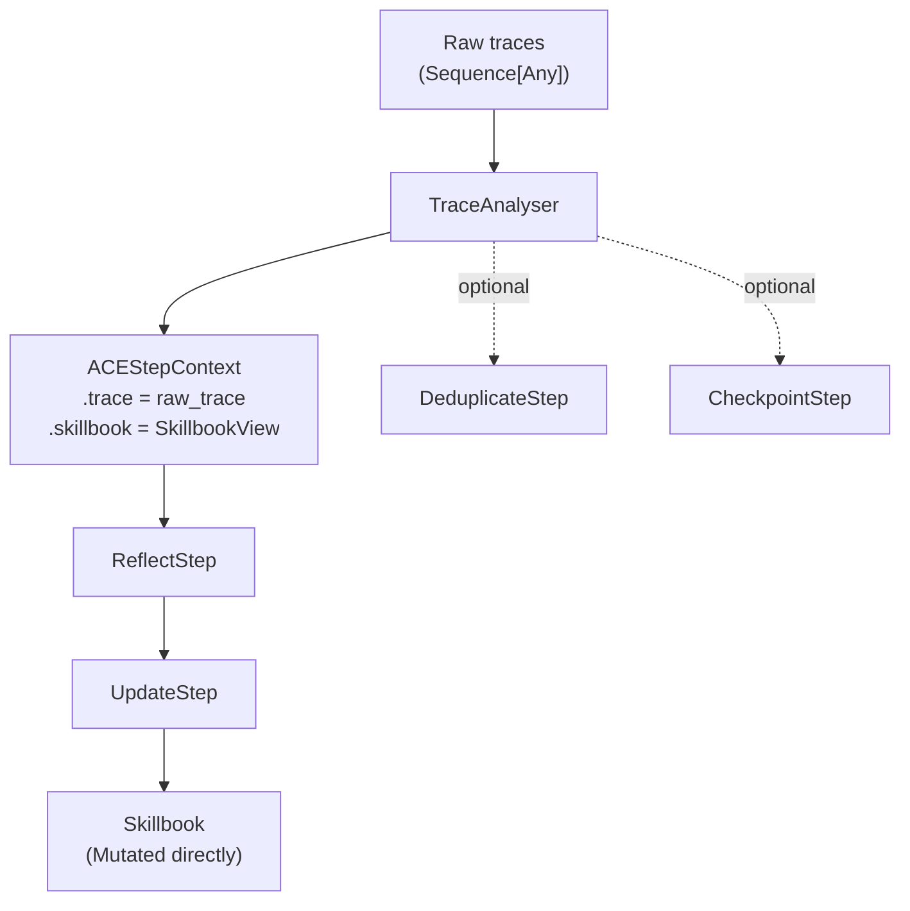
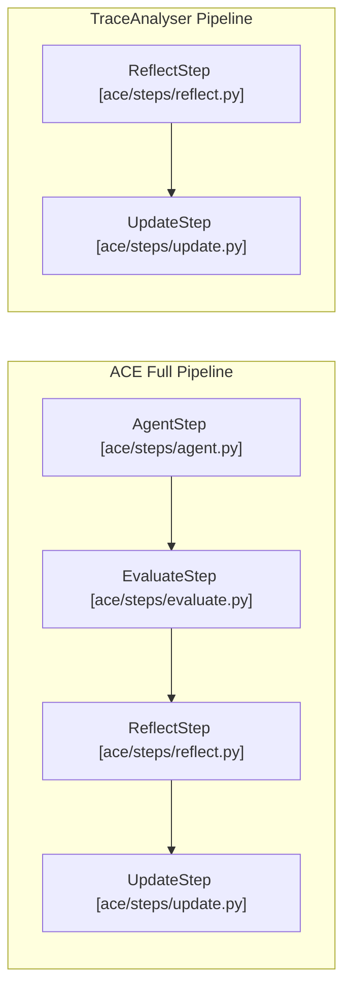
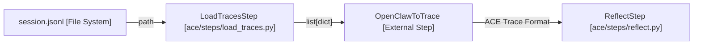

<!-- source: DeepWiki mcp.deepwiki.com · repo kayba-ai/agentic-context-engine · page 6.5 Trace Analysis · fetched 2026-10-27 -->

# Trace Analysis

<details>
<summary>Relevant source files</summary>

The following files were used as context for generating this wiki page:

- [ace/runners/ace.py](ace/runners/ace.py)
- [ace/runners/trace_analyser.py](ace/runners/trace_analyser.py)
- [tests/test_load_traces_step.py](tests/test_load_traces_step.py)

</details>


## Purpose

This page covers the `TraceAnalyser` runner, which learns from pre-recorded execution logs without re-executing tasks. Trace analysis builds or refines a skillbook by analyzing historical data from external systems (e.g., browser-use logs, LangChain intermediate steps, OpenClaw sessions, or Claude Code transcripts).

For live learning during task execution, see [Offline Training](6.3) and [Online Adaptation](6.4).

---

## What is Trace Analysis?

Trace analysis is a **post-hoc learning mode** where ACE extracts patterns and strategies from execution logs recorded by another system. Unlike the full ACE pipeline which executes an agent and then learns from the result, trace analysis skips the execution and evaluation phases entirely.

**Key characteristics:**

| Aspect | Trace Analysis | Live Learning (ACE) |
|--------|----------------|---------------------|
| **Execution** | No agent execution — reads logs | Executes agent on each sample |
| **Input** | Pre-recorded traces (any format) | Sample objects (question + context) |
| **Pipeline** | Learning tail only (`Reflect` → `Update`) | Full pipeline (`Agent` → `Evaluate` → `Reflect` → `Update`) |
| **Use case** | Historical data, external systems | Real-time learning, new tasks |

**Sources:** [ace/runners/trace_analyser.py:26-41](), [ace/runners/ace.py:27-38]()

---

## The TraceAnalyser Runner

### Core Class

The `TraceAnalyser` class is a specialized `ACERunner` that accepts raw trace objects of any type. These objects are placed directly on `ctx.trace` for the `Reflector` to interpret.

**Trace Analysis Data Flow**



**Sources:** [ace/runners/trace_analyser.py:26-41](), [ace/runners/trace_analyser.py:171-187]()

### Construction

Two factory methods exist for building a `TraceAnalyser`:

**1. `from_roles()` — construct from pre-built role instances:**

```python
from ace.runners.trace_analyser import TraceAnalyser
from ace.core.skillbook import Skillbook

analyser = TraceAnalyser.from_roles(
    reflector=my_reflector,
    skill_manager=my_skill_manager,
    skillbook=Skillbook(),  # optional
)
```

**2. `build_steps()` — inspect or modify steps before construction:**

```python
steps = TraceAnalyser.build_steps(
    reflector=r, 
    skill_manager=sm, 
    skillbook=sb
)
# Insert custom steps if needed
steps.append(MyCustomStep())
pipe = Pipeline(steps)
runner = ACERunner(pipeline=pipe, skillbook=sb)
```

**Sources:** [ace/runners/trace_analyser.py:44-89](), [ace/runners/trace_analyser.py:92-130]()

### Execution

The `run()` method processes a sequence of traces through the pipeline. It supports multi-epoch passes over the same data.

```python
results = analyser.run(
    traces=my_trace_list, 
    epochs=1, 
    wait=True
)
```

| Parameter | Type | Description |
|-----------|------|-------------|
| `traces` | `Sequence[Any]` | Raw trace objects (any type) |
| `epochs` | `int` | Number of passes over all traces (default: 1) |
| `wait` | `bool` | Block until background learning completes |
| `cancel_token` | `CancellationToken` | Optional signal to stop execution |

**Sources:** [ace/runners/trace_analyser.py:132-153]()

---

## Pipeline Architecture

### Step Composition

The `TraceAnalyser` pipeline is composed of the **learning tail only**. It omits `AgentStep` and `EvaluateStep` because the execution and evaluation have already occurred externally.

**System Mapping: Pipeline Primitives to Code Entities**



**Sources:** [ace/runners/trace_analyser.py:26-32](), [ace/runners/ace.py:79-91](), [ace/runners/trace_analyser.py:78-86]()

### The learning_tail Factory

Both `ACE` and `TraceAnalyser` use the `learning_tail()` factory to generate standard learning steps. This function encapsulates the reflection and update logic, along with optional maintenance steps like deduplication and checkpointing.

**Sources:** [ace/steps/__init__.py:22](), [ace/runners/trace_analyser.py:78-86]()

### Context Flow

The `_build_context()` method in `TraceAnalyser` maps raw traces to the `ACEStepContext`. It uses `infer_trace_identity` to extract metadata about the trace source.

```python
def _build_context(self, raw_trace: Any, **kwargs) -> ACEStepContext:
    return ACEStepContext(
        skillbook=SkillbookView(self.skillbook),
        trace=raw_trace, # Placed directly
        metadata=MappingProxyType({
            TRACE_IDENTITY_METADATA_KEY: infer_trace_identity(
                trace=raw_trace,
                default_source_system="trace",
            ).to_dict()
        }),
        # ... indices and epochs
    )
```

**Sources:** [ace/runners/trace_analyser.py:155-187]()

---

## Loading Traces from Files

### LoadTracesStep

The `LoadTracesStep` is a utility for reading JSONL files where each line represents a trace event. This is commonly used when analyzing session transcripts from tools like OpenClaw.

**Implementation Details:**
- **Requirements:** Expects `ctx.sample` to be a file path string.
- **Output:** Provides a list of parsed JSON objects in `ctx.trace`.
- **Robustness:** Skips unparseable lines and preserves full event data (no truncation).

**Sources:** [tests/test_load_traces_step.py:46-48](), [tests/test_load_traces_step.py:77-85](), [tests/test_load_traces_step.py:94-113]()

### Integration Example: OpenClaw Sessions

When analyzing OpenClaw sessions, the pipeline typically starts with a file loader and follows with a conversion step to prepare the data for the `Reflector`.

**Trace Loading Workflow**



**Sources:** [tests/test_load_traces_step.py:50-59](), [tests/test_load_traces_step.py:134-149]()

---

## Trace Identity and Metadata

To maintain provenance, every trace analyzed by the `TraceAnalyser` is tagged with a trace identity. This identity is inferred using `infer_trace_identity` and stored in the context metadata under the `TRACE_IDENTITY_METADATA_KEY`.

This allows the `Reflector` and `SkillManager` to know exactly which historical execution a specific insight or skill update was derived from.

**Sources:** [ace/runners/trace_analyser.py:15](), [ace/runners/trace_analyser.py:176-180]()

---

