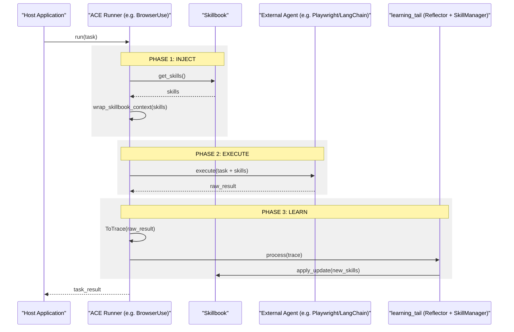
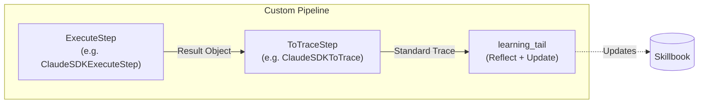

<!-- source: DeepWiki mcp.deepwiki.com · repo kayba-ai/agentic-context-engine · page 7 Integration Guide · fetched 2026-10-27 -->

# Integration Guide

<details>
<summary>Relevant source files</summary>

The following files were used as context for generating this wiki page:

- [ace/integrations/__init__.py](ace/integrations/__init__.py)
- [ace/integrations/claude_sdk.py](ace/integrations/claude_sdk.py)
- [docs/guides/integration.md](docs/guides/integration.md)
- [docs/integrations/claude-sdk.md](docs/integrations/claude-sdk.md)
- [docs/integrations/index.md](docs/integrations/index.md)
- [docs/integrations/mcp-client-setup.md](docs/integrations/mcp-client-setup.md)
- [docs/integrations/mcp.md](docs/integrations/mcp.md)
- [mkdocs.yml](mkdocs.yml)
- [specs/002-ace-mcp-server/contracts/tool-schemas.md](specs/002-ace-mcp-server/contracts/tool-schemas.md)
- [specs/002-ace-mcp-server/spec.md](specs/002-ace-mcp-server/spec.md)
- [tests/test_ace_mcp_compatibility.py](tests/test_ace_mcp_compatibility.py)

</details>


This page describes how to integrate ACE with external agentic systems. ACE provides built-in runners and composable pipeline steps for popular frameworks. All integrations follow a standardized three-phase pattern: **INJECT** skillbook context → **EXECUTE** with external agent → **LEARN** from results [docs/integrations/index.md:23-31]().

For specific implementation details, see the following child pages:
- [Integration Pattern Overview](#7.1) — The core INJECT/EXECUTE/LEARN design.
- [ACELiteLLM Integration](#7.2) — Direct LLM conversational agents with micro-level learning.
- [Browser Automation with ACEAgent](#7.3) — Integrating with `browser-use`.
- [LangChain Integration](#7.4) — Wrapping LangChain Runnables and Agents.
- [Claude Code Integration](#7.5) — Self-improving coding via Claude Code CLI.
- [OpenClaw Integration](#7.6) — Learning from gateway session transcripts.
- [MCP Server Integration](#7.7) — Exposing ACE as a tool provider via Model Context Protocol.
- [Kayba Hosted API](#7.8) — Using the cloud pipeline and CLI.
- [Claude SDK Integration](#7.9) — Direct Anthropic Python SDK steps.

## The Three-Phase Integration Pattern

Every integration runner follows a consistent lifecycle to enable self-improvement without modifying the external agent's internal logic [docs/guides/integration.md:10-18]().

### Sequence of Operations



**Title:** Standard ACE Integration Lifecycle

**Sources:** [docs/integrations/index.md:23-31](), [docs/guides/integration.md:10-18](), [ace/integrations/__init__.py:1-21]()

## Integration Architecture

ACE provides two ways to integrate: high-level **Runners** for quick setup and low-level **Steps** for custom pipeline composition [docs/integrations/index.md:3-5]().

### High-Level Runners
Every runner offers a `from_model()` factory that automatically builds the necessary ACE roles (Agent, Reflector, SkillManager) and initializes a `Skillbook` [docs/integrations/index.md:33-49]().

```python
from ace import BrowserUse, LangChain, ClaudeCode

# Quick construction pattern
runner = BrowserUse.from_model(browser_llm=my_llm, ace_model="gpt-4o-mini")
```

### Composable Pipeline Steps
For frameworks not covered by a runner, or for more granular control, you can use integration-specific steps directly in a `Pipeline` [ace/integrations/__init__.py:1-21]().



**Title:** Pipeline Composition for Integrations

**Sources:** [ace/integrations/__init__.py:1-21](), [docs/integrations/index.md:50-61]()

## Integration Comparison

| Runner / Step | Framework | Insight Level | Primary Use Case |
| :--- | :--- | :--- | :--- |
| `ACELiteLLM` | LiteLLM | Micro | Simple Q&A and reasoning agents [docs/integrations/index.md:11]() |
| `LangChain` | LangChain | Meso | Existing chains and tool-using agents [docs/integrations/index.md:12]() |
| `BrowserUse` | browser-use | Meso | Web automation and scraping [docs/integrations/index.md:13]() |
| `ClaudeCode` | Claude Code | Meso | Coding tasks via CLI [docs/integrations/index.md:14]() |
| `Claude SDK` | Anthropic SDK | Meso | Direct Messages API usage [docs/integrations/index.md:15]() |
| `OpenClaw` | OpenClaw | Meso | Learning from gateway transcripts [docs/integrations/index.md:16]() |
| `MCP Server` | MCP | Micro | Exposing ACE as a tool provider [docs/integrations/index.md:17]() |

**Sources:** [docs/integrations/index.md:9-21]()

## Common Features & Configuration

All integration runners share a common set of capabilities and parameters to ensure consistent behavior across different frameworks [docs/integrations/index.md:64-72]().

### Shared Parameters
| Parameter | Description |
| :--- | :--- |
| `skillbook_path` | Persistence path for saving/loading learned strategies [docs/guides/integration.md:115]() |
| `checkpoint_dir` | Directory for automatic intermediate saves during long runs [docs/guides/integration.md:119]() |
| `dedup_config` | Configuration for preventing duplicate skills in the skillbook [docs/guides/integration.md:117]() |
| `wait` | If `False`, learning happens asynchronously in the background [docs/integrations/index.md:71]() |

### Utility Functions
The `ace.integrations` module provides `wrap_skillbook_context(skillbook)` which uses the internal `wrap_skillbook_for_external_agent` to format learned strategies for injection into any external agent's system prompt [ace/integrations/__init__.py:39-45]().

**Sources:** [docs/integrations/index.md:64-72](), [docs/guides/integration.md:109-121](), [ace/integrations/__init__.py:39-70]()

## What to Read Next

- [Integration Pattern Overview](#7.1) — Deep dive into the INJECT/EXECUTE/LEARN cycle.
- [Building Custom Steps](../pipeline/custom-steps.md) — How to implement the `Step` protocol for new frameworks.
- [Async Learning](../guides/async-learning.md) — Details on non-blocking background learning.

---

