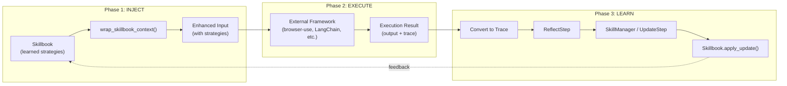
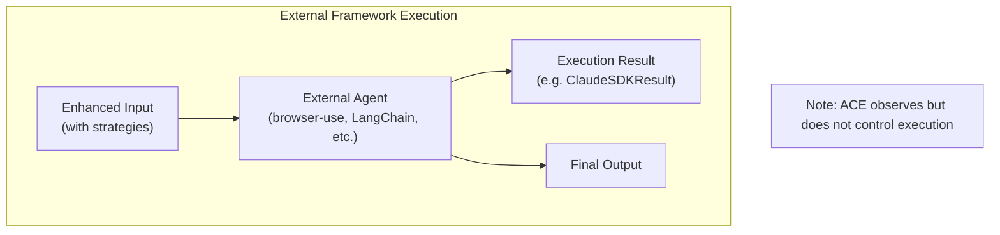
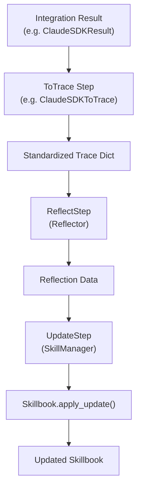
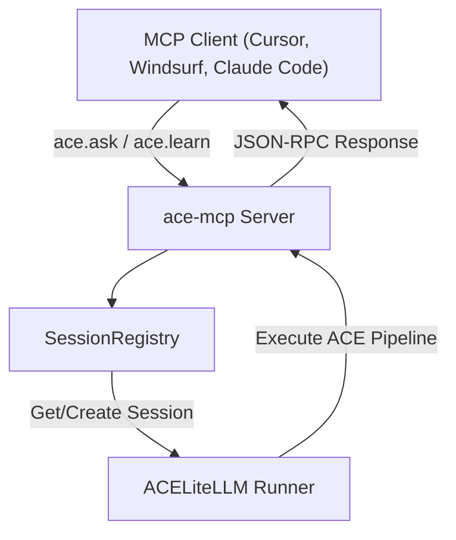

<!-- source: DeepWiki mcp.deepwiki.com · repo kayba-ai/agentic-context-engine · page 7.1 Integration Pattern Overview · fetched 2026-10-27 -->

# Integration Pattern Overview

<details>
<summary>Relevant source files</summary>

The following files were used as context for generating this wiki page:

- [ace/integrations/__init__.py](ace/integrations/__init__.py)
- [ace/integrations/claude_sdk.py](ace/integrations/claude_sdk.py)
- [docs/guides/integration.md](docs/guides/integration.md)
- [docs/integrations/claude-sdk.md](docs/integrations/claude-sdk.md)
- [docs/integrations/index.md](docs/integrations/index.md)
- [docs/integrations/mcp-client-setup.md](docs/integrations/mcp-client-setup.md)
- [docs/integrations/mcp.md](docs/integrations/mcp.md)
- [mkdocs.yml](mkdocs.yml)
- [specs/002-ace-mcp-server/contracts/tool-schemas.md](specs/002-ace-mcp-server/contracts/tool-schemas.md)
- [specs/002-ace-mcp-server/spec.md](specs/002-ace-mcp-server/spec.md)
- [tests/test_ace_mcp_compatibility.py](tests/test_ace_mcp_compatibility.py)

</details>


This page describes the universal pattern for integrating ACE with external agent frameworks and tools. All ACE integrations—whether wrapping browser automation, LangChain chains, Claude Code, or custom agents—follow the same three-phase execution model.

For specific integration implementations, see:
- Simple Q&A agents: [ACELiteLLM Integration](#7.2)
- Browser automation: [Browser Automation with ACEAgent](#7.3)
- LangChain chains/agents: [LangChain Integration](#7.4)
- Coding agents: [Claude Code Integration](#7.5)
- AI gateway logs: [OpenClaw Integration](#7.6)
- Tool provider protocol: [MCP Server Integration](#7.7)
- Building your own: [Kayba Hosted API](#7.8)

## The Universal Pattern

All ACE integrations implement the same three-phase pattern, regardless of the underlying framework:



**Sources:** [docs/integrations/index.md:23-31](), [docs/guides/integration.md:10-18](), [ace/integrations/__init__.py:1-21]()

## Three-Phase Execution Breakdown

### Phase 1: INJECT Context

The skillbook's learned strategies are injected into the agent's input or system prompt. This happens *before* the external framework executes.

| Component | Purpose | Code Entity |
|-----------|---------|-------------|
| Context Wrapper | Formats skillbook for agent consumption | `wrap_skillbook_context()` |
| Injection Point | Where strategies are added | System prompt, Task string, or Dict input |
| Formatting Logic | Canonical strategy string generation | `wrap_skillbook_for_external_agent()` |

**Key Implementation:**

The utility `wrap_skillbook_context` formats learned strategies for injection into external agents. [ace/integrations/__init__.py:39-45](). It calls the underlying prompt implementation to ensure consistency. [ace/integrations/__init__.py:25-25]().

**Sources:** [ace/integrations/__init__.py:39-45](), [ace/integrations/claude_sdk.py:30-30](), [docs/guides/integration.md:15-15]()

### Phase 2: EXECUTE with External Framework

The external framework (browser-use, LangChain, Claude SDK, etc.) executes the task normally. **ACE does not interfere with execution**—the agent runs exactly as it would without ACE, except it now has access to learned strategies in its context.



**What ACE Captures:**
Integrations capture framework-specific outputs like `ClaudeSDKResult` [ace/integrations/claude_sdk.py:116-162]() or `ClaudeCodeResult`. These models include:
- Final output/answer
- Success/failure status
- Token usage (input/output/total) [ace/integrations/claude_sdk.py:138-143]()
- Latency (wall-clock time) [ace/integrations/claude_sdk.py:145-147]()
- Tool calls made by the model [ace/integrations/claude_sdk.py:149-151]()

**Sources:** [ace/integrations/claude_sdk.py:116-162](), [ace/integrations/__init__.py:1-9](), [docs/integrations/index.md:29-29]()

### Phase 3: LEARN from Results

After execution, the integration-specific result is converted into a standardized trace format for the learning tail.



**Sources:** [ace/integrations/__init__.py:1-21](), [docs/integrations/claude-sdk.md:40-45](), [docs/integrations/index.md:30-31]()

## Insight Levels: Micro vs Meso

ACE integrations operate at different insight levels depending on whether they learn from simple input/output or complex execution traces:

| Level | Evaluation | Use Cases | Example Integrations |
|-------|------------|-----------|---------------------|
| **Micro** | Ground truth available | Q&A, classification, tool calls | `ACELiteLLM`, MCP Server |
| **Meso** | Execution trace only | Browser automation, chains, workflows, coding | `BrowserUse`, `LangChain`, `ClaudeCode`, `Claude SDK` |

**Sources:** [docs/integrations/index.md:9-17](), [specs/002-ace-mcp-server/spec.md:69-69]()

## Construction Patterns

All integration runners offer two primary construction paths to facilitate easy adoption:

### `from_model()` — Quick Setup
Builds ACE roles (Reflector, SkillManager) automatically from a model identifier.
```python
from ace import BrowserUse
# Builds roles using gpt-4o-mini
runner = BrowserUse.from_model(browser_llm=my_llm, ace_model="gpt-4o-mini")
```
**Sources:** [docs/integrations/index.md:33-48](), [docs/guides/integration.md:80-90]()

### `from_roles()` — Full Control
Allows providing pre-built role instances for custom configuration.
```python
from ace import BrowserUse, Reflector, SkillManager
runner = BrowserUse.from_roles(
    browser_llm=my_llm,
    reflector=Reflector("gpt-4o-mini"),
    skill_manager=SkillManager("gpt-4o-mini")
)
```
**Sources:** [docs/guides/integration.md:92-107]()

## Shared Integration Features

All runners and integration steps share a common set of capabilities:

| Feature | Description | Code/Config Reference |
|---------|-------------|-----------------------|
| **Persistence** | Save/load via `skillbook_path` | `runner.save("path.json")` |
| **Checkpointing** | Periodic saves during long runs | `checkpoint_interval` |
| **Deduplication** | Prevent redundant skills | `dedup_config` |
| **Background Learning** | Async learning tail | `wait=False` or `wait_for_background()` |
| **Stats Tracking** | Progress monitoring | `runner.learning_stats` |

**Sources:** [docs/integrations/index.md:65-72](), [docs/guides/integration.md:109-132]()

## Direct SDK Composition

For advanced users, ACE provides discrete steps that can be composed into a `Pipeline`. This is common for the Anthropic SDK integration.

```python
from ace import Pipeline, learning_tail
from ace.integrations import ClaudeSDKExecuteStep, ClaudeSDKToTrace

steps = [
    ClaudeSDKExecuteStep(model="claude-sonnet-4-20250514"), # Phase 1 & 2
    ClaudeSDKToTrace(),                                     # Phase 3 (Start)
    *learning_tail(reflector, skill_manager, skillbook),    # Phase 3 (End)
]
pipe = Pipeline(steps)
```

**Sources:** [ace/integrations/claude_sdk.py:192-199](), [docs/integrations/claude-sdk.md:10-20](), [ace/integrations/__init__.py:10-20]()

## MCP Server Integration

The ACE MCP Server follows a variation of the pattern where it exposes ACE as a tool provider. It uses a thin async layer over `ACELiteLLM` and isolates state by `session_id`.



**Key MCP Tools:**
- `ace.ask`: Inference using skillbook context. [specs/002-ace-mcp-server/contracts/tool-schemas.md:42-85]()
- `ace.learn.sample`: Batch learning from Q&A pairs. [specs/002-ace-mcp-server/contracts/tool-schemas.md:89-149]()
- `ace.learn.feedback`: Learning from specific interaction feedback. [specs/002-ace-mcp-server/contracts/tool-schemas.md:153-200]()

**Sources:** [docs/integrations/mcp.md:141-150](), [specs/002-ace-mcp-server/spec.md:128-136](), [tests/test_ace_mcp_compatibility.py:154-171]()

---

