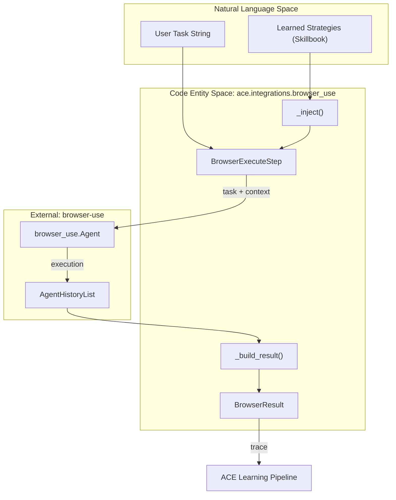
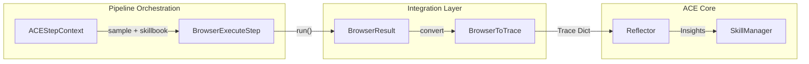

<!-- source: DeepWiki mcp.deepwiki.com · repo kayba-ai/agentic-context-engine · page 7.3 Browser Automation with ACEAgent · fetched 2026-10-27 -->

# Browser Automation with ACEAgent

<details>
<summary>Relevant source files</summary>

The following files were used as context for generating this wiki page:

- [ace/integrations/browser_use.py](ace/integrations/browser_use.py)
- [ace/integrations/langchain.py](ace/integrations/langchain.py)
- [docs/getting-started/installation.md](docs/getting-started/installation.md)
- [docs/integrations/browser-use.md](docs/integrations/browser-use.md)
- [docs/integrations/claude-code.md](docs/integrations/claude-code.md)
- [docs/integrations/langchain.md](docs/integrations/langchain.md)

</details>


## Purpose and Scope

This page documents the integration for browser automation using the [browser-use](https://github.com/browser-use/browser-use) framework. This integration enables agents to automate web tasks while self-improving through a learning loop that extracts strategies from execution traces.

**Related pages:**
- For simple conversational agents with learning, see [ACELiteLLM Integration](#7.2)
- For LangChain chains/agents with learning, see [LangChain Integration](#7.4)
- For general integration patterns, see [Integration Pattern Overview](#7.1)

---

## Overview

The browser automation integration follows the **INJECT → EXECUTE → LEARN** pattern. It wraps the `browser_use.Agent` to inject skillbook context into the task, executes the automation, extracts a detailed chronological trace, and then triggers the ACE learning pipeline.

### Key Characteristics

- **Insight Level**: Meso (execution pattern observation) [ace/integrations/browser_use.py:53-61]()
- **Framework**: Built on `browser-use` [ace/integrations/browser_use.py:14-21]()
- **Learning Mode**: Post-execution via Reflector + SkillManager [ace/integrations/browser_use.py:282-310]()
- **Skillbook Role**: Injected as strategic context into the browser task [ace/integrations/browser_use.py:109-117]()

Sources: [ace/integrations/browser_use.py:1-61](), [docs/integrations/browser-use.md:59-72]()

---

## Architecture

### Data Flow and System Mapping

The following diagram bridges the Natural Language Space (Tasks/Strategies) to the Code Entity Space (`BrowserExecuteStep`, `BrowserResult`, etc.).

**Title: Browser Automation Learning Loop**


Sources: [ace/integrations/browser_use.py:53-104](), [ace/integrations/browser_use.py:109-117]()

### Component Interaction

ACE uses a standardized `BrowserExecuteStep` within its pipeline to manage the interaction with the browser.

**Title: Browser Automation Component Architecture**


Sources: [ace/integrations/browser_use.py:53-65](), [ace/integrations/browser_use.py:304-320]()

---

## Core Components

### BrowserExecuteStep

The `BrowserExecuteStep` is the primary execution unit. It is an **async** step because `browser-use` is an asynchronous framework [ace/integrations/browser_use.py:53-61]().

- **Requires**: `sample` (the task), `skillbook` [ace/integrations/browser_use.py:63-63]()
- **Provides**: `trace` [ace/integrations/browser_use.py:64-64]()

The step performs two critical actions:
1. **Injection**: It calls `_inject` to wrap the skillbook strategies and append them to the task string [ace/integrations/browser_use.py:81-81]().
2. **Execution**: It initializes and runs the `browser_use.Agent` with the provided `browser_llm` [ace/integrations/browser_use.py:84-97]().

Sources: [ace/integrations/browser_use.py:53-104]()

### BrowserResult and Trace Extraction

After execution, the raw `browser-use` history is converted into a `BrowserResult` [ace/integrations/browser_use.py:30-46](). This object stores:
- **chronological_steps**: A list of dictionaries containing thoughts, actions, and results for every step [ace/integrations/browser_use.py:151-184]().
- **cited_skill_ids**: IDs of skills the agent claimed to use during the run [ace/integrations/browser_use.py:188-202]().
- **metadata**: Success status, step count, and duration [ace/integrations/browser_use.py:38-42]().

The `_build_result` helper extracts rich data from the `AgentHistoryList`, including:
- **Thinking**: The agent's internal reasoning, evaluations, and next goals [ace/integrations/browser_use.py:158-163]().
- **Actions**: The specific browser actions taken (clicks, typing, etc.) [ace/integrations/browser_use.py:164-168]().
- **Results**: The outcome of those actions (success/failure, extracted content) [ace/integrations/browser_use.py:170-179]().

Sources: [ace/integrations/browser_use.py:30-46](), [ace/integrations/browser_use.py:119-212]()

---

## Skillbook Context Injection

Strategies are injected using `wrap_skillbook_for_external_agent`, which formats the skillbook into a readable string for the LLM [ace/integrations/browser_use.py:113-113]().

| Feature | Description |
|:---|:---|
| **Contextualization** | Strategies are appended to the task prompt: `f"{task}\n\n{context}"` [ace/integrations/browser_use.py:116-116](). |
| **Citation Tracking** | ACE extracts cited IDs by looking for patterns in the agent's thinking text using `extract_cited_skill_ids` [ace/integrations/browser_use.py:198-200](). |

Sources: [ace/integrations/browser_use.py:109-117](), [ace/integrations/browser_use.py:188-202]()

---

## Implementation Example

### Quick Start with BrowserUse Runner

The `BrowserUse` runner provides a high-level API to initialize the pipeline and run tasks with learning.

```python
from ace import BrowserUse
from langchain_openai import ChatOpenAI

# 1. Initialize with execution LLM and ACE learning model
runner = BrowserUse.from_model(
    browser_llm=ChatOpenAI(model="gpt-4o"),
    ace_model="gpt-4o-mini"
)

# 2. Run task (Injects -> Executes -> Extracts Trace -> Learns)
results = runner.run("Find the top post on Hacker News")

# 3. Persist learned knowledge
runner.save("browser_expert.json")
```

Sources: [docs/integrations/browser-use.md:13-24]()

### Installation

To use this integration, install the `browser-use` extra:

```bash
uv add 'ace-framework[browser-use]'
```

Sources: [docs/getting-started/installation.md:17-17]()

---

## Configuration

The `BrowserUse.from_model` and `from_roles` methods allow for extensive configuration:

| Parameter | Type | Description |
|:---|:---|:---|
| `browser_llm` | `Any` | The LLM used by `browser-use` for the actual automation [docs/integrations/browser-use.md:32-32](). |
| `ace_model` | `str` | The model used for the Reflector and SkillManager roles [docs/integrations/browser-use.md:33-33](). |
| `browser` | `Browser` | Optional existing `browser-use` Browser instance [docs/integrations/browser-use.md:45-45](). |
| `agent_kwargs` | `dict` | Extra arguments passed to the `browser_use.Agent` constructor [docs/integrations/browser-use.md:46-46](). |

Sources: [docs/integrations/browser-use.md:28-49]()

---

