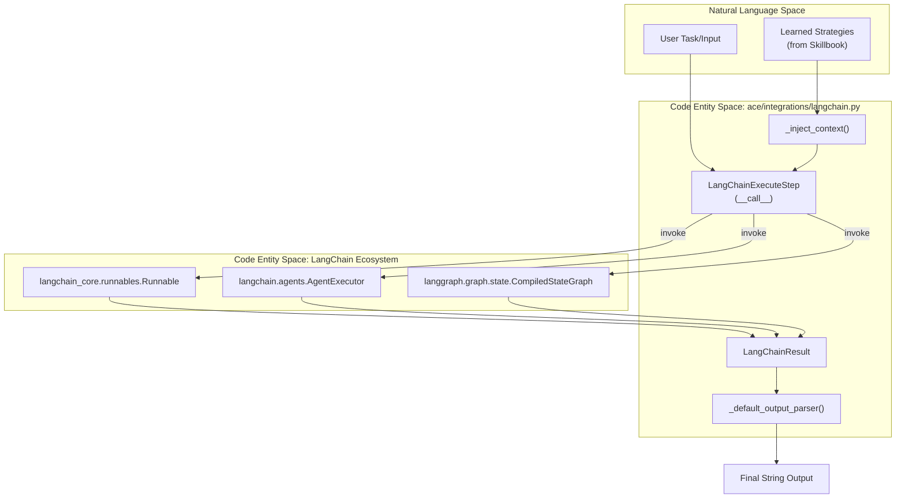
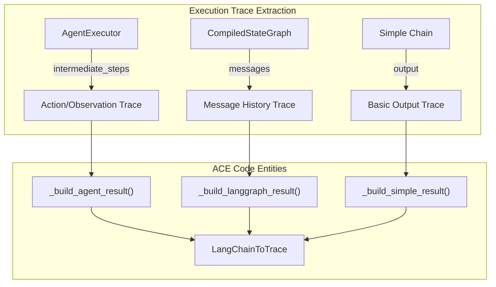

<!-- source: DeepWiki mcp.deepwiki.com · repo kayba-ai/agentic-context-engine · page 7.4 LangChain Integration · fetched 2026-10-27 -->

# LangChain Integration

<details>
<summary>Relevant source files</summary>

The following files were used as context for generating this wiki page:

- [ace/integrations/browser_use.py](ace/integrations/browser_use.py)
- [ace/integrations/langchain.py](ace/integrations/langchain.py)
- [docs/getting-started/installation.md](docs/getting-started/installation.md)
- [docs/integrations/browser-use.md](docs/integrations/browser-use.md)
- [docs/integrations/claude-code.md](docs/integrations/claude-code.md)
- [docs/integrations/langchain.md](docs/integrations/langchain.md)

</details>


The LangChain integration provides a high-level wrapper and pipeline steps for adding ACE self-improvement capabilities to any LangChain `Runnable`, including simple chains, `AgentExecutor`, and LangGraph `CompiledStateGraph`.

## Overview

The integration centers around the `LangChainExecuteStep` and the `LangChain` runner. It follows the core ACE pattern:
1.  **INJECT**: Skillbook strategies are injected into the LangChain input (string, dict, or messages) [ace/integrations/langchain.py:105]().
2.  **EXECUTE**: The LangChain `Runnable` is executed via `.invoke()` [ace/integrations/langchain.py:119]().
3.  **LEARN**: The execution results (including intermediate steps or message history) are captured into a `LangChainResult` [ace/integrations/langchain.py:136-141]() and converted into an ACE trace for the `Reflector`.

**Sources**: [ace/integrations/langchain.py:1-83](), [docs/integrations/langchain.md:1-65]()

## Architecture and Data Flow

The integration bridges LangChain's `Runnable` interface with ACE's pipeline `Step` architecture.

### LangChain Execution Pipeline



**Diagram**: Data flow from natural language input through the `LangChainExecuteStep`, interacting with various LangChain code entities to produce a structured `LangChainResult`.

**Sources**: [ace/integrations/langchain.py:73-143](), [ace/integrations/langchain.py:149-182](), [ace/integrations/langchain.py:44-66]()

### Implementation Details

| Component | Code Entity | Responsibility |
| :--- | :--- | :--- |
| **Step** | `LangChainExecuteStep` | Orchestrates injection and execution within an ACE pipeline [ace/integrations/langchain.py:73](). |
| **Result Carrier** | `LangChainResult` | Data class holding task, output, success status, and raw trace data [ace/integrations/langchain.py:45-66](). |
| **Injection Logic** | `_inject_context` | Appends skillbook context to strings, dicts, or `HumanMessage` lists [ace/integrations/langchain.py:150-182](). |
| **Trace Converter** | `LangChainToTrace` | Converts integration-specific results into the standard ACE trace format for reflection [ace/integrations/langchain.py:228](). |

**Sources**: [ace/integrations/langchain.py:45-249]()

## Trace Extraction and Meso-Level Learning

ACE supports "Meso-level" learning by extracting internal reasoning from complex LangChain objects.

### Supported Runnable Variants



**Diagram**: How different LangChain object types map to specific result builders and eventually the standard `LangChainToTrace` converter.

**Sources**: [ace/integrations/langchain.py:108-110](), [ace/integrations/langchain.py:188-226](), [ace/integrations/langchain.py:228-249]()

### Meso Learning Mechanisms
*   **AgentExecutor**: The step automatically sets `return_intermediate_steps = True` [ace/integrations/langchain.py:116](). It captures `AgentAction` (thoughts/tools) and observations [ace/integrations/langchain.py:200-203]().
*   **LangGraph**: Extracts the full `messages` list from the graph state [ace/integrations/langchain.py:211-213]().
*   **Simple Chains**: Captures only the final output via the `output_parser` [ace/integrations/langchain.py:191]().

**Sources**: [ace/integrations/langchain.py:108-141](), [docs/integrations/langchain.md:58-65]()

## The LangChain Runner

The `LangChain` runner (available in the `ace` package) provides a simplified interface for managing the full learning loop.

### Initialization Patterns

Users can initialize the runner using `from_model` (convenience) or `from_roles` (full control).

```python
from ace import LangChain
from langchain_openai import ChatOpenAI

# 1. Simple setup
runner = LangChain.from_model(my_runnable, ace_model="gpt-4o-mini")

# 2. Run with learning
results = runner.run("Find the weather in London")

# 3. Persist learned strategies
runner.save("weather_skills.json")
```

**Sources**: [docs/integrations/langchain.md:13-24](), [docs/integrations/langchain.md:51-56]()

### Runner Parameters

| Parameter | Type | Description |
| :--- | :--- | :--- |
| `runnable` | `Any` | The LangChain object to wrap [docs/integrations/langchain.md:32](). |
| `ace_model` | `str` | Model used by Reflector and SkillManager [docs/integrations/langchain.md:33](). |
| `output_parser` | `Callable` | Optional function to extract strings from complex outputs [docs/integrations/langchain.md:45](). |
| `skillbook_path` | `str` | Path to load/save learned skills [docs/integrations/langchain.md:44](). |

**Sources**: [docs/integrations/langchain.md:28-48]()

## Context Injection Strategies

The `_inject_context` method adapts to the input format of the `Runnable`:

1.  **String**: Appends strategies to the end of the string [ace/integrations/langchain.py:157-158]().
2.  **Message List**: Injects strategies into the content of the *first* message in the list [ace/integrations/langchain.py:160-165]().
3.  **Input Dict**: If an `"input"` key exists, it appends strategies to that specific field [ace/integrations/langchain.py:172-175]().
4.  **Generic Dict**: Adds a new key `"skillbook_context"` to the dictionary [ace/integrations/langchain.py:177-180]().

**Sources**: [ace/integrations/langchain.py:150-182](), [docs/integrations/langchain.md:67-80]()

---

