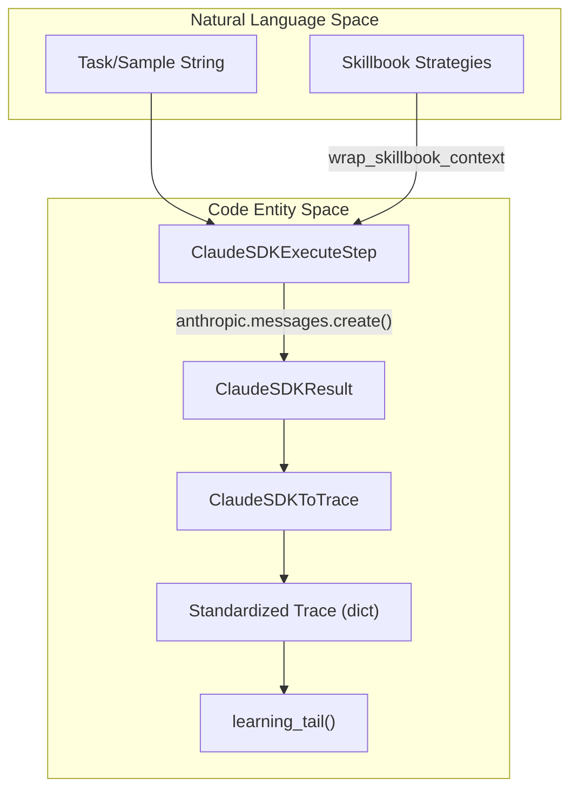
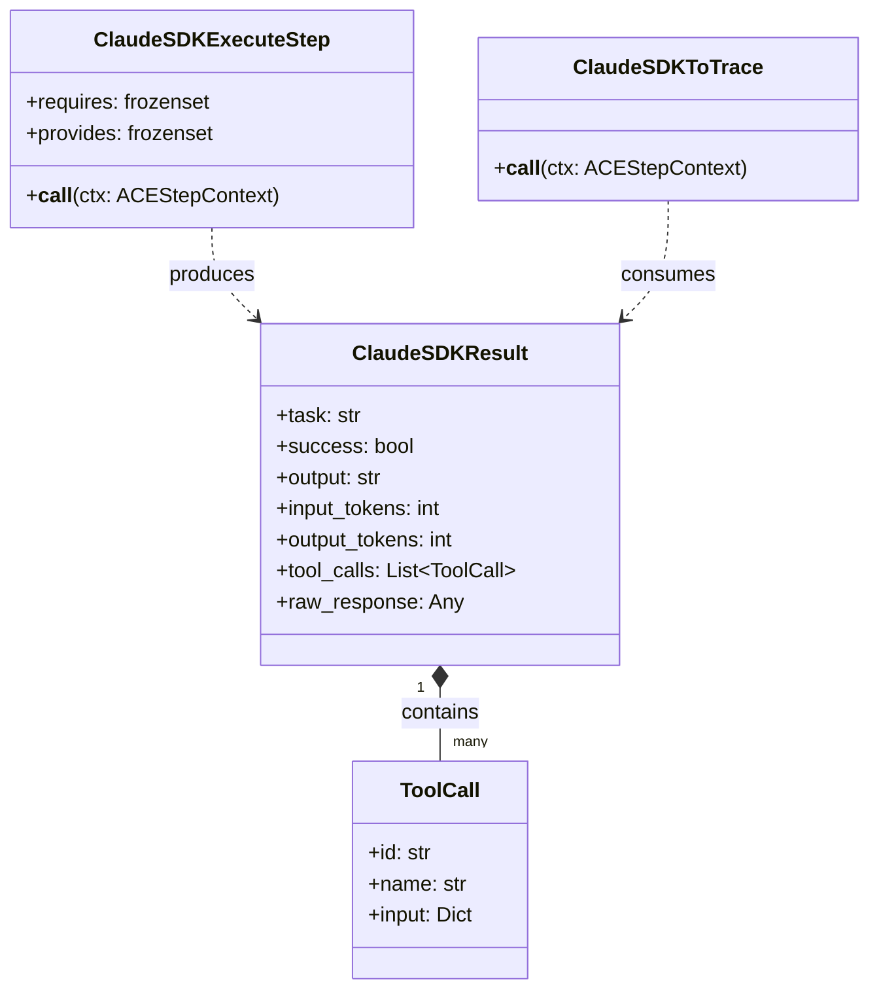

<!-- source: DeepWiki mcp.deepwiki.com · repo kayba-ai/agentic-context-engine · page 7.9 Claude SDK Integration · fetched 2026-10-27 -->

# Claude SDK Integration

<details>
<summary>Relevant source files</summary>

The following files were used as context for generating this wiki page:

- [ace/integrations/__init__.py](ace/integrations/__init__.py)
- [ace/integrations/claude_sdk.py](ace/integrations/claude_sdk.py)
- [docs/guides/integration.md](docs/guides/integration.md)
- [docs/integrations/claude-sdk.md](docs/integrations/claude-sdk.md)
- [tests/test_claude_sdk_live.py](tests/test_claude_sdk_live.py)
- [tests/test_claude_sdk_step.py](tests/test_claude_sdk_step.py)

</details>


The Claude SDK integration provides a specialized `ClaudeSDKExecuteStep` for direct interaction with the Anthropic Python SDK within the ACE pipeline framework. This integration is designed for developers who require fine-grained control over the Messages API, including tool use, specific model parameters, and validated result schemas, while still benefiting from the ACE self-learning loop.

Unlike high-level runners (e.g., `BrowserUse` or `LangChain`), this integration is step-based, allowing it to be composed into custom pipelines using the standard `Pipeline` primitives [docs/guides/integration.md:58-62]().

## Core Components

The integration consists of three primary entities that manage the execution and data transformation lifecycle:

1.  **`ClaudeSDKExecuteStep`**: The execution engine that handles skillbook injection and API interaction [ace/integrations/claude_sdk.py:176-177]().
2.  **`ClaudeSDKResult`**: A validated Pydantic model capturing the rich output of the Anthropic API, including observability metrics [ace/integrations/claude_sdk.py:116-123]().
3.  **`ClaudeSDKToTrace`**: A transformation step that converts the SDK-specific result into a standardized ACE trace format for the learning tail [ace/integrations/claude_sdk.py:14-15]().

### Data Flow and Pipeline Composition

The integration follows the standard ACE integration pattern: **INJECT → EXECUTE → LEARN** [docs/guides/integration.md:12-18]().

#### SDK Pipeline Data Flow
Title: Claude SDK Integration Data Flow

Sources: [ace/integrations/claude_sdk.py:176-202](), [ace/integrations/__init__.py:39-45](), [docs/guides/integration.md:12-18]()

## ClaudeSDKExecuteStep

The `ClaudeSDKExecuteStep` implements the `StepProtocol`. It requires a `sample` (the task) and a `skillbook` from the `ACEStepContext`, and provides a `trace` [ace/integrations/claude_sdk.py:201-202]().

### Implementation Details
- **Skillbook Injection**: If `inject_skillbook` is enabled (default), it uses `wrap_skillbook_for_external_agent` to format learned strategies into the system prompt [ace/integrations/claude_sdk.py:30-31]().
- **Tool Support**: Supports Anthropic-style tool definitions passed via the `tools` parameter [ace/integrations/claude_sdk.py:110]().
- **Observability**: Automatically tracks latency using wall-clock time and token usage from the API response [ace/integrations/claude_sdk.py:138-147]().

### Configuration Parameters
| Parameter | Type | Default | Description |
| :--- | :--- | :--- | :--- |
| `model` | `str` | `claude-sonnet-4-20250514` | The Anthropic model ID [ace/integrations/claude_sdk.py:106](). |
| `system_prompt` | `Optional[str]` | `None` | Base instructions for the model [ace/integrations/claude_sdk.py:107](). |
| `max_tokens` | `int` | `4096` | Maximum completion tokens [ace/integrations/claude_sdk.py:108](). |
| `temperature` | `float` | `0.0` | Sampling temperature [ace/integrations/claude_sdk.py:109](). |
| `tools` | `Optional[List[Dict]]` | `None` | Anthropic tool definitions [ace/integrations/claude_sdk.py:110](). |
| `inject_skillbook` | `bool` | `True` | Whether to prepend skills to the system prompt [ace/integrations/claude_sdk.py:113](). |

Sources: [ace/integrations/claude_sdk.py:101-114](), [docs/integrations/claude-sdk.md:52-65]()

## Observability and Logging

The integration features deep integration with **Logfire** for enterprise-grade tracing. When `ace.observability.is_configured()` is true, the step emits:

1.  **Step Spans**: A `logfire.span` wrapping the entire execution [ace/integrations/claude_sdk.py:50-63]().
2.  **Auto-Instrumentation**: If a client is not provided, the step can instrument the internal Anthropic client to capture sub-spans for every API request [docs/integrations/claude-sdk.md:68-74]().
3.  **Structured Attributes**: Metrics such as `input_tokens`, `output_tokens`, `latency_seconds`, and `stop_reason` are attached to the trace metadata [ace/integrations/claude_sdk.py:124-155]().

## Usage Example

The following example demonstrates how to compose a direct SDK integration with the standard ACE learning tail.

```python
from ace import Pipeline, Reflector, SkillManager, Skillbook, learning_tail
from ace.integrations import ClaudeSDKExecuteStep, ClaudeSDKToTrace

skillbook = Skillbook()
reflector = Reflector("gpt-4o-mini")
skill_manager = SkillManager("gpt-4o-mini")

# Compose the pipeline
steps = [
    ClaudeSDKExecuteStep(
        model="claude-3-5-sonnet-20240620",
        system_prompt="You are a specialized research assistant.",
        temperature=0.2
    ),
    ClaudeSDKToTrace(),
    *learning_tail(reflector, skill_manager, skillbook),
]

pipeline = Pipeline(steps)
```
Sources: [ace/integrations/claude_sdk.py:7-18](), [docs/guides/integration.md:64-74]()

## Class Relationships

Title: Claude SDK Integration Class Diagram

Sources: [ace/integrations/claude_sdk.py:89-168](), [ace/integrations/claude_sdk.py:176-202]()

---

