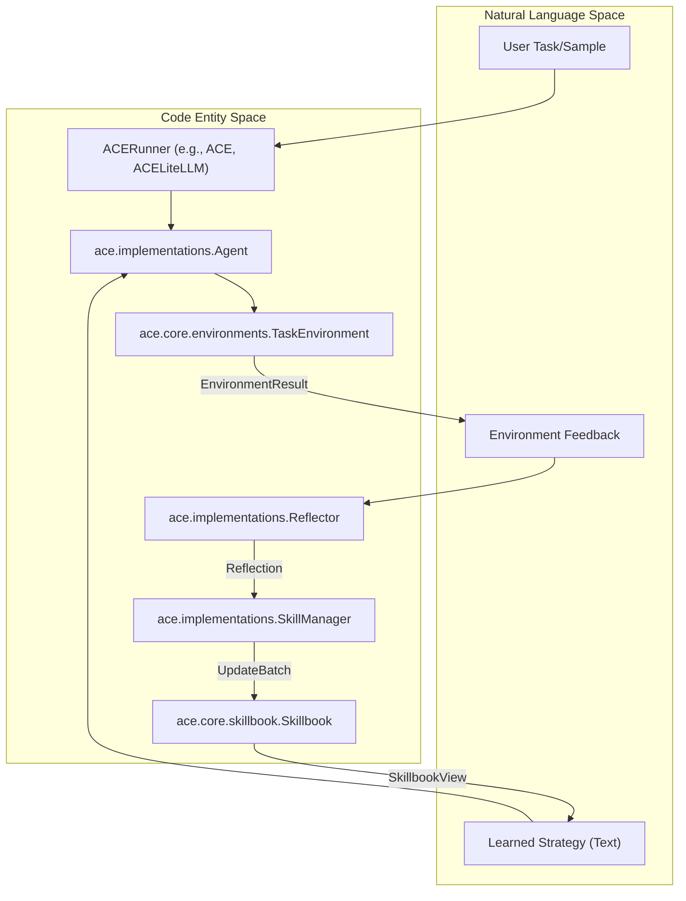

<!-- source: DeepWiki mcp.deepwiki.com · repo kayba-ai/agentic-context-engine · page 8 Examples and Use Cases · fetched 2026-10-27 -->

# Examples and Use Cases

Relevant source files

The following files were used as context for generating this wiki page:

- [CLAUDE.md](CLAUDE.md)
- [README.md](README.md)
- [ace/runners/litellm.py](ace/runners/litellm.py)
- [assets/kayba-banner.png](assets/kayba-banner.png)
- [examples/README.md](examples/README.md)
- [examples/ace/ace_demo.py](examples/ace/ace_demo.py)

This page demonstrates the ACE Framework in action through practical examples ranging from simple conversational agents to complex browser automation and offline trace analysis. ACE is designed to add a persistent learning loop to any agentic system, allowing it to improve over time without manual prompt engineering.

## Overview

The `examples/` directory contains runnable demonstrations organized by integration type and use case. These examples serve as both benchmarks for the framework's performance and templates for building your own self-improving agents.

| Example Type | Description | Key Components |
|:---|:---|:---|
| **Quick Start** | Minimal implementations for immediate testing | `ACELiteLLM`, `SimpleEnvironment` |
| **Browser Automation** | Web interaction agents that learn from success/failure | `ACEAgent`, `BrowserUse` runner |
| **Framework Integrations** | Adding learning to existing LangChain or Claude Code setups | `ACELangChain`, `ACEClaudeCode` |
| **Trace Analysis** | Offline learning from historical execution logs | `TraceAnalyser`, `ReplayAgent` |

Sources: [examples/README.md:5-64](), [README.md:54-70]()

## Core Example Architecture

Most examples follow a "closed-loop" pattern where an agent's execution is evaluated, reflected upon, and used to update a persistent `Skillbook`.

Sources: [ace/runners/litellm.py:35-55](), [examples/ace/ace_demo.py:119-126](), [README.md:90-99]()

## Browser Automation Examples

These examples demonstrate how ACE can reduce token usage and increase success rates in web-based tasks by learning the specific layout and quirks of websites. For details, see [Browser Automation Examples](#8.1).

*   **Domain Checker:** Learns to navigate registrar sites efficiently, reducing steps by up to 80%.
*   **Online Shopping:** Learns product search patterns on e-commerce sites like Migros.
*   **Form Filler:** Learns field mapping and validation rules for complex web forms.

Sources: [examples/README.md:17-25](), [README.md:28-30]()

## Agentic System Prompting

This use case focuses on "offline" learning. Instead of running a live agent, you provide a directory of pre-recorded traces (e.g., from production logs). The `TraceAnalyser` runner processes these to extract a high-quality system prompt or `Skillbook`. For details, see [Agentic System Prompting](#8.2).

*   **Pattern:** Uses `ReplayAgent` to simulate execution from logs.
*   **Output:** Generates a `skills.md` file containing optimized strategies and a ready-to-inject prompt string.

Sources: [examples/README.md:47-55](), [examples/ace/ace_demo.py:15-16]()

## Claude Code Loop

ACE integrates directly with the Claude Code CLI. This example shows a continuous improvement loop where Claude executes a coding task, ACE reflects on the build/test results, and the next session starts with improved coding strategies. For details, see [Claude Code Loop](#8.3).

*   **Integration:** `ACEClaudeCode` runner.
*   **Metric:** Demonstrated translating 14k lines of code with zero build errors by learning from initial compilation failures.

Sources: [README.md:30-30](), [CLAUDE.md:95-95]()

## OpenClaw Session Learning

This use case demonstrates processing session transcripts from the OpenClaw AI assistant gateway. By using the `ace-learn` command, developers can turn one-off assistant interactions into reusable organizational knowledge. For details, see [OpenClaw Session Learning](#8.4).

Sources: [README.md:103-103]()

## Summary of Results

Real-world benchmarks across these examples show significant improvements:

| Use Case | Result | Source |
|:---|:---|:---|
| **Consistency** | 2x pass rate on Tau2 airline benchmark | [README.md:28-28]() |
| **Efficiency** | 49% token reduction in browser automation | [README.md:29-29]() |
| **Cost** | ~$1.50 for complex 14k line code translation | [README.md:30-30]() |

## Interactive Demo

The framework includes a comprehensive interactive demo in `examples/ace/ace_demo.py` that walks through:
1. Building roles manually [examples/ace/ace_demo.py:91-101]()
2. Defining custom `TaskEnvironment` evaluators [examples/ace/ace_demo.py:164-187]()
3. Running multi-epoch training loops [examples/ace/ace_demo.py:233-252]()
4. Inspecting `Skillbook` evolution [examples/ace/ace_demo.py:158-161]()

Sources: [examples/ace/ace_demo.py:1-16]()

---

