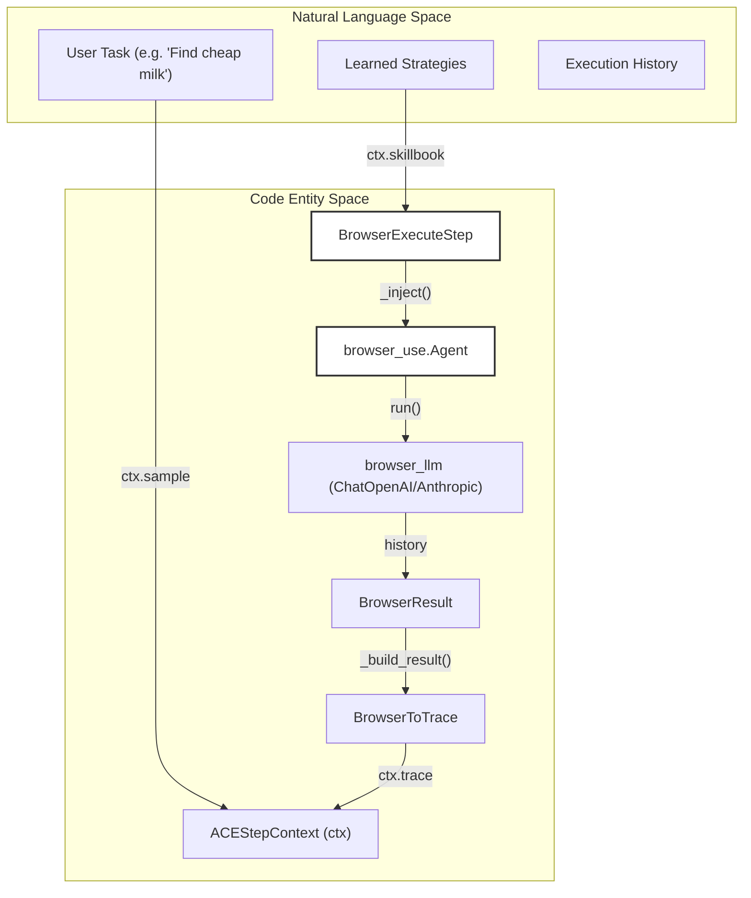
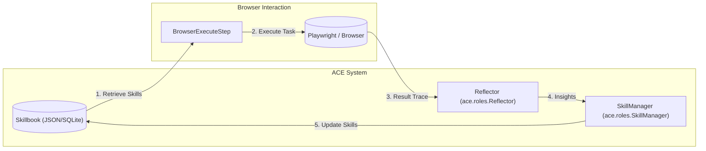

<!-- source: DeepWiki mcp.deepwiki.com · repo kayba-ai/agentic-context-engine · page 8.1 Browser Automation Examples · fetched 2026-10-27 -->

# Browser Automation Examples

<details>
<summary>Relevant source files</summary>

The following files were used as context for generating this wiki page:

- [ace/integrations/browser_use.py](ace/integrations/browser_use.py)
- [ace/integrations/langchain.py](ace/integrations/langchain.py)
- [examples/README.md](examples/README.md)

</details>


## Purpose and Scope

This document covers browser automation examples demonstrating ACE's integration with the [browser-use](https://github.com/browser-use/browser-use) library. These examples show how ACE enables browser automation agents to learn from execution feedback and improve over time without requiring fine-tuning or additional training data.

The examples demonstrate real-world use cases: domain availability checking, online grocery shopping, and form filling. Each example includes both an ACE-enabled version (with learning) and a baseline version (without learning) for performance comparison.

**Sources:** [examples/README.md:17-25](), [ace/integrations/browser_use.py:1-12]()

## Integration Architecture

ACE integrates with browser-use through the `BrowserExecuteStep` and specialized runners. This integration follows the INJECT-EXECUTE-LEARN pattern, allowing ACE to enhance browser automation without modifying the core behavior of the external library.

### ACE Browser Automation Data Flow

The following diagram maps the natural language "Execution Loop" to specific code entities within the `ace/integrations/browser_use.py` and the pipeline engine.



**Implementation Details:**
- **INJECT**: The `BrowserExecuteStep._inject` method [ace/integrations/browser_use.py:109-116]() uses `wrap_skillbook_for_external_agent` [ace/integrations/browser_use.py:113-113]() to append learned strategies to the user's task string.
- **EXECUTE**: The `BrowserExecuteStep.__call__` method [ace/integrations/browser_use.py:77-103]() initializes a `browser_use.Agent` and executes the task asynchronously.
- **CONVERT**: `_build_result` [ace/integrations/browser_use.py:119-215]() transforms the raw `browser_use` history into a structured `BrowserResult` object, capturing thoughts, actions, and errors.

**Sources:** [ace/integrations/browser_use.py:53-215](), [ace/integrations/browser_use.py:29-46]()

## Core Components for Browser Automation

| Component | Code Entity | Role |
|-----------|-------------|------|
| **Executor** | `BrowserExecuteStep` | Orchestrates the browser-use `Agent.run()` call and handles context injection [ace/integrations/browser_use.py:53-53](). |
| **Result Wrapper** | `BrowserResult` | A dataclass that standardizes output from browser actions, including `steps_count` and `cited_skill_ids` [ace/integrations/browser_use.py:29-46](). |
| **Context Injector** | `wrap_skillbook_for_external_agent` | Formats Skillbook content into a prompt-friendly string for external agents [ace/integrations/browser_use.py:10-10](). |
| **Trace Converter** | `BrowserToTrace` | (Conceptual) Logic that maps `BrowserResult` into the standard ACE trace format for the Reflector. |

**Sources:** [ace/integrations/browser_use.py:29-103]()

## Example Use Cases

### 1. Domain Availability Checker
The domain checker demonstrates ACE learning efficient browser navigation patterns. The agent learns to check domain availability using third-party websites (e.g., namecheap.com) rather than attempting direct navigation.

**Key Learning:** ACE discovers an efficient pattern: navigate to checker → search domain → extract result, eliminating redundant navigation and search attempts.

**Sources:** [examples/README.md:21-21]()

### 2. Online Shopping Automation
The online shopping example demonstrates ACE learning complex multi-step workflows. The agent shops for grocery items, learning to navigate Single Page Applications (SPAs) and find the cheapest options.

**Performance Results:**
- **Token Reduction**: ACE typically achieves ~40-50% reduction in tokens after learning the site structure.
- **Step Reduction**: Significant reduction in "back-and-forth" navigation as the agent learns where the search bar and filters are located.

**Sources:** [examples/README.md:23-23]()

### 3. Form Filling
The form filling examples demonstrate ACE learning form interaction patterns. These examples show how ACE can optimize web form completion strategies by remembering field mappings and validation rules.

**Sources:** [examples/README.md:22-22]()

## Implementation Example: ACEAgent Wrapper

The `ACEAgent` (found in integration examples) simplifies the setup by combining the `browser_use.Agent` with the ACE learning pipeline.



**Key Code Pointers:**
- The integration uses `extract_cited_skill_ids` [ace/integrations/browser_use.py:198-198]() to determine which learned skills were actually used by the agent during the browser session.
- `BrowserResult` captures `chronological_steps` [ace/integrations/browser_use.py:44-44](), which include the agent's `thinking`, `evaluation`, and `next_goal` [ace/integrations/browser_use.py:158-163](). This rich metadata is critical for the `Reflector` to provide high-quality feedback.

**Sources:** [ace/integrations/browser_use.py:150-184](), [ace/integrations/browser_use.py:188-202]()

## Running the Examples

### Installation
To run the browser automation examples, the `browser-use` extra is required:
```bash
pip install ace-framework[browser-use]
```

### Quick Start Template
The framework provides a template for creating new browser agents that learn:
1. Initialize a `Skillbook`.
2. Define a `BrowserExecuteStep` with your LLM choice.
3. Run the task through an `ACERunner`.

**Sources:** [examples/README.md:89-91](), [ace/integrations/browser_use.py:66-75]()

---

