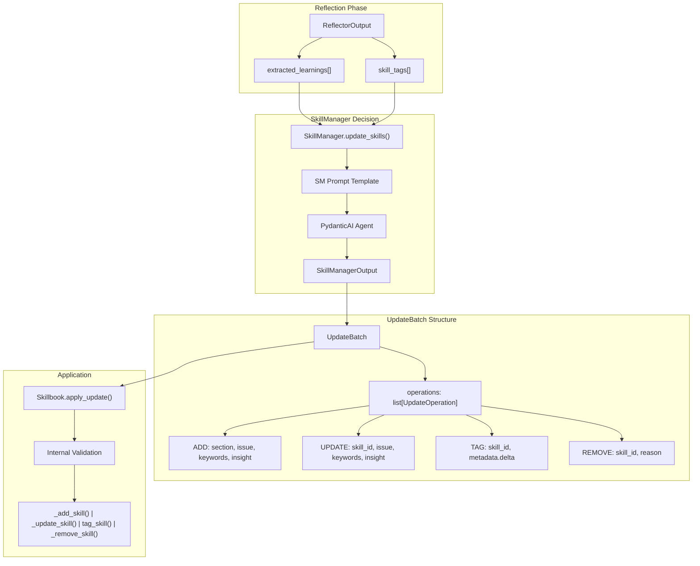
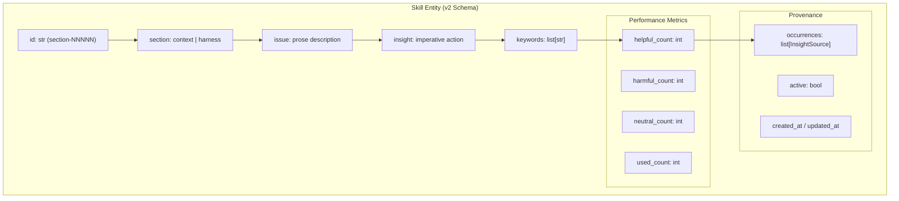
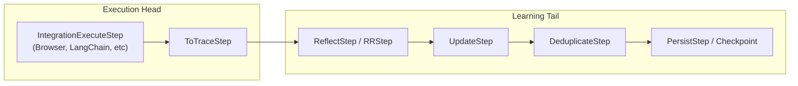
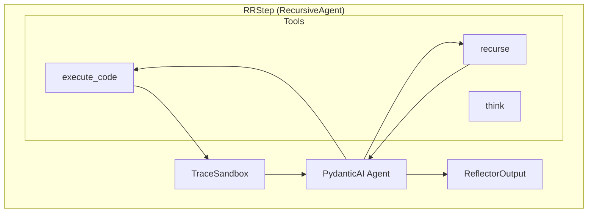

<!-- source: DeepWiki mcp.deepwiki.com · repo kayba-ai/agentic-context-engine · page 9 Advanced Topics · fetched 2026-10-27 -->

# Advanced Topics

Relevant source files

The following files were used as context for generating this wiki page:

- [docs/api/index.md](docs/api/index.md)
- [docs/concepts/skillbook.md](docs/concepts/skillbook.md)
- [docs/concepts/updates.md](docs/concepts/updates.md)
- [docs/design/ACE_ARCHITECTURE.md](docs/design/ACE_ARCHITECTURE.md)
- [docs/design/ACE_DECISIONS.md](docs/design/ACE_DECISIONS.md)
- [docs/design/ACE_REFERENCE.md](docs/design/ACE_REFERENCE.md)
- [docs/design/RR_DESIGN.md](docs/design/RR_DESIGN.md)
- [docs/design/SKILLBOOK_V2_PLAN.md](docs/design/SKILLBOOK_V2_PLAN.md)
- [docs/guides/composing-pipelines.md](docs/guides/composing-pipelines.md)
- [docs/guides/prompts.md](docs/guides/prompts.md)

## Purpose and Scope

This section covers advanced technical topics for users who need to:
- Customize skillbook update behavior beyond defaults.
- Implement custom pipeline compositions or integration patterns.
- Configure production deployments with LLM routing, deduplication, or session management.
- Understand internal mechanisms for debugging or extending the framework.

For basic usage patterns, see [Getting Started](#5) and [User Guide](#6). For integration examples, see [Integration Guide](#7).

---

## Quick Reference: When to Consult These Topics

| Topic | When You Need It | Page |
|-------|-----------------|------|
| **Update Operations** | Understanding or customizing how skillbook modifications work | [Update Operations](#9.1) |
| **Skill Tagging** | Implementing custom evaluation metrics or understanding helpful/harmful scoring | [Skill Tagging and Metadata](#9.2) |
| **Domain Prompts** | Specializing ACE for math, code, or other specific domains | [Domain-Specific Prompts](#9.3) |
| **Deduplication** | Managing skillbook growth or preventing redundant skills | [Deduplication and Consolidation](#9.4) |
| **Router & Fallbacks** | Setting up model redundancy or load balancing | [Router and Fallbacks](#9.5) |
| **Pipeline Composition** | Building custom runners or complex multi-stage workflows | [Pipeline Composition Patterns](#9.6) |
| **Session Management** | Deploying MCP server with concurrent users | [Session Management (MCP)](#9.7) |
| **Safety & Security** | Securing sandboxed execution or MCP endpoints | [Safety and Security](#9.8) |
| **Cross-Trace Generalization** | Understanding how skills broaden across domains | [Cross-Trace Generalization](#9.9) |

---

## Update Operation Architecture

The skillbook update system implements a command pattern where the `SkillManager` produces `UpdateBatch` objects containing typed operations. This architecture ensures that mutations to the `Skillbook` are structured, validated, and traceable.

### Update Operation Flow

**Sources:** [docs/api/index.md:178-198](), [docs/concepts/updates.md:1-124](), [docs/design/SKILLBOOK_V2_PLAN.md:61-77]()

### Operation Types and Semantics

Each `UpdateOperation` follows the `v2` schema requirements. `context` skills must include an `insight`, while `harness` skills may omit it.

| Type | Description | Required Fields |
|------|-------------|----------------|
| `ADD` | Create a new skill | `section`, `issue`, `keywords` (`insight` if context) |
| `UPDATE` | Modify an existing skill | `skill_id`, `issue` |
| `TAG` | Record effectiveness delta | `skill_id`, `metadata.delta` |
| `REMOVE` | Soft-remove a skill | `skill_id` |

For details on operation fields and atomic semantics, see [Update Operations](#9.1).

**Sources:** [docs/concepts/updates.md:5-13](), [docs/design/SKILLBOOK_V2_PLAN.md:61-72]()

---

## Skill Metadata and Scoring System

Skills carry metadata for tracking effectiveness and provenance. The `v2` schema prioritizes `issue` prose as the primary object and uses `keywords` for categorization.

### Skill Data Model

**Sources:** [docs/concepts/skillbook.md:7-35](), [docs/design/SKILLBOOK_V2_PLAN.md:18-37]()

### Tagging and Scoring

Effectiveness is recorded via `TAG` operations with a `delta` value:
- `1` → Increments `helpful_count`.
- `-1` → Increments `harmful_count`.
- `0` → Increments `neutral_count`.

For details on metadata structure and scoring logic, see [Skill Tagging and Metadata](#9.2).

**Sources:** [docs/concepts/updates.md:100-109](), [docs/design/SKILLBOOK_V2_PLAN.md:68-68]()

---

## Prompt Engineering System

ACE uses specialized prompt templates for each role. The `PromptManager` handles versioning and domain-specific overrides.

### Domain-Specific Variants

v2.1 prompts include variants optimized for specific task types, such as `math` and `code`. These are selected via the `PromptManager` to provide specialized instructions for arithmetic verification or syntax validation.

For details on template variables and domain selection, see [Domain-Specific Prompts](#9.3).

**Sources:** [docs/guides/prompts.md:1-54](), [docs/design/ACE_ARCHITECTURE.md:23-28]()

---

## Deduplication System

As skillbooks grow, the `DeduplicationManager` detects and consolidates similar entries using hybrid retrieval (BM25 + Dense embeddings).

### Consolidation Logic

The system identifies pairs above a `similarity_threshold` (default `0.82`) and presents them to the `SkillManager`. The manager can then issue `UPDATE` operations to merge content or `REMOVE` operations to prune redundancy.

For details on embedding formulas and consolidation strategies, see [Deduplication and Consolidation](#9.4).

**Sources:** [docs/concepts/skillbook.md:109-133](), [docs/design/SKILLBOOK_V2_PLAN.md:95-106]()

---

## Pipeline Composition Patterns

Advanced users can compose custom pipelines using `StepProtocol` primitives. The `learning_tail()` helper provides a standard sequence of `ReflectStep`, `UpdateStep`, `DeduplicateStep`, and `CheckpointStep`.

### Pipeline Anatomy

For details on nesting, branching, and custom steps, see [Pipeline Composition Patterns](#9.6).

**Sources:** [docs/guides/composing-pipelines.md:18-81](), [docs/design/ACE_REFERENCE.md:163-235]()

---

## Recursive Reflector (RR) Architecture

The `RRStep` is a sophisticated replacement for the single-pass `Reflector`. It uses a tool-calling agent that can execute Python code in a sandbox to verify traces.

### RR Iteration Loop

For details on sandbox security, recursion depth, and budget management, see [Recursive Reflector System](#3.3).

**Sources:** [docs/design/RR_DESIGN.md:1-100](), [docs/guides/composing-pipelines.md:208-239]()

---

## Session and Security Management

Production deployments, particularly via the **MCP Server**, require robust session lifecycle management and security sandboxing.

- **Session Management**: TTL-based cleanup and per-session `Skillbook` isolation. For details, see [Session Management (MCP)](#9.7).
- **Safety**: Path enforcement and sandbox restrictions for code execution. For details, see [Safety and Security](#9.8).

**Sources:** [docs/design/RR_DESIGN.md:130-135](), [docs/design/ACE_ARCHITECTURE.md:18-21]()

---

