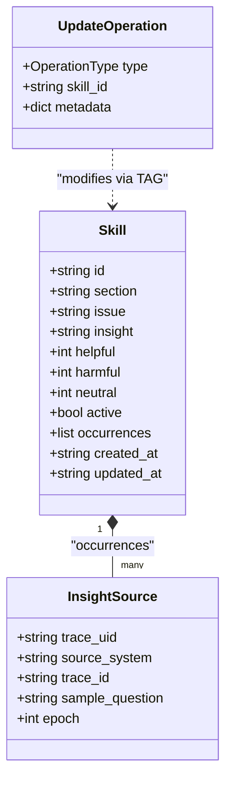
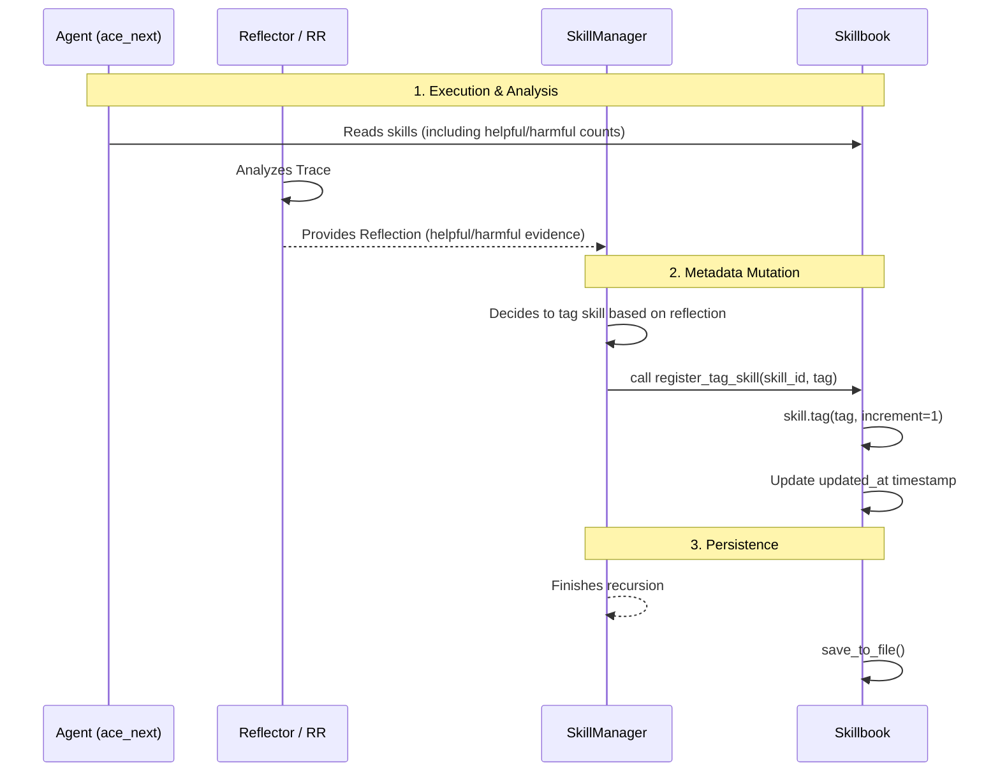

<!-- source: DeepWiki mcp.deepwiki.com · repo kayba-ai/agentic-context-engine · page 9.2 Skill Tagging and Metadata · fetched 2026-10-27 -->

# Skill Tagging and Metadata

<details>
<summary>Relevant source files</summary>

The following files were used as context for generating this wiki page:

- [ace/core/skillbook.py](ace/core/skillbook.py)
- [ace/implementations/prompts.py](ace/implementations/prompts.py)
- [ace/implementations/skill_manager.py](ace/implementations/skill_manager.py)
- [tests/test_ace_core.py](tests/test_ace_core.py)

</details>


## Purpose and Scope

This document explains the skill tagging and metadata system in the ACE framework. Skill tagging is a core feedback mechanism where the **Reflector** (and its recursive variants) classifies skillbook strategies as `helpful`, `harmful`, or `neutral` based on actual execution outcomes. These classifications accumulate as statistical evidence that guides the **Agent's** strategy selection and the **SkillManager's** skillbook refinement decisions.

Metadata in ACE encompasses not only these success counters but also provenance data (InsightSource), atomicity scores, and temporal markers. This system transforms the skillbook from a simple list of tips into a statistically-weighted knowledge base.

---

## Tag Types and Semantics

ACE uses three mutually exclusive tag types to classify skill effectiveness within the `Skill` object. These are managed primarily through the `tag_skill` tool and internal methods.

| Tag Type | Semantic Meaning | When Applied | Agent Impact |
|----------|-----------------|--------------|--------------|
| `helpful` | Strategy directly contributed to correct answer | Answer correct AND strategy was determinative | Increases selection probability |
| `harmful` | Strategy caused or contributed to incorrect answer | Answer incorrect AND strategy led to error | Decreases selection probability; triggers avoidance |
| `neutral` | Strategy referenced but not determinative | Strategy present but outcome ambiguous | Minimal impact on selection |

### Tag Assignment Criteria

The Reflector applies these tags using evidence-based criteria defined in its prompt templates.

**Helpful Tag** - Applied when:
- Strategy directly led to correct answer.
- Approach improved reasoning quality.
- Method proved reusable across similar problems.

**Harmful Tag** - Applied when:
- Strategy caused incorrect answer.
- Approach created confusion or errors.
- Specific tool/service/option choice consistently problematic.

**Sources**: [ace/implementations/prompts.py:15-28](), [ace/core/skillbook.py:19-20]()

---

## Skill Metadata Structure

Each skill maintains cumulative tag counters and timestamps. In the V2 schema, these are serialized as part of the skill's dictionary representation.



### Skill Class Fields

The `Skill` dataclass stores metadata for each strategy:

- **`helpful: int`**: Count of times strategy led to correct outcome.
- **`harmful: int`**: Count of times strategy caused incorrect outcome.
- **`neutral: int`**: Count of times strategy was inconclusive.
- **`occurrences: List[InsightSource]`**: A list of provenance records showing which traces contributed to or cited this skill.
- **`active: bool`**: Whether the skill is currently enabled for retrieval.
- **`created_at / updated_at`**: ISO 8601 timestamps.

**Sources**: [ace/core/skillbook.py:214-239](), [ace/core/insight_source.py:13-35]()

---

## Tagging and Update Workflow

The **SkillManager** is the primary entity responsible for mutating metadata in the V2 architecture. It uses specialized tools to interact with the `Skillbook`.



### SkillManager Tagging Tools
The `SkillManager` uses `register_tag_skill` to expose the tagging capability to the LLM. This tool directly calls `skillbook.tag_skill`.

**Sources**: [ace/implementations/skill_manager.py:31-39](), [ace/implementations/sm_tools.py:126-150]()

---

## Statistical Evidence and Prioritization

The Agent uses accumulated tag statistics to prioritize strategy selection. This is enforced via the `AGENT_PROMPT`.

### Success Rate in Prompts
When the `Skillbook` is rendered as a prompt (using `as_prompt()` or `wrap_skillbook_for_external_agent`), the metadata is included so the Agent can see the success rates.

**Example Rendering**:
```text
[content_extraction-00001] Extract the title using the <h1> tag. helpful=12 harmful=1 neutral=0
```

### Agent Selection Logic
The `AGENT_PROMPT` instructs the agent to:
1. **Analyze Available Strategies**: Examine `helpful/harmful` ratios.
2. **Prioritize**: "Prioritize strategies with high success rates (helpful > harmful)".
3. **Cite**: "ALWAYS cite specific skill IDs before applying them".

**Sources**: [ace/implementations/prompts.py:15-28](), [ace/implementations/prompts.py:104-110]()

---

## Atomicity and Evidence-Only Tagging

### Atomicity Scoring
While not a stored database field in `Skill` V2, **Atomicity** is a quality constraint enforced during the `Reflector` and `SkillManager` phases. The prompts define an atomic skill as one that addresses a single, specific problem-solving step.

### Evidence-Only Tagging (Provenance)
ACE tracks the "evidence" for a skill via the `InsightSource` (occurrences). Every time a skill is updated or tagged as a result of a new trace, that trace's identity is appended to the skill's `occurrences`.

- **`trace_uid`**: Unique identifier for the execution log.
- **`sample_question`**: The task context where the insight was validated.
- **`epoch`**: The training iteration.

**Sources**: [ace/core/skillbook.py:165-188](), [ace/core/insight_source.py:13-35]()

---

## Tag Management via UpdateBatch

Updates to metadata can be batched using `UpdateBatch` and `UpdateOperation`. This is used when learning from multiple traces simultaneously (Offline mode).

### The TAG Operation
An `UpdateOperation` with type `TAG` allows the system to increment metadata counters without modifying the text of the `issue` or `insight`.

```python
# Example of a TAG operation in an UpdateBatch
op = UpdateOperation(
    type="TAG",
    skill_id="context-00042",
    section="context",
    metadata={"helpful": 1}
)
```

**Sources**: [ace/core/skillbook.py:136-151](), [ace/core/skillbook.py:461-468]()

---

## Summary of Metadata Logic

| Feature | Implementation | Purpose |
|---------|----------------|---------|
| **Success Counters** | `helpful`, `harmful`, `neutral` ints | Quantitative measure of strategy reliability. |
| **Provenance** | `occurrences: List[InsightSource]` | Links skills back to the original traces/data. |
| **Lifecycle** | `active: bool`, `created_at`, `updated_at` | Manages soft-deletion and versioning. |
| **Mutation** | `tag_skill` tool in `SkillManager` | Allows LLM to record feedback after analysis. |
| **Injection** | `as_prompt()` in `Skillbook` | Surfaced to Agent to guide decision making. |

**Sources**: [ace/core/skillbook.py:214-239](), [ace/implementations/sm_tools.py:126-150](), [ace/implementations/prompts.py:31-59]()

---

