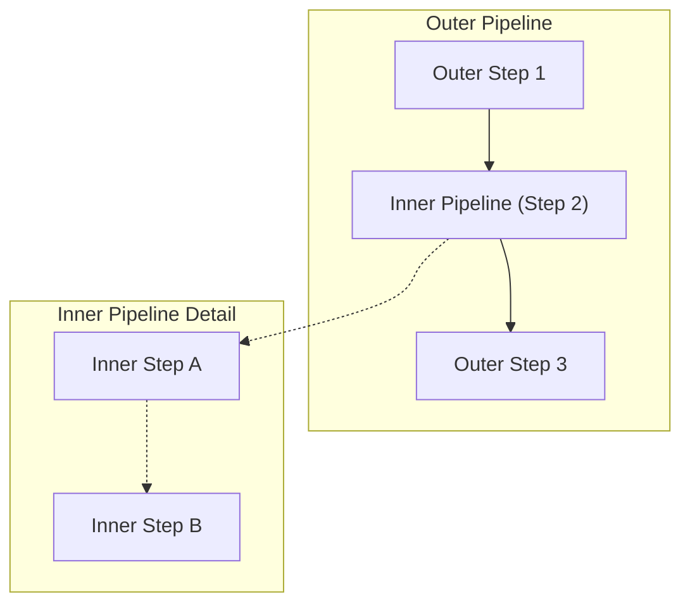
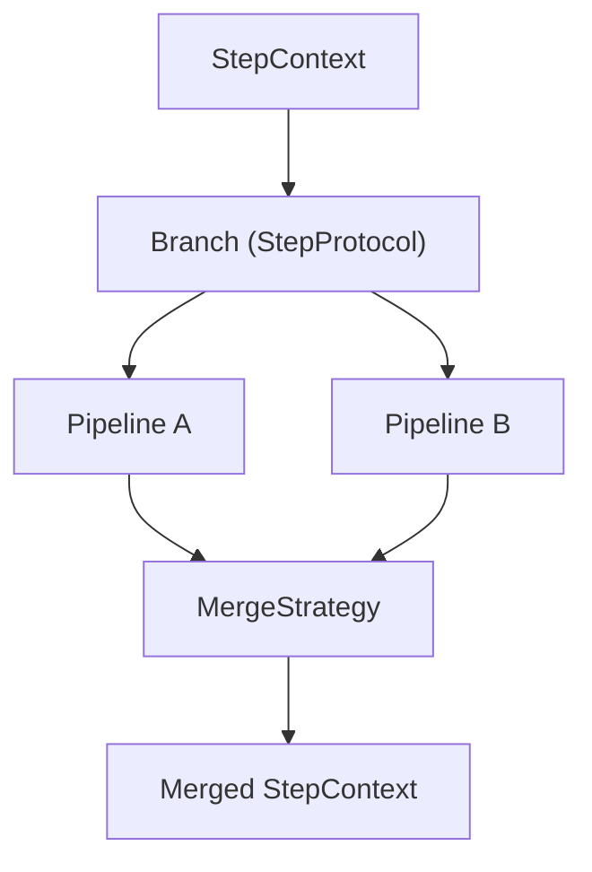
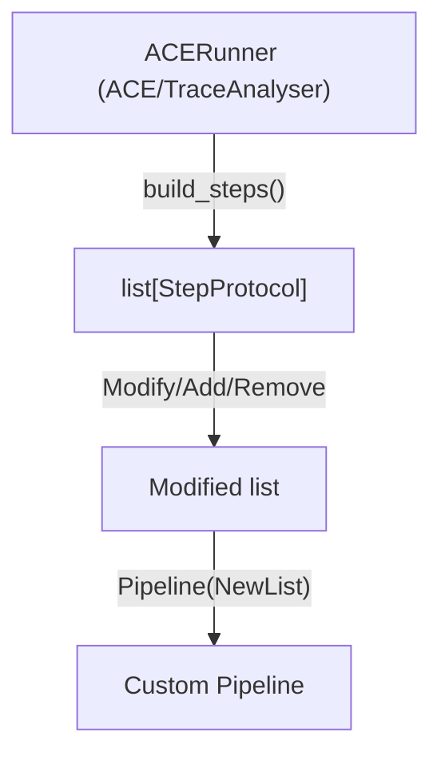

<!-- source: DeepWiki mcp.deepwiki.com · repo kayba-ai/agentic-context-engine · page 9.6 Pipeline Composition Patterns · fetched 2026-10-27 -->

# Pipeline Composition Patterns

<details>
<summary>Relevant source files</summary>

The following files were used as context for generating this wiki page:

- [docs/guides/full-pipeline.md](docs/guides/full-pipeline.md)
- [docs/index.md](docs/index.md)
- [docs/integrations/litellm.md](docs/integrations/litellm.md)
- [docs/integrations/opik.md](docs/integrations/opik.md)
- [docs/pipeline/custom-steps.md](docs/pipeline/custom-steps.md)
- [docs/pipeline/index.md](docs/pipeline/index.md)
- [examples/pipeline_composition/compose_custom_pipeline.py](examples/pipeline_composition/compose_custom_pipeline.py)
- [examples/pipeline_ex/pipeline_demo.py](examples/pipeline_ex/pipeline_demo.py)
- [tests/pipeline_engine/conftest.py](tests/pipeline_engine/conftest.py)
- [tests/pipeline_engine/test_branch.py](tests/pipeline_engine/test_branch.py)
- [tests/pipeline_engine/test_context.py](tests/pipeline_engine/test_context.py)
- [tests/pipeline_engine/test_pipeline.py](tests/pipeline_engine/test_pipeline.py)
- [tests/pipeline_engine/test_pipeline_e2e.py](tests/pipeline_engine/test_pipeline_e2e.py)
- [tests/pipeline_engine/test_protocol.py](tests/pipeline_engine/test_protocol.py)

</details>


This page covers advanced pipeline composition techniques in the ACE Framework. For basic pipeline concepts and primitives, see [3.2.1](). For step implementation details, see [3.2.2]().

---

## Overview

The pipeline engine provides five composition patterns that can be freely combined:

1.  **Sequential** — steps run in order on one context.
2.  **Nesting** — pipelines embed as steps inside other pipelines.
3.  **Parallel** — branches fork context, run simultaneously, then join.
4.  **Iterative** — `SubRunner` loops until a termination condition.
5.  **Reusable sequences** — factory functions return pre-configured step lists.

All patterns satisfy `StepProtocol`, making them interchangeable wherever a step is expected [pipeline/protocol.py:1-29]().

---

## Sequential Composition

### Basic Pattern

The fundamental pattern is a `Pipeline` — an ordered list of steps that execute sequentially for each input context [pipeline/pipeline.py:12-40]().


Sources: [pipeline/pipeline.py:12-40](), [pipeline/protocol.py:7-29]()

Steps declare `requires` and `provides` attributes. The pipeline validates at construction time that each step's requirements are satisfied by previous steps or the initial context [pipeline/pipeline.py:130-155]().

### Fluent Builder API

Pipelines support method chaining for readability via the `.then()` method [pipeline/pipeline.py:70-80]():

```python
pipe = (
    Pipeline()
    .then(AgentStep(agent))
    .then(EvaluateStep(env))
    .then(ReflectStep(reflector))
)
```
Sources: [pipeline/pipeline.py:70-80](), [tests/pipeline_engine/test_pipeline.py:51-62]()

### Contract Validation

The pipeline validates dependencies at construction time. If a step requires a field that no earlier step provides and is not provided externally, the engine identifies this dependency [pipeline/pipeline.py:144-155](). If internal ordering is wrong (e.g., Step B before Step A where B requires A's output), a `PipelineOrderError` is raised [pipeline/pipeline.py:165-175]().

Sources: [pipeline/pipeline.py:130-175](), [tests/pipeline_engine/test_pipeline.py:93-100]()

---

## Nesting Pipelines

### Pipeline as a Step

A `Pipeline` satisfies `StepProtocol`, so it can be placed directly inside another pipeline [pipeline/pipeline.py:12-13](). The nested pipeline receives one context and returns one context — it is a black box from the outer pipeline's perspective.


Sources: [pipeline/pipeline.py:12-40](), [tests/pipeline_engine/test_pipeline.py:163-170]()

### Automatic Contract Inference

When a `Pipeline` is used as a `Step`, its `requires` and `provides` are computed automatically from its inner steps [pipeline/pipeline.py:50-65](). The outer pipeline validates against these aggregated values.

Sources: [pipeline/pipeline.py:50-65](), [tests/pipeline_engine/test_pipeline.py:41-49]()

---

## Parallel Composition with Branch

### Branch Step

A `Branch` forks the context, runs multiple pipelines simultaneously, waits for all to complete, then merges their outputs [pipeline/branch.py:20-45]().


Sources: [pipeline/branch.py:20-60](), [tests/pipeline_engine/test_branch.py:194-204]()

### Context Merging

Since `StepContext` is frozen, branches cannot mutate the input. When all branches complete, their output contexts merge into one based on a `MergeStrategy` [pipeline/branch.py:65-80]().

| Strategy | Behavior |
|----------|----------|
| `RAISE_ON_CONFLICT` | Raises `BranchError` if two branches write the same field [pipeline/branch.py:180-195]() |
| `LAST_WRITE_WINS` | The value from the last defined branch wins on conflict [pipeline/branch.py:198-210]() |
| `NAMESPACED` | Branches write to `ctx.metadata["branch_0"]`, etc. [pipeline/branch.py:213-230]() |

Sources: [pipeline/branch.py:65-230](), [tests/pipeline_engine/test_branch.py:28-32]()

---

## Iterative Composition with SubRunner

`SubRunner` is a base class for steps that run an internal pipeline in a loop until a termination condition is met [ace/core/sub_runner.py:15-30]().

### Template Methods

Subclasses override methods to define loop behavior:

| Method | Purpose |
|--------|---------|
| `_build_inner_pipeline` | Define the per-iteration step sequence [ace/core/sub_runner.py:60-65]() |
| `_is_done` | Termination predicate [ace/core/sub_runner.py:75-80]() |
| `_accumulate` | Build next iteration's context [ace/core/sub_runner.py:85-90]() |

Sources: [ace/core/sub_runner.py:15-113](), [tests/pipeline_engine/test_sub_runner.py:1-50]()

---

## Reusable Step Sequences

### The learning_tail Factory

The `learning_tail()` factory returns the standard ACE learning sequence: `ReflectStep` → `UpdateStep` → `DeduplicateStep` → `PersistStep` [ace/pipeline/factory.py:10-40]().

```python
from ace.pipeline import learning_tail

# Build custom pipeline with standard learning logic
pipe = Pipeline([
    MyCustomAgentStep(),
    MyCustomEvalStep(),
    *learning_tail(reflector, skill_manager, skillbook)
])
```
Sources: [ace/pipeline/factory.py:10-40](), [docs/guides/full-pipeline.py:208-222]()

---

## Inspecting and Modifying Runners

### The build_steps Pattern

Runners like `ACE` or `TraceAnalyser` provide a `build_steps()` method that returns the list of steps they would use internally [ace/runners/ace.py:50-70]().


Sources: [ace/runners/ace.py:50-70](), [ace/runners/base.py:20-40]()

### Injection via extra_steps

The `from_roles` and `from_model` factories accept an `extra_steps` parameter to append custom logic (e.g., observability) to the end of the pipeline [ace/runners/ace.py:80-95]().

```python
runner = ACE.from_roles(
    agent=agent,
    reflector=reflector,
    skill_manager=sm,
    extra_steps=[OpikStep(project_name="my-project")]
)
```
Sources: [ace/runners/ace.py:80-95](), [docs/integrations/opik.md:32-40]()

---

## Validation and Constraints

### async_boundary Constraints

The `async_boundary` attribute marks where foreground execution ends and background processing begins [pipeline/pipeline.py:200-220]().

- **Single Boundary**: A pipeline can only have one `async_boundary` [pipeline/pipeline.py:177-185]().
- **Branching**: `async_boundary` is forbidden inside a `Branch` [pipeline/pipeline.py:187-192]().
- **Nesting**: If a nested pipeline has a boundary, a warning is emitted as it is ignored by the outer runner [tests/pipeline_engine/test_pipeline.py:131-143]().

Sources: [pipeline/pipeline.py:177-220](), [tests/pipeline_engine/test_pipeline.py:107-143]()

---

