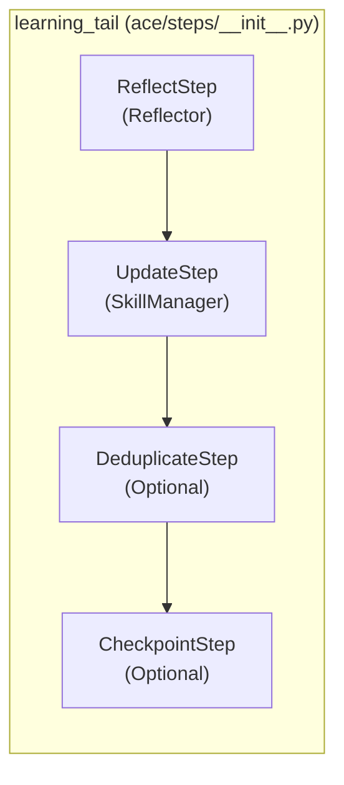
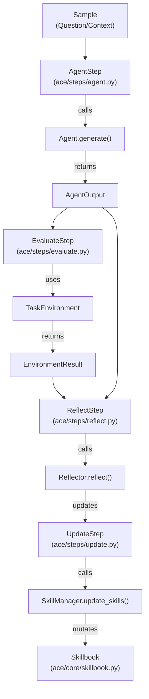
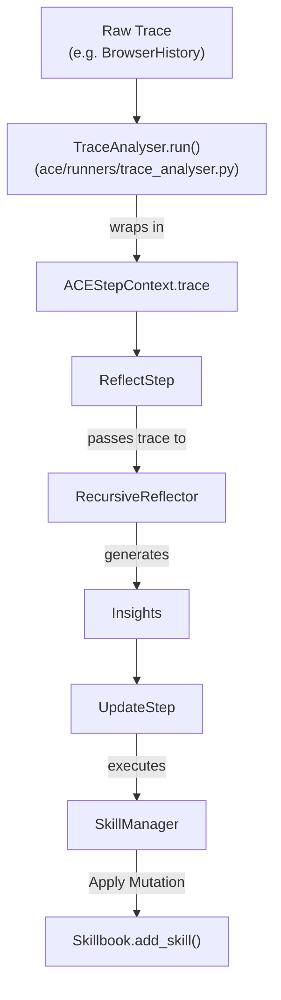

<!-- source: DeepWiki mcp.deepwiki.com · repo kayba-ai/agentic-context-engine · extra page Adaptation Loops (OfflineACE/OnlineACE) · fetched 2026-10-27 -->

# Adaptation Loops (OfflineACE/OnlineACE)

<details>
<summary>Relevant source files</summary>

The following files were used as context for generating this wiki page:

- [ace/runners/ace.py](ace/runners/ace.py)
- [ace/runners/base.py](ace/runners/base.py)
- [ace/runners/trace_analyser.py](ace/runners/trace_analyser.py)
- [ace/steps/agent.py](ace/steps/agent.py)
- [agent-guides/plan-sm-rewrite-v3.md](agent-guides/plan-sm-rewrite-v3.md)

</details>


## Purpose and Scope

This document describes the adaptation orchestration system in the ACE framework. It covers the transition from the legacy `ace/adaptation.py` adapters to the next-generation pipeline-based runners found in `ace/runners/`. These components coordinate the multi-role learning loop: **Execute → Evaluate → Reflect → Update**.

The system supports two primary operational modes:
1.  **Offline/Batch Learning**: Training a skillbook on a fixed dataset over multiple epochs (e.g., `TraceAnalyser`, `OfflineACE`).
2.  **Online/Real-time Learning**: Continuous adaptation during live execution (e.g., `ACE`, `OnlineACE`).

**Sources:** [ace/runners/ace.py:1-38](), [ace/runners/trace_analyser.py:1-41]()

---

## Architecture Overview

The modern adaptation system is built on a "Runner" architecture. Unlike the legacy inheritance-based adapters, modern runners compose a `Pipeline` of atomic `Step` objects.

### Class Hierarchy (Modern Runners)

```mermaid
graph TB
    ACERunner["ACERunner<br/>(base.py)"]
    ACE["ACE<br/>(ace.py)"]
    TraceAnalyser["TraceAnalyser<br/>(trace_analyser.py)"]
    
    ACERunner --> ACE
    ACERunner --> TraceAnalyser
    
    subgraph "Pipeline Components"
        Pipeline["Pipeline<br/>(pipeline engine)"]
        AgentStep["AgentStep"]
        EvaluateStep["EvaluateStep"]
        ReflectStep["ReflectStep"]
        UpdateStep["UpdateStep"]
    end
    
    ACE o-- Pipeline
    TraceAnalyser o-- Pipeline
    Pipeline *-- AgentStep
    Pipeline *-- EvaluateStep
    Pipeline *-- ReflectStep
    Pipeline *-- UpdateStep
```

**Sources:** [ace/runners/base.py:19-43](), [ace/runners/ace.py:27-38](), [ace/runners/trace_analyser.py:26-41]()

### Runner Comparison

| Feature | `ACE` Runner | `TraceAnalyser` Runner |
| :--- | :--- | :--- |
| **Primary Use Case** | End-to-end live learning | Learning from pre-recorded logs |
| **Input Type** | `Sequence[Sample]` | `Sequence[Any]` (Raw traces) |
| **Pipeline Steps** | Agent → Eval → Reflect → Update | Reflect → Update |
| **Skillbook Mutation** | Real-time during execution | Batch analysis of history |
| **Async Support** | Background learning tail | Optional blocking/non-blocking |

**Sources:** [ace/runners/ace.py:27-38](), [ace/runners/trace_analyser.py:26-41]()

---

## Core Adaptation Flow

The adaptation loop is orchestrated by composing a "Learning Tail". This tail consists of steps that analyze execution results and update the skillbook.

### The Learning Tail Composition

The `learning_tail` factory function creates the standard sequence of steps required for adaptation.



**Sources:** [ace/runners/ace.py:82-90](), [ace/runners/trace_analyser.py:78-86]()

### Step Implementation Details

1.  **AgentStep**: Executes the `Agent` role. It marks skills as "used" in the skillbook before generation to establish ground-truth attribution [ace/steps/agent.py:11-43]().
2.  **EvaluateStep**: Interfaces with a `TaskEnvironment` to produce feedback and metrics based on the agent's output [ace/runners/ace.py:81]().
3.  **ReflectStep**: Triggers the `Reflector` (or `RecursiveReflector`) to analyze the trace and extract insights [ace/runners/ace.py:82]().
4.  **UpdateStep**: Triggers the `SkillManager`. In the current architecture, the `SkillManager` uses tools to **directly mutate** the `Skillbook` [agent-guides/plan-sm-rewrite-v3.md:49-71]().

**Sources:** [ace/steps/agent.py:11-43](), [agent-guides/plan-sm-rewrite-v3.md:49-71]()

---

## Online Adaptation (ACE Runner)

The `ACE` runner implements the full closed-loop system where an agent improves in real-time.

### Data Flow: Natural Language to Code Entities

This diagram bridges the conceptual "Learning Loop" to the specific code classes and data structures used in the `ace/runners/ace.py` implementation.



**Sources:** [ace/runners/ace.py:79-91](), [ace/steps/agent.py:31-35](), [agent-guides/plan-sm-rewrite-v3.md:49-60]()

### Execution Logic

The `ACE.run()` method manages the epoch loop and delegates per-sample execution to the underlying pipeline.

*   **Context Building**: `_build_context` maps a `Sample` to an `ACEStepContext`, injecting the `SkillbookView` [ace/runners/ace.py:169-187]().
*   **Epoch Loop**: Handled by the base `_run` method, which supports multi-pass training if the input is a `Sequence` [ace/runners/base.py:86-145]().
*   **Concurrency**: Uses the pipeline's background learning capabilities to allow the Agent to continue to the next sample while Reflection/Update happens in parallel [ace/runners/base.py:65-73]().

**Sources:** [ace/runners/ace.py:144-167](), [ace/runners/base.py:86-145]()

---

## Offline Adaptation (TraceAnalyser Runner)

The `TraceAnalyser` is used for batch learning from existing data (e.g., logs from Browser-use, LangChain, or Claude Code).

### Trace-to-Skill Mapping

This diagram shows how raw external logs are transformed into skillbook updates via the `TraceAnalyser`.



**Sources:** [ace/runners/trace_analyser.py:26-41](), [ace/runners/trace_analyser.py:155-187]()

### Key Implementation Details

*   **Trace Handling**: Unlike the standard `ACE` runner, `TraceAnalyser` places raw trace objects directly onto `ctx.trace`. The Reflector is responsible for interpreting the specific format [ace/runners/trace_analyser.py:169-173]().
*   **Identity Inference**: It uses `infer_trace_identity` to extract metadata and source system information from the raw logs [ace/runners/trace_analyser.py:176-180]().
*   **Minimal Pipeline**: It excludes `AgentStep` and `EvaluateStep`, focusing purely on the learning tail [ace/runners/trace_analyser.py:29-32]().

**Sources:** [ace/runners/trace_analyser.py:26-41](), [ace/runners/trace_analyser.py:155-187]()

---

## Ground-Truth Attribution and Mutation

A critical aspect of the adaptation loop is how it tracks which skills contributed to an outcome.

### Injection-Based Attribution

Instead of relying on LLM self-citation, the loop uses **Injection Ground Truth**:
1.  **AgentStep** records every skill ID currently in the skillbook into `ctx.injected_skill_ids` [ace/steps/agent.py:29-30]().
2.  It increments the `used_count` for these skills in the `Skillbook` [ace/steps/agent.py:37]().
3.  **SkillManager** later reads these IDs and the environment feedback to determine if those skills were `helpful` or `harmful` [agent-guides/plan-sm-rewrite-v3.md:75-79]().

### Direct Mutation

In the modern loop, the `SkillManager` does not return a plan to be applied later. It uses tools to mutate the `Skillbook` immediately:
*   `add_skill()`: Creates a new entry [agent-guides/plan-sm-rewrite-v3.md:54]().
*   `tag_skill(id, delta)`: Updates the helpful/harmful counters [agent-guides/plan-sm-rewrite-v3.md:57]().
*   `remove_skill()`: Deletes skills that have high `harmful_count` [agent-guides/plan-sm-rewrite-v3.md:78-79]().

**Sources:** [ace/steps/agent.py:28-42](), [agent-guides/plan-sm-rewrite-v3.md:49-80]()

---

