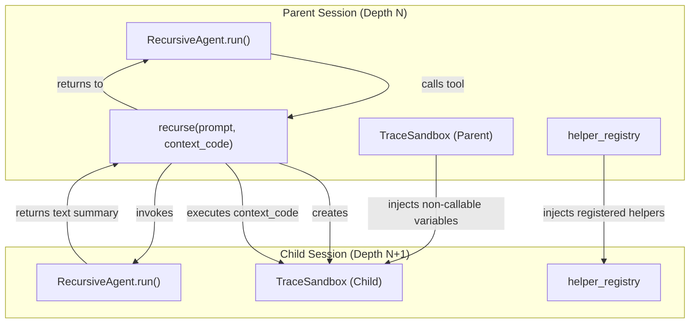
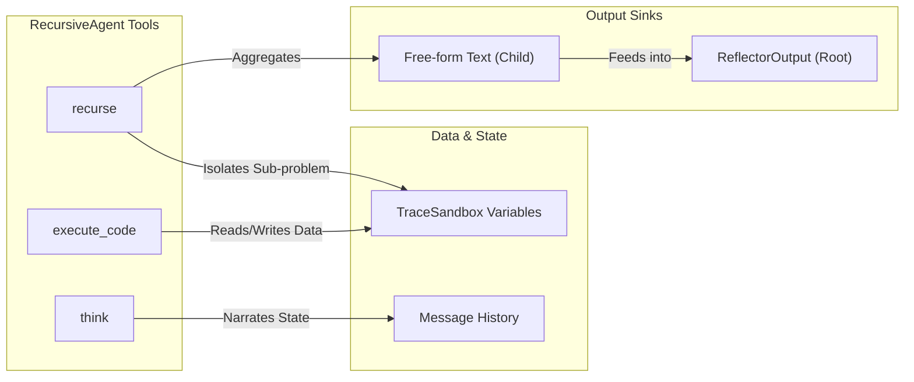

<!-- source: DeepWiki mcp.deepwiki.com · repo kayba-ai/agentic-context-engine · extra page Sub-agent System · fetched 2026-10-27 -->

# Sub-agent System

Relevant source files

The following files were used as context for generating this wiki page:

- [ace/core/__init__.py](ace/core/__init__.py)
- [ace/core/insight_source.py](ace/core/insight_source.py)
- [ace/core/recursive_agent.py](ace/core/recursive_agent.py)
- [ace/implementations/rr/__init__.py](ace/implementations/rr/__init__.py)
- [ace/implementations/rr/config.py](ace/implementations/rr/config.py)
- [ace/implementations/rr/prompts.py](ace/implementations/rr/prompts.py)
- [ace/implementations/rr/tools.py](ace/implementations/rr/tools.py)
- [ace/steps/rr_step.py](ace/steps/rr_step.py)

## Purpose and Scope

The sub-agent system enables recursive decomposition of complex analysis tasks. In the ACE Framework, particularly within the Recursive Reflector (RR), a parent agent can delegate sub-problems to child agents via the `recurse` tool [ace/core/recursive_agent.py:150-174](). This fan-out pattern allows for depth-bounded delegation, parallel processing of independent sub-tasks, and efficient management of large context windows by isolating data-heavy investigations into separate sessions [ace/implementations/rr/prompts.py:15-23]().

This page covers the recursive implementation, the `recurse` tool mechanics, budget management across the agent tree, and the shared sandbox environment.

---

## System Architecture

The sub-agent system is built on the `RecursiveAgent` base class, which provides the core infrastructure for recursion, compaction, and budget tracking [ace/core/recursive_agent.py:1-25]().

**Diagram: Recursive Delegation Flow**

Sources: [ace/core/recursive_agent.py:150-205](), [ace/steps/rr_step.py:51-68]()

---

## Core Components

### RecursiveAgent
The `RecursiveAgent` class wraps a `PydanticAI` agent with recursion capabilities. It manages the lifecycle of an agentic run, including the initialization of the `recurse` tool if the current depth is below the configured `max_depth` [ace/core/recursive_agent.py:143-174]().

### recurse Tool
The `recurse` tool is the primary mechanism for fanning out tasks. When called, it:
1.  **Creates a Child Sandbox**: A new `TraceSandbox` is initialized. It inherits all non-callable variables and registered helpers from the parent's namespace [ace/core/recursive_agent.py:182-205]().
2.  **Executes Context Code**: Optional Python code provided in the `context_code` argument is executed in the child sandbox before the child agent starts. This is typically used to slice data (e.g., `chunk = traces[5:10]`) [ace/core/recursive_agent.py:154-170]().
3.  **Spawns Child Agent**: A new instance of the agent is created with an incremented `depth`. If multiple `recurse` calls are made in one turn, they are dispatched in parallel using `asyncio.gather` [ace/core/recursive_agent.py:163-164]().

Sources: [ace/core/recursive_agent.py:150-205](), [ace/implementations/rr/prompts.py:15-23]()

### Helper Registry
To avoid re-pasting complex logic into every child, agents use `register_helper(name, source, description)`. This tool (available within `execute_code`) defines a function that persists in the current sandbox and is automatically injected into the sandbox of any future children [ace/implementations/rr/prompts.py:13]().

---

## Call Budget and Depth Management

The system uses `AgenticConfig` to control the scope of recursion and resource consumption.

**Table: Recursion Control Fields**

| Field | Description | Source |
|-------|-------------|--------|
| `max_depth` | Maximum number of recursive levels (default: 2). | [ace/core/recursive_agent.py:255]() |
| `max_requests` | Total LLM requests allowed for the entire tree. | [ace/core/recursive_agent.py:20]() |
| `timeout` | Execution timeout for sandbox operations. | [ace/core/recursive_agent.py:112]() |

### Shared Budget
Child agents share the overall budget of the root agent. This is enforced by passing the same dependency container or budget tracker down the recursion tree, ensuring that a fan-out of sub-agents cannot exceed the global token or request limits [ace/implementations/rr/prompts.py:51]().

### Parallelism
The system is designed for high-concurrency analysis. When an agent identifies multiple independent sub-problems (e.g., analyzing 10 different traces), it is instructed to dispatch 10 parallel `recurse` calls in a single turn [ace/implementations/rr/prompts.py:22-23]().

---

## Data Flow and Channel Routing

The Sub-agent system follows a strict "Three Channels" routing strategy to maintain clean context windows and structured outputs.

**Diagram: Channel Routing in Recursive Analysis**

**Channel Responsibilities:**
- **`execute_code`**: Carries **DATA**. It handles parsing, filtering, and computing evidence. Results are printed as compact structured artifacts (dicts, counts) [ace/implementations/rr/prompts.py:58]().
- **`think`**: Carries **NARRATION**. It is used for mid-run prose and working notes, keeping the Python stdout clean for data [ace/implementations/rr/prompts.py:59]().
- **`ReflectorOutput`**: Carries **CONCLUSIONS**. This is the final structured result of the root session. Child sessions return free-form text answering their specific sub-prompt, which the parent then integrates [ace/implementations/rr/prompts.py:60]().

Sources: [ace/implementations/rr/prompts.py:55-63](), [ace/implementations/rr/tools.py:97-107]()

---

## RR-Specific Specialization

While `RecursiveAgent` is generic, the `RRStep` (Recursive Reflector Step) specializes the `execute_code` tool description to emphasize its role as an "evidence workbench" [ace/steps/rr_step.py:128-147](). It also registers RR-specific tools like `search_skillbook` and `read_skill` which are made available to sub-agents via the standard tool registration mechanism [ace/steps/rr_step.py:102-107]().

Sources: [ace/steps/rr_step.py:128-147](), [ace/implementations/rr/tools.py:66-175]()

---

