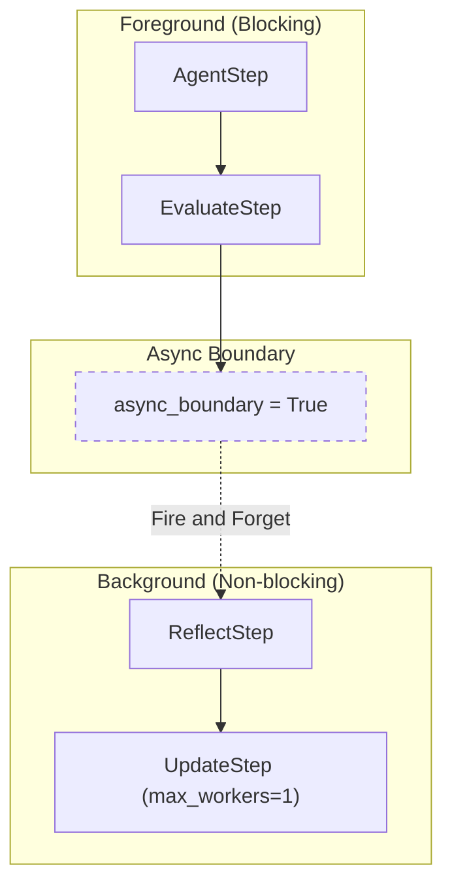
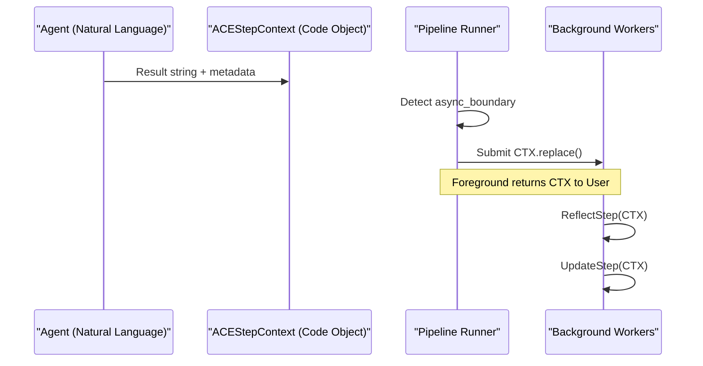

<!-- source: DeepWiki mcp.deepwiki.com · repo kayba-ai/agentic-context-engine · extra page Async Learning Pipeline · fetched 2026-10-27 -->

# Async Learning Pipeline

<details>
<summary>Relevant source files</summary>

The following files were used as context for generating this wiki page:

- [ace/runners/base.py](ace/runners/base.py)
- [ace/steps/agent.py](ace/steps/agent.py)
- [agent-guides/plan-sm-rewrite-v3.md](agent-guides/plan-sm-rewrite-v3.md)
- [docs/concepts/insight-levels.md](docs/concepts/insight-levels.md)
- [docs/guides/async-learning.md](docs/guides/async-learning.md)
- [examples/pipeline_ex/pipeline_demo.py](examples/pipeline_ex/pipeline_demo.py)
- [tests/pipeline_engine/conftest.py](tests/pipeline_engine/conftest.py)
- [tests/pipeline_engine/test_branch.py](tests/pipeline_engine/test_branch.py)
- [tests/pipeline_engine/test_context.py](tests/pipeline_engine/test_context.py)
- [tests/pipeline_engine/test_pipeline.py](tests/pipeline_engine/test_pipeline.py)
- [tests/pipeline_engine/test_pipeline_e2e.py](tests/pipeline_engine/test_pipeline_e2e.py)
- [tests/pipeline_engine/test_protocol.py](tests/pipeline_engine/test_protocol.py)

</details>


## Purpose and Scope

The Async Learning Pipeline provides a background learning architecture that enables non-blocking adaptation. By using an `async_boundary` and thread-safe processing, the system allows the primary agent execution to return results immediately while the computationally expensive Reflector and SkillManager phases proceed in the background. This architecture is fundamental to maintaining low latency in production environments while enabling continuous self-improvement.

This page covers the implementation details of background execution, the `async_boundary` primitive, thread pool management, and data flow between foreground and background steps.

---

## System Architecture

The pipeline engine decouples execution into two distinct phases: **Foreground** (blocking) and **Background** (non-blocking). The transition is marked by a step with the `async_boundary = True` attribute.

### Background Learning Flow

The diagram below illustrates how data transitions from Natural Language space (Agent responses) into Code Entity space (Pipeline steps and context) via the async boundary.



**Implementation Details:**
- **StepProtocol**: Every step must implement the `StepProtocol`, requiring `requires`, `provides`, and a `__call__` method. [pipeline/protocol.py:1-20]()
- **Pipeline.run()**: Orchestrates the execution of samples. If a step has `async_boundary = True`, the pipeline submits subsequent steps to a thread pool and returns the current `StepContext` to the caller. [pipeline/pipeline.py:180-210]()
- **Thread Safety**: The `StepContext` is an immutable dataclass using `MappingProxyType` for metadata to ensure safe sharing across threads. [pipeline/context.py:20-50]()

**Sources:** [pipeline/pipeline.py:180-210](), [pipeline/protocol.py:1-20](), [pipeline/context.py:20-50]()

---

## Core Components

### Async Boundary Mechanism

The `async_boundary` is a boolean flag on a step class that signals the `Pipeline` runner to split execution.

| Attribute | Type | Description |
|-----------|------|-------------|
| `async_boundary` | `bool` | If `True`, this step and all subsequent steps run in the background. |
| `max_workers` | `int` | Defines the concurrency level for that specific step. |

In the ACE implementation, `ReflectStep` (or `RRStep`) typically serves as the boundary because reflection involves high-latency LLM calls that do not need to block the user response. [tests/pipeline_engine/test_pipeline_e2e.py:73-80]()

### Step Concurrency Control

The pipeline engine manages concurrency at the step level using `ThreadPoolExecutor`.

- **Parallel Reflection**: `ReflectStep` usually has `max_workers > 1` (e.g., 3 or 5) to allow multiple samples to be analyzed concurrently. [tests/pipeline_engine/test_pipeline_e2e.py:79]()
- **Serialized Updates**: `UpdateStep` (which invokes the `SkillManager`) is configured with `max_workers = 1`. This ensures that skillbook mutations are serialized, preventing race conditions during deduplication and persistence. [tests/pipeline_engine/test_pipeline_e2e.py:96]()

**Sources:** [pipeline/pipeline.py:250-280](), [tests/pipeline_engine/test_pipeline_e2e.py:73-98]()

---

## Data Flow and Context Management

The `StepContext` acts as the data carrier throughout the async pipeline. Because it is immutable, each step returns a new instance using `.replace()`.

### Transitioning from Natural Language to Code Entities

The following diagram shows how execution results are packaged into code objects for background processing.



**Key Implementation Points:**
- **Immutability**: `StepContext` uses `frozen=True`. [pipeline/context.py:23]()
- **Metadata Coercion**: Metadata is stored in a `MappingProxyType` to prevent in-place mutation. [pipeline/context.py:42-45]()
- **Result Handling**: The `Pipeline.run()` method returns a list of `SampleResult` objects. In async mode, these results contain the context state *at the moment of the boundary*. [pipeline/pipeline.py:205-215]()

**Sources:** [pipeline/context.py:20-50](), [pipeline/pipeline.py:180-220]()

---

## Pipeline Lifecycle Management

### Waiting for Background Completion

Since background tasks run independently, the `Pipeline` class provides a synchronization mechanism to ensure all learning is persisted before the process exits.

```python
# From ace/runners/base.py
def wait_for_background(self, timeout: float | None = None) -> None:
    """Block until all background learning tasks complete."""
    self.pipeline.wait_for_background(timeout)
```

**Implementation:**
- **`wait_for_background`**: Uses a `threading.Event` or joins the internal `ThreadPoolExecutor` to block until the background queues are empty. [pipeline/pipeline.py:310-330]()
- **`background_stats`**: Returns a dictionary containing `active` and `completed` task counts. [pipeline/pipeline.py:340-355]()

**Sources:** [ace/runners/base.py:65-72](), [pipeline/pipeline.py:310-355]()

---

## Error Handling in Async Mode

Errors occurring in the background do not crash the main thread. Instead, they are captured within the `SampleResult` object or logged via the internal pipeline monitor.

1. **Isolation**: If a `ReflectStep` fails for Sample A, Sample B continues processing. [pipeline/pipeline.py:280-300]()
2. **Capture**: Exceptions are caught and stored in `SampleResult.error`. [pipeline/protocol.py:97-120]()
3. **Traceback**: The `failed_at` field in `SampleResult` identifies exactly which background step triggered the exception. [pipeline/protocol.py:101]()

**Sources:** [pipeline/pipeline.py:280-300](), [pipeline/protocol.py:97-136]()

---

## Performance Considerations

| Component | Concurrency | Bottleneck Type |
|-----------|-------------|-----------------|
| **AgentStep** | N (via `Pipeline.run`) | LLM API Latency |
| **EvaluateStep** | N (via `Pipeline.run`) | Environment I/O |
| **ReflectStep** | `max_workers` (e.g., 3) | LLM API Latency |
| **UpdateStep** | 1 (Serialized) | Skillbook Disk I/O / Embedding Latency |

By setting `UpdateStep.max_workers = 1`, the engine guarantees that the `SkillManager` (the `RecursiveAgent` implementation) has a consistent view of the `Skillbook` while it performs complex deduplication and consolidation. [tests/pipeline_engine/test_pipeline_e2e.py:96](), [tests/pipeline_engine/test_pipeline_e2e.py:204-208]()

**Sources:** [tests/pipeline_engine/test_pipeline_e2e.py:73-106](), [pipeline/pipeline.py:250-280]()

---

