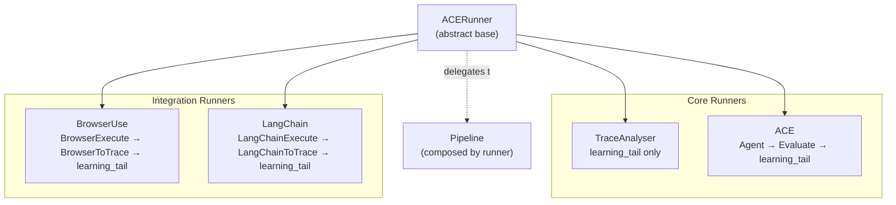
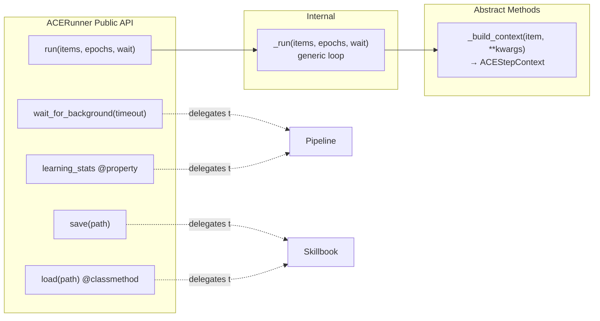
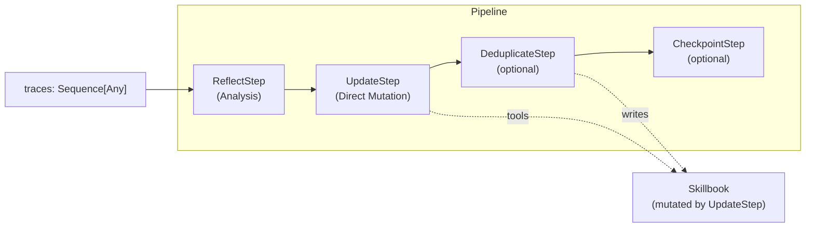
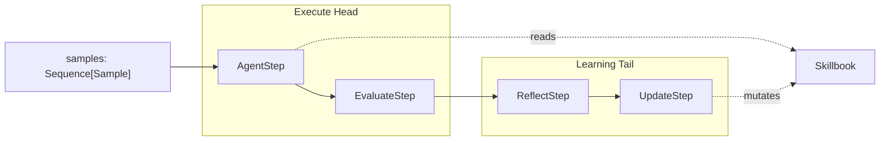

<!-- source: DeepWiki mcp.deepwiki.com · repo kayba-ai/agentic-context-engine · extra page Runner System · fetched 2026-10-27 -->

# Runner System

<details>
<summary>Relevant source files</summary>

The following files were used as context for generating this wiki page:

- [ace/integrations/browser_use.py](ace/integrations/browser_use.py)
- [ace/integrations/langchain.py](ace/integrations/langchain.py)
- [ace/runners/ace.py](ace/runners/ace.py)
- [ace/runners/base.py](ace/runners/base.py)
- [ace/runners/trace_analyser.py](ace/runners/trace_analyser.py)
- [ace/steps/agent.py](ace/steps/agent.py)
- [agent-guides/plan-sm-rewrite-v3.md](agent-guides/plan-sm-rewrite-v3.md)

</details>


## Purpose and Scope

The runner system provides the orchestration layer that composes pipeline steps into complete learning workflows. Runners manage the epoch loop, sample iteration, and delegate to `Pipeline.run()` for per-sample execution. This page covers the `ACERunner` base class and its concrete implementations: `ACE`, `TraceAnalyser`, and integration runners (`BrowserUse`, `LangChain`).

Following the SkillManager rewrite [agent-guides/plan-sm-rewrite-v3.md:49-71](), the runner system now supports a streamlined learning tail where the `SkillManager` mutates the `Skillbook` directly via tools, removing the need for a separate `ApplyStep`.

---

## Runner Class Hierarchy



**Sources:** [ace/runners/base.py:19-43](), [ace/runners/ace.py:27-38](), [ace/runners/trace_analyser.py:26-41](), [ace/integrations/browser_use.py:53-61](), [ace/integrations/langchain.py:73-83]()

All runners extend `ACERunner` and compose a `Pipeline` internally. The runner's only job is the epoch loop and input mapping. Per-sample iteration, error handling, and background execution are delegated to `Pipeline.run()`.

---

## ACERunner Base Class

### Responsibilities

| Concern | Owner |
|---------|-------|
| Epoch loop + `Iterable` validation | `ACERunner._run()` |
| Per-sample iteration + error isolation | `Pipeline.run()` |
| Foreground/background split | `Pipeline.run()` (via `async_boundary`) |
| Concurrent workers | `Pipeline.run(workers=N)` |
| Background drain | `ACERunner.wait_for_background()` |
| Skillbook I/O | `ACERunner.save()`, `ACERunner.load()` |

**Sources:** [ace/runners/base.py:19-167]()

### Key Methods



**Sources:** [ace/runners/base.py:45-167]()

The runner provides a clean separation: public methods for orchestration and skillbook management, abstract `_build_context()` for subclass-specific input mapping, and delegation to `Pipeline` and `Skillbook` for actual work.

### Generic Run Loop

The `_run()` method implements the epoch loop shared by all runners:

**Sources:** [ace/runners/base.py:86-145]()

**Key behaviors:**

1. **Iterable validation** — If `epochs > 1` and `items` is not a `Sequence`, it raises `ValueError` because a consumed iterable cannot be replayed [ace/runners/base.py:108-111]().
2. **Context materialization** — Builds `ACEStepContext` objects for all items using `_build_context()` before calling `Pipeline.run()` [ace/runners/base.py:125-138]().
3. **Epoch bookkeeping** — Sets `epoch`, `total_epochs`, `index`, `total`, and `global_sample_index` on each context [ace/runners/base.py:128-134]().
4. **Background control** — When `wait=True` (default), blocks until background learning completes [ace/runners/base.py:142-143]().

---

## TraceAnalyser

Analyzes pre-recorded traces to build a skillbook. It runs the **learning tail** only: `ReflectStep` and `UpdateStep`.

### Pipeline Composition



**Sources:** [ace/runners/trace_analyser.py:44-89](), [agent-guides/plan-sm-rewrite-v3.md:69-70]()

Following the direct mutation pattern, `UpdateStep` uses tools to modify the `Skillbook` directly [agent-guides/plan-sm-rewrite-v3.md:53-58](). No `AgentStep` or `EvaluateStep` is included as the trace is already recorded [ace/runners/trace_analyser.py:29-30]().

### Context Building

```python
def _build_context(self, raw_trace, ...) -> ACEStepContext:
    return ACEStepContext(
        skillbook=SkillbookView(self.skillbook),
        trace=raw_trace,
        metadata={TRACE_IDENTITY_METADATA_KEY: ...},
        # ... bookkeeping fields
    )
```

**Sources:** [ace/runners/trace_analyser.py:155-187]()

The raw trace is placed directly on `ctx.trace` with no conversion [ace/runners/trace_analyser.py:171-173](). The `Reflector` receives it as-is and is responsible for interpreting it.

---

## ACE Runner

The full live adaptive pipeline: `AgentStep → EvaluateStep → ReflectStep → UpdateStep`.

### Pipeline Composition



**Sources:** [ace/runners/ace.py:78-91](), [ace/steps/agent.py:11-19]()

The `AgentStep` executes the agent role, reading from the `Skillbook` and recording `injected_skill_ids` onto the context [ace/steps/agent.py:28-42](). `EvaluateStep` provides feedback from the `TaskEnvironment` [ace/runners/ace.py:81]().

### Attribution and Counters

During execution, `AgentStep` marks skills as used:
1. It renders the `Skillbook` into the agent prompt.
2. It records `injected_skill_ids` on the context [ace/steps/agent.py:39-42]().
3. It increments the `used_count` for those skills in the `Skillbook` [ace/steps/agent.py:37]().

Downstream, the `SkillManager` uses these IDs and the outcome to decide whether to increment `helpful_count` or `harmful_count` [agent-guides/plan-sm-rewrite-v3.md:77-78]().

---

## Integration Runners

Integration runners provide specific `ExecuteStep` implementations for external frameworks.

### BrowserUse Integration

Wraps the `browser-use` framework.

| Class | Role |
|-------|------|
| `BrowserExecuteStep` | Injects skillbook context into task and runs `browser_use.Agent` [ace/integrations/browser_use.py:53-61]() |
| `BrowserResult` | Dataclass containing task success, output, and chronological steps [ace/integrations/browser_use.py:29-45]() |

**Sources:** [ace/integrations/browser_use.py:53-103]()

### LangChain Integration

Wraps LangChain `Runnable` objects.

| Class | Role |
|-------|------|
| `LangChainExecuteStep` | Injects context into inputs and invokes LangChain chains or agents [ace/integrations/langchain.py:73-83]() |
| `LangChainResult` | Captures output, intermediate steps, and messages [ace/integrations/langchain.py:44-65]() |

**Sources:** [ace/integrations/langchain.py:73-143]()

---

## Factory Methods

### from_roles()

Constructs a runner from pre-built role instances. This is the primary way to configure specific LLMs for different roles.

```python
# ACE construction
runner = ACE.from_roles(
    agent=my_agent,
    reflector=my_reflector,
    skill_manager=my_sm,
    skillbook=sb
)
```

**Sources:** [ace/runners/ace.py:97-142](), [ace/runners/trace_analyser.py:92-130]()

### build_steps()

A class method that returns the list of `StepProtocol` objects the runner would compose. This allows for manual pipeline modification before runner instantiation.

```python
steps = ACE.build_steps(agent=a, reflector=r, skill_manager=sm)
steps.append(MyCustomStep())
runner = ACERunner(pipeline=Pipeline(steps), skillbook=sb)
```

**Sources:** [ace/runners/ace.py:41-94](), [ace/runners/trace_analyser.py:44-89]()

---

## Background Learning and Stats

Runners delegate background execution management to the underlying `Pipeline`.

- **`wait_for_background()`**: Blocks until all async learning tasks (usually reflection and updates) are complete [ace/runners/base.py:65-72]().
- **`learning_stats`**: Returns a dictionary of background progress (active vs. completed tasks) [ace/runners/base.py:74-80]().

**Sources:** [ace/runners/base.py:65-80]()

---

