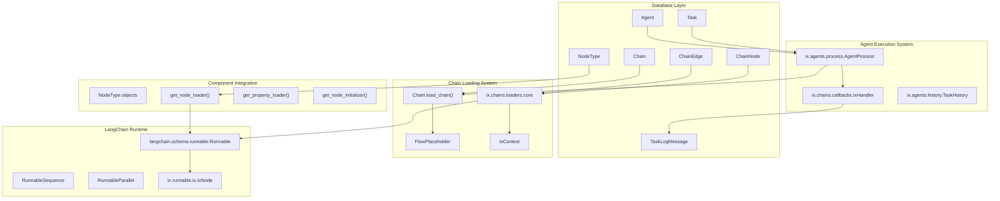
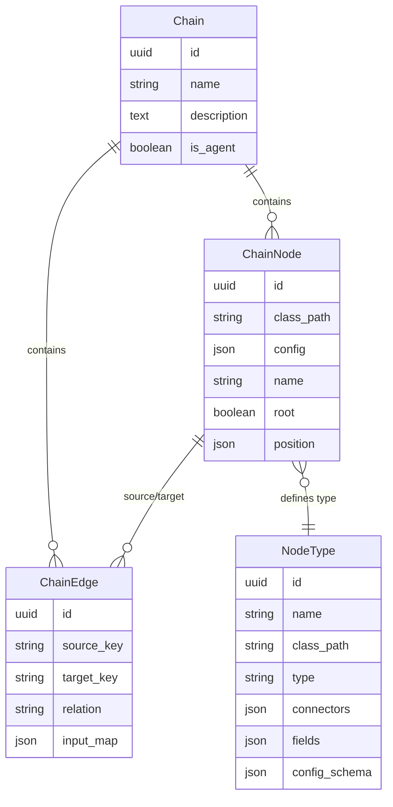
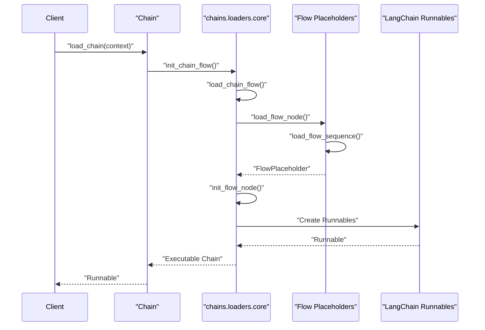
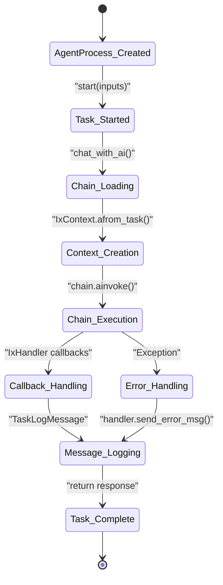
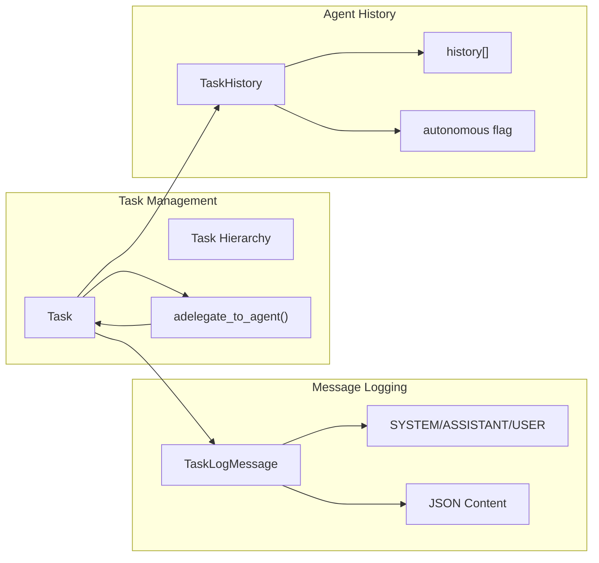
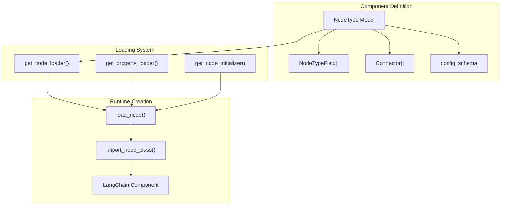
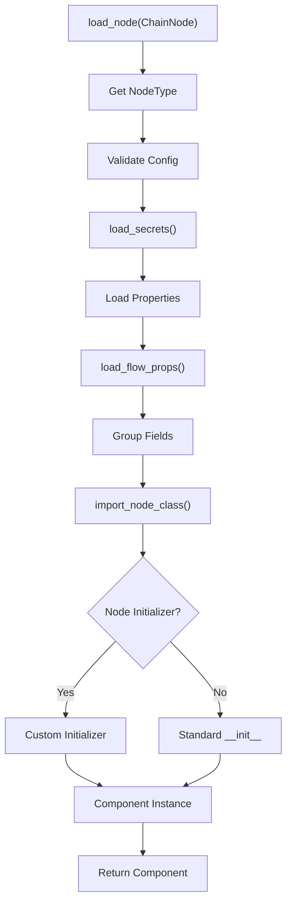
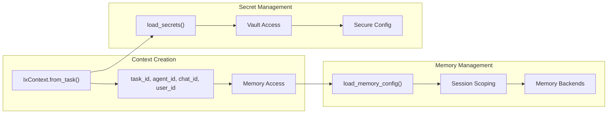
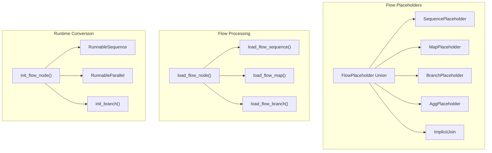

<!-- source: DeepWiki mcp.deepwiki.com · repo kreneskyp/ix · page 3 Core Architecture · fetched 2026-10-27 -->

# Core Architecture

Relevant source files

The following files were used as context for generating this wiki page:

- [ix/agents/history.py](ix/agents/history.py)
- [ix/agents/process.py](ix/agents/process.py)
- [ix/agents/tests/test_history.py](ix/agents/tests/test_history.py)
- [ix/agents/tests/test_process.py](ix/agents/tests/test_process.py)
- [ix/api/components/types.py](ix/api/components/types.py)
- [ix/chains/loaders/__init__.py](ix/chains/loaders/__init__.py)
- [ix/chains/loaders/core.py](ix/chains/loaders/core.py)
- [ix/chains/loaders/memory.py](ix/chains/loaders/memory.py)
- [ix/chains/migrations/0005_refine_node_type.py](ix/chains/migrations/0005_refine_node_type.py)
- [ix/chains/models.py](ix/chains/models.py)
- [ix/conftest.py](ix/conftest.py)
- [ix/pg_vector/tests/models.py](ix/pg_vector/tests/models.py)
- [ix/task_log/models.py](ix/task_log/models.py)
- [ix/task_log/tasks/agent_runner.py](ix/task_log/tasks/agent_runner.py)
- [ix/task_log/tests/fake.py](ix/task_log/tests/fake.py)

This document provides a comprehensive overview of the IX AI agent platform's core architecture, focusing on the fundamental systems that enable visual chain building, agent execution, and LangChain integration. The architecture consists of four primary subsystems: the Chain System for workflow definition and execution, the Agent Execution System for runtime processing, the Component Integration layer for LangChain components, and the supporting data models and context management.

For specific implementation details of individual subsystems, see [Chain System](#3.1), [Agent Execution System](#3.2), and [Component Integration](#3.3).

## System Overview

The IX platform is built around a modular architecture that separates workflow definition from execution, enabling visual chain building while maintaining full compatibility with LangChain's ecosystem.

### Core System Architecture

Sources: [ix/chains/models.py:288-362](), [ix/agents/process.py:29-79](), [ix/chains/loaders/core.py:1-968](), [ix/task_log/models.py:13-239]()

## Chain System Architecture

The Chain System provides the foundation for visual workflow definition and execution, converting graph-based representations into executable LangChain runnables.

### Chain Data Model

Sources: [ix/chains/models.py:288-362](), [ix/chains/models.py:230-287](), [ix/chains/models.py:263-287](), [ix/chains/models.py:45-104]()

### Chain Loading Process

The chain loading system transforms database representations into executable LangChain components through a multi-phase process:

Sources: [ix/chains/models.py:316-324](), [ix/chains/loaders/core.py:512-534](), [ix/chains/loaders/core.py:564-578](), [ix/chains/loaders/core.py:895-968]()

## Agent Execution Architecture

The Agent Execution System manages the runtime execution of AI agents, handling task lifecycle, message logging, and callback management.

### Agent Process Lifecycle

Sources: [ix/agents/process.py:29-79](), [ix/chains/callbacks.py:1-500](), [ix/task_log/models.py:80-151]()

### Task and Message Management

Sources: [ix/task_log/models.py:13-71](), [ix/task_log/models.py:80-151](), [ix/agents/history.py:11-157]()

## Component Integration Architecture

The Component Integration layer provides a bridge between IX's visual interface and LangChain's component ecosystem, enabling seamless integration of AI components.

### NodeType System

Sources: [ix/api/components/types.py:484-630](), [ix/chains/loaders/core.py:40-87](), [ix/chains/loaders/core.py:154-323]()

### Component Loading Flow

The component loading system handles the instantiation and configuration of LangChain components from IX node definitions:

Sources: [ix/chains/loaders/core.py:154-323](), [ix/chains/loaders/core.py:89-119](), [ix/chains/loaders/core.py:121-152]()

## Context and Memory Management

The platform provides sophisticated context management for maintaining state across agent executions and chain invocations.

### IxContext System

Sources: [ix/chains/loaders/context.py:1-200](), [ix/chains/loaders/memory.py:48-171](), [ix/chains/loaders/core.py:89-119]()

## Flow Execution System

The Flow Execution System handles the complex task of converting visual node graphs into executable LangChain flows, managing parallel execution, branching, and data flow.

### Flow Placeholder Architecture

Sources: [ix/chains/loaders/core.py:348-464](), [ix/chains/loaders/core.py:580-644](), [ix/chains/loaders/core.py:706-874](), [ix/chains/loaders/core.py:895-968]()

This architecture enables IX to provide a powerful visual interface for building AI agents while maintaining full compatibility with LangChain's extensive ecosystem of components and tools.

---

