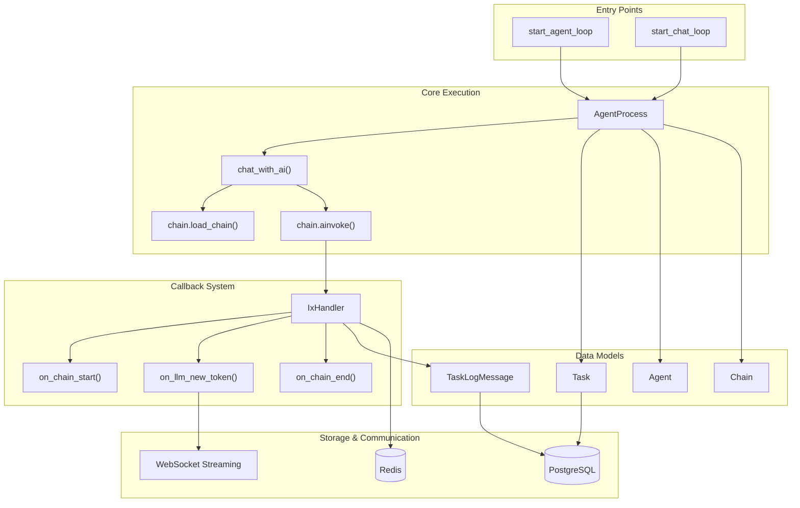
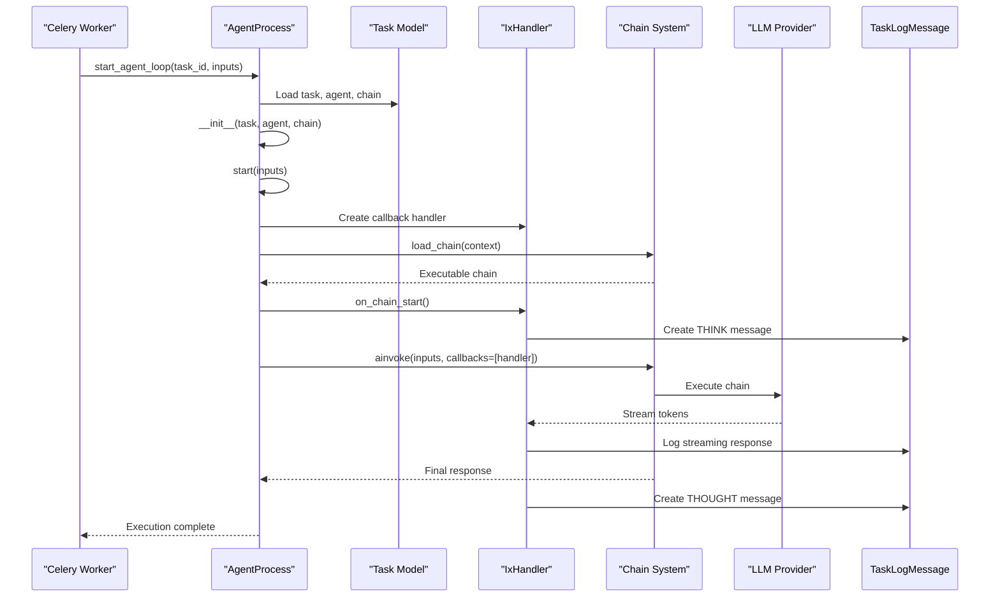
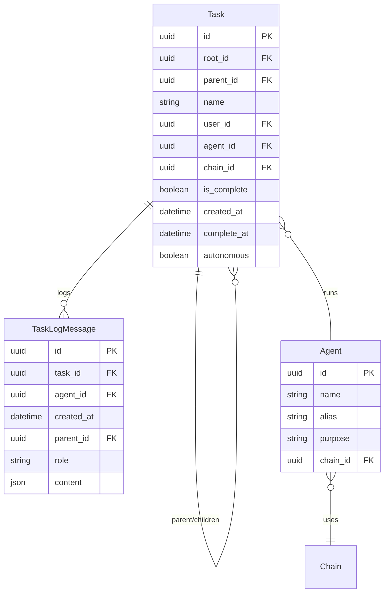
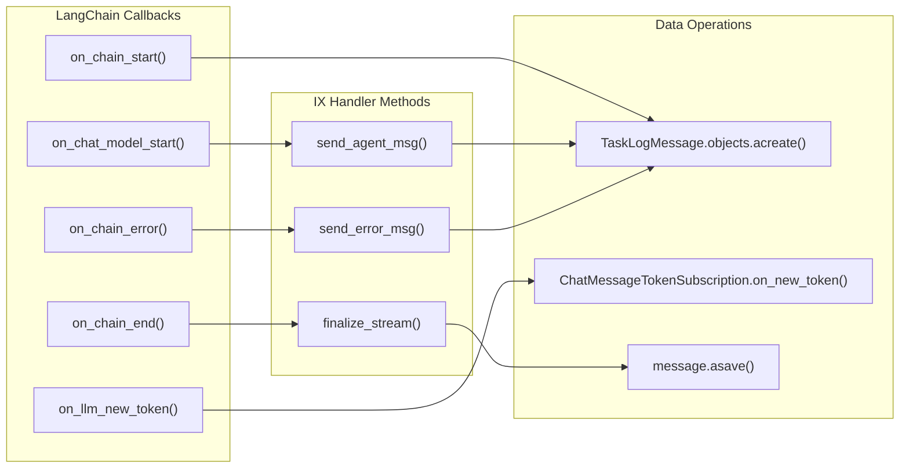
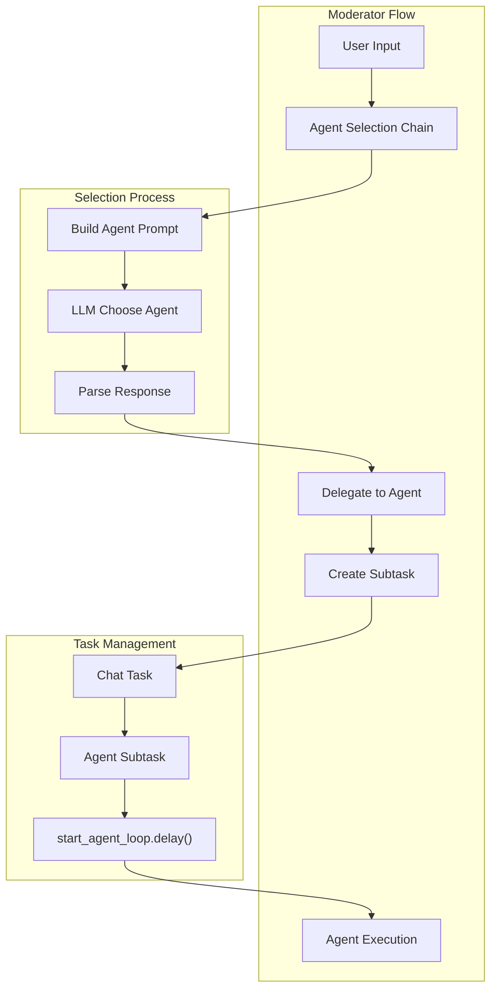

<!-- source: DeepWiki mcp.deepwiki.com · repo kreneskyp/ix · page 3.2 Agent Execution System · fetched 2026-10-27 -->

# Agent Execution System

<details>
<summary>Relevant source files</summary>

The following files were used as context for generating this wiki page:

- [ix/agents/history.py](ix/agents/history.py)
- [ix/agents/process.py](ix/agents/process.py)
- [ix/agents/tests/test_history.py](ix/agents/tests/test_history.py)
- [ix/agents/tests/test_process.py](ix/agents/tests/test_process.py)
- [ix/chains/artifacts.py](ix/chains/artifacts.py)
- [ix/chains/callbacks.py](ix/chains/callbacks.py)
- [ix/chains/management/commands/create_ix_v2.py](ix/chains/management/commands/create_ix_v2.py)
- [ix/chains/moderator.py](ix/chains/moderator.py)
- [ix/chains/tests/test_artifacts.py](ix/chains/tests/test_artifacts.py)
- [ix/chains/tests/test_moderator.py](ix/chains/tests/test_moderator.py)
- [ix/task_log/models.py](ix/task_log/models.py)
- [ix/task_log/tasks/agent_runner.py](ix/task_log/tasks/agent_runner.py)
- [ix/task_log/tests/fake.py](ix/task_log/tests/fake.py)

</details>


The Agent Execution System is the core runtime engine that manages the lifecycle of AI agents within the IX platform. This system orchestrates agent execution, handles task management, provides real-time logging and streaming, and coordinates multi-agent interactions. For information about chain definition and loading, see [Chain System](#3.1). For details about the REST APIs that trigger agent execution, see [Chat and Agent API](#4.2).

## Core Components

The agent execution system consists of several interconnected components that work together to run AI agents:

### Agent Execution Flow



Sources: [ix/agents/process.py:29-79](), [ix/chains/callbacks.py:103-360](), [ix/task_log/tasks/agent_runner.py:20-58]()

### Key Classes and Their Roles

| Class | File | Purpose |
|-------|------|---------|
| `AgentProcess` | [ix/agents/process.py]() | Main orchestrator for agent execution |
| `IxHandler` | [ix/chains/callbacks.py]() | Callback handler for logging and streaming |
| `Task` | [ix/task_log/models.py]() | Represents an agent execution instance |
| `TaskLogMessage` | [ix/task_log/models.py]() | Logs all agent interactions and system events |
| `ChatModerator` | [ix/chains/moderator.py]() | Routes requests between multiple agents |

Sources: [ix/agents/process.py:29-39](), [ix/chains/callbacks.py:103-122](), [ix/task_log/models.py:13-71]()

## Agent Execution Lifecycle

The agent execution process follows a well-defined lifecycle managed by the `AgentProcess` class:

### Process Initialization and Startup



Sources: [ix/agents/process.py:40-78](), [ix/chains/callbacks.py:192-256](), [ix/task_log/tasks/agent_runner.py:28-57]()

### Input Processing and Context Management

The `AgentProcess.chat_with_ai()` method handles input processing and context setup:

```python
# Input mapping and context creation
context = await IxContext.afrom_task(task=self.task)
inputs = user_input.copy()
if "input" not in inputs:
    inputs["input"] = user_input["user_input"]
if "question" not in inputs:
    inputs["question"] = user_input["user_input"]
```

Sources: [ix/agents/process.py:49-73]()

## Task Management and Logging

### Task Model Structure

The `Task` model represents a running agent instance and supports hierarchical execution:



Sources: [ix/task_log/models.py:13-71](), [ix/task_log/models.py:80-151]()

### Message Types and Content Structure

The system logs various types of messages during execution:

| Message Type | Role | Purpose |
|--------------|------|---------|
| `THINK` | SYSTEM | Input received and processing started |
| `ASSISTANT` | ASSISTANT | AI response content (with streaming support) |
| `THOUGHT` | SYSTEM | Execution metadata and runtime statistics |
| `FEEDBACK` | USER | User input and responses |
| `EXECUTE_ERROR` | ASSISTANT | Error messages and stack traces |
| `ARTIFACT` | ASSISTANT | Generated files and data objects |

Sources: [ix/task_log/models.py:86-102](), [ix/chains/callbacks.py:216-225](), [ix/chains/callbacks.py:295-322]()

## Callback System and Real-time Communication

### IxHandler Callback Architecture

The `IxHandler` class implements LangChain's callback interface to provide logging and streaming:



Sources: [ix/chains/callbacks.py:141-360]()

### Streaming and WebSocket Integration

The system provides real-time token streaming through WebSocket connections:

```python
async def on_llm_new_token(self, token: str, parent_run_id: Optional[UUID] = None, **kwargs: Any) -> Any:
    context = self.contexts[parent_run_id]
    if isinstance(token, str):
        context.tokens.append(token)
    await ChatMessageTokenSubscription.on_new_token(
        task=self.task,
        message_id=context.message.id,
        index=len(context.tokens),
        text=token,
    )
```

Sources: [ix/chains/callbacks.py:170-184]()

## Multi-Agent Coordination

### Chat Moderator System

The `ChatModerator` class handles routing and delegation between multiple agents:



Sources: [ix/chains/moderator.py:113-254]()

### Task Delegation and Hierarchies

Tasks support hierarchical relationships for multi-agent workflows:

```python
def delegate_to_agent(self, agent: Agent) -> "Task":
    return Task.objects.create(
        root_id=self.root_id or self.id,
        parent=self,
        name=f"delegating to agent {agent.alias}",
        agent_id=agent.id,
        chain=agent.chain,
        autonomous=self.autonomous,
        user=self.user,
    )
```

Sources: [ix/task_log/models.py:41-53]()

## Error Handling and Recovery

### Exception Management

The system provides comprehensive error handling through the callback system:

```python
async def send_error_msg(self, error: Exception) -> TaskLogMessage:
    traceback_list = traceback.format_exception(
        type(error), error, error.__traceback__
    )
    traceback_string = "".join(traceback_list)
    error_type = type(error).__name__
    
    failure_msg = await TaskLogMessage.objects.acreate(
        task_id=self.task.id,
        parent_id=parent_id,
        role="ASSISTANT",
        content={
            "type": "EXECUTE_ERROR",
            "error_type": error_type,
            "text": str(error),
            "details": traceback_string,
        },
    )
```

Sources: [ix/chains/callbacks.py:295-322]()

### Celery Task Management

The system uses Celery with singleton pattern to prevent duplicate executions:

```python
@app.task(
    base=Singleton,
    unique_on=[
        "task_id",
        "chain_id",
    ],
)
@sync
async def start_agent_loop(task_id: str, user_id: str, chain_id: str = None, inputs: Dict[str, Any] = None):
```

Sources: [ix/task_log/tasks/agent_runner.py:20-33]()

The Agent Execution System provides a robust, scalable foundation for running AI agents with comprehensive logging, real-time communication, and multi-agent coordination capabilities. The modular design allows for easy extension and integration with various LLM providers and tools.

---

