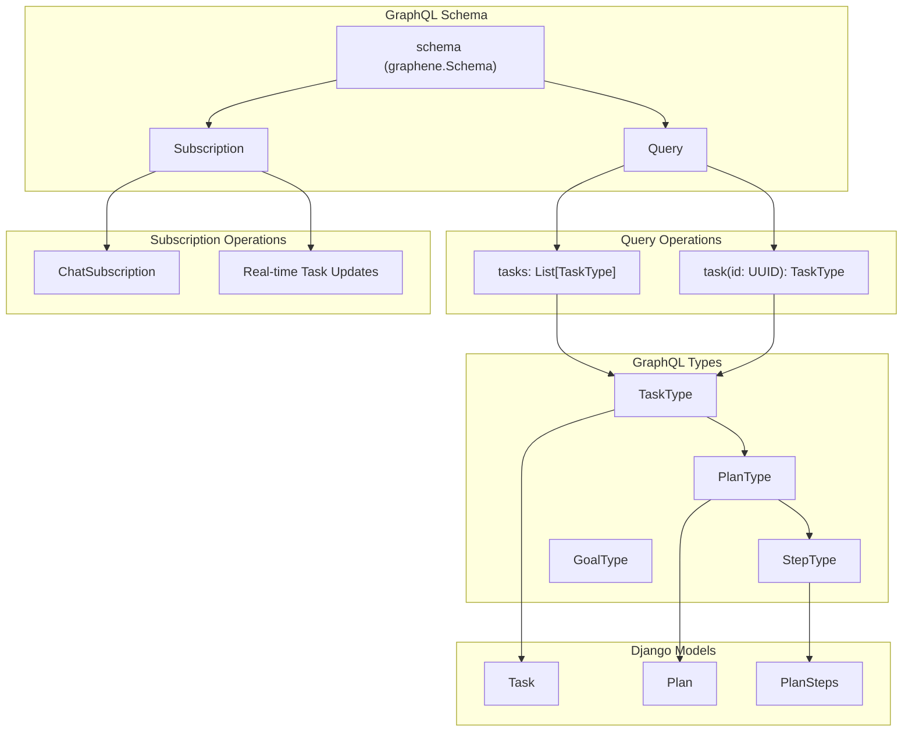
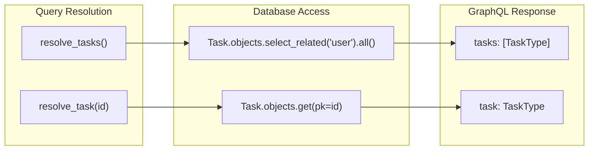
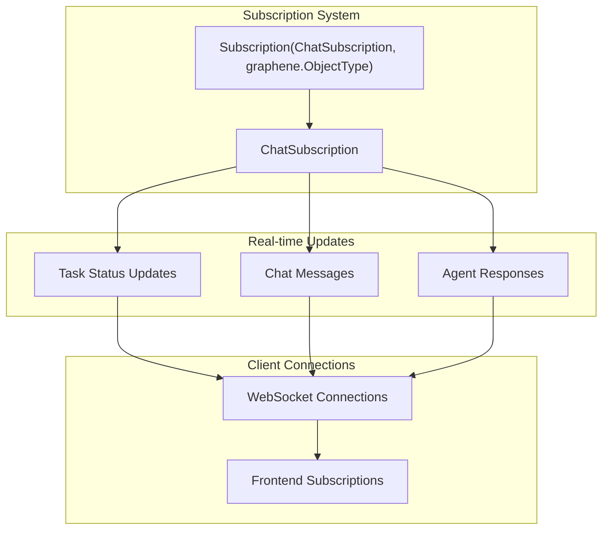
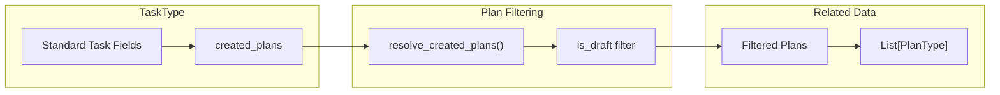
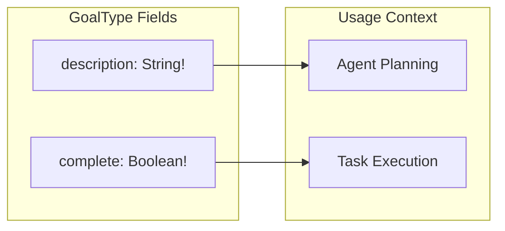
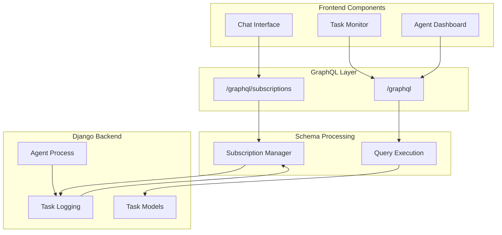

<!-- source: DeepWiki mcp.deepwiki.com · repo kreneskyp/ix · page 4.3 GraphQL API · fetched 2026-10-27 -->

# GraphQL API

Relevant source files

The following files were used as context for generating this wiki page:

- [ix/schema/__init__.py](ix/schema/__init__.py)
- [ix/schema/types/tasks.py](ix/schema/types/tasks.py)
- [ix/task_log/migrations/0005_rename_artifact_storage.py](ix/task_log/migrations/0005_rename_artifact_storage.py)

## Purpose and Scope

The GraphQL API provides real-time query and subscription capabilities for the IX platform, primarily focused on task management and streaming updates. This API complements the REST APIs by offering efficient data fetching and real-time subscriptions for live task monitoring and chat interfaces.

For information about REST API endpoints for chain management, see [Chain Management API](#4.1). For chat and agent REST endpoints, see [Chat and Agent API](#4.2).

## Schema Architecture

The GraphQL schema is implemented using the Graphene library and integrates with Django models to provide task-related data access and real-time subscriptions.

### GraphQL Schema Structure

**Sources:** [ix/schema/__init__.py:11-33](), [ix/schema/types/tasks.py:1-42]()

## Queries

The GraphQL API provides two main query operations for accessing task data:

### Task Queries

| Query | Parameters | Return Type | Description |
|-------|------------|-------------|-------------|
| `tasks` | None | `List[TaskType]` | Retrieves all tasks with user relationships |
| `task` | `id: UUID!` | `TaskType` | Retrieves a specific task by ID |

### Query Implementation

**Sources:** [ix/schema/__init__.py:16-23]()

## Subscriptions

The subscription system enables real-time updates for task monitoring and chat interfaces. The main subscription class aggregates chat-related subscriptions.

### Subscription Architecture

**Sources:** [ix/schema/__init__.py:26-30](), [ix/schema/subscriptions.py:1]()

## GraphQL Types

The API defines several GraphQL types that map to Django models and provide structured data access:

### Type Definitions

| Type | Base | Model | Description |
|------|------|-------|-------------|
| `TaskType` | `DjangoObjectType` | `Task` | Represents agent tasks with execution context |
| `PlanType` | `DjangoObjectType` | `Plan` | Represents agent plans and planning steps |
| `StepType` | `DjangoObjectType` | `PlanSteps` | Individual steps within agent plans |
| `GoalType` | `graphene.ObjectType` | N/A | Goal definitions with completion status |

### TaskType Fields and Relationships

**Sources:** [ix/schema/types/tasks.py:28-42]()

### GoalType Structure

The `GoalType` provides a simple structure for representing agent goals:

**Sources:** [ix/schema/types/tasks.py:11-14]()

## Integration with IX Platform

The GraphQL API integrates with the broader IX platform architecture to provide real-time data access:

### Data Flow Integration

**Sources:** [ix/schema/__init__.py:32-33]()

## Usage Patterns

### Querying Tasks

The GraphQL API supports efficient task data retrieval with relationship loading:

- **All Tasks**: The `tasks` query includes user relationships via `select_related("user")`
- **Single Task**: The `task` query retrieves specific tasks by UUID
- **Plan Relationships**: TaskType includes `created_plans` field with optional draft filtering

### Real-time Subscriptions

Subscriptions enable live monitoring of:
- Task execution progress
- Chat message streams
- Agent response generation
- Plan creation and updates

**Sources:** [ix/schema/__init__.py:19-23](), [ix/schema/types/tasks.py:37-41]()

---

