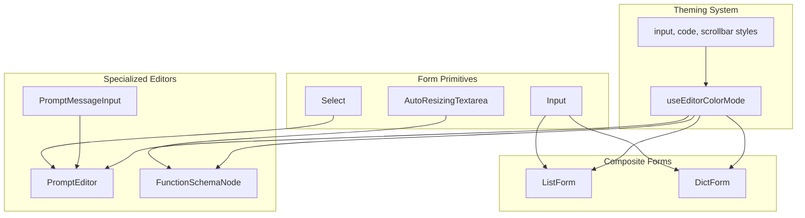
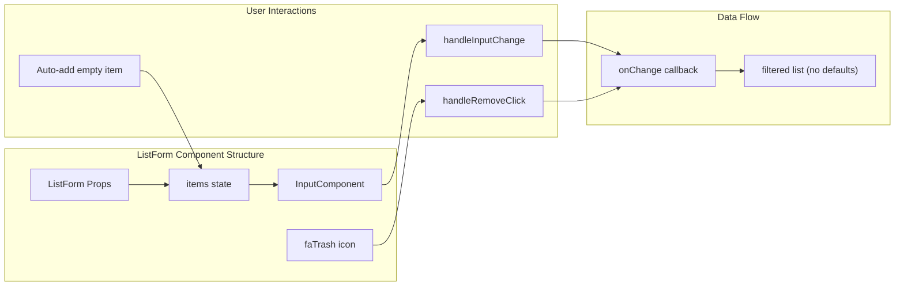
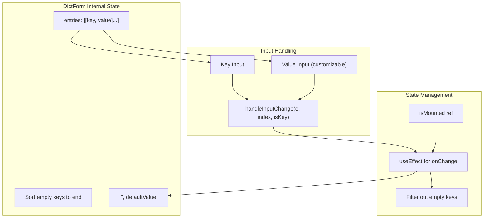
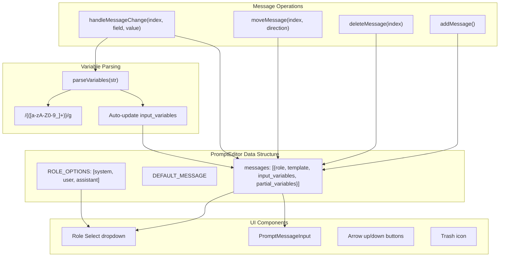
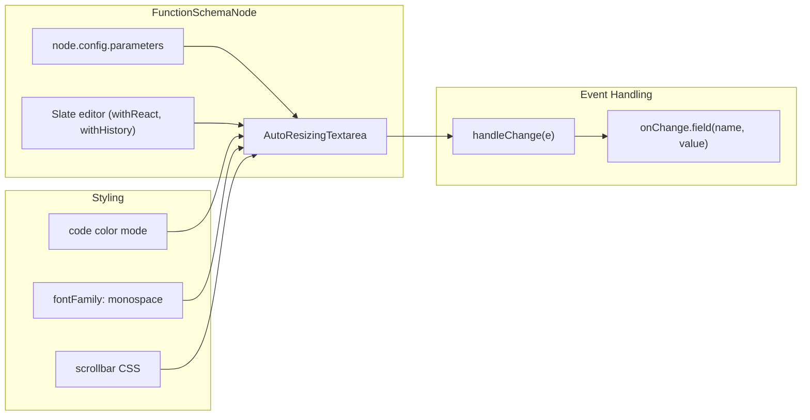
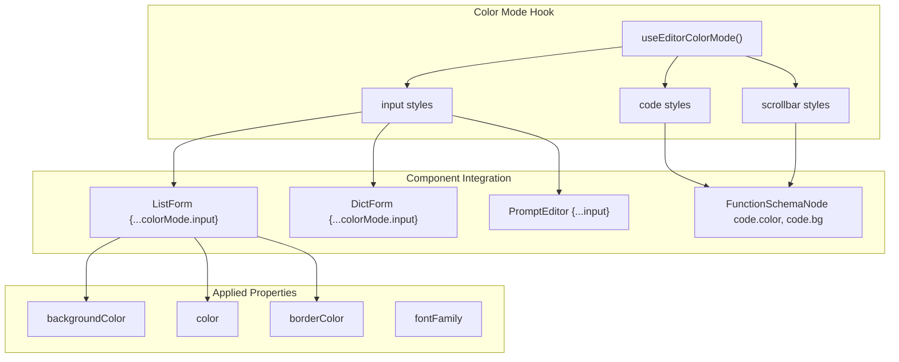

<!-- source: DeepWiki mcp.deepwiki.com · repo kreneskyp/ix · page 5.3 UI Components · fetched 2026-10-27 -->

# UI Components

Relevant source files

The following files were used as context for generating this wiki page:

- [frontend/chains/editor/PromptEditor.js](frontend/chains/editor/PromptEditor.js)
- [frontend/chains/flow/FunctionSchemaNode.js](frontend/chains/flow/FunctionSchemaNode.js)
- [frontend/components/DictForm.js](frontend/components/DictForm.js)
- [frontend/components/ListForm.js](frontend/components/ListForm.js)

This document covers the reusable React components that form the building blocks of the IX platform's user interface. These components provide standardized form inputs, editors, and data manipulation interfaces used throughout the chain editor, chat interface, and configuration pages.

For information about the visual chain graph editor, see [Chain Graph Editor](#5.1). For chat-specific interface components, see [Chat Interface](#5.2).

## Purpose and Scope

The UI components system provides a library of reusable React components designed for data input, editing, and display within the IX platform. These components handle common patterns like:

- Dynamic list and dictionary editing
- Multi-message prompt construction  
- Schema and code editing
- Consistent theming and color mode support

All components integrate with the platform's theming system and follow consistent design patterns for form validation, change handling, and user interaction.

## Component Architecture

The UI components follow a hierarchical structure where complex editors are built from simpler form primitives:

Sources: [frontend/components/ListForm.js:1-89](), [frontend/components/DictForm.js:1-107](), [frontend/chains/editor/PromptEditor.js:1-173](), [frontend/chains/flow/FunctionSchemaNode.js:1-39]()

## Dynamic Collection Components

### ListForm Component

The `ListForm` component provides an interface for editing arrays of strings with dynamic add/remove functionality:

Key features:
- Automatically adds empty input at end for new items ([frontend/components/ListForm.js:37-41]())
- Filters out default values before calling `onChange` ([frontend/components/ListForm.js:48]())
- Supports custom input components via `component` prop ([frontend/components/ListForm.js:57]())

### DictForm Component

The `DictForm` component enables editing of key-value objects with dynamic entry management:

Key implementation details:
- Maintains entries as array of `[key, value]` tuples ([frontend/components/DictForm.js:17-28]())
- Sorts entries to place empty keys at end ([frontend/components/DictForm.js:23-24]())
- Uses `isMounted` ref to prevent initial `onChange` call ([frontend/components/DictForm.js:44-58]())
- Supports custom value input components ([frontend/components/DictForm.js:67]())

Sources: [frontend/components/ListForm.js:15-86](), [frontend/components/DictForm.js:8-104]()

## Specialized Editor Components

### PromptEditor Component

The `PromptEditor` handles multi-message prompt construction for chat-based AI interactions:

Key features:
- Automatic variable extraction from templates using regex ([frontend/chains/editor/PromptEditor.js:31-41]())
- Message reordering with up/down arrows ([frontend/chains/editor/PromptEditor.js:68-77]())
- Role selection from predefined options ([frontend/chains/editor/PromptEditor.js:13](), [frontend/chains/editor/PromptEditor.js:105-120]())
- Integration with `PromptMessageInput` for template editing ([frontend/chains/editor/PromptEditor.js:144-153]())

### FunctionSchemaNode Component

The `FunctionSchemaNode` provides JSON schema editing for function parameters:

Implementation details:
- Uses Slate editor for rich text capabilities ([frontend/chains/flow/FunctionSchemaNode.js:10]())
- Applies monospace font for code editing ([frontend/chains/flow/FunctionSchemaNode.js:30-32]())
- Integrates with color mode theming ([frontend/chains/flow/FunctionSchemaNode.js:12](), [frontend/chains/flow/FunctionSchemaNode.js:28-29]())

Sources: [frontend/chains/editor/PromptEditor.js:43-172](), [frontend/chains/flow/FunctionSchemaNode.js:9-38]()

## Theming and Color Mode Integration

All UI components integrate with the `useEditorColorMode` hook to provide consistent theming:

The theming system provides:
- Consistent input styling across components ([frontend/components/ListForm.js:74](), [frontend/components/DictForm.js:84]())
- Code-specific styling for syntax highlighting ([frontend/chains/flow/FunctionSchemaNode.js:28-29]())
- Scrollbar customization for better visual integration ([frontend/chains/flow/FunctionSchemaNode.js:33]())

Sources: [frontend/components/ListForm.js:33](), [frontend/components/DictForm.js:29](), [frontend/chains/editor/PromptEditor.js:45](), [frontend/chains/flow/FunctionSchemaNode.js:12]()

## Component Usage Patterns

The UI components follow consistent patterns for integration:

| Pattern | Description | Example Components |
|---------|-------------|-------------------|
| **Controlled Components** | State managed by parent, changes via `onChange` | `ListForm`, `DictForm`, `PromptEditor` |
| **Prop Spreading** | Color mode and custom props spread to inputs | All form components |
| **Dynamic Rendering** | Components add/remove UI elements based on data | `ListForm` auto-adds inputs, `PromptEditor` message management |
| **Custom Component Support** | Accept custom input components via props | `ListForm.component`, `DictForm.component` |
| **Icon Integration** | FontAwesome icons for actions | `faTrash`, `faPlus`, `faArrowUp`, `faArrowDown` |

Sources: [frontend/components/ListForm.js:24-30](), [frontend/components/DictForm.js:8-16](), [frontend/chains/editor/PromptEditor.js:43]()

---

