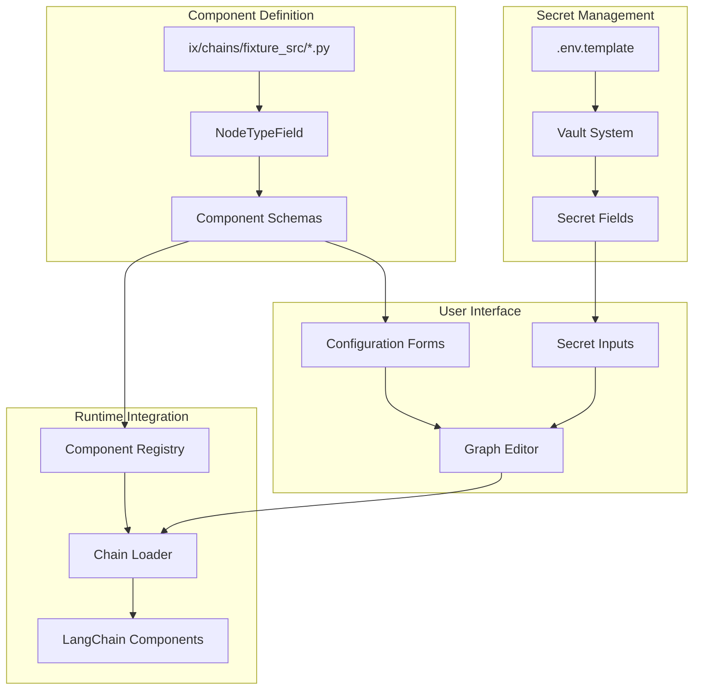
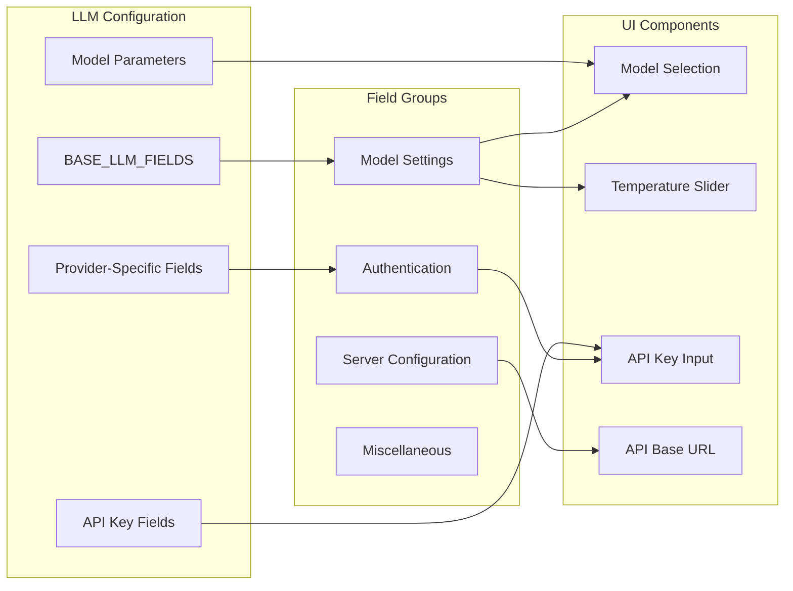
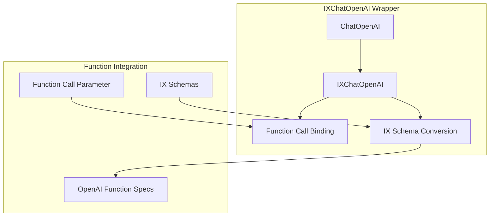
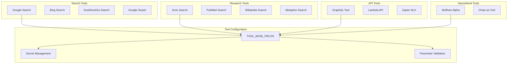
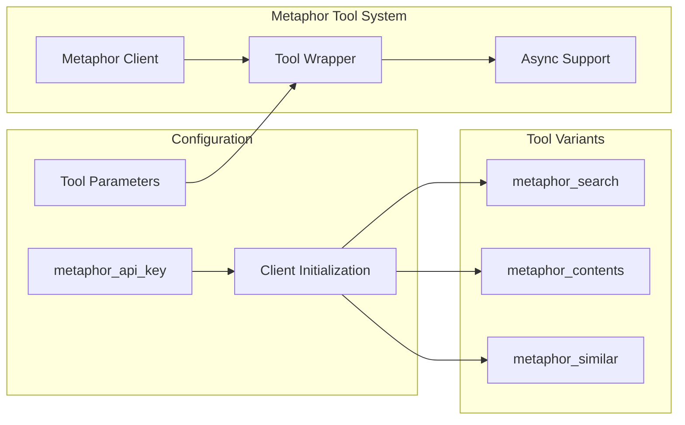
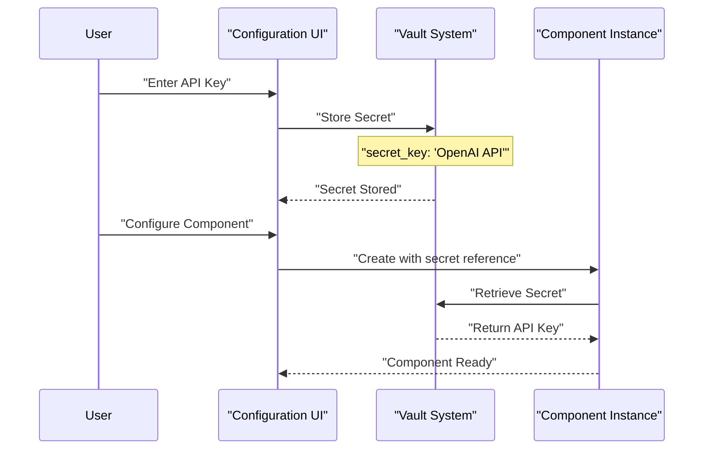
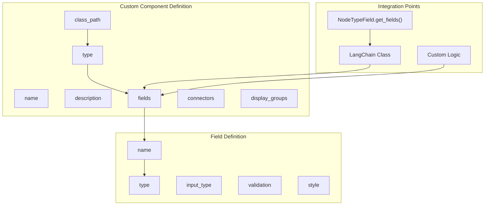
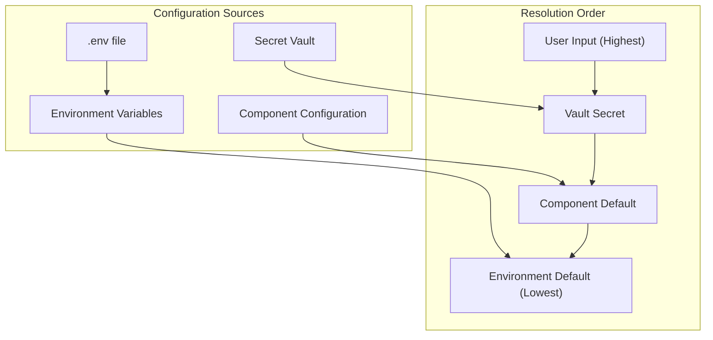

<!-- source: DeepWiki mcp.deepwiki.com · repo kreneskyp/ix · page 6 Configuration and Extensions · fetched 2026-10-27 -->

# Configuration and Extensions

<details>
<summary>Relevant source files</summary>

The following files were used as context for generating this wiki page:

- [.env.template](.env.template)
- [ix/chains/fixture_src/llm.py](ix/chains/fixture_src/llm.py)
- [ix/chains/fixture_src/tools.py](ix/chains/fixture_src/tools.py)
- [ix/runnable/llm.py](ix/runnable/llm.py)
- [ix/tools/metaphor.py](ix/tools/metaphor.py)
- [test_data/snapshots/components/langchain.chat_models.anthropic.ChatAnthropic.json](test_data/snapshots/components/langchain.chat_models.anthropic.ChatAnthropic.json)
- [test_data/snapshots/components/langchain.chat_models.fireworks.ChatFireworks.json](test_data/snapshots/components/langchain.chat_models.fireworks.ChatFireworks.json)
- [test_data/snapshots/components/langchain.chat_models.google_palm.ChatGooglePalm.json](test_data/snapshots/components/langchain.chat_models.google_palm.ChatGooglePalm.json)
- [test_data/snapshots/components/langchain.llms.fireworks.Fireworks.json](test_data/snapshots/components/langchain.llms.fireworks.Fireworks.json)
- [test_data/snapshots/components/langchain.llms.llamacpp.LlamaCpp.json](test_data/snapshots/components/langchain.llms.llamacpp.LlamaCpp.json)

</details>


This document covers the configuration and extension systems in IX, including how to configure LLM providers, integrate tools, manage secrets, and create custom components. The IX platform provides a flexible component system built on top of LangChain that allows users to easily configure and extend agent capabilities.

For information about using the Chain Graph Editor to configure individual chains, see [Chain Graph Editor](#5.1). For details about the underlying component integration architecture, see [Component Integration](#3.3).

## Configuration Architecture Overview

IX uses a fixture-based system to define available components and their configuration schemas. This system automatically generates UI forms, validates inputs, and manages the integration between the visual editor and the underlying LangChain components.



The configuration system operates through several key components:

- **Fixture Files**: Python modules in `ix/chains/fixture_src/` that define component configurations
- **NodeTypeField**: Utility class for extracting configuration fields from LangChain classes
- **Secret Management**: Secure handling of API keys and sensitive configuration
- **Component Registry**: Runtime system that loads and manages available components

Sources: [ix/chains/fixture_src/llm.py:1-639](), [ix/chains/fixture_src/tools.py:1-301](), [ix/api/components/types.py]()

## LLM Configuration System

The LLM configuration system supports multiple AI providers through a standardized interface. Each LLM provider is defined in the fixture system with provider-specific configuration options.

### Supported LLM Providers

| Provider | Class Path | Key Features |
|----------|------------|--------------|
| OpenAI | `ix.runnable.llm.IXChatOpenAI` | Function calling, streaming, multiple models |
| Anthropic | `langchain.chat_models.anthropic.ChatAnthropic` | Claude models, custom API endpoints |
| Google | `langchain_google_genai.ChatGoogleGenerativeAI` | Gemini models, vision support |
| Ollama | `langchain_community.llms.ollama.Ollama` | Local model hosting |
| Llama CPP | `langchain.llms.llamacpp.LlamaCpp` | Local C++ implementation |
| Fireworks | `langchain.llms.fireworks.Fireworks` | Hosted open-source models |
| Mistral | `langchain_mistralai.chat_models.ChatMistralAI` | Mistral AI models |

### LLM Configuration Structure



The LLM configuration system uses several key patterns:

- **Base Fields**: Common fields like `cache`, `verbose`, `tags`, and `metadata` inherited by all LLMs
- **Field Groups**: Organized display groups for the UI (Model, Authentication, Server, etc.)
- **Secret Integration**: API keys are handled through the secret management system
- **Validation**: Input validation with sliders, dropdowns, and custom constraints

Sources: [ix/chains/fixture_src/llm.py:12-26](), [ix/chains/fixture_src/llm.py:96-184](), [ix/chains/fixture_src/llm.py:89-95]()

### Custom LLM Wrapper Example

IX provides custom LLM wrappers like `IXChatOpenAI` that extend LangChain components with additional functionality:



The `IXChatOpenAI` class in `ix/runnable/llm.py` demonstrates how to extend LangChain components:

- Converts IX Schema objects to OpenAI function specifications
- Handles function call parameter mapping
- Maintains compatibility with the standard LangChain interface

Sources: [ix/runnable/llm.py:25-46](), [ix/runnable/llm.py:10-23]()

## Tool Integration System

The tool integration system provides a wide range of tools that agents can use to interact with external services and APIs. Each tool is configured through the fixture system with provider-specific options.

### Available Tool Categories



### Tool Configuration Patterns

All tools inherit from `TOOL_BASE_FIELDS` which includes:
- `return_direct`: Boolean flag for direct result return
- `verbose`: Enable verbose logging
- Provider-specific configuration fields generated from LangChain classes

### Custom Tool Implementation Example

The Metaphor search tool demonstrates how custom tools are implemented:



The Metaphor tool implementation shows key patterns:
- Common initialization logic in `get_metaphor_tool()`
- API key handling with environment variable fallback
- Async support through `sync_to_async()`
- Multiple tool variants for different operations

Sources: [ix/chains/fixture_src/tools.py:41-89](), [ix/tools/metaphor.py:14-36](), [ix/chains/fixture_src/tools.py:199-232]()

## Secret Management

IX provides secure secret management for API keys and sensitive configuration data. Secrets are handled through a vault system that keeps sensitive data separate from chain configurations.

### Secret Configuration Flow



### Secret Field Configuration

Secret fields are defined in component fixtures using the `secret_key` parameter:

```python
{
    "name": "openai_api_key",
    "input_type": "secret",
    "secret_key": "OpenAI API",
    "label": "API Key"
}
```

This configuration:
- Renders a secure input field in the UI
- Stores the value in the vault system under the specified key
- References the secret during component initialization

### Environment Variable Integration

The `.env.template` file defines the environment variables that can be used as default values:

| Variable | Purpose | Components |
|----------|---------|------------|
| `OPENAI_API_KEY` | OpenAI API access | OpenAI LLMs |
| `ANTHROPIC_API_KEY` | Anthropic API access | Claude models |
| `GOOGLE_API_KEY` | Google API access | Google LLMs, Search |
| `METAPHOR_API_KEY` | Metaphor API access | Metaphor tools |
| `WOLFRAM_APP_ID` | Wolfram Alpha access | Wolfram Alpha tool |

Sources: [ix/chains/fixture_src/llm.py:133-138](), [ix/chains/fixture_src/tools.py:202-209](), [.env.template:1-44]()

## Custom Component Development

IX supports extending the platform with custom components through the fixture system. Custom components can be LLMs, tools, or other LangChain-compatible components.

### Component Definition Structure



### Custom Component Example

A custom component definition follows this pattern:

```python
CUSTOM_COMPONENT = {
    "class_path": "my_module.MyCustomComponent",
    "type": "llm",  # or "tool", "memory", etc.
    "name": "My Custom Component",
    "description": "Description of functionality",
    "fields": [
        {
            "name": "parameter_name",
            "type": "string",
            "label": "Parameter Label",
            "required": True,
            "default": "default_value"
        }
    ],
    "display_groups": [
        {
            "key": "Configuration",
            "fields": ["parameter_name"]
        }
    ]
}
```

### Adding Custom Components

To add a custom component:

1. **Create the component class** implementing the appropriate LangChain interface
2. **Define the fixture** in a fixture source file
3. **Register the component** by adding it to the appropriate list (e.g., `LLMS`, `TOOLS`)
4. **Handle initialization** in the chain loader system

Sources: [ix/chains/fixture_src/llm.py:197-240](), [ix/chains/fixture_src/tools.py:82-89]()

## Environment Configuration

Environment configuration is managed through the `.env` file and provides default values for component configurations. This system allows for easy deployment across different environments.

### Configuration Hierarchy



### Required vs Optional Configuration

The environment template distinguishes between required and optional configuration:

**Required Setup:**
- `OPENAI_API_KEY`: Required for default agents and most LLM functionality

**Optional Setup:**
- Provider-specific API keys (Anthropic, Google, etc.)
- Service-specific keys (Pinecone, search APIs, etc.)
- Development tools (LangSmith tracing)

### Configuration Best Practices

1. **Use environment variables** for deployment-specific settings
2. **Store secrets in the vault** rather than environment files
3. **Provide sensible defaults** in component fixtures
4. **Document required configuration** in the environment template
5. **Validate configuration** through field validation rules

Sources: [.env.template:1-44](), [ix/chains/fixture_src/llm.py:96-184]()

---

