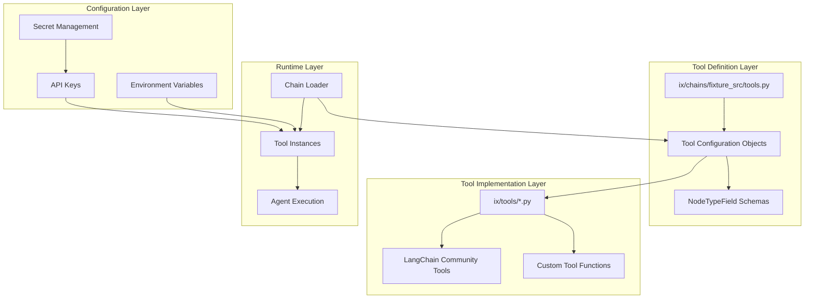
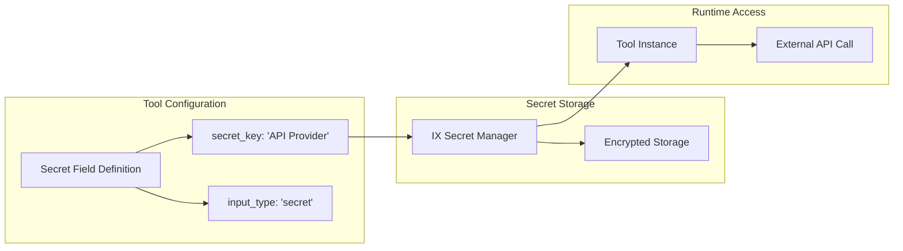
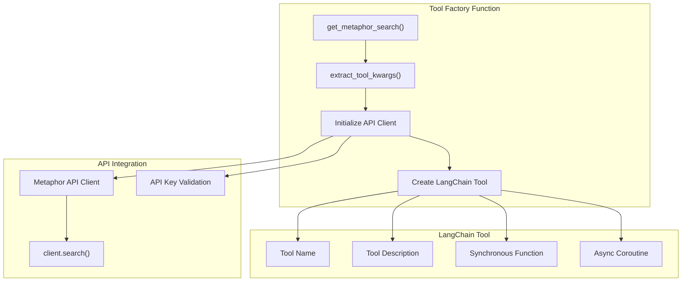

<!-- source: DeepWiki mcp.deepwiki.com · repo kreneskyp/ix · page 6.2 Tool Integration · fetched 2026-10-27 -->

# Tool Integration

<details>
<summary>Relevant source files</summary>

The following files were used as context for generating this wiki page:

- [.env.template](.env.template)
- [ix/chains/fixture_src/tools.py](ix/chains/fixture_src/tools.py)
- [ix/tools/metaphor.py](ix/tools/metaphor.py)

</details>


This document covers the tool integration system in IX, which provides agents with access to external services and APIs. Tools enable agents to perform actions beyond text generation, such as searching the web, querying databases, calling APIs, and executing code.

For information about configuring LLM providers, see [LLM Configuration](#6.1). For details about the component integration architecture, see [Component Integration](#3.3).

## Tool Architecture

The IX platform integrates tools through a combination of LangChain tool wrappers and custom implementations. Tools are defined as fixtures in the component system and made available through the chain graph editor.



Sources: [ix/chains/fixture_src/tools.py:1-301](), [ix/tools/metaphor.py:1-56]()

## Available Tools

IX provides a comprehensive set of pre-built tools covering search engines, knowledge bases, APIs, and custom integrations.

### Search Tools

| Tool Name | Class Path | Description | API Key Required |
|-----------|------------|-------------|------------------|
| Bing Search | `ix.tools.bing.get_bing_search` | Web search via Bing API | Yes |
| DuckDuckGo Search | `ix.tools.duckduckgo.get_ddg_search` | Web search via DuckDuckGo | No |
| Google Search | `ix.tools.google.get_google_search` | Web search via Google Custom Search | Yes |
| Google Serper | `ix.tools.google.get_google_serper` | Web search via Serper API | Yes |
| Metaphor Search | `ix.tools.metaphor.get_metaphor_search` | Neural web search | Yes |

Sources: [ix/chains/fixture_src/tools.py:61-80](), [ix/chains/fixture_src/tools.py:91-101](), [ix/chains/fixture_src/tools.py:103-123](), [ix/chains/fixture_src/tools.py:125-141](), [ix/chains/fixture_src/tools.py:210-216]()

### Knowledge Base Tools

| Tool Name | Class Path | Description | Configuration |
|-----------|------------|-------------|---------------|
| Wikipedia | `ix.tools.wikipedia.get_wikipedia` | Wikipedia article search and retrieval | Language, result limits |
| Arxiv Search | `ix.tools.arxiv.get_arxiv` | Academic paper search | Result limits, content length |
| PubMed | `ix.tools.pubmed.get_pubmed` | Medical literature search | Email for rate limiting |

Sources: [ix/chains/fixture_src/tools.py:182-197](), [ix/chains/fixture_src/tools.py:43-59](), [ix/chains/fixture_src/tools.py:164-180]()

### API Integration Tools

| Tool Name | Class Path | Description | Requirements |
|-----------|------------|-------------|--------------|
| GraphQL Tool | `ix.tools.graphql.get_graphql_tool` | Execute GraphQL queries | Endpoint URL |
| Lambda API | `ix.tools.lambda_api.get_lambda_api` | Invoke AWS Lambda functions | AWS credentials |
| Zapier | `ix.tools.zapier.zapier_toolkit` | Zapier automation integration | API key or OAuth |
| Wolfram Alpha | `ix.tools.wolfram_alpha.get_wolfram_alpha` | Mathematical computations | App ID |

Sources: [ix/chains/fixture_src/tools.py:143-150](), [ix/chains/fixture_src/tools.py:152-162](), [ix/chains/fixture_src/tools.py:253-282](), [ix/chains/fixture_src/tools.py:235-251]()

### Chain Tools

| Tool Name | Class Path | Description | Configuration |
|-----------|------------|-------------|---------------|
| Chain Tool | `ix.chains.tools.chain_as_tool` | Convert any chain into a tool | Target chain connection |

Sources: [ix/chains/fixture_src/tools.py:82-89]()

## Tool Configuration

### Environment Variables

Tools requiring API keys are configured through environment variables defined in the `.env` file:

```bash
# Search APIs
GOOGLE_API_KEY=your_google_api_key
GOOGLE_CX_ID=your_custom_search_engine_id
WOLFRAM_APP_ID=your_wolfram_alpha_app_id
METAPHOR_API_KEY=your_metaphor_api_key

# LLM Providers
OPENAI_API_KEY=your_openai_key
ANTHROPIC_API_KEY=your_anthropic_key

# Vector Databases
PINECONE_API_KEY=your_pinecone_key
PINECONE_ENV=your_pinecone_environment
```

Sources: [.env.template:14-44]()

### Secret Management

Sensitive configuration values like API keys are handled through IX's secret management system. Tools define secret fields using the `input_type: "secret"` configuration:



Sources: [ix/chains/fixture_src/tools.py:71-74](), [ix/chains/fixture_src/tools.py:113-121](), [ix/chains/fixture_src/tools.py:134-139]()

## Tool Implementation Pattern

Tools in IX follow a consistent implementation pattern demonstrated by the Metaphor tool implementation:



Sources: [ix/tools/metaphor.py:14-35](), [ix/tools/metaphor.py:38-43]()

### Key Implementation Components

1. **Tool Factory Functions**: Functions like `get_metaphor_search()` that create and configure tool instances
2. **Keyword Extraction**: `extract_tool_kwargs()` separates tool-specific parameters from LangChain Tool parameters
3. **API Client Initialization**: Setting up the external service client with proper authentication
4. **LangChain Tool Creation**: Wrapping the functionality in a `Tool` object with both sync and async support

Sources: [ix/tools/metaphor.py:38-43](), [ix/chains/loaders/tools.py:8]()

## Tool Field Configuration

Tools define their configuration interface through field specifications that control how they appear in the chain graph editor:

### Common Tool Fields

All tools inherit base fields defined in `TOOL_BASE_FIELDS`:

- `return_direct`: Boolean flag for direct tool output return
- `verbose`: Enable verbose logging during tool execution

Sources: [ix/chains/fixture_src/tools.py:35-41]()

### Dynamic Field Generation

Tools leverage `NodeTypeField.get_fields()` to automatically generate configuration fields from LangChain wrapper classes:

```python
# Example: Bing Search tool fields
NodeTypeField.get_fields(
    BingSearchAPIWrapper,
    include=["bing_subscription_key", "bing_search_url", "k"],
    field_options={
        "bing_subscription_key": {
            "input_type": "secret",
            "secret_key": "Bing",
        },
    },
)
```

Sources: [ix/chains/fixture_src/tools.py:67-79]()

## Adding Custom Tools

To add a custom tool, create both the implementation and fixture definition:

### 1. Tool Implementation

Create a tool module in `ix/tools/` following the established pattern:

```python
from langchain.tools import Tool
from ix.chains.loaders.tools import extract_tool_kwargs

def get_custom_tool(**kwargs):
    tool_kwargs = extract_tool_kwargs(kwargs)
    # Initialize your service/API client
    # Return Tool instance
```

### 2. Tool Fixture Definition

Add the tool configuration to `ix/chains/fixture_src/tools.py`:

```python
CUSTOM_TOOL = {
    "class_path": "ix.tools.custom.get_custom_tool",
    "type": "tool", 
    "name": "Custom Tool",
    "description": "Description of what the tool does",
    "fields": TOOL_BASE_FIELDS + [
        # Additional configuration fields
    ],
}
```

### 3. Registration

Add the new tool to the `TOOLS` list at the end of the fixtures file to make it available in the system.

Sources: [ix/chains/fixture_src/tools.py:284-300]()

---

