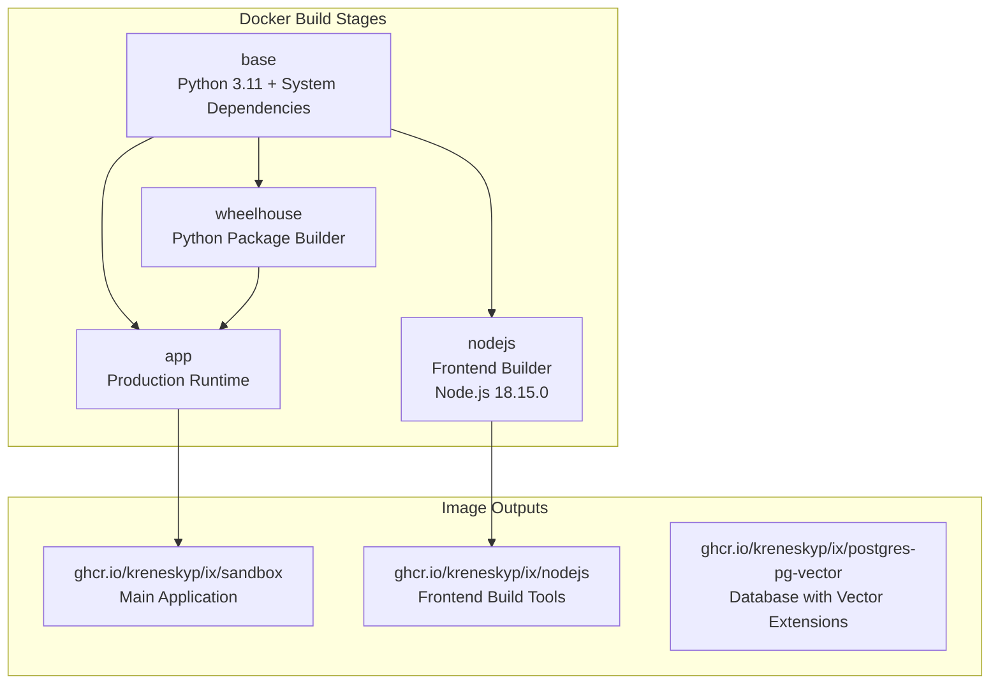
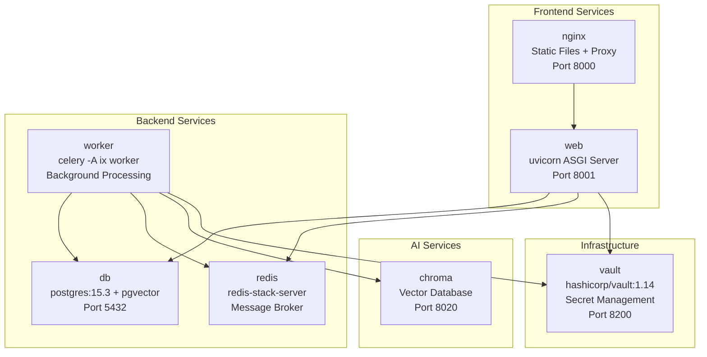
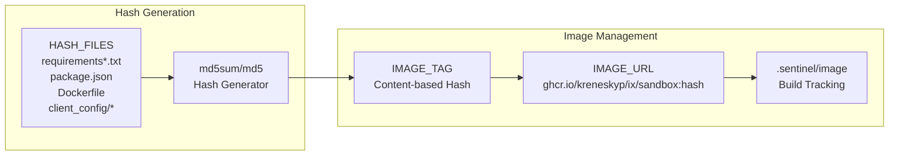
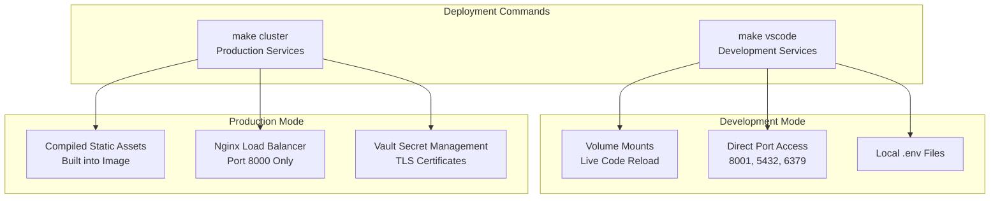
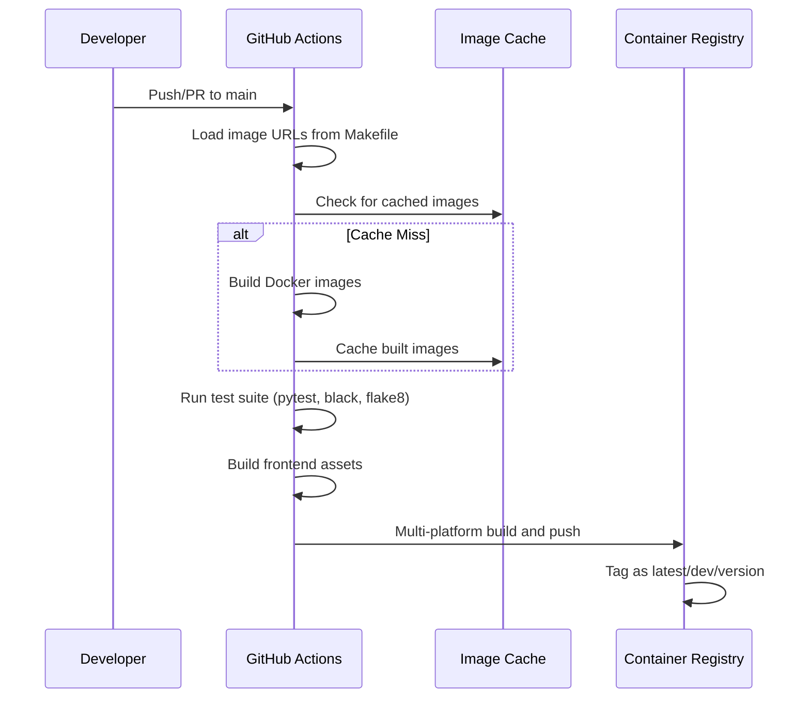
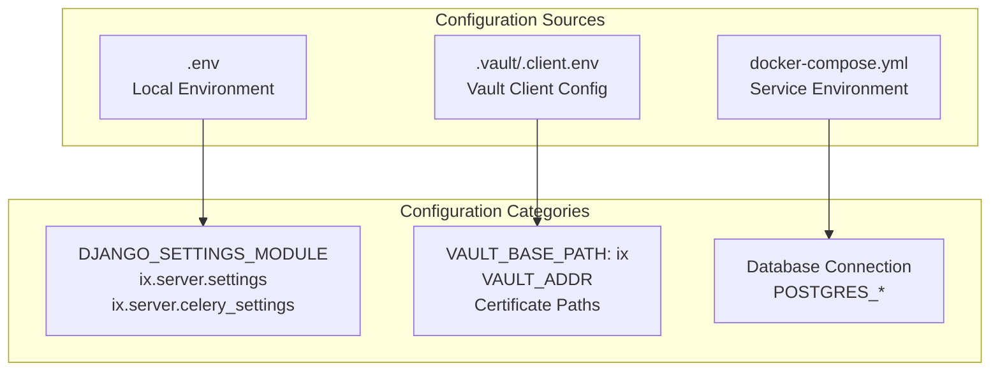
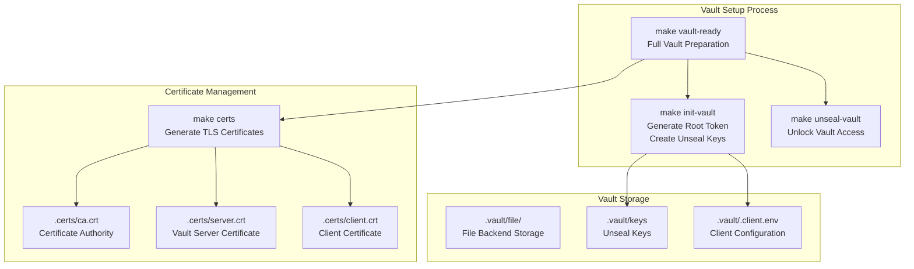

<!-- source: DeepWiki mcp.deepwiki.com · repo kreneskyp/ix · page 7.2 Deployment · fetched 2026-10-27 -->

# Deployment

<details>
<summary>Relevant source files</summary>

The following files were used as context for generating this wiki page:

- [.github/actions/run-docker/action.yml](.github/actions/run-docker/action.yml)
- [.github/workflows/publish-dev.yml](.github/workflows/publish-dev.yml)
- [.github/workflows/publish.yml](.github/workflows/publish.yml)
- [.github/workflows/test.yml](.github/workflows/test.yml)
- [.gitignore](.gitignore)
- [Dockerfile](Dockerfile)
- [Makefile](Makefile)
- [bin/get_uuid.py](bin/get_uuid.py)
- [docker-compose.yml](docker-compose.yml)
- [psql.Dockerfile](psql.Dockerfile)

</details>


This document covers production deployment strategies, Docker configuration, scaling considerations, and CI/CD pipeline setup for the IX AI agent platform. It focuses on containerized deployment using Docker and Docker Compose, build automation through Make, and automated publishing via GitHub Actions.

For initial setup and local development environment configuration, see [Getting Started](#2). For testing infrastructure and validation practices, see [Testing](#7.1).

## Docker Architecture

IX uses a multi-stage Docker build system that creates separate optimized images for different components of the platform.

### Multi-Stage Build Configuration

The main application uses a multi-stage Dockerfile that produces three distinct images:



**Image Build Process**

Sources: [Dockerfile:1-123](), [Makefile:10-96]()

The `base` stage establishes the foundation with Python 3.11 and system dependencies including PostgreSQL client tools. The `wheelhouse` stage downloads and builds Python package wheels separately to optimize caching. The `nodejs` stage provides Node.js 18.15.0 with npm and frontend build tools. Finally, the `app` stage combines compiled assets and creates the production runtime.

### Service Architecture

The platform deploys as multiple interconnected Docker services:



Sources: [docker-compose.yml:1-107]()

## Build System

The build system uses Make to orchestrate Docker image creation, frontend compilation, and deployment tasks.

### Image Tagging and Caching Strategy



Sources: [Makefile:14-17](), [Makefile:72-78]()

The build system generates content-based image tags by hashing key dependency files. This enables efficient caching where images are only rebuilt when their dependencies change. The `.sentinel` directory tracks build completion to avoid unnecessary rebuilds.

### Build Targets and Dependencies

| Target | Purpose | Dependencies |
|--------|---------|--------------|
| `image` | Build main application image | `.compiled-static`, `${IMAGE_SENTINEL}`, `${IMAGE_SENTINEL_PSQL}` |
| `nodejs` | Build frontend toolchain image | `${IMAGE_SENTINEL_NODEJS}` |
| `frontend` | Complete frontend build | `nodejs`, `graphene_to_graphql`, `compile_relay`, `webpack` |
| `dev_setup` | Full development setup | `image`, `frontend`, `migrate`, `dev_fixtures` |

Sources: [Makefile:106-128]()

## Service Orchestration

### Docker Compose Configuration

The platform uses Docker Compose to orchestrate multiple services with specific networking and volume requirements:

**Web Service Configuration**
- Image: `ghcr.io/kreneskyp/ix/sandbox:latest`
- Command: `uvicorn ix.server.asgi:application --host 0.0.0.0 --port 8001 --reload`
- Volumes: Source code mount for development, certificate management
- Environment: Django settings module, Vault configuration

**Worker Service Configuration**  
- Image: `ghcr.io/kreneskyp/ix/sandbox:latest`
- Command: `celery -A ix worker --loglevel=info --pool=solo --concurrency=1`
- Settings Module: `ix.server.celery_settings`
- Dependencies: Database, Redis, Chroma vector database

Sources: [docker-compose.yml:15-68]()

### Development vs Production Modes



Sources: [Makefile:161-179](), [Makefile:181-188]()

## CI/CD Pipeline

### GitHub Actions Workflow

The platform implements a comprehensive CI/CD pipeline using GitHub Actions with Docker image caching and multi-platform builds:



Sources: [.github/workflows/test.yml:1-217](), [.github/workflows/publish-dev.yml:1-100]()

### Build and Test Matrix

| Job | Trigger | Purpose | Dependencies |
|-----|---------|---------|--------------|
| `build` | Push/PR | Build and cache main image | Docker layer caching |
| `nodejs_build` | Push/PR | Build frontend toolchain | Separate Node.js image cache |
| `dev_setup` | Push/PR | Test full setup process | `build`, `nodejs_build` |
| `pytest` | Push/PR | Run Python test suite | `build` |
| `black` | Push/PR | Code formatting validation | `build` |
| `flake8` | Push/PR | Python linting | `build` |
| `prettier` | Push/PR | JavaScript formatting | `nodejs_build` |

Sources: [.github/workflows/test.yml:121-204]()

### Multi-Platform Publishing

The publishing workflow builds for multiple architectures:

```yaml
platforms: linux/amd64,linux/arm64
push: true
tags: |
  ghcr.io/kreneskyp/ix/sandbox:latest
  ghcr.io/kreneskyp/ix/sandbox:${{ github.event.release.tag_name }}
```

Sources: [.github/workflows/publish.yml:96-100]()

## Production Deployment

### Service Scaling Configuration

The platform supports horizontal scaling of worker processes:

```bash
# Scale workers to N instances
make scale N=5

# Reset worker processes (for code deployment)
make worker-reset
```

Sources: [Makefile:231-234](), [Makefile:223-228]()

### Environment Configuration



Sources: [docker-compose.yml:30-36](), [docker-compose.yml:62-67]()

### Volume Management

| Volume | Purpose | Mount Point |
|--------|---------|-------------|
| `postgres_data` | Database persistence | `/var/lib/postgresql/data` |
| `.compiled-static` | Frontend assets | `/var/static/` |
| `.certs` | TLS certificates | `/var/vault/certs` |
| `.vault/file` | Vault file backend | `/vault/file` |

Sources: [docker-compose.yml:13](), [docker-compose.yml:44](), [docker-compose.yml:29](), [docker-compose.yml:98]()

## Security and Secret Management

### Vault Integration

The platform integrates HashiCorp Vault for secret management:



Sources: [Makefile:379-429](), [Makefile:438-466]()

### Certificate Generation

The system automatically generates required TLS certificates for secure Vault communication:

```bash
# Certificate generation process
openssl genpkey -algorithm RSA -out .certs/ca.key
openssl req -x509 -new -nodes -key .certs/ca.key -subj "/CN=Vault CA" -days 3650 -out .certs/ca.crt
openssl genpkey -algorithm RSA -out .certs/server.key
openssl req -new -key .certs/server.key -subj "/CN=localhost" -out .certs/server.csr
openssl x509 -req -in .certs/server.csr -CA .certs/ca.crt -CAkey .certs/ca.key -CAcreateserial -out .certs/server.crt -days 3650
```

Sources: [Makefile:441-451]()