# Page: Overview

# Overview

<details>
<summary>Relevant source files</summary>

The following files were used as context for generating this wiki page:

- [README.md](README.md)
- [docs/FizzBuzzExample.gif](docs/FizzBuzzExample.gif)
- [docs/chat.png](docs/chat.png)
- [docs/chat_interactions.png](docs/chat_interactions.png)
- [docs/create_task.png](docs/create_task.png)
- [ix/api/artifacts/endpoints.py](ix/api/artifacts/endpoints.py)
- [ix/api/artifacts/types.py](ix/api/artifacts/types.py)
- [ix/api/tests/test_artifacts.py](ix/api/tests/test_artifacts.py)
- [ix/runnable/tests/__init__.py](ix/runnable/tests/__init__.py)
- [ix/server/fast_api.py](ix/server/fast_api.py)
- [ix/server/settings.py](ix/server/settings.py)
- [ix/server/test_settings.py](ix/server/test_settings.py)
- [ix/task_log/fixtures/dev_data.json~](ix/task_log/fixtures/dev_data.json~)
- [ix/task_log/migrations/0011_artifact_group_artifact_user.py](ix/task_log/migrations/0011_artifact_group_artifact_user.py)

</details>


## Purpose and Scope

IX is a platform for designing, deploying, and managing autonomous and semi-autonomous LLM-powered agents and workflows. This page provides a high-level overview of the IX platform architecture, core components, and system design. It covers the fundamental concepts and technical structure needed to understand how IX enables visual no-code agent creation, multi-agent orchestration, and scalable AI workflow execution.

For detailed information about specific subsystems, see [Core Architecture](#3), [API Reference](#4), and [Frontend Documentation](#5). For setup and deployment instructions, see [Getting Started](#2).

## Platform Architecture

IX is built as a modern web application with a React frontend, Django/FastAPI backend, and distributed task execution system. The platform integrates deeply with LangChain to provide a visual interface for building AI agent workflows.

### System Overview

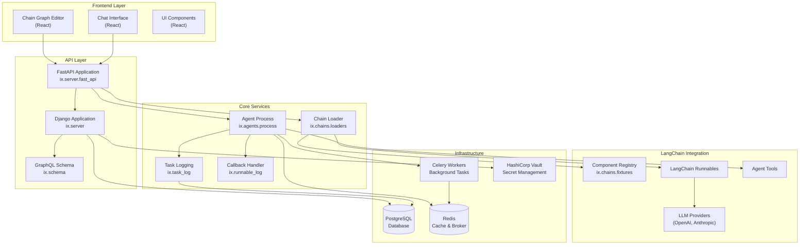

Sources: [ix/server/fast_api.py:1-95](), [ix/server/settings.py:1-268](), [README.md:30-87]()

## Core Concepts

### Chains
Chains are visual workflows that define the logic and flow of AI agent operations. They are built using a graph-based editor and executed through the LangChain framework.

### Agents  
Agents are autonomous entities that can execute chains, use tools, and interact with users through chat interfaces. Multiple agents can collaborate within a single conversation.

### Components
Components are LangChain-compatible building blocks (LLMs, tools, memory systems, etc.) that can be visually connected in the chain editor to create complex workflows.

### Tasks
Tasks represent individual execution instances of agent operations, providing logging, artifact management, and conversation history.

## API Structure

IX exposes its functionality through both REST and GraphQL APIs, organized into distinct routers for different domains:

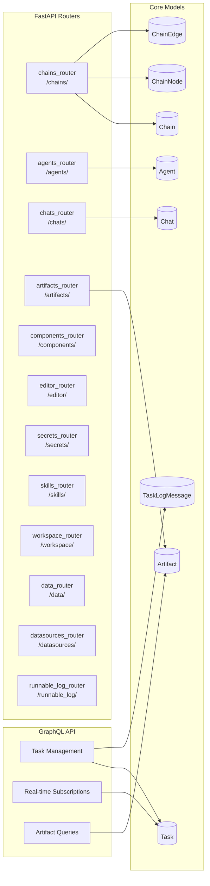

Sources: [ix/server/fast_api.py:8-38](), [ix/api/artifacts/endpoints.py:1-122]()

## Data Models and Relationships

The IX platform uses a relational data model centered around chains, agents, tasks, and artifacts:

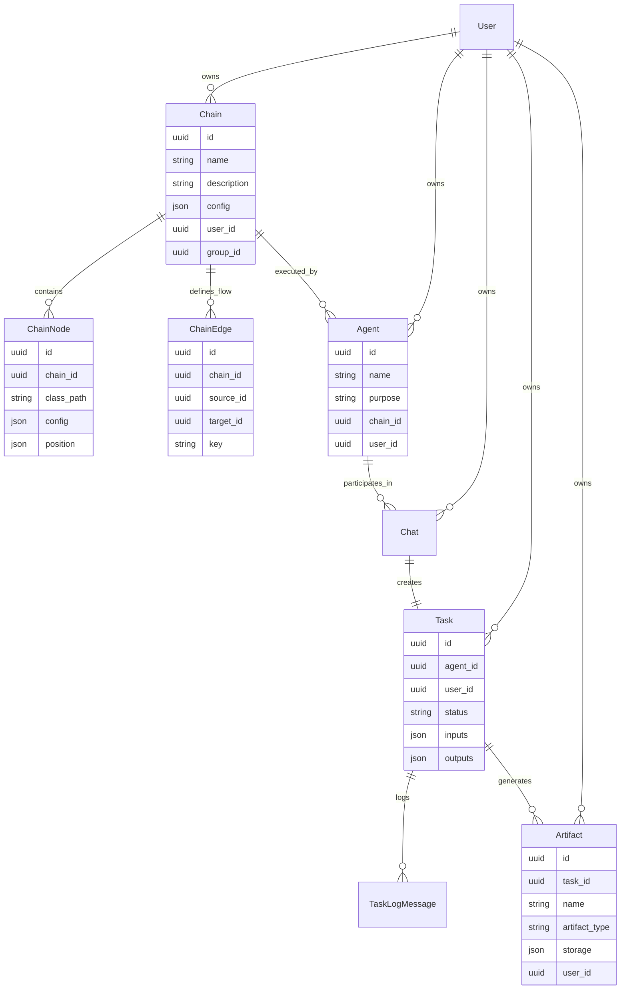

Sources: [ix/task_log/migrations/0011_artifact_group_artifact_user.py:1-33](), [ix/api/artifacts/types.py:1-40]()

## Execution Flow

When a user interacts with an agent through the chat interface, IX follows this execution pattern:

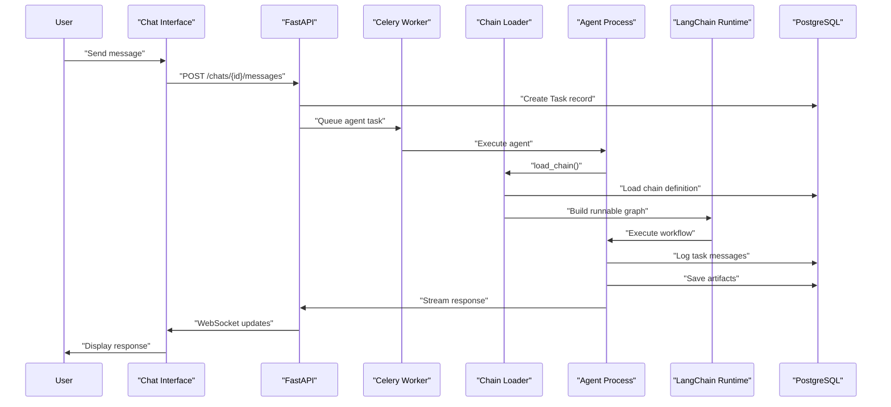

Sources: [ix/server/fast_api.py:1-95](), [ix/server/settings.py:193-196]()

## Component Integration

IX provides a component configuration layer that maps LangChain components to visual node types in the chain editor:

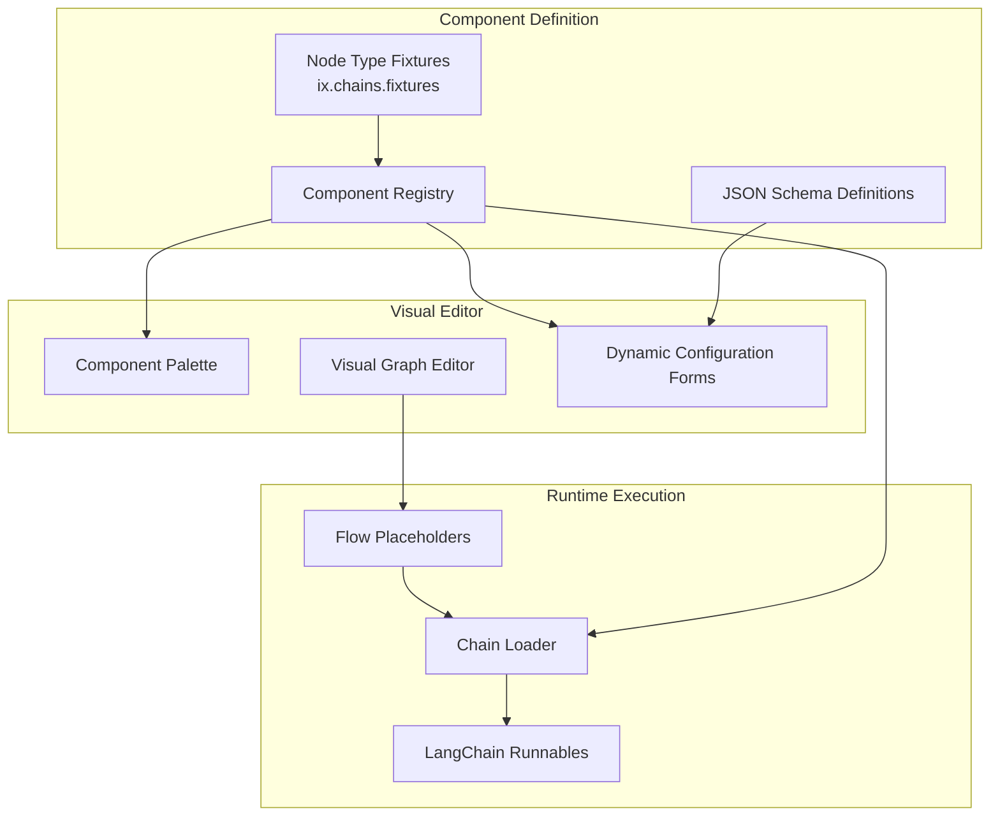

Sources: [README.md:82-87](), [ix/server/settings.py:288-289]()

This architecture enables IX to provide a visual, no-code interface for building sophisticated AI agent workflows while maintaining the full power and flexibility of the LangChain ecosystem.

---

# Page: Getting Started

# Getting Started

<details>
<summary>Relevant source files</summary>

The following files were used as context for generating this wiki page:

- [.github/actions/run-docker/action.yml](.github/actions/run-docker/action.yml)
- [.github/workflows/publish-dev.yml](.github/workflows/publish-dev.yml)
- [.github/workflows/publish.yml](.github/workflows/publish.yml)
- [.github/workflows/test.yml](.github/workflows/test.yml)
- [.gitignore](.gitignore)
- [Dockerfile](Dockerfile)
- [Makefile](Makefile)
- [bin/get_uuid.py](bin/get_uuid.py)
- [docker-compose.yml](docker-compose.yml)
- [ix/chains/fixtures/agent/code2.json](ix/chains/fixtures/agent/code2.json)
- [ix/chains/fixtures/agent/each.json](ix/chains/fixtures/agent/each.json)
- [ix/chains/fixtures/agent/gemini.json](ix/chains/fixtures/agent/gemini.json)
- [ix/chains/fixtures/agent/ingest.json](ix/chains/fixtures/agent/ingest.json)
- [ix/chains/fixtures/agent/ingest_url.json](ix/chains/fixtures/agent/ingest_url.json)
- [ix/chains/fixtures/agent/knowledge.json](ix/chains/fixtures/agent/knowledge.json)
- [ix/chains/fixtures/agent/readme.json](ix/chains/fixtures/agent/readme.json)
- [ix/data/fixtures/ix_api.json](ix/data/fixtures/ix_api.json)
- [ix/task_log/management/commands/setup.py](ix/task_log/management/commands/setup.py)
- [psql.Dockerfile](psql.Dockerfile)

</details>


This document provides step-by-step instructions for installing, configuring, and deploying the IX AI agent platform. It covers everything from initial setup through verification that the system is running correctly.

The IX platform is a visual no-code agent builder that integrates with LangChain to create and deploy AI agents through a web interface. For detailed information about the core architecture and how components work together, see [Core Architecture](#3). For API usage and integration details, see [API Reference](#4).

## Prerequisites

Before starting, ensure you have the following installed on your system:

- **Docker** and **Docker Compose** - The platform runs entirely in containers
- **Make** - Used for build automation and common tasks
- **Git** - For cloning the repository
- At least **8GB RAM** and **4 CPU cores** recommended for optimal performance

## Quick Start

The fastest way to get IX running is using the automated development setup:

```bash
# Clone the repository
git clone https://github.com/kreneskyp/ix.git
cd ix

# Run complete development setup
make dev_setup
```

This single command handles the entire setup process, including building Docker images, running database migrations, loading LangChain components, and setting up example agents.

### Service Architecture

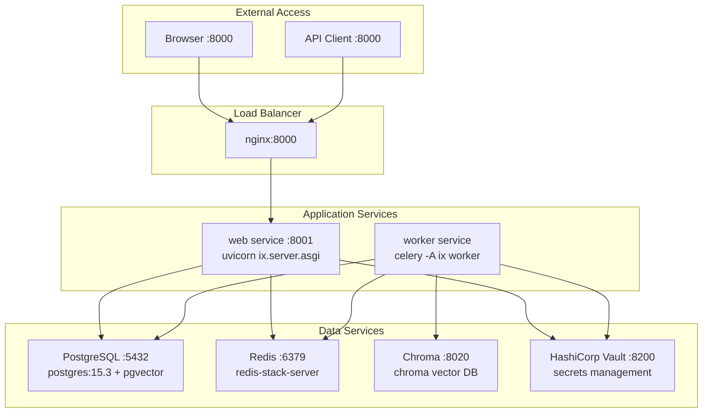

Sources: [docker-compose.yml:1-107](), [Makefile:181-189](), [nginx.conf:1-50]()

## Development Setup Process

The `make dev_setup` command executes several steps in sequence. Understanding these steps helps with troubleshooting and customization:

### Build Process Flow

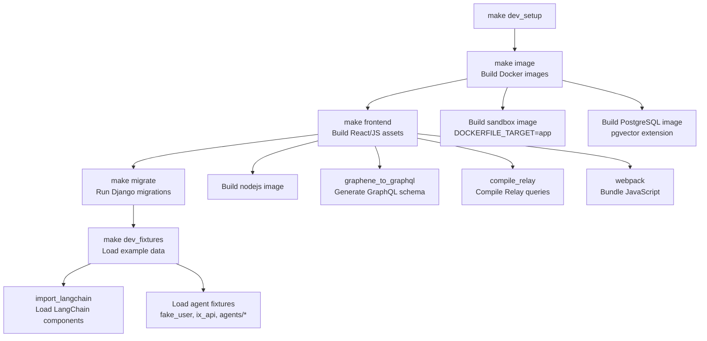

Sources: [Makefile:107-109](), [Makefile:127-129](), [ix/task_log/management/commands/setup.py:8-35]()

### Manual Step-by-Step Setup

If you prefer to run setup steps individually or encounter issues:

```bash
# 1. Build Docker images
make image

# 2. Build frontend assets
make frontend

# 3. Start core services
make cluster

# 4. Run database migrations
make migrate

# 5. Load LangChain components
make components

# 6. Load example agents and fixtures
make dev_fixtures
```

### Key Build Targets

| Command | Purpose | Key Files |
|---------|---------|-----------|
| `make image` | Build application containers | [Dockerfile:1-123](), [psql.Dockerfile:1-6]() |
| `make frontend` | Compile React/JavaScript assets | [webpack.config.js](), [package.json]() |
| `make migrate` | Apply database schema changes | Django migrations in `ix/*/migrations/` |
| `make components` | Import LangChain components to database | [ix/chains/management/commands/import_langchain.py]() |

Sources: [Makefile:117-129](), [Makefile:257-304]()

## Service Management

### Starting Services

```bash
# Start all services in background
make up

# Start services and view logs
make server

# Start individual components
make db      # PostgreSQL only
make redis   # Redis only
```

### Service Status and Logs

```bash
# View running containers
docker-compose ps

# View logs for specific services
docker-compose logs web
docker-compose logs worker
docker-compose logs nginx

# Follow logs in real-time
make server  # web + nginx logs
make worker  # worker logs only
```

### Development Containers

For VS Code development or direct database access:

```bash
# Start development containers (DB + Redis only)
make vscode

# Stop development containers
make vscode-down

# Access application shell
make shell    # Django shell_plus
make bash     # Raw bash shell
```

Sources: [Makefile:161-179](), [Makefile:206-229](), [Makefile:239-252]()

## Verification Steps

### 1. Check Service Health

Verify all containers are running:

```bash
docker-compose ps
```

Expected output should show all services as "Up":
- `ix_web_1` - Application server
- `ix_nginx_1` - Load balancer  
- `ix_worker_1` - Background worker
- `ix_db_1` - PostgreSQL database
- `ix_redis_1` - Redis cache/broker
- `ix_chroma_1` - Vector database

### 2. Access Web Interface

Open your browser to `http://localhost:8000`. You should see the IX platform interface with:
- Chain graph editor for building agent workflows
- Chat interface for interacting with agents
- Agent management and configuration options

### 3. Test API Endpoints

```bash
# Check API health
curl http://localhost:8000/api/health

# List available agents
curl http://localhost:8000/agents/

# List available chains  
curl http://localhost:8000/chains/
```

### 4. Verify Agent Functionality

The setup includes several example agents loaded from fixtures:

| Agent | Alias | Purpose | Fixture File |
|-------|-------|---------|--------------|
| IX Readme | `readme` | Answers questions about IX using README | [ix/chains/fixtures/agent/readme.json]() |
| Knowledge | `knowledge` | RAG agent with vector search | [ix/chains/fixtures/agent/knowledge.json]() |
| Coder | `code` | Generates code solutions | [ix/chains/fixtures/agent/code2.json]() |
| Ingestion | `ingest` | Loads data into vector stores | [ix/chains/fixtures/agent/ingest.json]() |

Test an agent through the chat interface by typing: `@readme What is IX?`

Sources: [ix/chains/fixtures/agent/readme.json:1-379](), [ix/chains/fixtures/agent/knowledge.json:1-449](), [ix/task_log/management/commands/setup.py:12-35]()

## Configuration

### Environment Variables

Copy and customize the environment configuration:

```bash
cp .env.example .env
```

Key configuration options:

| Variable | Purpose | Default |
|----------|---------|---------|
| `OPENAI_API_KEY` | OpenAI API access | Required for most agents |
| `DJANGO_SECRET_KEY` | Django security | Auto-generated in container |
| `POSTGRES_*` | Database configuration | Set in docker-compose.yml |
| `VAULT_*` | Secrets management | Optional for development |

### LLM Provider Setup

To use different LLM providers, configure API keys in your `.env` file:

```bash
# OpenAI (most common)
OPENAI_API_KEY=your_openai_key

# Google Gemini
GOOGLE_API_KEY=your_google_key  

# Anthropic Claude
ANTHROPIC_API_KEY=your_anthropic_key
```

For detailed LLM configuration, see [LLM Configuration](#6.1).

Sources: [docker-compose.yml:30-36](), [Dockerfile:92-96]()

## Troubleshooting

### Common Issues

**Port conflicts**: If port 8000 is in use, modify the port mapping in [docker-compose.yml:40-41]()

**Memory issues**: Increase Docker memory allocation to at least 8GB for optimal performance

**Frontend build failures**: Ensure Node.js assets build correctly:
```bash
make nodejs
make webpack
```

**Database connection errors**: Verify PostgreSQL is running:
```bash
make db
docker-compose logs db
```

### Reset and Clean Commands

```bash
# Reset worker processes
make worker-reset

# Clean build artifacts
make clean

# Full restart
make restart

# Fix file ownership issues (Linux)
make fix-file-ownership
```

Sources: [Makefile:222-234](), [Makefile:361-373]()

## Next Steps

Once IX is running successfully:

1. **Explore the Interface**: Visit [Chain Graph Editor](#5.1) to learn about building agent workflows visually
2. **Try the Examples**: Interact with the pre-loaded agents through the [Chat Interface](#5.2)  
3. **Build Custom Agents**: See [Agent Execution System](#3.2) for details on agent architecture
4. **Add Tools and Components**: Check [Tool Integration](#6.2) for extending agent capabilities
5. **Deploy to Production**: Review [Deployment](#7.2) for production deployment strategies

The IX platform provides a complete environment for building, testing, and deploying AI agents. The visual editor makes it accessible to non-programmers while maintaining the flexibility needed for complex agent workflows.

---

# Page: Core Architecture

# Core Architecture

<details>
<summary>Relevant source files</summary>

The following files were used as context for generating this wiki page:

- [ix/agents/history.py](ix/agents/history.py)
- [ix/agents/process.py](ix/agents/process.py)
- [ix/agents/tests/test_history.py](ix/agents/tests/test_history.py)
- [ix/agents/tests/test_process.py](ix/agents/tests/test_process.py)
- [ix/api/components/types.py](ix/api/components/types.py)
- [ix/chains/loaders/__init__.py](ix/chains/loaders/__init__.py)
- [ix/chains/loaders/core.py](ix/chains/loaders/core.py)
- [ix/chains/loaders/memory.py](ix/chains/loaders/memory.py)
- [ix/chains/migrations/0005_refine_node_type.py](ix/chains/migrations/0005_refine_node_type.py)
- [ix/chains/models.py](ix/chains/models.py)
- [ix/conftest.py](ix/conftest.py)
- [ix/pg_vector/tests/models.py](ix/pg_vector/tests/models.py)
- [ix/task_log/models.py](ix/task_log/models.py)
- [ix/task_log/tasks/agent_runner.py](ix/task_log/tasks/agent_runner.py)
- [ix/task_log/tests/fake.py](ix/task_log/tests/fake.py)

</details>


This document provides a comprehensive overview of the IX AI agent platform's core architecture, focusing on the fundamental systems that enable visual chain building, agent execution, and LangChain integration. The architecture consists of four primary subsystems: the Chain System for workflow definition and execution, the Agent Execution System for runtime processing, the Component Integration layer for LangChain components, and the supporting data models and context management.

For specific implementation details of individual subsystems, see [Chain System](#3.1), [Agent Execution System](#3.2), and [Component Integration](#3.3).

## System Overview

The IX platform is built around a modular architecture that separates workflow definition from execution, enabling visual chain building while maintaining full compatibility with LangChain's ecosystem.

### Core System Architecture

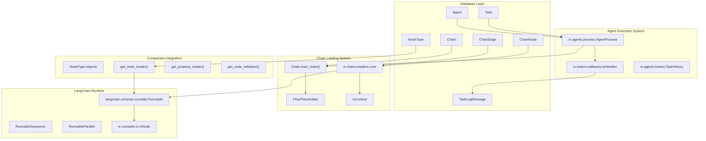

Sources: [ix/chains/models.py:288-362](), [ix/agents/process.py:29-79](), [ix/chains/loaders/core.py:1-968](), [ix/task_log/models.py:13-239]()

## Chain System Architecture

The Chain System provides the foundation for visual workflow definition and execution, converting graph-based representations into executable LangChain runnables.

### Chain Data Model

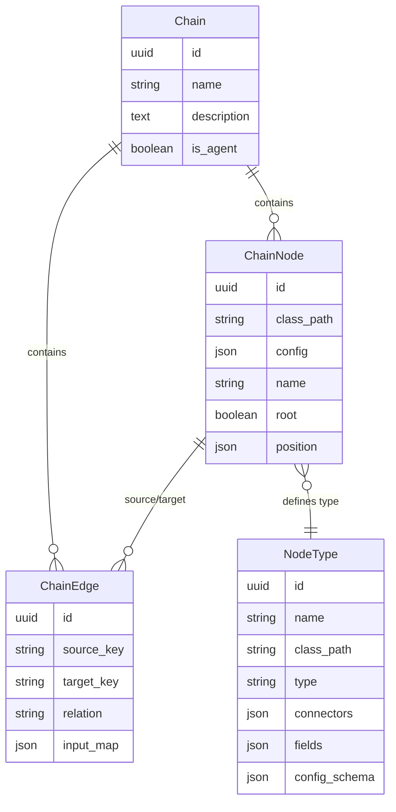

Sources: [ix/chains/models.py:288-362](), [ix/chains/models.py:230-287](), [ix/chains/models.py:263-287](), [ix/chains/models.py:45-104]()

### Chain Loading Process

The chain loading system transforms database representations into executable LangChain components through a multi-phase process:

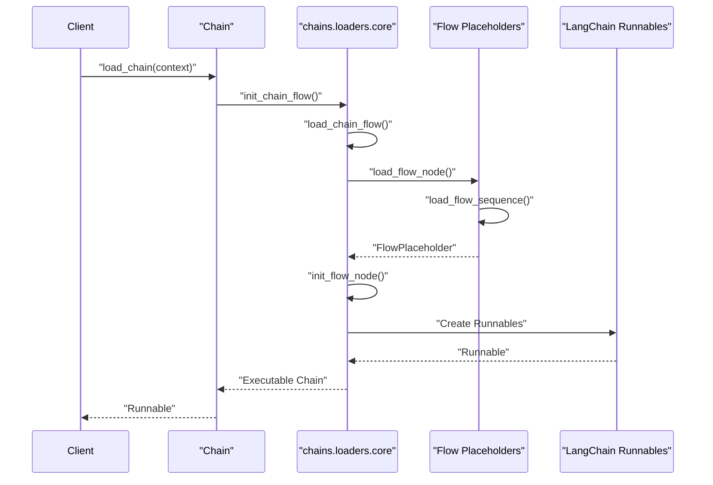

Sources: [ix/chains/models.py:316-324](), [ix/chains/loaders/core.py:512-534](), [ix/chains/loaders/core.py:564-578](), [ix/chains/loaders/core.py:895-968]()

## Agent Execution Architecture

The Agent Execution System manages the runtime execution of AI agents, handling task lifecycle, message logging, and callback management.

### Agent Process Lifecycle

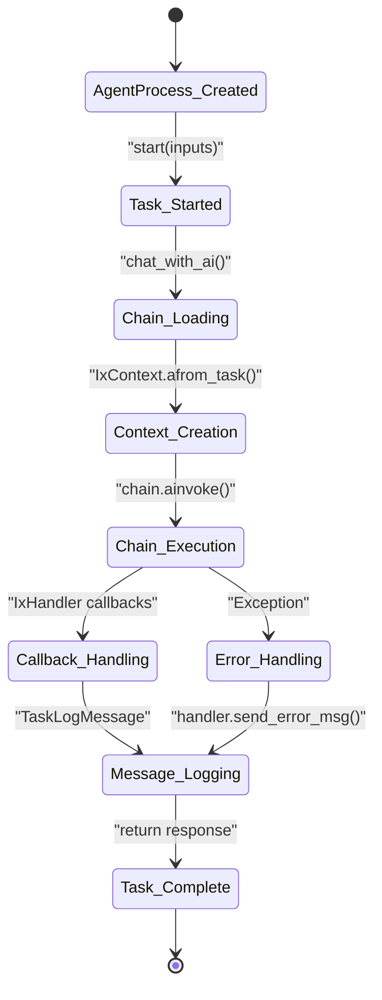

Sources: [ix/agents/process.py:29-79](), [ix/chains/callbacks.py:1-500](), [ix/task_log/models.py:80-151]()

### Task and Message Management

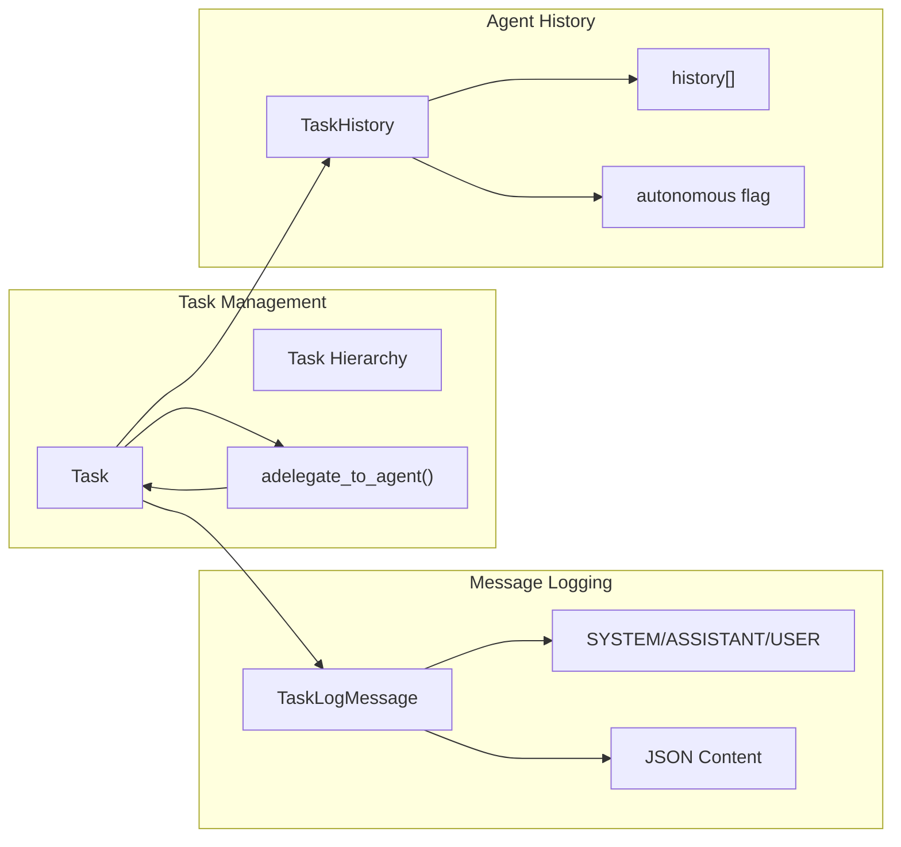

Sources: [ix/task_log/models.py:13-71](), [ix/task_log/models.py:80-151](), [ix/agents/history.py:11-157]()

## Component Integration Architecture

The Component Integration layer provides a bridge between IX's visual interface and LangChain's component ecosystem, enabling seamless integration of AI components.

### NodeType System

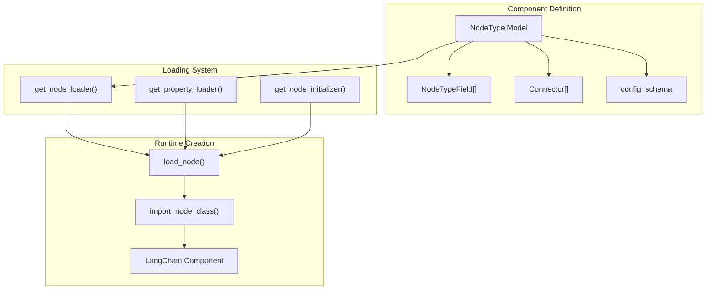

Sources: [ix/api/components/types.py:484-630](), [ix/chains/loaders/core.py:40-87](), [ix/chains/loaders/core.py:154-323]()

### Component Loading Flow

The component loading system handles the instantiation and configuration of LangChain components from IX node definitions:

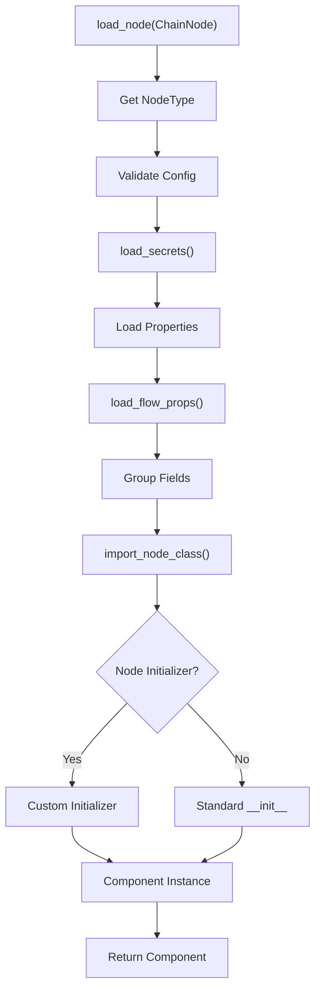

Sources: [ix/chains/loaders/core.py:154-323](), [ix/chains/loaders/core.py:89-119](), [ix/chains/loaders/core.py:121-152]()

## Context and Memory Management

The platform provides sophisticated context management for maintaining state across agent executions and chain invocations.

### IxContext System

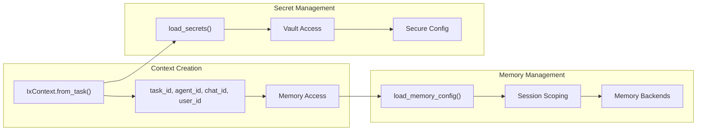

Sources: [ix/chains/loaders/context.py:1-200](), [ix/chains/loaders/memory.py:48-171](), [ix/chains/loaders/core.py:89-119]()

## Flow Execution System

The Flow Execution System handles the complex task of converting visual node graphs into executable LangChain flows, managing parallel execution, branching, and data flow.

### Flow Placeholder Architecture

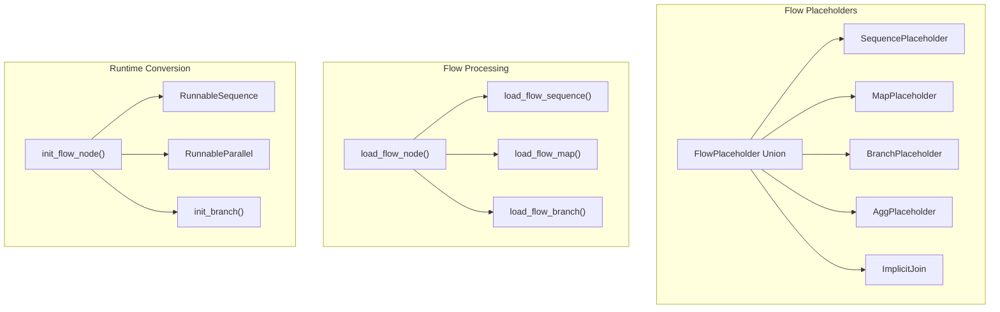

Sources: [ix/chains/loaders/core.py:348-464](), [ix/chains/loaders/core.py:580-644](), [ix/chains/loaders/core.py:706-874](), [ix/chains/loaders/core.py:895-968]()

This architecture enables IX to provide a powerful visual interface for building AI agents while maintaining full compatibility with LangChain's extensive ecosystem of components and tools.

---

# Page: Chain System

# Chain System

<details>
<summary>Relevant source files</summary>

The following files were used as context for generating this wiki page:

- [ix/agents/callback_manager.py](ix/agents/callback_manager.py)
- [ix/api/components/types.py](ix/api/components/types.py)
- [ix/chains/functions.py](ix/chains/functions.py)
- [ix/chains/json.py](ix/chains/json.py)
- [ix/chains/llm_chain.py](ix/chains/llm_chain.py)
- [ix/chains/loaders/__init__.py](ix/chains/loaders/__init__.py)
- [ix/chains/loaders/core.py](ix/chains/loaders/core.py)
- [ix/chains/loaders/memory.py](ix/chains/loaders/memory.py)
- [ix/chains/loaders/tools.py](ix/chains/loaders/tools.py)
- [ix/chains/migrations/0005_refine_node_type.py](ix/chains/migrations/0005_refine_node_type.py)
- [ix/chains/models.py](ix/chains/models.py)
- [ix/chains/routing.py](ix/chains/routing.py)
- [ix/chains/tests/conftest.py](ix/chains/tests/conftest.py)
- [ix/chains/tests/fake.py](ix/chains/tests/fake.py)
- [ix/chains/tests/mock_configs.py](ix/chains/tests/mock_configs.py)
- [ix/chains/tests/mock_memory.py](ix/chains/tests/mock_memory.py)
- [ix/chains/tests/test_config_loader.py](ix/chains/tests/test_config_loader.py)
- [ix/chains/tests/test_llm_chain.py](ix/chains/tests/test_llm_chain.py)
- [ix/chains/tests/test_routing.py](ix/chains/tests/test_routing.py)
- [ix/conftest.py](ix/conftest.py)
- [ix/pg_vector/tests/models.py](ix/pg_vector/tests/models.py)

</details>


The Chain System is the core workflow engine of the IX platform that handles chain definition, loading, and execution. It provides a visual graph-based interface for building AI workflows while translating them into executable LangChain components at runtime. This system bridges the gap between the visual node-and-edge representation used in the UI and the LangChain Expression Language (LCEL) components that execute the actual workflows.

For information about agent execution and task management, see [Agent Execution System](#3.2). For details on UI components and the visual editor, see [Chain Graph Editor](#5.1).

## Core Architecture

The Chain System consists of three primary layers: the data models that define chain structure, the loading system that converts graphs to executable components, and the runtime execution context.

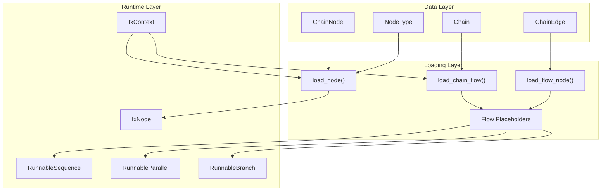

Sources: [ix/chains/models.py:1-362](), [ix/chains/loaders/core.py:1-968](), [ix/chains/loaders/context.py:1-50]()

## Chain Models and Data Structure

The Chain System uses four core Django models to represent workflow graphs in the database.

### Chain Model

The `Chain` model represents a complete workflow with metadata and references to its constituent nodes.

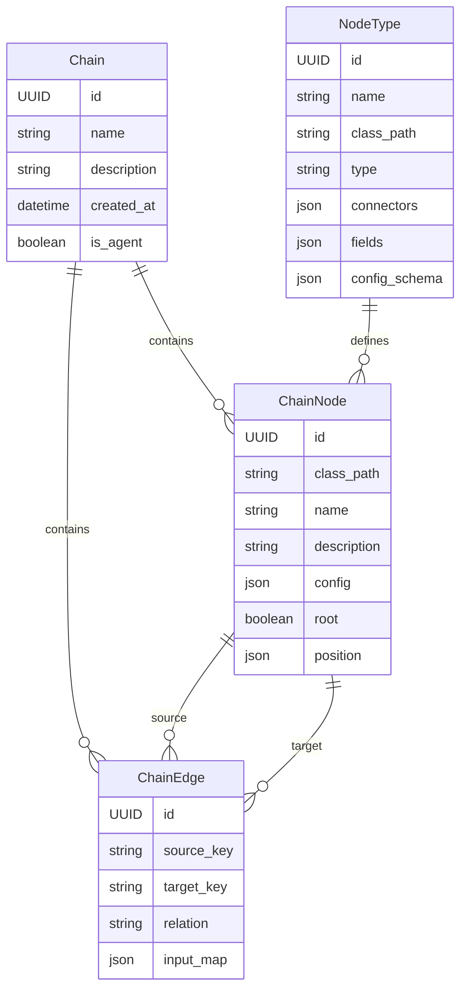

Key methods on the `Chain` model include:
- `load_chain(context)` - Loads the chain into executable components
- `aload_chain(context)` - Async version of chain loading
- `chat_root` - Property that finds the root node for chat workflows

Sources: [ix/chains/models.py:288-362]()

### ChainNode Model

The `ChainNode` model represents individual components in the workflow graph. Each node has a `class_path` that identifies the LangChain component it represents and a `config` containing initialization parameters.

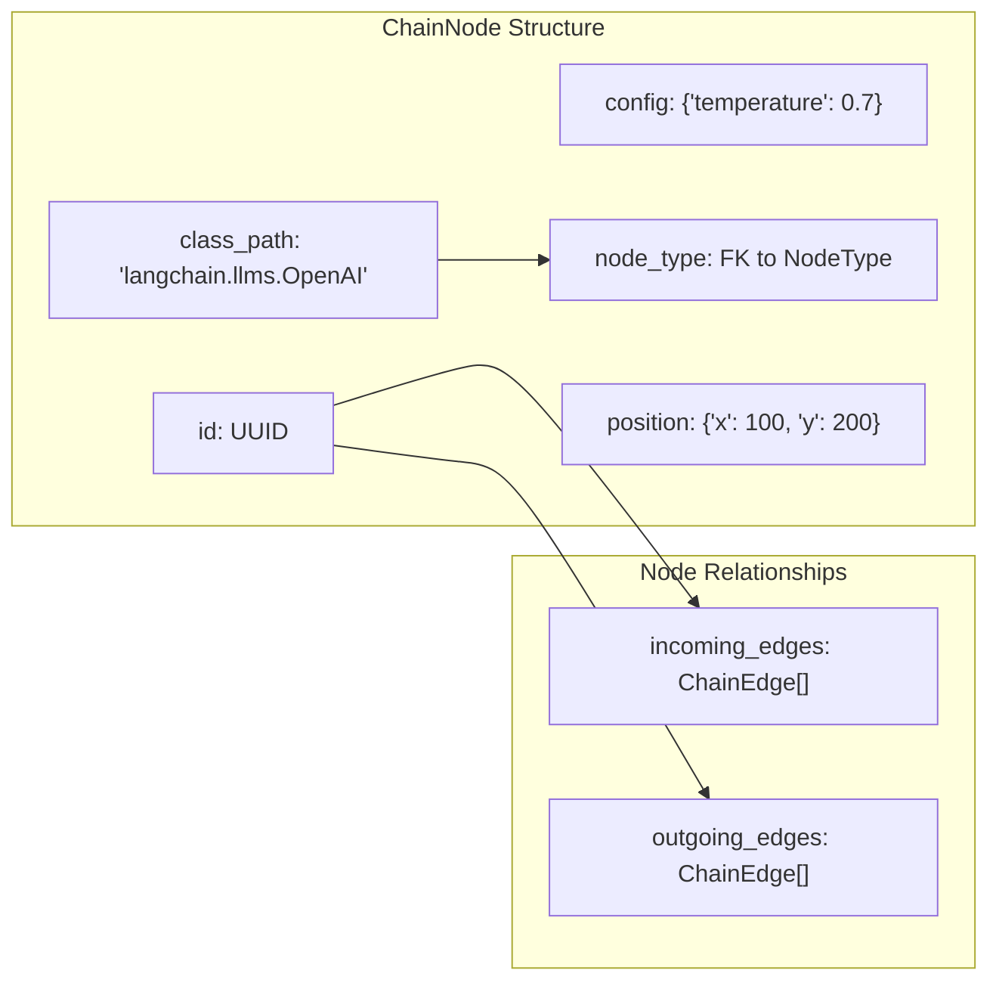

Sources: [ix/chains/models.py:230-261]()

### ChainEdge Model

The `ChainEdge` model defines connections between nodes with two types of relationships:
- `LINK` - Data flow connections that define execution order
- `PROP` - Property connections that inject one node as a property of another

The `source_key` and `target_key` fields specify which outputs and inputs are connected.

Sources: [ix/chains/models.py:263-286]()

### NodeType Model

The `NodeType` model provides metadata about available components, including their configuration schema, connectors, and field definitions. This enables the UI to generate appropriate forms and validates component configurations.

Sources: [ix/chains/models.py:45-104](), [ix/api/components/types.py:484-643]()

## Chain Loading Process

The chain loading process converts the database graph representation into executable LangChain components through a multi-stage pipeline.

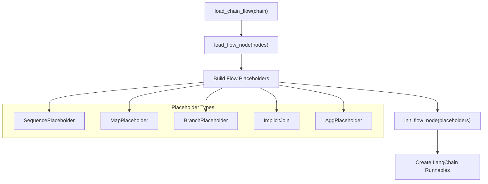

### Phase 1: Graph Loading

The `load_chain_flow()` function starts by identifying root nodes and building the flow structure using placeholder objects.

```python
def load_chain_flow(chain: Chain) -> Tuple[Type[BaseModel], FlowPlaceholder]:
    nodes = chain.nodes.filter(incoming_edges__source=chain.chat_root)
    return chain.types.INPUT, load_flow_node(nodes)
```

Sources: [ix/chains/loaders/core.py:564-578]()

### Phase 2: Flow Placeholder Construction

The `load_flow_node()` function traverses the graph and creates placeholder objects that represent different flow patterns:

- **SequencePlaceholder** - Sequential execution of nodes
- **MapPlaceholder** - Parallel execution with different inputs
- **BranchPlaceholder** - Conditional execution paths
- **ImplicitJoin** - Automatic aggregation points

Sources: [ix/chains/loaders/core.py:580-601](), [ix/chains/loaders/core.py:348-464]()

### Phase 3: Component Initialization

The `init_flow_node()` function converts placeholders into actual LangChain `Runnable` components:

```python
def init_flow_node(root: FlowPlaceholder, context: IxContext) -> Runnable:
    if isinstance(root, ChainNode):
        instance = load_node(root, context=context)
        return IxNode(name=root.name, child=instance, context=context)
    elif isinstance(root, SequencePlaceholder):
        nodes = [init_flow_node(node, context) for node in root.steps]
        return init_sequence(steps=nodes)
    # ... handle other placeholder types
```

Sources: [ix/chains/loaders/core.py:895-968]()

## Flow Processing and Placeholders

The Chain System uses placeholder objects to represent different execution patterns before converting them to LangChain components.

### Sequence Processing

Sequences represent linear execution chains where the output of one node becomes the input to the next.

```mermaid
graph LR
    A["ChainNode A"] --> B["ChainNode B"]
    B --> C["ChainNode C"]
    
    subgraph "Becomes"
        SeqA["IxNode(A)"] --> SeqB["IxNode(B)"]
        SeqB --> SeqC["IxNode(C)"]
    end
    
    A -.-> SeqA
    B -.-> SeqB
    C -.-> SeqC
```

The `load_flow_sequence()` function handles complex traversal logic including loop detection and map node processing.

Sources: [ix/chains/loaders/core.py:706-874]()

### Parallel Processing

Map nodes enable parallel execution where the same input is processed by multiple branches simultaneously.

```mermaid
graph TD
    Input["Input"] --> MapNode["RunnableParallel"]
    MapNode --> BranchA["Branch A"]
    MapNode --> BranchB["Branch B"] 
    MapNode --> BranchC["Branch C"]
    
    BranchA --> OutputA["Output A"]
    BranchB --> OutputB["Output B"]
    BranchC --> OutputC["Output C"]
    
    OutputA --> Collector["Collected Output"]
    OutputB --> Collector
    OutputC --> Collector
```

Sources: [ix/chains/loaders/core.py:603-645]()

### Branch Processing 

Branch nodes implement conditional logic where different execution paths are taken based on input conditions.

```mermaid
graph TD
    Input["Input"] --> Branch["RunnableBranch"]
    Branch --> ConditionA["if condition_a"]
    Branch --> ConditionB["if condition_b"]
    Branch --> Default["default"]
    
    ConditionA --> PathA["Execution Path A"]
    ConditionB --> PathB["Execution Path B"]
    Default --> DefaultPath["Default Path"]
```

Sources: [ix/chains/loaders/core.py:647-700]()

## Component Integration

The Chain System integrates with LangChain components through a flexible loading mechanism that supports various component types.

### Node Loading

The `load_node()` function handles individual component initialization:

```mermaid
graph TD
    LoadNode["load_node()"]
    GetNodeType["Get NodeType"]
    LoadConfig["Process Config"]
    LoadSecrets["Load Secrets"]
    LoadProperties["Load Properties"]
    InitComponent["Initialize Component"]
    WrapIxNode["Wrap in IxNode"]
    
    LoadNode --> GetNodeType
    GetNodeType --> LoadConfig
    LoadConfig --> LoadSecrets
    LoadSecrets --> LoadProperties
    LoadProperties --> InitComponent
    InitComponent --> WrapIxNode
    
    subgraph "Property Types"
        StandardProps["Standard Properties"]
        FlowProps["Flow Properties"]  
        CollectionProps["Collection Properties"]
    end
    
    LoadProperties --> StandardProps
    LoadProperties --> FlowProps
    LoadProperties --> CollectionProps
```

Key features of node loading:
- **Secret Management** - Automatically loads secrets from the vault
- **Property Resolution** - Recursively loads connected components
- **Type Conversion** - Handles type-specific loading logic
- **Context Injection** - Provides execution context to components

Sources: [ix/chains/loaders/core.py:154-323]()

### Specialized Loaders

The system includes specialized loaders for different component types:

- **Memory Loader** - Handles memory components with session management
- **Tool Loader** - Loads tools and toolkits for agent use  
- **Prompt Loader** - Processes prompt templates and variables

Sources: [ix/chains/loaders/memory.py:48-171](), [ix/chains/loaders/tools.py:91-145]()

### IxNode Wrapper

All loaded components are wrapped in `IxNode` instances that provide:
- Execution context access
- Task logging integration
- Callback management
- Debugging information

```python
instance = IxNode(
    name=root.name,
    description=root.description, 
    node_id=root.id,
    child=instance,
    context=context,
    config=root.config,
    bind_points=node_type.bind_points,
)
```

Sources: [ix/chains/loaders/core.py:910-918]()

## Execution Context

The `IxContext` class provides runtime context and state management for chain execution.

```mermaid
graph TB
    subgraph "IxContext Components"
        TaskRef["task: Task"]
        AgentRef["agent: Agent"] 
        ChainRef["chain: Chain"]
        UserRef["user: User"]
        SessionIDs["Session Identifiers"]
    end
    
    subgraph "Context Methods"
        FromTask["from_task()"]
        AfromTask["afrom_task()"]
        GetMemorySession["get_memory_session()"]
    end
    
    FromTask --> TaskRef
    AfromTask --> TaskRef
    TaskRef --> AgentRef
    TaskRef --> ChainRef
    TaskRef --> UserRef
    
    SessionIDs --> GetMemorySession
```

The context provides:
- **Task Information** - Current task being executed
- **Agent Details** - The agent running the chain
- **User Context** - User who initiated the execution
- **Session Management** - Session IDs for memory and state

Sources: [ix/chains/loaders/context.py:1-50]()

### Context Usage

Components use context for:
- **Memory Scoping** - Session-based memory isolation
- **Secret Access** - User-scoped secret retrieval
- **Callback Management** - Task logging and progress tracking
- **Resource Access** - Database connections and external services

The context system ensures that chains execute with proper isolation and access controls while maintaining observability through the task logging system.

Sources: [ix/chains/loaders/memory.py:101-171](), [ix/chains/loaders/core.py:89-119]()

---

# Page: Agent Execution System

# Agent Execution System

<details>
<summary>Relevant source files</summary>

The following files were used as context for generating this wiki page:

- [ix/agents/history.py](ix/agents/history.py)
- [ix/agents/process.py](ix/agents/process.py)
- [ix/agents/tests/test_history.py](ix/agents/tests/test_history.py)
- [ix/agents/tests/test_process.py](ix/agents/tests/test_process.py)
- [ix/chains/artifacts.py](ix/chains/artifacts.py)
- [ix/chains/callbacks.py](ix/chains/callbacks.py)
- [ix/chains/management/commands/create_ix_v2.py](ix/chains/management/commands/create_ix_v2.py)
- [ix/chains/moderator.py](ix/chains/moderator.py)
- [ix/chains/tests/test_artifacts.py](ix/chains/tests/test_artifacts.py)
- [ix/chains/tests/test_moderator.py](ix/chains/tests/test_moderator.py)
- [ix/task_log/models.py](ix/task_log/models.py)
- [ix/task_log/tasks/agent_runner.py](ix/task_log/tasks/agent_runner.py)
- [ix/task_log/tests/fake.py](ix/task_log/tests/fake.py)

</details>


The Agent Execution System is the core runtime engine that manages the lifecycle of AI agents within the IX platform. This system orchestrates agent execution, handles task management, provides real-time logging and streaming, and coordinates multi-agent interactions. For information about chain definition and loading, see [Chain System](#3.1). For details about the REST APIs that trigger agent execution, see [Chat and Agent API](#4.2).

## Core Components

The agent execution system consists of several interconnected components that work together to run AI agents:

### Agent Execution Flow

```mermaid
graph TB
    subgraph "Entry Points"
        StartAgentLoop["start_agent_loop"]
        StartChatLoop["start_chat_loop"]
    end
    
    subgraph "Core Execution"
        AgentProcess["AgentProcess"]
        ChatWithAI["chat_with_ai()"]
        ChainLoad["chain.load_chain()"]
        ChainInvoke["chain.ainvoke()"]
    end
    
    subgraph "Callback System"
        IxHandler["IxHandler"]
        OnChainStart["on_chain_start()"]
        OnLLMNewToken["on_llm_new_token()"]
        OnChainEnd["on_chain_end()"]
    end
    
    subgraph "Data Models"
        Task["Task"]
        TaskLogMessage["TaskLogMessage"]
        Agent["Agent"]
        Chain["Chain"]
    end
    
    subgraph "Storage & Communication"
        PostgreSQL[("PostgreSQL")]
        Redis[("Redis")]
        WebSocket["WebSocket Streaming"]
    end
    
    StartAgentLoop --> AgentProcess
    StartChatLoop --> AgentProcess
    AgentProcess --> ChatWithAI
    ChatWithAI --> ChainLoad
    ChatWithAI --> ChainInvoke
    
    ChainInvoke --> IxHandler
    IxHandler --> OnChainStart
    IxHandler --> OnLLMNewToken
    IxHandler --> OnChainEnd
    
    AgentProcess --> Task
    AgentProcess --> Agent
    AgentProcess --> Chain
    IxHandler --> TaskLogMessage
    
    TaskLogMessage --> PostgreSQL
    Task --> PostgreSQL
    IxHandler --> Redis
    OnLLMNewToken --> WebSocket
```

Sources: [ix/agents/process.py:29-79](), [ix/chains/callbacks.py:103-360](), [ix/task_log/tasks/agent_runner.py:20-58]()

### Key Classes and Their Roles

| Class | File | Purpose |
|-------|------|---------|
| `AgentProcess` | [ix/agents/process.py]() | Main orchestrator for agent execution |
| `IxHandler` | [ix/chains/callbacks.py]() | Callback handler for logging and streaming |
| `Task` | [ix/task_log/models.py]() | Represents an agent execution instance |
| `TaskLogMessage` | [ix/task_log/models.py]() | Logs all agent interactions and system events |
| `ChatModerator` | [ix/chains/moderator.py]() | Routes requests between multiple agents |

Sources: [ix/agents/process.py:29-39](), [ix/chains/callbacks.py:103-122](), [ix/task_log/models.py:13-71]()

## Agent Execution Lifecycle

The agent execution process follows a well-defined lifecycle managed by the `AgentProcess` class:

### Process Initialization and Startup

```mermaid
sequenceDiagram
    participant Celery as "Celery Worker"
    participant AP as "AgentProcess"
    participant Task as "Task Model"
    participant IxHandler as "IxHandler"
    participant Chain as "Chain System"
    participant LLM as "LLM Provider"
    
    Celery->>AP: start_agent_loop(task_id, inputs)
    AP->>Task: Load task, agent, chain
    AP->>AP: __init__(task, agent, chain)
    AP->>AP: start(inputs)
    
    AP->>IxHandler: Create callback handler
    AP->>Chain: load_chain(context)
    Chain-->>AP: Executable chain
    
    AP->>IxHandler: on_chain_start()
    IxHandler->>TaskLogMessage: Create THINK message
    
    AP->>Chain: ainvoke(inputs, callbacks=[handler])
    Chain->>LLM: Execute chain
    LLM-->>IxHandler: Stream tokens
    IxHandler->>TaskLogMessage: Log streaming response
    
    Chain-->>AP: Final response
    IxHandler->>TaskLogMessage: Create THOUGHT message
    AP-->>Celery: Execution complete
```

Sources: [ix/agents/process.py:40-78](), [ix/chains/callbacks.py:192-256](), [ix/task_log/tasks/agent_runner.py:28-57]()

### Input Processing and Context Management

The `AgentProcess.chat_with_ai()` method handles input processing and context setup:

```python
# Input mapping and context creation
context = await IxContext.afrom_task(task=self.task)
inputs = user_input.copy()
if "input" not in inputs:
    inputs["input"] = user_input["user_input"]
if "question" not in inputs:
    inputs["question"] = user_input["user_input"]
```

Sources: [ix/agents/process.py:49-73]()

## Task Management and Logging

### Task Model Structure

The `Task` model represents a running agent instance and supports hierarchical execution:

```mermaid
erDiagram
    Task {
        uuid id PK
        uuid root_id FK
        uuid parent_id FK
        string name
        uuid user_id FK
        uuid agent_id FK
        uuid chain_id FK
        boolean is_complete
        datetime created_at
        datetime complete_at
        boolean autonomous
    }
    
    TaskLogMessage {
        uuid id PK
        uuid task_id FK
        uuid agent_id FK
        datetime created_at
        uuid parent_id FK
        string role
        json content
    }
    
    Agent {
        uuid id PK
        string name
        string alias
        string purpose
        uuid chain_id FK
    }
    
    Task ||--o{ TaskLogMessage : "logs"
    Task ||--o{ Task : "parent/children"
    Task }o--|| Agent : "runs"
    Agent }o--|| Chain : "uses"
```

Sources: [ix/task_log/models.py:13-71](), [ix/task_log/models.py:80-151]()

### Message Types and Content Structure

The system logs various types of messages during execution:

| Message Type | Role | Purpose |
|--------------|------|---------|
| `THINK` | SYSTEM | Input received and processing started |
| `ASSISTANT` | ASSISTANT | AI response content (with streaming support) |
| `THOUGHT` | SYSTEM | Execution metadata and runtime statistics |
| `FEEDBACK` | USER | User input and responses |
| `EXECUTE_ERROR` | ASSISTANT | Error messages and stack traces |
| `ARTIFACT` | ASSISTANT | Generated files and data objects |

Sources: [ix/task_log/models.py:86-102](), [ix/chains/callbacks.py:216-225](), [ix/chains/callbacks.py:295-322]()

## Callback System and Real-time Communication

### IxHandler Callback Architecture

The `IxHandler` class implements LangChain's callback interface to provide logging and streaming:

```mermaid
graph LR
    subgraph "LangChain Callbacks"
        OnChainStart["on_chain_start()"]
        OnChatModelStart["on_chat_model_start()"]
        OnLLMNewToken["on_llm_new_token()"]
        OnChainEnd["on_chain_end()"]
        OnChainError["on_chain_error()"]
    end
    
    subgraph "IX Handler Methods"
        SendAgentMsg["send_agent_msg()"]
        SendErrorMsg["send_error_msg()"]
        FinalizeStream["finalize_stream()"]
    end
    
    subgraph "Data Operations"
        CreateTaskLogMessage["TaskLogMessage.objects.acreate()"]
        StreamToWebSocket["ChatMessageTokenSubscription.on_new_token()"]
        UpdateMessage["message.asave()"]
    end
    
    OnChainStart --> CreateTaskLogMessage
    OnChatModelStart --> SendAgentMsg
    OnLLMNewToken --> StreamToWebSocket
    OnChainEnd --> FinalizeStream
    OnChainError --> SendErrorMsg
    
    SendAgentMsg --> CreateTaskLogMessage
    SendErrorMsg --> CreateTaskLogMessage
    FinalizeStream --> UpdateMessage
```

Sources: [ix/chains/callbacks.py:141-360]()

### Streaming and WebSocket Integration

The system provides real-time token streaming through WebSocket connections:

```python
async def on_llm_new_token(self, token: str, parent_run_id: Optional[UUID] = None, **kwargs: Any) -> Any:
    context = self.contexts[parent_run_id]
    if isinstance(token, str):
        context.tokens.append(token)
    await ChatMessageTokenSubscription.on_new_token(
        task=self.task,
        message_id=context.message.id,
        index=len(context.tokens),
        text=token,
    )
```

Sources: [ix/chains/callbacks.py:170-184]()

## Multi-Agent Coordination

### Chat Moderator System

The `ChatModerator` class handles routing and delegation between multiple agents:

```mermaid
graph TB
    subgraph "Moderator Flow"
        UserInput["User Input"]
        AgentSelection["Agent Selection Chain"]
        Delegation["Delegate to Agent"]
        SubtaskCreation["Create Subtask"]
        AgentExecution["Agent Execution"]
    end
    
    subgraph "Selection Process"
        AgentPrompt["Build Agent Prompt"]
        LLMChoose["LLM Choose Agent"]
        ParseResponse["Parse Response"]
    end
    
    subgraph "Task Management"
        ChatTask["Chat Task"]
        Subtask["Agent Subtask"]
        StartAgentLoop["start_agent_loop.delay()"]
    end
    
    UserInput --> AgentSelection
    AgentSelection --> AgentPrompt
    AgentPrompt --> LLMChoose
    LLMChoose --> ParseResponse
    ParseResponse --> Delegation
    
    Delegation --> SubtaskCreation
    SubtaskCreation --> ChatTask
    ChatTask --> Subtask
    Subtask --> StartAgentLoop
    StartAgentLoop --> AgentExecution
```

Sources: [ix/chains/moderator.py:113-254]()

### Task Delegation and Hierarchies

Tasks support hierarchical relationships for multi-agent workflows:

```python
def delegate_to_agent(self, agent: Agent) -> "Task":
    return Task.objects.create(
        root_id=self.root_id or self.id,
        parent=self,
        name=f"delegating to agent {agent.alias}",
        agent_id=agent.id,
        chain=agent.chain,
        autonomous=self.autonomous,
        user=self.user,
    )
```

Sources: [ix/task_log/models.py:41-53]()

## Error Handling and Recovery

### Exception Management

The system provides comprehensive error handling through the callback system:

```python
async def send_error_msg(self, error: Exception) -> TaskLogMessage:
    traceback_list = traceback.format_exception(
        type(error), error, error.__traceback__
    )
    traceback_string = "".join(traceback_list)
    error_type = type(error).__name__
    
    failure_msg = await TaskLogMessage.objects.acreate(
        task_id=self.task.id,
        parent_id=parent_id,
        role="ASSISTANT",
        content={
            "type": "EXECUTE_ERROR",
            "error_type": error_type,
            "text": str(error),
            "details": traceback_string,
        },
    )
```

Sources: [ix/chains/callbacks.py:295-322]()

### Celery Task Management

The system uses Celery with singleton pattern to prevent duplicate executions:

```python
@app.task(
    base=Singleton,
    unique_on=[
        "task_id",
        "chain_id",
    ],
)
@sync
async def start_agent_loop(task_id: str, user_id: str, chain_id: str = None, inputs: Dict[str, Any] = None):
```

Sources: [ix/task_log/tasks/agent_runner.py:20-33]()

The Agent Execution System provides a robust, scalable foundation for running AI agents with comprehensive logging, real-time communication, and multi-agent coordination capabilities. The modular design allows for easy extension and integration with various LLM providers and tools.

---

# Page: Component Integration

# Component Integration

<details>
<summary>Relevant source files</summary>

The following files were used as context for generating this wiki page:

- [ix/chains/components/memory.py](ix/chains/components/memory.py)
- [ix/chains/fixture_src/__init__.py](ix/chains/fixture_src/__init__.py)
- [ix/chains/fixture_src/chat_memory_backend.py](ix/chains/fixture_src/chat_memory_backend.py)
- [ix/chains/fixture_src/common.py](ix/chains/fixture_src/common.py)
- [ix/chains/fixture_src/deprecated.py](ix/chains/fixture_src/deprecated.py)
- [ix/chains/fixture_src/memory.py](ix/chains/fixture_src/memory.py)
- [ix/chains/fixture_src/openai_functions.py](ix/chains/fixture_src/openai_functions.py)
- [ix/chains/management/commands/import_langchain.py](ix/chains/management/commands/import_langchain.py)
- [ix/chains/openapi.py](ix/chains/openapi.py)
- [ix/chains/tests/mock_runnable.py](ix/chains/tests/mock_runnable.py)
- [ix/runnable/tests/test_flow.py](ix/runnable/tests/test_flow.py)
- [requirements.txt](requirements.txt)
- [test_data/snapshots/components/langchain.memory.chat_message_histories.postgres.PostgresChatMessageHistory.json](test_data/snapshots/components/langchain.memory.chat_message_histories.postgres.PostgresChatMessageHistory.json)
- [test_data/snapshots/components/langchain.text_splitter.RecursiveCharacterTextSplitter.from_language.json](test_data/snapshots/components/langchain.text_splitter.RecursiveCharacterTextSplitter.from_language.json)
- [test_data/snapshots/components/langchain_community.document_loaders.parsers.language.language_parser.LanguageParser.json](test_data/snapshots/components/langchain_community.document_loaders.parsers.language.language_parser.LanguageParser.json)

</details>


The Component Integration system manages how LangChain components are made available within the IX platform. This system handles the registration, schema generation, and lifecycle management of components that can be used in the visual chain editor. The integration layer converts LangChain's Python-based components into structured definitions that the IX frontend can understand and manipulate.

For information about how components are used during chain execution, see [Chain System](#3.1). For details about the visual editing interface, see [Chain Graph Editor](#5.1).

## Component Definition System

Components in IX are defined through Python fixture files located in [ix/chains/fixture_src/](), which provide structured definitions of LangChain components. These definitions include metadata, configuration schemas, connection points, and field specifications that enable the visual editor to work with the components.

### Fixture Architecture

The component definitions are organized into category-specific fixture files:

```mermaid
graph TD
    subgraph "Fixture Sources"
        LLMS["ix/chains/fixture_src/llm.py"]
        AGENTS["ix/chains/fixture_src/agents.py"] 
        TOOLS["ix/chains/fixture_src/tools.py"]
        MEMORY["ix/chains/fixture_src/memory.py"]
        CHAINS["ix/chains/fixture_src/chains.py"]
        EMBEDDINGS["ix/chains/fixture_src/embeddings.py"]
        PARSERS["ix/chains/fixture_src/parsers.py"]
    end
    
    subgraph "Import Command"
        ImportLangChain["import_langchain.py"]
        ComponentList["COMPONENTS list"]
    end
    
    subgraph "Database Models"
        NodeType["NodeType"]
        SecretType["SecretType"]
    end
    
    LLMS --> ComponentList
    AGENTS --> ComponentList
    TOOLS --> ComponentList
    MEMORY --> ComponentList
    CHAINS --> ComponentList
    EMBEDDINGS --> ComponentList
    PARSERS --> ComponentList
    
    ComponentList --> ImportLangChain
    ImportLangChain --> NodeType
    ImportLangChain --> SecretType
```

The [import_langchain command](ix/chains/management/commands/import_langchain.py:101-159)() aggregates components from all fixture sources and processes them into database records.

Sources: [ix/chains/management/commands/import_langchain.py:1-159]()

### Component Structure

Each component definition follows a standardized structure that includes:

| Field | Purpose | Example |
|-------|---------|---------|
| `class_path` | Python import path to the LangChain class | `"langchain.memory.ConversationBufferMemory"` |
| `type` | Component category | `"memory"`, `"llm"`, `"tool"` |
| `name` | Display name | `"Conversation Buffer"` |
| `description` | Component description | `"Memory that stores conversation history"` |
| `fields` | Configuration fields | Field definitions with types and defaults |
| `connectors` | Input/output connection points | Source and target connectors |

Here's an example from the memory fixtures:

```mermaid
graph LR
    subgraph "Component Definition"
        ClassPath["class_path: langchain.memory.ConversationBufferMemory"]
        Type["type: memory"]
        Name["name: Conversation Buffer"]
        Fields["fields: [memory_key, human_prefix, ai_prefix]"]
        Connectors["connectors: [MEMORY_BACKEND_TARGET]"]
    end
    
    subgraph "Generated Schema"
        ConfigSchema["config_schema"]
        FieldValidation["Field validation rules"]
        ConnectorTypes["Connector type definitions"]
    end
    
    ClassPath --> ConfigSchema
    Fields --> FieldValidation
    Connectors --> ConnectorTypes
```

Sources: [ix/chains/fixture_src/memory.py:84-91]()

## NodeType Registration Process

The component registration process converts fixture definitions into `NodeType` database records through the `import_langchain` management command.

### Registration Flow

```mermaid
sequenceDiagram
    participant CMD as "import_langchain Command"
    participant Fixtures as "Fixture Sources"
    participant Validator as "Pydantic Validator"
    participant DB as "Database"
    participant Secrets as "SecretType Registry"
    
    CMD->>Fixtures: "Load COMPONENTS list"
    Fixtures-->>CMD: "Component dictionaries"
    
    loop "For each component"
        CMD->>Validator: "NodeTypePydantic(**component)"
        Validator-->>CMD: "Validated component"
        CMD->>Validator: "get_config_schema()"
        Validator-->>CMD: "JSON schema"
        
        alt "NodeType exists"
            CMD->>DB: "Update existing NodeType"
        else "New NodeType"
            CMD->>DB: "Create new NodeType"
        end
        
        CMD->>Secrets: "Process secret_groups"
        Secrets-->>CMD: "SecretType records"
    end
```

The registration process performs validation using [NodeTypePydantic](ix/chains/management/commands/import_langchain.py:126-129)() and generates configuration schemas for the frontend.

Sources: [ix/chains/management/commands/import_langchain.py:120-159]()

### Schema Generation

Each component's configuration schema is automatically generated from its field definitions:

```mermaid
graph TD
    subgraph "Field Definition"
        FieldName["name: memory_key"]
        FieldType["type: string"]
        FieldDefault["default: history"]
        FieldStyle["style: {width: 100%}"]
    end
    
    subgraph "Generated Schema"
        Properties["properties.memory_key"]
        TypeInfo["type: string"]
        DefaultValue["default: history"]
        UIHints["style information"]
    end
    
    FieldName --> Properties
    FieldType --> TypeInfo
    FieldDefault --> DefaultValue
    FieldStyle --> UIHints
```

Sources: [ix/chains/management/commands/import_langchain.py:129-144]()

## Component Types and Integration Patterns

Different categories of LangChain components follow specific integration patterns within IX.

### Memory Components

Memory components integrate with IX's session management system through scoped memory fields:

```mermaid
graph LR
    subgraph "Memory Component"
        MemoryClass["ConversationBufferMemory"]
        SessionScope["session_scope: chat|agent|task|user"]
        SessionPrefix["session_prefix: custom prefix"]
        Backend["memory_backend connector"]
    end
    
    subgraph "IX Memory System"
        LoadMemory["LoadMemory runnable"]
        SaveMemory["SaveMemory runnable"]
        SessionManager["Session management"]
    end
    
    MemoryClass --> LoadMemory
    MemoryClass --> SaveMemory
    SessionScope --> SessionManager
    SessionPrefix --> SessionManager
    Backend --> SessionManager
```

Sources: [ix/chains/fixture_src/memory.py:28-63](), [ix/chains/components/memory.py:8-75]()

### Custom IX Components

IX provides custom components that extend LangChain functionality:

| Component | Purpose | Class Path |
|-----------|---------|------------|
| `LoadMemory` | Load memories from storage | `ix.chains.components.memory.LoadMemory` |
| `SaveMemory` | Save memories to storage | `ix.chains.components.memory.SaveMemory` |
| `ParseFunctionCall` | Parse OpenAI function calls | `ix.runnable.output_parser.ParseFunctionCall` |

These components follow the same registration pattern but implement IX-specific functionality.

Sources: [ix/chains/fixture_src/memory.py:151-188](), [ix/chains/fixture_src/openai_functions.py:42-63]()

### Tool and Agent Integration

Tools and agents are registered with connector specifications that define their input/output interfaces:

```mermaid
graph TD
    subgraph "Tool Definition"
        ToolClass["class_path: tool implementation"]
        ToolConnectors["connectors: [input/output specs]"]
        ToolFields["fields: configuration options"]
    end
    
    subgraph "Agent Integration"
        AgentClass["class_path: agent implementation"]
        AgentTools["tool connections"]
        AgentMemory["memory connections"]
        AgentLLM["LLM connections"]
    end
    
    ToolClass --> AgentTools
    ToolConnectors --> AgentTools
    AgentTools --> AgentClass
```

Sources: [ix/chains/management/commands/import_langchain.py:44-46]()

## Runtime Integration

At runtime, the component integration system works with the chain loading system to instantiate actual LangChain components from their NodeType definitions.

### Component Instantiation Flow

```mermaid
sequenceDiagram
    participant ChainLoader as "Chain Loader"
    participant NodeType as "NodeType Registry"
    participant ClassLoader as "Class Loader"
    participant LangChain as "LangChain Component"
    participant IxNode as "IxNode Wrapper"
    
    ChainLoader->>NodeType: "Get component definition"
    NodeType-->>ChainLoader: "NodeType with class_path"
    ChainLoader->>ClassLoader: "import_class(class_path)"
    ClassLoader-->>ChainLoader: "Component class"
    ChainLoader->>LangChain: "Instantiate with config"
    LangChain-->>ChainLoader: "Component instance"
    ChainLoader->>IxNode: "Wrap component"
    IxNode-->>ChainLoader: "Executable runnable"
```

The integration system ensures that components defined in fixtures can be seamlessly instantiated and used within IX chains.

Sources: [ix/runnable/tests/test_flow.py:58-123]()

### Testing Framework

The component integration system includes testing utilities like `MockRunnable` for validating component behavior:

```mermaid
graph LR
    subgraph "Test Components"
        MockRunnable["MockRunnable"]
        MockConfig["MOCK_RUNNABLE_CONFIG"]
        TestSchema["MockRunnableInput schema"]
    end
    
    subgraph "Test Integration"
        ComponentTest["Component validation"]
        SchemaTest["Schema validation"] 
        RuntimeTest["Runtime behavior test"]
    end
    
    MockRunnable --> ComponentTest
    MockConfig --> ComponentTest
    TestSchema --> SchemaTest
    ComponentTest --> RuntimeTest
```

Sources: [ix/chains/tests/mock_runnable.py:14-57]()

## Secret Management Integration

Components that require API keys or other secrets integrate with IX's secret management system through `secret_groups` definitions:

```mermaid
graph TD
    subgraph "Component Definition"
        SecretGroups["secret_groups: [api_key_group]"]
        FieldsSchema["fields_schema"]
    end
    
    subgraph "Secret Management"
        SecretType["SecretType model"]
        SecretStore["Secret storage"]
        FieldValidation["Field validation"]
    end
    
    SecretGroups --> SecretType
    FieldsSchema --> FieldValidation
    SecretType --> SecretStore
```

The import command automatically creates `SecretType` records for components that define secret requirements.

Sources: [ix/chains/management/commands/import_langchain.py:151-159]()

---

# Page: API Reference

# API Reference

<details>
<summary>Relevant source files</summary>

The following files were used as context for generating this wiki page:

- [frontend/chat/hooks/useSendInput.js](frontend/chat/hooks/useSendInput.js)
- [frontend/chat/input/ChatInput.js](frontend/chat/input/ChatInput.js)
- [frontend/chat/input/useSendInput.js](frontend/chat/input/useSendInput.js)
- [ix/api/chains/endpoints.py](ix/api/chains/endpoints.py)
- [ix/api/chains/types.py](ix/api/chains/types.py)
- [ix/api/chats/endpoints.py](ix/api/chats/endpoints.py)
- [ix/api/chats/types.py](ix/api/chats/types.py)
- [ix/api/editor/endpoints.py](ix/api/editor/endpoints.py)
- [ix/api/editor/types.py](ix/api/editor/types.py)
- [ix/api/tests/test_chains.py](ix/api/tests/test_chains.py)
- [ix/api/tests/test_chat.py](ix/api/tests/test_chat.py)
- [ix/chains/migrations/0016_alter_chainedge_relation.py](ix/chains/migrations/0016_alter_chainedge_relation.py)

</details>


This document provides complete documentation of the REST APIs provided by the IX AI agent platform. The APIs enable programmatic management of chains, agents, chats, and the visual chain editor interface.

For information about the underlying chain execution system, see [Core Architecture](#3). For details about GraphQL subscriptions and real-time updates, see [GraphQL API](#4.3).

## API Architecture Overview

The IX platform exposes three primary REST API groups built on FastAPI with Django ORM integration:

```mermaid
graph TB
    subgraph "Client Applications"
        Frontend["React Frontend"]
        APIClient["External API Clients"]
    end
    
    subgraph "API Layer (FastAPI)"
        ChainAPI["chains/endpoints.py<br/>Chain Management"]
        ChatAPI["chats/endpoints.py<br/>Chat & Agent API"] 
        EditorAPI["editor/endpoints.py<br/>Chain Editor API"]
        AuthMiddleware["auth.py<br/>Authentication"]
    end
    
    subgraph "Request/Response Types"
        ChainTypes["chains/types.py<br/>Chain, Node, Edge"]
        ChatTypes["chats/types.py<br/>Chat, ChatMessage"]
        EditorTypes["editor/types.py<br/>GraphModel, UpdateNode"]
    end
    
    subgraph "Django Models"
        ChainModel["chains.models.Chain"]
        ChatModel["chat.models.Chat"]
        TaskModel["task_log.models.Task"]
        AgentModel["agents.models.Agent"]
    end
    
    Frontend --> ChainAPI
    Frontend --> ChatAPI
    Frontend --> EditorAPI
    APIClient --> ChainAPI
    APIClient --> ChatAPI
    
    ChainAPI --> ChainTypes
    ChatAPI --> ChatTypes
    EditorAPI --> EditorTypes
    
    ChainAPI --> ChainModel
    ChatAPI --> ChatModel
    ChatAPI --> TaskModel
    ChatAPI --> AgentModel
    
    AuthMiddleware --> ChainAPI
    AuthMiddleware --> ChatAPI
    AuthMiddleware --> EditorAPI
```

All APIs require authentication via the `get_request_user` dependency and support owner-based filtering for multi-tenant access control.

**Sources:** [ix/api/chains/endpoints.py:1-226](), [ix/api/chats/endpoints.py:1-383](), [ix/api/editor/endpoints.py:1-281](), [ix/api/auth.py]()

## Chain Management API

The Chain Management API provides CRUD operations for chains, which represent AI agent workflows and their configurations.

### Core Endpoints

| Method | Endpoint | Operation ID | Purpose |
|--------|----------|--------------|---------|
| GET | `/chains/` | `get_chains` | List chains with pagination and filtering |
| POST | `/chains/` | `create_chain` | Create new chain with optional agent |
| GET | `/chains/{chain_id}` | `get_chain_detail` | Get specific chain details |
| PUT | `/chains/{chain_id}` | `update_chain` | Update chain properties |
| DELETE | `/chains/{chain_id}` | `delete_chain` | Delete chain and cleanup |

### Chain Creation Flow

```mermaid
sequenceDiagram
    participant Client
    participant "create_chain" as CreateEndpoint
    participant "create_chain_instance" as CreateFunc
    participant "create_chain_chat" as ChatFunc
    participant "create_chain_agent" as AgentFunc
    participant Database
    
    Client->>CreateEndpoint: "POST /chains/"<br/>CreateChain data
    CreateEndpoint->>CreateFunc: "create_chain_instance(**data)"
    CreateFunc->>Database: "Chain.asave()"
    CreateFunc->>ChatFunc: "create_chain_chat(chain)"
    ChatFunc->>Database: "Agent.objects.acreate(is_test=True)"
    ChatFunc->>Database: "Task.objects.acreate()"
    ChatFunc->>Database: "Chat.objects.acreate()"
    
    alt chain.is_agent == True
        CreateFunc->>AgentFunc: "create_chain_agent(chain, alias)"
        AgentFunc->>Database: "Agent.objects.acreate(is_test=False)"
    end
    
    CreateFunc-->>CreateEndpoint: Chain instance
    CreateEndpoint-->>Client: ChainPydantic response
```

### Request/Response Models

**CreateChain**: Name, description, `is_agent` flag, and optional `alias` for agent chains
**Chain**: Complete chain data including UUID, timestamps, and agent properties
**ChainQueryPage**: Paginated list response with search and filtering support

**Sources:** [ix/api/chains/endpoints.py:120-131](), [ix/api/chains/types.py:15-51](), [ix/api/chains/endpoints.py:62-117]()

## Chat and Agent API  

The Chat and Agent API manages conversational interfaces, agent interactions, and message handling for AI agent sessions.

### Chat Management

| Method | Endpoint | Operation ID | Purpose |
|--------|----------|--------------|---------|
| POST | `/chats/` | `create_chat` | Create new chat session |
| GET | `/chats/` | `get_chats` | List user's chats with search |
| GET | `/chats/{chat_id}` | `get_chat` | Get chat details |
| PUT | `/chats/{chat_id}` | `update_chat` | Update chat properties |
| DELETE | `/chats/{chat_id}` | `delete_chat` | Delete chat session |

### Agent and Message Operations

| Method | Endpoint | Operation ID | Purpose |
|--------|----------|--------------|---------|
| PUT | `/chats/{chat_id}/agents/{agent_id}` | `add_agent` | Add agent to chat |
| DELETE | `/chats/{chat_id}/agents/{agent_id}` | `remove_agent` | Remove agent from chat |
| GET | `/chats/{chat_id}/graph` | `get_chat_graph` | Get complete chat context |
| GET | `/chats/{chat_id}/messages` | `get_messages` | Get chat message history |
| POST | `/chats/{chat_id}/messages` | `send_message` | Send user message |
| POST | `/chats/{chat_id}/messages/clear` | `clear_messages` | Clear message history |

### Message Processing Flow

```mermaid
sequenceDiagram
    participant Client
    participant "send_message" as SendMsg
    participant "TaskLogMessage" as LogMsg
    participant "start_agent" as StartAgent
    participant "start_agent_loop" as AgentLoop
    participant CeleryWorker
    
    Client->>SendMsg: "POST /chats/{id}/messages"<br/>ChatInput{text, artifact_ids}
    SendMsg->>LogMsg: "TaskLogMessage.objects.acreate()"<br/>UserFeedback content
    
    alt text.startswith("@agent_alias")
        SendMsg->>SendMsg: "Find target agent"<br/>Extract alias from message
        SendMsg->>SendMsg: "task.adelegate_to_agent(agent)"<br/>Create subtask
    end
    
    SendMsg->>StartAgent: "start_agent(task_id, agent, inputs)"
    StartAgent->>AgentLoop: "start_agent_loop.delay()"<br/>Celery task
    AgentLoop->>CeleryWorker: "Async agent execution"
    
    SendMsg-->>Client: "ChatMessage response"
```

The `send_message` endpoint supports agent targeting via `@alias` syntax and artifact attachment through `artifact_ids`.

**Sources:** [ix/api/chats/endpoints.py:284-352](), [ix/api/chats/endpoints.py:372-382](), [ix/api/chats/types.py:103-127]()

## Chain Editor API

The Chain Editor API provides fine-grained control over chain graph construction, enabling the visual editor to manipulate nodes, edges, and chain structure.

### Node Operations

| Method | Endpoint | Operation ID | Purpose |
|--------|----------|--------------|---------|
| POST | `/chains/nodes` | `add_node` | Add node to chain or create new chain |
| PUT | `/chains/nodes/{node_id}` | `update_node` | Update node configuration |
| POST | `/chains/nodes/{node_id}/position` | `move_node` | Update node position |
| DELETE | `/chains/nodes/{node_id}` | `delete_node` | Delete node and connected edges |

### Edge Operations  

| Method | Endpoint | Operation ID | Purpose |
|--------|----------|--------------|---------|
| POST | `/chains/edges` | `add_edge` | Create connection between nodes |
| PUT | `/chains/edges/{edge_id}` | `update_edge` | Update edge properties |
| DELETE | `/chains/edges/{edge_id}` | `delete_edge` | Remove edge connection |

### Graph Operations

| Method | Endpoint | Operation ID | Purpose |
|--------|----------|--------------|---------|
| GET | `/chains/{chain_id}/graph` | `get_chain_graph` | Get complete chain graph |
| POST | `/chains/{chain_id}/set_root` | `set_root` | Set chain root nodes |
| GET | `/chains/{chain_id}/chat` | `get_test_chat` | Get test chat for chain |
| POST | `/nodes/bulk` | `get_nodes` | Bulk fetch nodes by IDs |

### Chain Graph Data Model

```mermaid
graph LR
    subgraph "GraphModel Response"
        Chain["ChainPydantic<br/>{id, name, description, is_agent}"]
        Nodes["List[NodePydantic]<br/>{id, class_path, config, position}"]
        Edges["List[EdgePydantic]<br/>{source_id, target_id, relation}"]
        Types["List[NodeTypePydantic]<br/>{class_path, connectors, schema}"]
    end
    
    subgraph "Database Models"
        ChainModel["chains.models.Chain"]
        ChainNode["chains.models.ChainNode"]  
        ChainEdge["chains.models.ChainEdge"]
        NodeType["chains.models.NodeType"]
    end
    
    Chain --> ChainModel
    Nodes --> ChainNode
    Edges --> ChainEdge
    Types --> NodeType
```

The `get_chain_graph` endpoint returns the complete graph structure needed by the frontend editor, including node types for rendering component schemas.

**Sources:** [ix/api/editor/endpoints.py:198-232](), [ix/api/editor/types.py:73-82](), [ix/api/chains/types.py:65-136]()

## Data Models and Types

The API uses Pydantic models for request/response validation with Django ORM models for persistence.

### Core Data Types

**Position**: Coordinate pair for node positioning
```python
class Position(BaseModel):
    x: float
    y: float
```

**Node**: Chain graph node with configuration and positioning
```python
class Node(BaseModel):
    id: UUID
    chain_id: UUID
    class_path: str
    config: dict
    position: Position
    root: bool = False
```

**Edge**: Connection between nodes with relationship type
```python
class Edge(BaseModel):
    id: UUID
    source_id: UUID
    target_id: UUID
    source_key: Optional[str]
    target_key: Optional[str]
    relation: Literal["LINK", "PROP", "GRAPH"]
```

### Chat Data Types

**ChatMessage**: Message in chat conversation
```python
class ChatMessage(BaseModel):
    id: UUID
    agent_id: Optional[UUID]
    role: RoleChoice  # SYSTEM, ASSISTANT, USER
    content: Dict[str, Any]
    created_at: datetime
```

**ChatInput**: User input with optional artifacts
```python
class ChatInput(BaseModel):
    text: str
    artifact_ids: Optional[List[UUID]]
```

### Pagination Support

All list endpoints support pagination through `QueryPage` base class:
- `limit`: Items per page (default 10)
- `offset`: Starting position (default 0)  
- `search`: Text search filter where applicable

**Sources:** [ix/api/chains/types.py:53-136](), [ix/api/chats/types.py:103-127](), [ix/utils/graphene/pagination.py]()

## Authentication and Authorization

All API endpoints require authentication via the `get_request_user` dependency. The system implements owner-based access control where users can only access resources they own or have group access to.

### Access Control Implementation

```mermaid
graph TD
    Request["API Request"] --> AuthDep["get_request_user()"]
    AuthDep --> UserAuth{User Authenticated?}
    UserAuth -->|No| AuthError["401 Unauthorized"]
    UserAuth -->|Yes| OwnerFilter["filtered_owners(user)"]
    
    OwnerFilter --> QuerySet["Django QuerySet<br/>with owner filtering"]
    QuerySet --> ModelAccess{Resource Exists?}
    ModelAccess -->|No| NotFound["404 Not Found"]
    ModelAccess -->|Yes| Success["Resource Access Granted"]
```

Models inherit from `OwnedModel` base class which provides:
- `user` field for individual ownership
- `group` field for group-based access
- `filtered_owners(user)` method for query filtering

**Sources:** [ix/api/auth.py](), [ix/ix_users/models.py](), [ix/api/chains/endpoints.py:44-59]()

## Error Handling and Responses

The API returns consistent error responses following FastAPI conventions:

### Standard HTTP Status Codes

| Code | Usage | Example |
|------|-------|---------|
| 200 | Success | Resource retrieved/modified |
| 401 | Unauthorized | Authentication required |
| 404 | Not Found | Resource doesn't exist or no access |
| 422 | Validation Error | Invalid request data |
| 500 | Server Error | Internal processing failure |

### Error Response Format

```python
{
    "detail": "Human readable error message",
    "type": "error_type",  # For validation errors
    "errors": [...],       # Field-specific errors
}
```

### Common Error Patterns

**Resource Not Found**: Raised when querying with `filtered_owners` returns no results
```python
try:
    chain = await Chain.filtered_owners(user).aget(id=chain_id)
except Chain.DoesNotExist:
    raise HTTPException(status_code=404, detail="Chain not found")
```

**Validation Errors**: Automatically handled by Pydantic models with detailed field errors

**Sources:** [ix/api/chains/endpoints.py:144-146](), [ix/api/chats/endpoints.py:97-98](), [ix/api/editor/endpoints.py:117-119]()

---

# Page: Chain Management API

# Chain Management API

<details>
<summary>Relevant source files</summary>

The following files were used as context for generating this wiki page:

- [ix/api/chains/endpoints.py](ix/api/chains/endpoints.py)
- [ix/api/chains/types.py](ix/api/chains/types.py)
- [ix/api/editor/endpoints.py](ix/api/editor/endpoints.py)
- [ix/api/editor/types.py](ix/api/editor/types.py)
- [ix/api/tests/test_chains.py](ix/api/tests/test_chains.py)
- [ix/chains/migrations/0016_alter_chainedge_relation.py](ix/chains/migrations/0016_alter_chainedge_relation.py)

</details>


The Chain Management API provides REST endpoints for creating, updating, and managing chains, nodes, and edges within the IX AI agent platform. This API serves as the primary interface for the visual chain editor and enables programmatic manipulation of agent workflows.

This document covers the REST API endpoints for chain structure management. For chat and agent execution APIs, see [Chat and Agent API](#4.2). For GraphQL subscriptions and real-time updates, see [GraphQL API](#4.3).

## Core Concepts

The Chain Management API operates on three primary entities that form the structure of agent workflows:

### Chain Model

A `Chain` represents a complete agent workflow or reusable component. Chains can be configured as agents (executable workflows) or as reusable components.

| Field | Type | Description |
|-------|------|-------------|
| `id` | UUID | Unique identifier |
| `name` | string | Human-readable name |
| `description` | string | Purpose description |
| `is_agent` | boolean | Whether chain can be executed as agent |
| `alias` | string | Agent alias (when `is_agent=true`) |
| `created_at` | datetime | Creation timestamp |

### Node Model

A `Node` represents a single component within a chain, typically wrapping a LangChain component with configuration and positioning data.

| Field | Type | Description |
|-------|------|-------------|
| `id` | UUID | Unique identifier |
| `chain_id` | UUID | Parent chain reference |
| `class_path` | string | Python class path for component |
| `node_type_id` | UUID | Reference to NodeType definition |
| `config` | dict | Component configuration |
| `position` | Position | Visual editor coordinates |
| `root` | boolean | Whether node is a chain entry point |

### Edge Model

An `Edge` represents a connection between nodes, defining data flow and relationships within the chain.

| Field | Type | Description |
|-------|------|-------------|
| `id` | UUID | Unique identifier |
| `source_id` | UUID | Source node reference |
| `target_id` | UUID | Target node reference |
| `source_key` | string | Output connector on source |
| `target_key` | string | Input connector on target |
| `relation` | enum | Connection type: LINK, PROP, or GRAPH |
| `input_map` | dict | Input transformation mapping |

Sources: [ix/api/chains/types.py:15-137]()

## API Endpoints Overview

The Chain Management API is organized into several endpoint groups handling different aspects of chain management:

```mermaid
graph TB
    subgraph "Chain Management API"
        ChainCRUD["Chain CRUD<br/>/chains/"]
        NodeCRUD["Node CRUD<br/>/chains/nodes"]
        EdgeCRUD["Edge CRUD<br/>/chains/edges"]
        ChainGraph["Chain Graph<br/>/chains/{id}/graph"]
        ChainRoot["Root Management<br/>/chains/{id}/set_root"]
    end
    
    subgraph "Data Models"
        ChainModel["Chain"]
        NodeModel["ChainNode"]
        EdgeModel["ChainEdge"]
        NodeTypeModel["NodeType"]
    end
    
    subgraph "Related Systems"
        AgentModel["Agent"]
        ChatModel["Chat"]
        TaskModel["Task"]
    end
    
    ChainCRUD --> ChainModel
    NodeCRUD --> NodeModel
    EdgeCRUD --> EdgeModel
    ChainGraph --> ChainModel
    ChainGraph --> NodeModel
    ChainGraph --> EdgeModel
    ChainGraph --> NodeTypeModel
    
    ChainModel --> AgentModel
    ChainModel --> ChatModel
    ChainModel --> TaskModel
```

Sources: [ix/api/chains/endpoints.py:33-226](), [ix/api/editor/endpoints.py:44-281]()

## Chain CRUD Operations

### List Chains
`GET /chains/` returns paginated chains with filtering support.

**Query Parameters:**
- `search`: Filter by name substring
- `limit`: Results per page (default: 10)
- `offset`: Page offset (default: 0)
- `is_agent`: Filter by agent status

**Response:** `ChainQueryPage` containing Chain objects

### Create Chain
`POST /chains/` creates a new chain with associated test infrastructure.

**Request Body:** `CreateChain`
```json
{
  "name": "string",
  "description": "string",
  "is_agent": false,
  "alias": "string"
}
```

The creation process automatically:
1. Creates the chain record
2. Creates a test chat for development
3. Creates an Agent record if `is_agent=true`

### Get Chain Details
`GET /chains/{chain_id}` retrieves a specific chain with agent alias populated.

### Update Chain
`PUT /chains/{chain_id}` updates chain properties and synchronizes related Agent records.

### Delete Chain
`DELETE /chains/{chain_id}` removes the chain and all related objects.

Sources: [ix/api/chains/endpoints.py:33-226]()

## Node Management

### Add Node
`POST /chains/nodes` creates a new node in a chain. If no `chain_id` is provided, creates a new unnamed chain.

**Request Body:** `AddNode`
```json
{
  "id": "uuid",
  "chain_id": "uuid",
  "class_path": "string",
  "config": {},
  "position": {"x": 0, "y": 0},
  "edges": []
}
```

### Update Node
`PUT /chains/nodes/{node_id}` updates node configuration and properties.

### Update Node Position
`POST /chains/nodes/{node_id}/position` updates only the visual position.

### Delete Node
`DELETE /chains/nodes/{node_id}` removes the node and all connected edges.

Sources: [ix/api/editor/endpoints.py:66-153]()

## Edge Management

### Add Edge
`POST /chains/edges` creates a connection between nodes.

**Request Body:** `Edge`
```json
{
  "source_id": "uuid",
  "target_id": "uuid", 
  "source_key": "string",
  "target_key": "string",
  "relation": "LINK",
  "input_map": {}
}
```

### Update Edge
`PUT /chains/edges/{edge_id}` modifies edge connection properties.

### Delete Edge
`DELETE /chains/edges/{edge_id}` removes the connection.

Sources: [ix/api/editor/endpoints.py:155-196]()

## Chain Graph Operations

### Get Complete Graph
`GET /chains/{chain_id}/graph` returns the complete chain structure including nodes, edges, and node type definitions.

**Response:** `GraphModel`
```json
{
  "chain": {},
  "nodes": [],
  "edges": [],
  "types": []
}
```

### Set Root Nodes
`POST /chains/{chain_id}/set_root` manages which nodes serve as chain entry points.

**Request Body:** `UpdateRoot`
```json
{
  "node_ids": ["uuid1", "uuid2"]
}
```

Sources: [ix/api/editor/endpoints.py:198-233](), [ix/api/editor/endpoints.py:44-64]()

## Data Flow and Integration

The Chain Management API integrates with several other systems to provide complete workflow management:

```mermaid
sequenceDiagram
    participant Frontend as "Chain Editor"
    participant API as "Chain Management API"
    participant DB as "PostgreSQL"
    participant AgentSys as "Agent System"
    participant ChatSys as "Chat System"
    
    Frontend->>API: "POST /chains/"
    API->>DB: "Create Chain record"
    API->>AgentSys: "Create test Agent"
    API->>ChatSys: "Create test Chat"
    API-->>Frontend: "Chain created"
    
    Frontend->>API: "POST /chains/nodes"
    API->>DB: "Create ChainNode"
    API->>DB: "Create ChainEdges"
    API-->>Frontend: "Node added"
    
    Frontend->>API: "GET /chains/{id}/graph"
    API->>DB: "Fetch Chain+Nodes+Edges+Types"
    API-->>Frontend: "Complete graph data"
    
    Frontend->>API: "PUT /chains/{id}"
    API->>DB: "Update Chain"
    API->>AgentSys: "Sync Agent properties"
    API-->>Frontend: "Chain updated"
```

Sources: [ix/api/chains/endpoints.py:103-118](), [ix/api/editor/endpoints.py:204-233]()

## Error Handling

The API uses standard HTTP status codes and returns structured error responses:

- `404 Not Found`: Chain, node, or edge not found
- `400 Bad Request`: Invalid request data or validation errors
- `500 Internal Server Error`: Unexpected server errors

Common error scenarios include:
- Attempting to update non-existent resources
- Creating edges with invalid node references
- Missing required fields in request bodies

Sources: [ix/api/chains/endpoints.py:146](), [ix/api/editor/endpoints.py:119](), [ix/api/editor/endpoints.py:177]()

## Authentication and Authorization

All endpoints require authentication via the `get_request_user` dependency. The API enforces ownership-based access control through `Chain.filtered_owners()` and related filtering mechanisms.

Users can only access chains they own or have been granted access to through the ownership system.

Sources: [ix/api/chains/endpoints.py:44](), [ix/api/chains/endpoints.py:46]()

---

# Page: Chat and Agent API

# Chat and Agent API

<details>
<summary>Relevant source files</summary>

The following files were used as context for generating this wiki page:

- [frontend/chat/hooks/useSendInput.js](frontend/chat/hooks/useSendInput.js)
- [frontend/chat/input/ChatInput.js](frontend/chat/input/ChatInput.js)
- [frontend/chat/input/useSendInput.js](frontend/chat/input/useSendInput.js)
- [ix/api/chats/endpoints.py](ix/api/chats/endpoints.py)
- [ix/api/chats/types.py](ix/api/chats/types.py)
- [ix/api/tests/test_chat.py](ix/api/tests/test_chat.py)

</details>


This document covers the REST API endpoints for managing chat sessions and agent interactions in the IX platform. These endpoints handle chat creation, message exchange, agent management, and real-time communication between users and AI agents.

For information about the GraphQL API used for real-time updates and subscriptions, see [GraphQL API](#4.3). For details about the frontend chat interface components, see [Chat Interface](#5.2).

## Overview

The Chat and Agent API provides REST endpoints for:
- Creating and managing chat sessions
- Sending messages and receiving agent responses  
- Adding and removing agents from chat sessions
- Retrieving chat history and related artifacts
- Coordinating multi-agent conversations

The API is built using FastAPI and integrates with the IX agent execution system to provide real-time AI agent interactions.

## Core Entities

### Chat Session Management

```mermaid
graph TB
    subgraph "Chat API Structure"
        CreateChat["/chats/ POST<br/>create_chat()"]
        GetChat["/chats/{chat_id} GET<br/>get_chat()"]
        GetChats["/chats/ GET<br/>get_chats()"]
        UpdateChat["/chats/{chat_id} PUT<br/>update_chat()"]
        DeleteChat["/chats/{chat_id} DELETE<br/>delete_chat()"]
    end
    
    subgraph "Data Models"
        ChatNew["ChatNew<br/>name, lead_id, autonomous"]
        Chat["Chat<br/>id, name, lead_id, task_id"]
        ChatUpdate["ChatUpdate<br/>name, lead_id, autonomous"]
        ChatQueryPage["ChatQueryPage<br/>paginated chat list"]
    end
    
    subgraph "Database"
        ChatModel["Chat model"]
        TaskModel["Task model"]
        AgentModel["Agent model"]
    end
    
    CreateChat --> ChatNew
    GetChat --> Chat
    GetChats --> ChatQueryPage
    UpdateChat --> ChatUpdate
    
    Chat --> ChatModel
    Chat --> TaskModel
    Chat --> AgentModel
```

*Sources: [ix/api/chats/endpoints.py:44-158](), [ix/api/chats/types.py:13-67]()*

### Agent Management

```mermaid
graph TB
    subgraph "Agent Management Endpoints"
        AddAgent["/chats/{chat_id}/agents/{agent_id} PUT<br/>add_agent()"]
        RemoveAgent["/chats/{chat_id}/agents/{agent_id} DELETE<br/>remove_agent()"]
        GetChatGraph["/chats/{chat_id}/graph GET<br/>get_chat_graph()"]
    end
    
    subgraph "Response Models"
        ChatAgentAction["ChatAgentAction<br/>chat_id, agent_id"]
        ChatGraph["ChatGraph<br/>chat, lead, agents, task, plans, artifacts"]
    end
    
    subgraph "Related Entities"
        Agent["Agent<br/>lead agent or chat participant"]
        Task["Task<br/>execution context"]
        Artifact["Artifact<br/>generated content"]
        Plan["Plan<br/>agent planning data"]
    end
    
    AddAgent --> ChatAgentAction
    RemoveAgent --> ChatAgentAction
    GetChatGraph --> ChatGraph
    
    ChatGraph --> Agent
    ChatGraph --> Task
    ChatGraph --> Artifact
    ChatGraph --> Plan
```

*Sources: [ix/api/chats/endpoints.py:160-241](), [ix/api/chats/types.py:69-95]()*

## Message Handling

### Message Flow Architecture

```mermaid
sequenceDiagram
    participant Frontend as "ChatInput.js"
    participant SendHook as "useSendInput.js"
    participant API as "send_message()"
    participant TaskLog as "TaskLogMessage"
    participant AgentRunner as "start_agent_loop"
    participant Agent as "Agent Process"
    
    Frontend->>SendHook: sendInput(text, artifact_ids)
    SendHook->>API: POST /chats/{chat_id}/messages
    API->>TaskLog: create UserFeedback message
    
    alt Agent targeting (@agent)
        API->>Agent: find targeted agent
        API->>TaskLog: delegate to agent subtask
    else Default flow
        API->>Agent: use lead agent
    end
    
    API->>AgentRunner: start_agent_loop.delay()
    AgentRunner->>Agent: execute agent chain
    Agent-->>Frontend: response via WebSocket
```

*Sources: [ix/api/chats/endpoints.py:284-382](), [frontend/chat/input/useSendInput.js:1-58](), [frontend/chat/hooks/useSendInput.js:1-36]()*

### Message API Endpoints

| Endpoint | Method | Function | Purpose |
|----------|---------|----------|---------|
| `/chats/{chat_id}/messages` | GET | `get_messages()` | Retrieve paginated message history |
| `/chats/{chat_id}/messages` | POST | `send_message()` | Send user message and trigger agent |
| `/chats/{chat_id}/messages/clear` | POST | `clear_messages()` | Clear all messages in chat |

### Message Data Models

```mermaid
graph LR
    subgraph "Input Models"
        ChatInput["ChatInput<br/>text: str<br/>artifact_ids: List[UUID]"]
    end
    
    subgraph "Message Models"
        ChatMessage["ChatMessage<br/>id, agent_id, created_at<br/>parent_id, role, content"]
        RoleChoice["RoleChoice<br/>SYSTEM, ASSISTANT, USER"]
        UserFeedback["UserFeedback<br/>type: FEEDBACK<br/>feedback: str<br/>artifact_ids: List[str]"]
    end
    
    subgraph "Storage"
        TaskLogMessage["TaskLogMessage<br/>database model"]
    end
    
    ChatInput --> UserFeedback
    UserFeedback --> TaskLogMessage
    TaskLogMessage --> ChatMessage
    ChatMessage --> RoleChoice
```

*Sources: [ix/api/chats/types.py:97-127](), [ix/task_log/models.py:34]() (UserFeedback content)*

## Agent Targeting and Delegation

### Agent Selection Logic

The API supports targeting specific agents in multi-agent chats using `@agent_alias` syntax:

```mermaid
flowchart TD
    UserInput["User Input<br/>text message"]
    CheckPrefix{"starts with '@'?"}
    ParseAgent["Extract agent_alias<br/>from @agent_alias"]
    FindAgent["Find agent by alias<br/>in chat.agents or lead"]
    CreateSubtask["Create subtask<br/>task.adelegate_to_agent()"]
    UseLeadAgent["Use chat.lead agent"]
    StartAgent["start_agent_loop.delay()"]
    
    UserInput --> CheckPrefix
    CheckPrefix -->|Yes| ParseAgent
    CheckPrefix -->|No| UseLeadAgent
    ParseAgent --> FindAgent
    FindAgent --> CreateSubtask
    CreateSubtask --> StartAgent
    UseLeadAgent --> StartAgent
```

*Sources: [ix/api/chats/endpoints.py:315-335]()*

### Agent Management Operations

| Operation | Endpoint | Function | Description |
|-----------|----------|----------|-------------|
| Add Agent | `PUT /chats/{chat_id}/agents/{agent_id}` | `add_agent()` | Add agent to chat participants |
| Remove Agent | `DELETE /chats/{chat_id}/agents/{agent_id}` | `remove_agent()` | Remove agent from chat |
| Get Chat Graph | `GET /chats/{chat_id}/graph` | `get_chat_graph()` | Get complete chat context |

## Authentication and Authorization

All endpoints require authentication via the `get_request_user` dependency. The API implements ownership-based access control:

- Users can only access chats they own or are group members of
- Chat creation requires authentication (`user.is_anonymous` check)
- Agent management operations verify both chat and agent ownership

```mermaid
graph TB
    subgraph "Access Control Flow"
        Request["API Request"]
        Auth["get_request_user()"]
        CheckAuth{"user.is_anonymous?"}
        FilterOwners["Chat.filtered_owners(user)"]
        CheckExists{"Object exists?"}
        ProcessRequest["Process Request"]
        Return404["HTTP 404"]
        Return401["HTTP 401"]
    end
    
    Request --> Auth
    Auth --> CheckAuth
    CheckAuth -->|Yes| Return401
    CheckAuth -->|No| FilterOwners
    FilterOwners --> CheckExists
    CheckExists -->|Yes| ProcessRequest
    CheckExists -->|No| Return404
```

*Sources: [ix/api/chats/endpoints.py:12](), [ix/api/tests/test_chat.py:366-440]() (ownership tests)*

## Integration Points

### Frontend Integration

The Chat API integrates with React components for real-time chat functionality:

- `ChatInput.js` handles user input with agent mentions and artifact references
- `useSendInput` hook manages API calls and editor state
- Slate.js editor supports rich text with agent and artifact highlighting

### Backend Integration

The API coordinates with several backend systems:

- **Task System**: Creates and manages `Task` objects for agent execution
- **Agent Runner**: Triggers `start_agent_loop` for asynchronous agent processing  
- **Task Logging**: Stores messages in `TaskLogMessage` for conversation history
- **Artifact System**: Links artifacts to messages via `artifact_ids`

```mermaid
graph TB
    subgraph "API Integration"
        ChatAPI["Chat API Endpoints"]
        TaskSystem["Task Management"]
        AgentRunner["Agent Runner (Celery)"]
        TaskLog["Task Log System"]
        ArtifactSystem["Artifact System"]
    end
    
    subgraph "External Systems"
        WebSocket["WebSocket Subscriptions"]
        LangChain["LangChain Agents"]
        Database["PostgreSQL"]
        Redis["Redis (Celery)"]
    end
    
    ChatAPI --> TaskSystem
    ChatAPI --> AgentRunner
    ChatAPI --> TaskLog
    ChatAPI --> ArtifactSystem
    
    TaskSystem --> Database
    AgentRunner --> Redis
    AgentRunner --> LangChain
    TaskLog --> Database
    TaskLog --> WebSocket
```

*Sources: [ix/api/chats/endpoints.py:35-37]() (imports), [ix/task_log/tasks/agent_runner.py]() (agent execution)*

## Error Handling

The API implements consistent error handling patterns:

- **404 Not Found**: Chat/Agent does not exist or user lacks access
- **401 Unauthorized**: Authentication required or failed
- **400 Bad Request**: Invalid input data or malformed requests

Standard error responses follow FastAPI conventions with structured error messages in the `detail` field.

*Sources: [ix/api/tests/test_chat.py:95-203]() (error handling tests)*

---

# Page: GraphQL API

# GraphQL API

<details>
<summary>Relevant source files</summary>

The following files were used as context for generating this wiki page:

- [ix/schema/__init__.py](ix/schema/__init__.py)
- [ix/schema/types/tasks.py](ix/schema/types/tasks.py)
- [ix/task_log/migrations/0005_rename_artifact_storage.py](ix/task_log/migrations/0005_rename_artifact_storage.py)

</details>


## Purpose and Scope

The GraphQL API provides real-time query and subscription capabilities for the IX platform, primarily focused on task management and streaming updates. This API complements the REST APIs by offering efficient data fetching and real-time subscriptions for live task monitoring and chat interfaces.

For information about REST API endpoints for chain management, see [Chain Management API](#4.1). For chat and agent REST endpoints, see [Chat and Agent API](#4.2).

## Schema Architecture

The GraphQL schema is implemented using the Graphene library and integrates with Django models to provide task-related data access and real-time subscriptions.

### GraphQL Schema Structure

```mermaid
graph TB
    subgraph "GraphQL Schema"
        Schema["schema (graphene.Schema)"]
        Query["Query"]
        Subscription["Subscription"]
    end
    
    subgraph "Query Operations"
        QueryTasks["tasks: List[TaskType]"]
        QueryTask["task(id: UUID): TaskType"]
    end
    
    subgraph "Subscription Operations"
        ChatSubscription["ChatSubscription"]
        TaskUpdates["Real-time Task Updates"]
    end
    
    subgraph "GraphQL Types"
        TaskType["TaskType"]
        PlanType["PlanType"]
        StepType["StepType"]
        GoalType["GoalType"]
    end
    
    subgraph "Django Models"
        TaskModel["Task"]
        PlanModel["Plan"]
        PlanStepsModel["PlanSteps"]
    end
    
    Schema --> Query
    Schema --> Subscription
    
    Query --> QueryTasks
    Query --> QueryTask
    
    Subscription --> ChatSubscription
    Subscription --> TaskUpdates
    
    QueryTasks --> TaskType
    QueryTask --> TaskType
    TaskType --> PlanType
    PlanType --> StepType
    
    TaskType --> TaskModel
    PlanType --> PlanModel
    StepType --> PlanStepsModel
```

**Sources:** [ix/schema/__init__.py:11-33](), [ix/schema/types/tasks.py:1-42]()

## Queries

The GraphQL API provides two main query operations for accessing task data:

### Task Queries

| Query | Parameters | Return Type | Description |
|-------|------------|-------------|-------------|
| `tasks` | None | `List[TaskType]` | Retrieves all tasks with user relationships |
| `task` | `id: UUID!` | `TaskType` | Retrieves a specific task by ID |

### Query Implementation

```mermaid
graph LR
    subgraph "Query Resolution"
        ResolveTasks["resolve_tasks()"]
        ResolveTask["resolve_task(id)"]
    end
    
    subgraph "Database Access"
        TasksQuery["Task.objects.select_related('user').all()"]
        TaskQuery["Task.objects.get(pk=id)"]
    end
    
    subgraph "GraphQL Response"
        TasksList["tasks: [TaskType]"]
        SingleTask["task: TaskType"]
    end
    
    ResolveTasks --> TasksQuery
    ResolveTask --> TaskQuery
    
    TasksQuery --> TasksList
    TaskQuery --> SingleTask
```

**Sources:** [ix/schema/__init__.py:16-23]()

## Subscriptions

The subscription system enables real-time updates for task monitoring and chat interfaces. The main subscription class aggregates chat-related subscriptions.

### Subscription Architecture

```mermaid
graph TB
    subgraph "Subscription System"
        SubscriptionClass["Subscription(ChatSubscription, graphene.ObjectType)"]
        ChatSubscriptionBase["ChatSubscription"]
    end
    
    subgraph "Real-time Updates"
        TaskUpdates["Task Status Updates"]
        ChatMessages["Chat Messages"]
        AgentResponses["Agent Responses"]
    end
    
    subgraph "Client Connections"
        WebSocket["WebSocket Connections"]
        UISubscriptions["Frontend Subscriptions"]
    end
    
    SubscriptionClass --> ChatSubscriptionBase
    ChatSubscriptionBase --> TaskUpdates
    ChatSubscriptionBase --> ChatMessages
    ChatSubscriptionBase --> AgentResponses
    
    TaskUpdates --> WebSocket
    ChatMessages --> WebSocket
    AgentResponses --> WebSocket
    
    WebSocket --> UISubscriptions
```

**Sources:** [ix/schema/__init__.py:26-30](), [ix/schema/subscriptions.py:1]()

## GraphQL Types

The API defines several GraphQL types that map to Django models and provide structured data access:

### Type Definitions

| Type | Base | Model | Description |
|------|------|-------|-------------|
| `TaskType` | `DjangoObjectType` | `Task` | Represents agent tasks with execution context |
| `PlanType` | `DjangoObjectType` | `Plan` | Represents agent plans and planning steps |
| `StepType` | `DjangoObjectType` | `PlanSteps` | Individual steps within agent plans |
| `GoalType` | `graphene.ObjectType` | N/A | Goal definitions with completion status |

### TaskType Fields and Relationships

```mermaid
graph LR
    subgraph "TaskType"
        TaskFields["Standard Task Fields"]
        CreatedPlans["created_plans"]
    end
    
    subgraph "Plan Filtering"
        PlanResolver["resolve_created_plans()"]
        DraftFilter["is_draft filter"]
    end
    
    subgraph "Related Data"
        PlansList["List[PlanType]"]
        FilteredPlans["Filtered Plans"]
    end
    
    TaskFields --> CreatedPlans
    CreatedPlans --> PlanResolver
    PlanResolver --> DraftFilter
    DraftFilter --> FilteredPlans
    FilteredPlans --> PlansList
```

**Sources:** [ix/schema/types/tasks.py:28-42]()

### GoalType Structure

The `GoalType` provides a simple structure for representing agent goals:

```mermaid
graph LR
    subgraph "GoalType Fields"
        Description["description: String!"]
        Complete["complete: Boolean!"]
    end
    
    subgraph "Usage Context"
        AgentPlanning["Agent Planning"]
        TaskExecution["Task Execution"]
    end
    
    Description --> AgentPlanning
    Complete --> TaskExecution
```

**Sources:** [ix/schema/types/tasks.py:11-14]()

## Integration with IX Platform

The GraphQL API integrates with the broader IX platform architecture to provide real-time data access:

### Data Flow Integration

```mermaid
graph TB
    subgraph "Frontend Components"
        ChatInterface["Chat Interface"]
        TaskMonitor["Task Monitor"]
        AgentDashboard["Agent Dashboard"]
    end
    
    subgraph "GraphQL Layer"
        GraphQLEndpoint["/graphql"]
        SubscriptionEndpoint["/graphql/subscriptions"]
    end
    
    subgraph "Schema Processing"
        QueryExecution["Query Execution"]
        SubscriptionManager["Subscription Manager"]
    end
    
    subgraph "Django Backend"
        TaskModels["Task Models"]
        AgentProcess["Agent Process"]
        TaskLogging["Task Logging"]
    end
    
    ChatInterface --> SubscriptionEndpoint
    TaskMonitor --> GraphQLEndpoint
    AgentDashboard --> GraphQLEndpoint
    
    GraphQLEndpoint --> QueryExecution
    SubscriptionEndpoint --> SubscriptionManager
    
    QueryExecution --> TaskModels
    SubscriptionManager --> TaskLogging
    
    AgentProcess --> TaskLogging
    TaskLogging --> SubscriptionManager
```

**Sources:** [ix/schema/__init__.py:32-33]()

## Usage Patterns

### Querying Tasks

The GraphQL API supports efficient task data retrieval with relationship loading:

- **All Tasks**: The `tasks` query includes user relationships via `select_related("user")`
- **Single Task**: The `task` query retrieves specific tasks by UUID
- **Plan Relationships**: TaskType includes `created_plans` field with optional draft filtering

### Real-time Subscriptions

Subscriptions enable live monitoring of:
- Task execution progress
- Chat message streams
- Agent response generation
- Plan creation and updates

**Sources:** [ix/schema/__init__.py:19-23](), [ix/schema/types/tasks.py:37-41]()

---

# Page: Frontend Documentation

# Frontend Documentation

<details>
<summary>Relevant source files</summary>

The following files were used as context for generating this wiki page:

- [frontend/agents/AgentEditButton.js](frontend/agents/AgentEditButton.js)
- [frontend/chains/ChainEditButton.js](frontend/chains/ChainEditButton.js)
- [frontend/chains/ChainEditorView.js](frontend/chains/ChainEditorView.js)
- [frontend/chains/ChainGraphEditor.js](frontend/chains/ChainGraphEditor.js)
- [frontend/chains/editor/EditorTopBar.js](frontend/chains/editor/EditorTopBar.js)
- [frontend/chains/editor/contexts.js](frontend/chains/editor/contexts.js)
- [frontend/chains/hooks/useChainState.js](frontend/chains/hooks/useChainState.js)
- [frontend/chains/hooks/useEdgeState.js](frontend/chains/hooks/useEdgeState.js)
- [frontend/chat/ChatInterface.js](frontend/chat/ChatInterface.js)
- [frontend/chat/ChatMessages.js](frontend/chat/ChatMessages.js)
- [frontend/chat/ChatView.js](frontend/chat/ChatView.js)
- [frontend/chat/hooks/useChatGraph.js](frontend/chat/hooks/useChatGraph.js)
- [frontend/hooks/useLinkedScroll.js](frontend/hooks/useLinkedScroll.js)
- [frontend/site/RightSidebar.js](frontend/site/RightSidebar.js)
- [frontend/site/ScrollableBox.js](frontend/site/ScrollableBox.js)
- [frontend/site/SidebarTabs.js](frontend/site/SidebarTabs.js)

</details>


## Purpose and Scope

This document provides comprehensive documentation for the IX platform's React-based frontend architecture. It covers the main user interface components, state management patterns, and how the frontend integrates with the backend APIs to provide visual chain editing and chat interfaces.

The frontend consists of two primary interfaces: the Chain Graph Editor for visually building AI agent workflows, and the Chat Interface for interacting with deployed agents. For detailed information about specific interface components, see [Chain Graph Editor](#5.1), [Chat Interface](#5.2), and [UI Components](#5.3).

## Frontend Architecture Overview

The IX frontend is built using React with a component-based architecture that emphasizes reusable UI components and centralized state management through React Context providers.

### Component Architecture

```mermaid
graph TB
    subgraph "App Layer"
        App["App"]
        Router["React Router"]
    end
    
    subgraph "Layout Components"
        Layout["Layout"]
        LayoutLeftPane["LayoutLeftPane"]
        LayoutContent["LayoutContent"]
    end
    
    subgraph "Chain Editor System"
        ChainEditorView["ChainEditorView"]
        ChainEditorControl["ChainEditorControl"]
        ChainGraphEditor["ChainGraphEditor"]
        ReactFlowProvider["ReactFlowProvider"]
    end
    
    subgraph "Chat System"
        ChatView["ChatView"]
        ChatInterface["ChatInterface"]
        ChatMessages["ChatMessages"]
        ChatInput["ChatInput"]
    end
    
    subgraph "Shared Components"
        RightSidebar["RightSidebar"]
        ScrollableBox["ScrollableBox"]
        NodeComponents["ConfigNode, RootNode"]
    end
    
    App --> Router
    Router --> Layout
    Layout --> LayoutLeftPane
    Layout --> LayoutContent
    
    LayoutContent --> ChainEditorView
    LayoutContent --> ChatView
    
    ChainEditorView --> ReactFlowProvider
    ReactFlowProvider --> ChainEditorControl
    ChainEditorControl --> ChainGraphEditor
    
    ChatView --> ChatInterface
    ChatInterface --> ChatMessages
    ChatInterface --> ChatInput
    
    ChainGraphEditor --> NodeComponents
    ChatView --> RightSidebar
    ChatInterface --> ScrollableBox
```

Sources: [frontend/chains/ChainEditorView.js:1-245](), [frontend/chat/ChatView.js:1-127](), [frontend/chains/ChainGraphEditor.js:1-510](), [frontend/site/RightSidebar.js:1-113](), [frontend/site/ScrollableBox.js:1-16]()

### State Management Architecture

The frontend uses React Context extensively for state management, with different contexts handling specific domains of application state.

```mermaid
graph TB
    subgraph "Context Providers"
        EditorViewState["EditorViewState"]
        TabState["TabState"]
        ChainState["ChainState"]
        NodeStateContext["NodeStateContext"]
        EdgeState["EdgeState"]
        SelectedNodeContext["SelectedNodeContext"]
        ChainTypes["ChainTypes"]
        MessagesContext["MessagesContext"]
        ChatInputProvider["ChatInputProvider"]
    end
    
    subgraph "Custom Hooks"
        useChainState["useChainState"]
        useNodeState["useNodeState"]
        useEdgeState["useEdgeState"]
        useTabState["useTabState"]
        useSelectedNode["useSelectedNode"]
        useMessageStream["useMessageStream"]
    end
    
    subgraph "Components"
        ChainGraphEditor2["ChainGraphEditor"]
        ChatInterface2["ChatInterface"]
        EditorTopBar["EditorTopBar"]
    end
    
    EditorViewState --> useChainState
    EditorViewState --> useNodeState
    EditorViewState --> useEdgeState
    TabState --> useTabState
    
    useChainState --> ChainState
    useNodeState --> NodeStateContext
    useEdgeState --> EdgeState
    useSelectedNode --> SelectedNodeContext
    
    ChainState --> ChainGraphEditor2
    NodeStateContext --> ChainGraphEditor2
    SelectedNodeContext --> ChainGraphEditor2
    TabState --> EditorTopBar
    
    useMessageStream --> MessagesContext
    MessagesContext --> ChatInterface2
    ChatInputProvider --> ChatInterface2
```

Sources: [frontend/chains/editor/contexts.js:1-11](), [frontend/chains/hooks/useChainState.js:1-36](), [frontend/chains/hooks/useEdgeState.js:1-25](), [frontend/chains/ChainEditorView.js:48-121]()

## Key Frontend Systems

### Chain Graph Editor System

The chain editor is built around `ReactFlow` and provides a visual drag-and-drop interface for building AI agent workflows. The main components include:

- **ChainGraphEditor**: Core ReactFlow-based editor component [frontend/chains/ChainGraphEditor.js:65-509]()
- **ConfigNode**: Configurable node components for different node types [frontend/chains/ChainGraphEditor.js:47-52]()
- **NodeTypes**: Registry of available node types (`node`, `list`, `root`, `direct_root`) [frontend/chains/ChainGraphEditor.js:47-52]()
- **EdgeTypes**: Custom edge components (`PROP`, `LINK`) [frontend/chains/ChainGraphEditor.js:54-57]()

The editor supports:
- Drag-and-drop node creation from component palette
- Visual connection creation between nodes
- Real-time validation of connections
- Auto-save functionality with debounced API calls
- Multi-tab editing with tab state management

### Chat Interface System

The chat system provides real-time messaging with AI agents through WebSocket connections:

- **ChatInterface**: Main chat container with message display and input [frontend/chat/ChatInterface.js:140-163]()
- **ChatMessages**: Scrollable message history display [frontend/chat/ChatMessages.js:8-28]()
- **ChatInput**: Message composition with autocomplete
- **Message streaming**: Real-time token streaming for agent responses

The chat interface includes:
- WebSocket-based message streaming
- Responsive message display with light/dark themes
- Artifact sidebar for generated content
- Agent management and configuration

## Data Flow Patterns

### Editor Data Flow

```mermaid
sequenceDiagram
    participant User
    participant ChainGraphEditor
    participant ChainEditorAPI
    participant NodeState
    participant Backend
    
    User->>ChainGraphEditor: "Drag node to canvas"
    ChainGraphEditor->>ChainGraphEditor: "onDrop(event)"
    ChainGraphEditor->>NodeState: "setNode(data)"
    ChainGraphEditor->>ChainEditorAPI: "addNode(data)"
    ChainEditorAPI->>Backend: "POST /api/chain_nodes/"
    Backend-->>ChainEditorAPI: "Node created"
    ChainEditorAPI-->>ChainGraphEditor: "onNodeSaved(response)"
    ChainGraphEditor->>ChainGraphEditor: "Update ReactFlow nodes"
```

Sources: [frontend/chains/ChainGraphEditor.js:138-265](), [frontend/chains/hooks/useChainEditorAPI.js]()

### Chat Data Flow

```mermaid
sequenceDiagram
    participant User
    participant ChatInput
    participant ChatInterface
    participant MessageStream
    participant WebSocket
    participant Backend
    
    User->>ChatInput: "Send message"
    ChatInput->>Backend: "POST /api/chats/{id}/messages/"
    Backend-->>WebSocket: "Message created event"
    WebSocket-->>MessageStream: "GraphQL subscription"
    MessageStream->>ChatInterface: "Update messages context"
    ChatInterface->>ChatMessages: "Re-render with new message"
```

Sources: [frontend/chat/ChatInterface.js:140-163](), [frontend/chat/hooks/useMessageStream.js]()

## API Integration Patterns

The frontend integrates with the backend through several patterns:

### REST API Integration
- **Chain Management**: CRUD operations for chains, nodes, and edges
- **Chat Operations**: Message sending and chat management
- **Agent Configuration**: Agent creation and modification

### GraphQL Subscriptions
- **Real-time Updates**: Task execution status and message streaming
- **Live Data**: Chain execution logs and agent responses

### Custom Hooks for API Integration
- `useChainEditorAPI`: Provides API methods for chain operations [frontend/chains/hooks/useChainEditorAPI.js]()
- `useChatGraph`: Loads chat data and related entities [frontend/chat/hooks/useChatGraph.js:3-5]()
- `useMessageStream`: Manages WebSocket connections for real-time chat
- `usePaginatedAPI`: Generic hook for paginated data loading

## Component Styling and Theming

The frontend uses Chakra UI as the component library with support for light and dark themes:

### Theme Configuration
- **Color Mode**: Automatic light/dark theme switching
- **Component Styles**: Consistent styling across all components
- **Chat Themes**: Specialized styling for chat interface [frontend/chat/ChatInterface.js:25-125]()

### Responsive Design
- **Layout System**: Flexible layout with sidebars and main content areas
- **Sidebar Management**: Collapsible sidebars with size toggle functionality [frontend/site/RightSidebar.js:16-112]()
- **Scrolling**: Custom scrollable components with linked scroll behavior [frontend/hooks/useLinkedScroll.js:9-56]()

Sources: [frontend/chat/ChatInterface.js:25-132](), [frontend/site/RightSidebar.js:1-113](), [frontend/chains/editor/EditorTopBar.js:89-150]()

---

# Page: Chain Graph Editor

# Chain Graph Editor

<details>
<summary>Relevant source files</summary>

The following files were used as context for generating this wiki page:

- [frontend/agents/AgentEditButton.js](frontend/agents/AgentEditButton.js)
- [frontend/chains/ChainEditButton.js](frontend/chains/ChainEditButton.js)
- [frontend/chains/ChainEditorView.js](frontend/chains/ChainEditorView.js)
- [frontend/chains/ChainGraphEditor.js](frontend/chains/ChainGraphEditor.js)
- [frontend/chains/editor/ConnectorPopover.js](frontend/chains/editor/ConnectorPopover.js)
- [frontend/chains/editor/EditorTopBar.js](frontend/chains/editor/EditorTopBar.js)
- [frontend/chains/editor/contexts.js](frontend/chains/editor/contexts.js)
- [frontend/chains/editor/styles.js](frontend/chains/editor/styles.js)
- [frontend/chains/editor/useColorMode.js](frontend/chains/editor/useColorMode.js)
- [frontend/chains/flow/BranchNode.js](frontend/chains/flow/BranchNode.js)
- [frontend/chains/flow/ChainNode.js](frontend/chains/flow/ChainNode.js)
- [frontend/chains/flow/ConfigNode.js](frontend/chains/flow/ConfigNode.js)
- [frontend/chains/flow/GraphNode.js](frontend/chains/flow/GraphNode.js)
- [frontend/chains/flow/NodeMenu.js](frontend/chains/flow/NodeMenu.js)
- [frontend/chains/flow/PromptNode.js](frontend/chains/flow/PromptNode.js)
- [frontend/chains/hooks/useChainState.js](frontend/chains/hooks/useChainState.js)
- [frontend/chains/hooks/useEdgeState.js](frontend/chains/hooks/useEdgeState.js)
- [frontend/components/RequiredAsterisk.js](frontend/components/RequiredAsterisk.js)
- [frontend/icons/GraphIcon.js](frontend/icons/GraphIcon.js)

</details>


## Purpose and Scope

The Chain Graph Editor is a visual, drag-and-drop interface for building AI agent workflows in the IX platform. It provides a React-based node-graph editor built on ReactFlow that allows users to create, edit, and connect LangChain components without writing code. The editor supports real-time collaboration, multiple tabs, and visual execution feedback.

For information about the backend chain execution system, see [Chain System](#3.1). For details about the REST API that powers the editor, see [Chain Management API](#4.1).

## Architecture Overview

The Chain Graph Editor is built as a React application using ReactFlow for the graph visualization, with a multi-layered architecture for state management, API communication, and component rendering.

### Core Architecture Diagram

```mermaid
graph TB
    subgraph "React Components"
        ChainGraphEditor["ChainGraphEditor"]
        ChainEditorView["ChainEditorView"]
        ConfigNode["ConfigNode"]
        ChainNode["ChainNode"]
        BranchNode["BranchNode"]
        GraphNode["GraphNode"]
    end
    
    subgraph "Context Providers"
        ChainEditorProvider["ChainEditorProvider"]
        ReactFlowProvider["ReactFlowProvider"]
        EditorViewState["EditorViewState"]
        ChainState["ChainState"]
        NodeStateContext["NodeStateContext"]
        EdgeState["EdgeState"]
        SelectedNodeContext["SelectedNodeContext"]
    end
    
    subgraph "State Management"
        useChainState["useChainState"]
        useNodeState["useNodeState"]
        useEdgeState["useEdgeState"]
        useTabState["useTabState"]
        useSelectedNode["useSelectedNode"]
    end
    
    subgraph "API Layer"
        ChainEditorAPIContext["ChainEditorAPIContext"]
        useChainEditorAPI["useChainEditorAPI"]
    end
    
    subgraph "ReactFlow Integration"
        ReactFlow["ReactFlow"]
        useNodesState["useNodesState"]
        useEdgesState["useEdgesState"]
        useReactFlow["useReactFlow"]
    end
    
    ChainEditorView --> ReactFlowProvider
    ReactFlowProvider --> ChainEditorProvider
    ChainEditorProvider --> EditorViewState
    ChainEditorProvider --> ChainGraphEditor
    
    ChainGraphEditor --> ReactFlow
    ChainGraphEditor --> ConfigNode
    
    ConfigNode --> ChainNode
    ConfigNode --> BranchNode
    ConfigNode --> GraphNode
    
    ChainEditorProvider --> ChainState
    ChainEditorProvider --> NodeStateContext
    ChainEditorProvider --> EdgeState
    ChainEditorProvider --> SelectedNodeContext
    ChainEditorProvider --> ChainEditorAPIContext
    
    ChainState --> useChainState
    NodeStateContext --> useNodeState
    EdgeState --> useEdgeState
    SelectedNodeContext --> useSelectedNode
    
    ReactFlow --> useNodesState
    ReactFlow --> useEdgesState
    ReactFlow --> useReactFlow
```

Sources: [frontend/chains/ChainGraphEditor.js:1-509](), [frontend/chains/ChainEditorView.js:1-244](), [frontend/chains/editor/contexts.js:1-11]()

## Core Components

### ChainGraphEditor Component

The main `ChainGraphEditor` component serves as the primary interface, handling drag-and-drop operations, node creation, edge connections, and user interactions.

```mermaid
graph LR
    subgraph "ChainGraphEditor Responsibilities"
        DragDrop["onDrop Handler"]
        NodeCreation["Node Creation"]
        EdgeManagement["Edge Management"]
        Selection["Selection Handling"]
        Positioning["Node Positioning"]
    end
    
    subgraph "ReactFlow Integration"
        ReactFlowInstance["reactFlowInstance"]
        NodesState["useNodesState"]
        EdgesState["useEdgesState"]
        ReactFlowComponent["ReactFlow Component"]
    end
    
    subgraph "Event Handlers"
        onDragOver["onDragOver"]
        onNodeDragStop["onNodeDragStop"]
        onConnect["onConnect"]
        onEdgeUpdate["onEdgeUpdate"]
        onSelectionChange["onSelectionChange"]
    end
    
    ChainGraphEditor --> DragDrop
    ChainGraphEditor --> NodeCreation
    ChainGraphEditor --> EdgeManagement
    ChainGraphEditor --> Selection
    ChainGraphEditor --> Positioning
    
    ChainGraphEditor --> ReactFlowInstance
    ChainGraphEditor --> NodesState
    ChainGraphEditor --> EdgesState
    ChainGraphEditor --> ReactFlowComponent
    
    ReactFlowComponent --> onDragOver
    ReactFlowComponent --> onNodeDragStop
    ReactFlowComponent --> onConnect
    ReactFlowComponent --> onEdgeUpdate
    ReactFlowComponent --> onSelectionChange
```

Sources: [frontend/chains/ChainGraphEditor.js:65-509]()

### Node Type System

The editor supports multiple node types through a configurable node type system with specialized rendering components:

| Node Type | Component | Icon | Purpose |
|-----------|-----------|------|---------|
| `node` | `ConfigNode` | Gear | Generic node configuration |
| `list` | `ConfigNode` | Gear | List-based operations |
| `root` | `RootNode` | Keyboard | Entry point for chains |
| `direct_root` | `DirectRootNode` | Keyboard | Direct execution root |

```mermaid
graph TD
    subgraph "Node Type Registry"
        nodeTypes["nodeTypes Object"]
        ConfigNode["ConfigNode"]
        RootNode["RootNode"]
        DirectRootNode["DirectRootNode"]
    end
    
    subgraph "Node Rendering"
        NodeProperties["NodeProperties"]
        PropertyTarget["PropertyTarget"]
        ConnectorPopover["ConnectorPopover"]
        NodeMenu["NodeMenu"]
    end
    
    subgraph "Specialized Nodes"
        ChainNode["ChainNode"]
        BranchNode["BranchNode"]
        GraphNode["GraphNode"]
        MapNode["MapNode"]
    end
    
    nodeTypes --> ConfigNode
    nodeTypes --> RootNode
    nodeTypes --> DirectRootNode
    
    ConfigNode --> NodeProperties
    NodeProperties --> PropertyTarget
    PropertyTarget --> ConnectorPopover
    ConfigNode --> NodeMenu
    
    ConfigNode --> ChainNode
    ConfigNode --> BranchNode
    ConfigNode --> GraphNode
    ConfigNode --> MapNode
```

Sources: [frontend/chains/ChainGraphEditor.js:47-52](), [frontend/chains/flow/ConfigNode.js:145-239](), [frontend/chains/editor/styles.js:29-131]()

## Node System

### ConfigNode Architecture

The `ConfigNode` component is the primary node renderer that handles different node types through a pluggable component system:

```mermaid
graph TB
    subgraph "ConfigNode Component"
        ConfigNodeMain["ConfigNode"]
        NodeStyle["Node Styling"]
        NodeHeader["Node Header"]
        NodeContent["Node Content"]
        NodeMenu["Node Menu"]
    end
    
    subgraph "Content Components"
        DefaultNodeContent["DefaultNodeContent"]
        ChainNodeContent["ChainNode"]
        BranchNodeContent["BranchNode"]
        GraphNodeContent["GraphNode"]
    end
    
    subgraph "Properties System"
        NodeProperties["NodeProperties"]
        PropertyTarget["PropertyTarget"]
        usePropertyTargets["usePropertyTargets"]
        useConnectorColor["useConnectorColor"]
    end
    
    subgraph "Handle System"
        ReactFlowHandle["ReactFlow Handle"]
        ConnectorPopover["ConnectorPopover"]
        RequiredAsterisk["RequiredAsterisk"]
    end
    
    ConfigNodeMain --> NodeStyle
    ConfigNodeMain --> NodeHeader
    ConfigNodeMain --> NodeContent
    ConfigNodeMain --> NodeMenu
    
    NodeContent --> DefaultNodeContent
    NodeContent --> ChainNodeContent
    NodeContent --> BranchNodeContent
    NodeContent --> GraphNodeContent
    
    DefaultNodeContent --> NodeProperties
    NodeProperties --> PropertyTarget
    NodeProperties --> usePropertyTargets
    PropertyTarget --> useConnectorColor
    
    PropertyTarget --> ReactFlowHandle
    PropertyTarget --> ConnectorPopover
    PropertyTarget --> RequiredAsterisk
```

Sources: [frontend/chains/flow/ConfigNode.js:145-239](), [frontend/chains/flow/ConfigNode.js:39-135]()

### Node Properties and Connectors

Each node exposes connection points (connectors) that define how components can be linked together:

```mermaid
graph LR
    subgraph "Connector Types"
        SourceConnector["Source Connector"]
        TargetConnector["Target Connector"]
    end
    
    subgraph "Connector Properties"
        ConnectorKey["key"]
        ConnectorType["type"]
        ConnectorRequired["required"]
        ConnectorSourceType["source_type"]
        ConnectorConnected["connected"]
    end
    
    subgraph "Visual Elements"
        Handle["ReactFlow Handle"]
        Label["Connector Label"]
        Asterisk["Required Asterisk"]
        Popover["Help Popover"]
    end
    
    SourceConnector --> ConnectorKey
    TargetConnector --> ConnectorKey
    ConnectorKey --> ConnectorType
    ConnectorType --> ConnectorRequired
    ConnectorRequired --> ConnectorSourceType
    ConnectorSourceType --> ConnectorConnected
    
    ConnectorConnected --> Handle
    Handle --> Label
    Label --> Asterisk
    Label --> Popover
```

Sources: [frontend/chains/flow/ConfigNode.js:72-135](), [frontend/chains/editor/ConnectorPopover.js:28-98]()

## Edge System

### Edge Types and Relationships

The editor supports two primary edge types for different kinds of connections:

| Edge Type | Purpose | Visual Style |
|-----------|---------|--------------|
| `PROP` | Property connections between components | Dotted lines |
| `LINK` | Sequential flow connections | Solid lines |

```mermaid
graph TD
    subgraph "Edge Type System"
        edgeTypes["edgeTypes Object"]
        PropEdge["PropEdge"]
        LinkEdge["LinkEdge"]
    end
    
    subgraph "Edge Creation"
        onConnect["onConnect Handler"]
        onDrop["onDrop Handler"]
        addEdge["ReactFlow addEdge"]
        edgeValidation["Connection Validation"]
    end
    
    subgraph "Edge Management"
        onEdgeUpdate["onEdgeUpdate"]
        onEdgeUpdateStart["onEdgeUpdateStart"]
        onEdgeUpdateEnd["onEdgeUpdateEnd"]
        deleteEdge["Edge Deletion"]
    end
    
    subgraph "Edge Styling"
        getEdgeStyle["getEdgeStyle"]
        colorMode["Color Mode"]
        edgeColors["Edge Colors"]
    end
    
    edgeTypes --> PropEdge
    edgeTypes --> LinkEdge
    
    onConnect --> addEdge
    onDrop --> addEdge
    addEdge --> edgeValidation
    
    onEdgeUpdate --> onEdgeUpdateStart
    onEdgeUpdateStart --> onEdgeUpdateEnd
    onEdgeUpdateEnd --> deleteEdge
    
    getEdgeStyle --> colorMode
    colorMode --> edgeColors
```

Sources: [frontend/chains/ChainGraphEditor.js:54-57](), [frontend/chains/ChainGraphEditor.js:294-426]()

### Connection Validation

The editor includes sophisticated connection validation to ensure only compatible components can be connected:

```mermaid
graph LR
    subgraph "Validation Process"
        useConnectionValidator["useConnectionValidator"]
        isValidConnection["isValidConnection"]
        getExpectedTypes["getExpectedTypes"]
        sourceTypeCheck["Source Type Check"]
    end
    
    subgraph "Connection Data"
        sourceNode["Source Node"]
        targetNode["Target Node"]
        sourceHandle["Source Handle"]
        targetHandle["Target Handle"]
        sourceType["Source Type"]
        targetType["Target Type"]
    end
    
    subgraph "Validation Rules"
        typeCompatibility["Type Compatibility"]
        connectorAvailability["Connector Availability"]
        existingConnections["Existing Connections"]
    end
    
    useConnectionValidator --> isValidConnection
    isValidConnection --> getExpectedTypes
    getExpectedTypes --> sourceTypeCheck
    
    sourceNode --> sourceType
    targetNode --> targetType
    sourceHandle --> sourceType
    targetHandle --> targetType
    
    sourceType --> typeCompatibility
    targetType --> typeCompatibility
    typeCompatibility --> connectorAvailability
    connectorAvailability --> existingConnections
```

Sources: [frontend/chains/ChainGraphEditor.js:59-63](), [frontend/chains/ChainGraphEditor.js:356]()

## State Management

### Context-Based State Architecture

The editor uses a comprehensive context-based state management system to handle different aspects of the application state:

```mermaid
graph TB
    subgraph "Top Level Contexts"
        EditorViewState["EditorViewState"]
        TabState["TabState"]
        ChainEditorProvider["ChainEditorProvider"]
    end
    
    subgraph "Data Contexts"
        ChainState["ChainState"]
        ChainTypes["ChainTypes"]
        NodeStateContext["NodeStateContext"]
        EdgeState["EdgeState"]
    end
    
    subgraph "UI Contexts"
        SelectedNodeContext["SelectedNodeContext"]
        NodeEditorContext["NodeEditorContext"]
        RunLog["RunLog"]
    end
    
    subgraph "API Context"
        ChainEditorAPIContext["ChainEditorAPIContext"]
    end
    
    subgraph "State Hooks"
        useChainState["useChainState"]
        useNodeState["useNodeState"]
        useEdgeState["useEdgeState"]
        useSelectedNode["useSelectedNode"]
    end
    
    EditorViewState --> TabState
    TabState --> ChainEditorProvider
    
    ChainEditorProvider --> ChainState
    ChainEditorProvider --> ChainTypes
    ChainEditorProvider --> NodeStateContext
    ChainEditorProvider --> EdgeState
    ChainEditorProvider --> SelectedNodeContext
    ChainEditorProvider --> NodeEditorContext
    ChainEditorProvider --> RunLog
    ChainEditorProvider --> ChainEditorAPIContext
    
    ChainState --> useChainState
    NodeStateContext --> useNodeState
    EdgeState --> useEdgeState
    SelectedNodeContext --> useSelectedNode
```

Sources: [frontend/chains/editor/contexts.js:1-11](), [frontend/chains/ChainEditorView.js:123-159]()

### Tab State Management

The editor supports multiple tabs through a sophisticated tab state system that manages individual chain editing sessions:

```mermaid
graph LR
    subgraph "Tab Operations"
        useEditorTabs["useEditorTabs"]
        openChain["openChain"]
        addChain["addChain"]
        selectOrOpenChain["selectOrOpenChain"]
        closeChain["closeChain"]
    end
    
    subgraph "Tab Data Structure"
        tabState["Tab State"]
        chainId["chain_id"]
        chainData["chain"]
        nodesData["nodes"]
        edgesData["edges"]
        typesData["types"]
    end
    
    subgraph "State Hooks"
        useTabState["useTabState"]
        useTabDataField["useTabDataField"]
        useChainState["useChainState"]
        useNodeState["useNodeState"]
        useEdgeState["useEdgeState"]
    end
    
    useEditorTabs --> openChain
    useEditorTabs --> addChain
    useEditorTabs --> selectOrOpenChain
    useEditorTabs --> closeChain
    
    openChain --> chainId
    addChain --> chainData
    selectOrOpenChain --> nodesData
    closeChain --> edgesData
    
    tabState --> typesData
    typesData --> useTabState
    useTabState --> useTabDataField
    useTabDataField --> useChainState
    useChainState --> useNodeState
    useNodeState --> useEdgeState
```

Sources: [frontend/chains/ChainEditorView.js:48-121](), [frontend/chains/hooks/useChainState.js:8-35]()

## Drag and Drop System

### Node Creation Flow

The drag and drop system enables users to create nodes by dragging components from the sidebar and dropping them onto the canvas:

```mermaid
sequenceDiagram
    participant User
    participant Sidebar as "Component Sidebar"
    participant Editor as "ChainGraphEditor"
    participant API as "ChainEditorAPI"
    participant ReactFlow as "ReactFlow"
    participant State as "Node State"
    
    User->>Sidebar: "Drag Component"
    Sidebar->>Editor: "dataTransfer with node data"
    Editor->>Editor: "onDragOver (preventDefault)"
    User->>Editor: "Drop on canvas"
    Editor->>Editor: "onDrop handler"
    Editor->>Editor: "Calculate position"
    Editor->>Editor: "Generate UUID"
    Editor->>Editor: "Create node data"
    Editor->>API: "addNode(data)"
    Editor->>State: "setNode(data)"
    Editor->>ReactFlow: "setNodes(concat flowNode)"
    ReactFlow->>User: "Display new node"
    
    Note over Editor,API: Auto-connection logic
    Editor->>Editor: "Check selectedConnector"
    Editor->>Editor: "Validate connection"
    Editor->>API: "addEdge(edge)"
    Editor->>State: "setEdge(edge)"
    Editor->>ReactFlow: "setEdges(addEdge)"
```

Sources: [frontend/chains/ChainGraphEditor.js:97-265]()

### Auto-Connection Logic

The editor includes intelligent auto-connection that automatically creates edges when dropping compatible nodes:

```mermaid
graph TD
    subgraph "Auto-Connection Decision"
        selectedConnector["selectedConnector?"]
        selectedNode["selectedNode?"]
        findConnector["Find Compatible Connector"]
        validateConnection["Validate Connection"]
    end
    
    subgraph "Edge Creation"
        createFlowEdge["Create ReactFlow Edge"]
        createDataEdge["Create Data Edge"]
        addToReactFlow["Add to ReactFlow"]
        saveToAPI["Save to API"]
    end
    
    subgraph "Connection Types"
        isOutput["Is Output Connector?"]
        flipEdge["Flip Edge Direction"]
        setHandles["Set Source/Target Handles"]
    end
    
    selectedConnector --> validateConnection
    selectedNode --> findConnector
    findConnector --> validateConnection
    validateConnection --> createFlowEdge
    
    createFlowEdge --> isOutput
    isOutput --> flipEdge
    flipEdge --> setHandles
    setHandles --> createDataEdge
    
    createDataEdge --> addToReactFlow
    addToReactFlow --> saveToAPI
```

Sources: [frontend/chains/ChainGraphEditor.js:176-254]()

## Styling and Theming

### Color Mode System

The editor supports both light and dark themes through a comprehensive color mode system:

```mermaid
graph LR
    subgraph "Color Mode Hooks"
        useEditorColorMode["useEditorColorMode"]
        useColorMode["useColorMode"]
        isLight["isLight boolean"]
    end
    
    subgraph "Theme Categories"
        nodeColors["Node Colors"]
        connectorColors["Connector Colors"]
        highlightColors["Highlight Colors"]
        backgroundColors["Background Colors"]
    end
    
    subgraph "Component Types"
        llmColors["LLM Colors"]
        chainColors["Chain Colors"]
        agentColors["Agent Colors"]
        toolColors["Tool Colors"]
        memoryColors["Memory Colors"]
    end
    
    subgraph "State Colors"
        connectedColor["Connected"]
        requiredColor["Required"]
        selectedColor["Selected"]
        defaultColor["Default"]
    end
    
    useEditorColorMode --> useColorMode
    useColorMode --> isLight
    isLight --> nodeColors
    isLight --> connectorColors
    isLight --> highlightColors
    isLight --> backgroundColors
    
    nodeColors --> llmColors
    nodeColors --> chainColors
    nodeColors --> agentColors
    nodeColors --> toolColors
    nodeColors --> memoryColors
    
    connectorColors --> connectedColor
    connectorColors --> requiredColor
    connectorColors --> selectedColor
    connectorColors --> defaultColor
```

Sources: [frontend/chains/editor/useColorMode.js:4-174]()

### Node Visual Styles

Each node type has specific visual styling including icons, colors, and specialized components:

| Node Type | Background Color | Icon | Component |
|-----------|------------------|------|-----------|
| `llm` | Red | Brain | `ChainNode` |
| `chain` | Blue | Chain | `ChainNode` |
| `agent` | Green | Robot | `ChainNode` |
| `tool` | Yellow | Tools | `ChainNode` |
| `memory` | Purple | Memory | Default |
| `branch` | Gray | Split | `BranchNode` |
| `graph` | Green | Graph | `GraphNode` |

Sources: [frontend/chains/editor/styles.js:29-131](), [frontend/chains/editor/useColorMode.js:62-88]()

---

# Page: Chat Interface

# Chat Interface

<details>
<summary>Relevant source files</summary>

The following files were used as context for generating this wiki page:

- [frontend/chat/ChatInterface.js](frontend/chat/ChatInterface.js)
- [frontend/chat/ChatMessages.js](frontend/chat/ChatMessages.js)
- [frontend/chat/ChatView.js](frontend/chat/ChatView.js)
- [frontend/chat/hooks/useChatGraph.js](frontend/chat/hooks/useChatGraph.js)
- [frontend/hooks/useLinkedScroll.js](frontend/hooks/useLinkedScroll.js)
- [frontend/site/RightSidebar.js](frontend/site/RightSidebar.js)
- [frontend/site/ScrollableBox.js](frontend/site/ScrollableBox.js)
- [frontend/site/SidebarTabs.js](frontend/site/SidebarTabs.js)
- [frontend/site/key_frames.js](frontend/site/key_frames.js)

</details>


The Chat Interface provides the frontend user interface for interacting with AI agents through conversational messaging. This system enables users to send messages to agents, view responses in real-time with streaming support, and access related artifacts and agent information through integrated sidebars.

For information about the backend chat API that powers this interface, see [Chat and Agent API](#4.2). For details about the visual chain editor interface, see [Chain Graph Editor](#5.1).

## Architecture Overview

The Chat Interface is built as a React-based system that combines message display, input handling, and contextual sidebars into a unified conversational experience. The interface connects to backend services through GraphQL subscriptions for real-time message streaming and REST APIs for chat management.

```mermaid
graph TB
    subgraph "Chat Interface System"
        ChatView["ChatView"]
        ChatInterface["ChatInterface"]
        ChatMessages["ChatMessages"]
        ChatInput["ChatInput"]
        LeftPane["ChatLeftPaneShim"]
        RightSidebar["ChatRightSidebar"]
    end
    
    subgraph "Data Management"
        useChatGraph["useChatGraph"]
        useMessageStream["useMessageStream"]
        MessagesContext["MessagesContext"]
        MessagesTokenContext["MessagesTokenContext"]
    end
    
    subgraph "UI Components"
        ScrollableBox["ScrollableBox"]
        Layout["Layout"]
        SideBarArtifactList["SideBarArtifactList"]
        ChatMembersButton["ChatMembersButton"]
    end
    
    subgraph "Backend Integration"
        ChatAPI["/api/chats/{id}/graph"]
        GraphQLSub["GraphQL Subscriptions"]
        WebSocket["WebSocket Streaming"]
    end
    
    ChatView --> ChatInterface
    ChatView --> LeftPane
    ChatView --> RightSidebar
    ChatView --> useChatGraph
    
    ChatInterface --> ChatMessages
    ChatInterface --> ChatInput
    ChatInterface --> useMessageStream
    
    ChatMessages --> MessagesContext
    ChatInterface --> MessagesTokenContext
    
    useChatGraph --> ChatAPI
    useMessageStream --> GraphQLSub
    useMessageStream --> WebSocket
    
    ChatInterface --> ScrollableBox
    ChatView --> Layout
    RightSidebar --> SideBarArtifactList
    LeftPane --> ChatMembersButton
```

Sources: [frontend/chat/ChatView.js:1-127](), [frontend/chat/ChatInterface.js:1-168](), [frontend/chat/ChatMessages.js:1-31]()

## Core Components

### ChatView Component

The `ChatView` component serves as the main container orchestrating the entire chat interface. It manages the three-pane layout with left sidebar for agents, central chat area, and collapsible right sidebar for artifacts.

```mermaid
graph LR
    subgraph "ChatView Layout"
        LayoutLeftPane["LayoutLeftPane"]
        LayoutContent["LayoutContent"]
        RightSidebarToggle["IconButton"]
    end
    
    subgraph "Left Pane Content"
        ChatLeftPaneShim["ChatLeftPaneShim"]
        AgentCardListButton["AgentCardListButton"]
        ChatMembersButton["ChatMembersButton"]
    end
    
    subgraph "Main Content"
        ChatInterface["ChatInterface"]
        ScrollBox["scrollBoxRef"]
    end
    
    subgraph "Right Sidebar"
        ChatRightSidebar["ChatRightSidebar"]
        SideBarArtifactList["SideBarArtifactList"]
        DrawerRef["drawerRef"]
    end
    
    LayoutLeftPane --> ChatLeftPaneShim
    ChatLeftPaneShim --> AgentCardListButton
    ChatLeftPaneShim --> ChatMembersButton
    
    LayoutContent --> ChatInterface
    LayoutContent --> RightSidebarToggle
    ChatInterface --> ScrollBox
    
    RightSidebarToggle --> ChatRightSidebar
    ChatRightSidebar --> SideBarArtifactList
    ChatRightSidebar --> DrawerRef
```

The component uses the `useChatGraph` hook to load chat data and implements linked scrolling between the main content and right sidebar through `useLinkedScroll`.

Sources: [frontend/chat/ChatView.js:69-126](), [frontend/hooks/useLinkedScroll.js:9-56]()

### ChatInterface Component

The `ChatInterface` component provides the core conversational experience with message display and input functionality. It manages real-time message streaming and token-level updates through React contexts.

Key features:
- Message streaming with `useMessageStream` hook
- Token-level streaming context with `MessagesTokenContext`
- Scrollable message history with auto-scroll to bottom
- Integrated chat input with styling context

Sources: [frontend/chat/ChatInterface.js:140-163](), [frontend/chat/ChatMessages.js:8-28]()

### Message Display System

The message display system renders conversation history with support for streaming content updates:

```mermaid
graph TD
    ChatMessages["ChatMessages"]
    MessagesContext["MessagesContext"]
    MessagesTokenContext["MessagesTokenContext"]
    ChatMessage["ChatMessage"]
    ScrollToBottom["scrollToBottom()"]
    
    subgraph "Message Rendering"
        MessageGroups["messageGroup.id"]
        StreamTokens["streams"]
        MessagesEndRef["messagesEndRef"]
    end
    
    ChatMessages --> MessagesContext
    ChatMessages --> MessagesTokenContext
    ChatMessages --> ChatMessage
    ChatMessages --> ScrollToBottom
    
    MessagesContext --> MessageGroups
    MessagesTokenContext --> StreamTokens
    ScrollToBottom --> MessagesEndRef
    
    ChatMessage --> MessageGroups
```

The system automatically scrolls to the bottom when new messages or streaming tokens arrive, ensuring users always see the latest content.

Sources: [frontend/chat/ChatMessages.js:1-31]()

## Layout and UI Structure

### Three-Pane Layout

The chat interface uses a responsive three-pane layout implemented through the `Layout` component system:

| Pane | Component | Purpose |
|------|-----------|---------|
| Left | `ChatLeftPaneShim` | Agent management and chat members |
| Center | `ChatInterface` | Message display and input |
| Right | `ChatRightSidebar` | Artifacts and additional context |

The right sidebar is collapsible and supports multiple width sizes that users can toggle through.

Sources: [frontend/chat/ChatView.js:82-125](), [frontend/site/RightSidebar.js:16-108]()

### Scrollable Content Management

The interface uses `ScrollableBox` for message history with custom scrollbar styling and `useLinkedScroll` to synchronize scrolling between the main content area and right sidebar:

- Main chat area: Fixed height calculation `calc(100vh - 50px - 100px)`
- Automatic scroll to bottom on new messages
- Linked scroll synchronization when sidebar is open
- Custom scrollbar CSS for consistent appearance

Sources: [frontend/site/ScrollableBox.js:5-15](), [frontend/chat/ChatInterface.js:14-18](), [frontend/hooks/useLinkedScroll.js:9-56]()

## Styling and Theming

### Chat Style System

The chat interface implements a comprehensive theming system with light and dark mode support through the `ChatStyle` context:

```mermaid
graph LR
    subgraph "Style Contexts"
        ChatStyle["ChatStyle Context"]
        useChatStyle["useChatStyle()"]
        useColorModeValue["useColorModeValue()"]
    end
    
    subgraph "Theme Definitions"
        DEFAULT_CHAT_DARK_STYLE["DEFAULT_CHAT_DARK_STYLE"]
        DEFAULT_CHAT_LIGHT_STYLE["DEFAULT_CHAT_LIGHT_STYLE"]
    end
    
    subgraph "Style Categories"
        ContainerStyles["container"]
        AvatarStyles["avatar"]
        MessageStyles["message"]
        InputStyles["input"]
        AutocompleteStyles["autocomplete"]
    end
    
    ChatStyle --> DEFAULT_CHAT_DARK_STYLE
    ChatStyle --> DEFAULT_CHAT_LIGHT_STYLE
    useChatStyle --> useColorModeValue
    useChatStyle --> ContainerStyles
    useChatStyle --> AvatarStyles
    useChatStyle --> MessageStyles
    useChatStyle --> InputStyles
    useChatStyle --> AutocompleteStyles
```

The theming system provides consistent styling across:
- Message containers and content areas
- Avatar appearance and borders  
- Input field styling and autocomplete
- Scrollbox dimensions and positioning

Sources: [frontend/chat/ChatInterface.js:25-132]()

### Responsive Design Elements

The interface adapts to different screen sizes through:
- Fixed-width message containers (800px)
- Responsive sidebar sizing (xs, sm, xl options)
- Flexible layout components with Chakra UI
- Overlay management for mobile interactions

Sources: [frontend/chat/ChatInterface.js:37-115](), [frontend/site/RightSidebar.js:14-30]()

## Integration Points

### Backend Connectivity

The Chat Interface connects to backend services through several integration points:

| Integration | Endpoint/Method | Purpose |
|-------------|----------------|---------|
| Chat Graph Loading | `/api/chats/{id}/graph` | Load chat metadata and context |
| Agent Management | `/api/agents/` | Manage chat participants |
| Message Streaming | GraphQL Subscriptions | Real-time message updates |
| Token Streaming | WebSocket connections | Live typing indicators |

Sources: [frontend/chat/hooks/useChatGraph.js:3-5](), [frontend/chat/ChatView.js:27-34]()

### Context Providers

The system uses React contexts to manage state across the component tree:

- `ChatGraph.Provider` - Chat metadata and agent information
- `ChatAgents.Provider` - Agent list and management state  
- `MessagesContext.Provider` - Message history state
- `MessagesTokenContext.Provider` - Streaming token state
- `SubscriptionActiveContext.Provider` - WebSocket connection status
- `ChatInputProvider` - Input field state and handlers

These contexts enable components to access shared state without prop drilling through the component hierarchy.

Sources: [frontend/chat/ChatView.js:42-51](), [frontend/chat/ChatInterface.js:147-161]()

---

# Page: UI Components

# UI Components

<details>
<summary>Relevant source files</summary>

The following files were used as context for generating this wiki page:

- [frontend/chains/editor/PromptEditor.js](frontend/chains/editor/PromptEditor.js)
- [frontend/chains/flow/FunctionSchemaNode.js](frontend/chains/flow/FunctionSchemaNode.js)
- [frontend/components/DictForm.js](frontend/components/DictForm.js)
- [frontend/components/ListForm.js](frontend/components/ListForm.js)

</details>


This document covers the reusable React components that form the building blocks of the IX platform's user interface. These components provide standardized form inputs, editors, and data manipulation interfaces used throughout the chain editor, chat interface, and configuration pages.

For information about the visual chain graph editor, see [Chain Graph Editor](#5.1). For chat-specific interface components, see [Chat Interface](#5.2).

## Purpose and Scope

The UI components system provides a library of reusable React components designed for data input, editing, and display within the IX platform. These components handle common patterns like:

- Dynamic list and dictionary editing
- Multi-message prompt construction  
- Schema and code editing
- Consistent theming and color mode support

All components integrate with the platform's theming system and follow consistent design patterns for form validation, change handling, and user interaction.

## Component Architecture

The UI components follow a hierarchical structure where complex editors are built from simpler form primitives:

```mermaid
graph TD
    subgraph "Form Primitives"
        Input["Input"]
        AutoResizingTextarea["AutoResizingTextarea"]
        Select["Select"]
    end
    
    subgraph "Composite Forms"
        ListForm["ListForm"]
        DictForm["DictForm"]
    end
    
    subgraph "Specialized Editors"
        PromptEditor["PromptEditor"]
        PromptMessageInput["PromptMessageInput"]
        FunctionSchemaNode["FunctionSchemaNode"]
    end
    
    subgraph "Theming System"
        useEditorColorMode["useEditorColorMode"]
        ColorModeStyles["input, code, scrollbar styles"]
    end
    
    Input --> ListForm
    Input --> DictForm
    AutoResizingTextarea --> FunctionSchemaNode
    Select --> PromptEditor
    
    PromptMessageInput --> PromptEditor
    
    useEditorColorMode --> ListForm
    useEditorColorMode --> DictForm
    useEditorColorMode --> PromptEditor
    useEditorColorMode --> FunctionSchemaNode
    
    ColorModeStyles --> useEditorColorMode
```

Sources: [frontend/components/ListForm.js:1-89](), [frontend/components/DictForm.js:1-107](), [frontend/chains/editor/PromptEditor.js:1-173](), [frontend/chains/flow/FunctionSchemaNode.js:1-39]()

## Dynamic Collection Components

### ListForm Component

The `ListForm` component provides an interface for editing arrays of strings with dynamic add/remove functionality:

```mermaid
graph LR
    subgraph "ListForm Component Structure"
        ListFormProps["ListForm Props"]
        ListState["items state"]
        InputComponent["InputComponent"]
        TrashIcon["faTrash icon"]
    end
    
    subgraph "User Interactions"
        AddItem["Auto-add empty item"]
        RemoveItem["handleRemoveClick"]
        EditItem["handleInputChange"]
    end
    
    subgraph "Data Flow"
        OnChange["onChange callback"]
        FilteredList["filtered list (no defaults)"]
    end
    
    ListFormProps --> ListState
    ListState --> InputComponent
    InputComponent --> EditItem
    TrashIcon --> RemoveItem
    
    EditItem --> OnChange
    RemoveItem --> OnChange
    AddItem --> ListState
    
    OnChange --> FilteredList
```

Key features:
- Automatically adds empty input at end for new items ([frontend/components/ListForm.js:37-41]())
- Filters out default values before calling `onChange` ([frontend/components/ListForm.js:48]())
- Supports custom input components via `component` prop ([frontend/components/ListForm.js:57]())

### DictForm Component

The `DictForm` component enables editing of key-value objects with dynamic entry management:

```mermaid
graph TB
    subgraph "DictForm Internal State"
        EntriesState["entries: [[key, value]...]"]
        SortLogic["Sort empty keys to end"]
        DefaultEntry["['', defaultValue]"]
    end
    
    subgraph "Input Handling"
        KeyInput["Key Input"]
        ValueInput["Value Input (customizable)"]
        HandleInputChange["handleInputChange(e, index, isKey)"]
    end
    
    subgraph "State Management"
        IsMounted["isMounted ref"]
        UseEffect["useEffect for onChange"]
        FilterEntries["Filter out empty keys"]
    end
    
    EntriesState --> KeyInput
    EntriesState --> ValueInput
    KeyInput --> HandleInputChange
    ValueInput --> HandleInputChange
    
    HandleInputChange --> UseEffect
    UseEffect --> FilterEntries
    UseEffect --> DefaultEntry
    
    IsMounted --> UseEffect
```

Key implementation details:
- Maintains entries as array of `[key, value]` tuples ([frontend/components/DictForm.js:17-28]())
- Sorts entries to place empty keys at end ([frontend/components/DictForm.js:23-24]())
- Uses `isMounted` ref to prevent initial `onChange` call ([frontend/components/DictForm.js:44-58]())
- Supports custom value input components ([frontend/components/DictForm.js:67]())

Sources: [frontend/components/ListForm.js:15-86](), [frontend/components/DictForm.js:8-104]()

## Specialized Editor Components

### PromptEditor Component

The `PromptEditor` handles multi-message prompt construction for chat-based AI interactions:

```mermaid
graph TD
    subgraph "PromptEditor Data Structure"
        MessagesArray["messages: [{role, template, input_variables, partial_variables}]"]
        DefaultMessage["DEFAULT_MESSAGE"]
        RoleOptions["ROLE_OPTIONS: [system, user, assistant]"]
    end
    
    subgraph "Message Operations"
        AddMessage["addMessage()"]
        DeleteMessage["deleteMessage(index)"]
        MoveMessage["moveMessage(index, direction)"]
        HandleMessageChange["handleMessageChange(index, field, value)"]
    end
    
    subgraph "Variable Parsing"
        ParseVariables["parseVariables(str)"]
        VariableRegex["/{([a-zA-Z0-9_]+)}/g"]
        UpdateInputVars["Auto-update input_variables"]
    end
    
    subgraph "UI Components"
        RoleSelect["Role Select dropdown"]
        PromptMessageInput["PromptMessageInput"]
        MoveButtons["Arrow up/down buttons"]
        DeleteButton["Trash icon"]
    end
    
    MessagesArray --> RoleSelect
    MessagesArray --> PromptMessageInput
    
    AddMessage --> MessagesArray
    DeleteMessage --> MessagesArray
    MoveMessage --> MessagesArray
    HandleMessageChange --> MessagesArray
    
    HandleMessageChange --> ParseVariables
    ParseVariables --> VariableRegex
    ParseVariables --> UpdateInputVars
    UpdateInputVars --> MessagesArray
    
    RoleOptions --> RoleSelect
```

Key features:
- Automatic variable extraction from templates using regex ([frontend/chains/editor/PromptEditor.js:31-41]())
- Message reordering with up/down arrows ([frontend/chains/editor/PromptEditor.js:68-77]())
- Role selection from predefined options ([frontend/chains/editor/PromptEditor.js:13](), [frontend/chains/editor/PromptEditor.js:105-120]())
- Integration with `PromptMessageInput` for template editing ([frontend/chains/editor/PromptEditor.js:144-153]())

### FunctionSchemaNode Component

The `FunctionSchemaNode` provides JSON schema editing for function parameters:

```mermaid
graph LR
    subgraph "FunctionSchemaNode"
        NodeConfig["node.config.parameters"]
        AutoResizingTextarea["AutoResizingTextarea"]
        SlateEditor["Slate editor (withReact, withHistory)"]
    end
    
    subgraph "Styling"
        CodeColorMode["code color mode"]
        MonospaceFont["fontFamily: monospace"]
        ScrollbarCSS["scrollbar CSS"]
    end
    
    subgraph "Event Handling"
        HandleChange["handleChange(e)"]
        OnChangeField["onChange.field(name, value)"]
    end
    
    NodeConfig --> AutoResizingTextarea
    SlateEditor --> AutoResizingTextarea
    
    CodeColorMode --> AutoResizingTextarea
    MonospaceFont --> AutoResizingTextarea
    ScrollbarCSS --> AutoResizingTextarea
    
    AutoResizingTextarea --> HandleChange
    HandleChange --> OnChangeField
```

Implementation details:
- Uses Slate editor for rich text capabilities ([frontend/chains/flow/FunctionSchemaNode.js:10]())
- Applies monospace font for code editing ([frontend/chains/flow/FunctionSchemaNode.js:30-32]())
- Integrates with color mode theming ([frontend/chains/flow/FunctionSchemaNode.js:12](), [frontend/chains/flow/FunctionSchemaNode.js:28-29]())

Sources: [frontend/chains/editor/PromptEditor.js:43-172](), [frontend/chains/flow/FunctionSchemaNode.js:9-38]()

## Theming and Color Mode Integration

All UI components integrate with the `useEditorColorMode` hook to provide consistent theming:

```mermaid
graph TB
    subgraph "Color Mode Hook"
        useEditorColorMode["useEditorColorMode()"]
        InputStyles["input styles"]
        CodeStyles["code styles"]
        ScrollbarStyles["scrollbar styles"]
    end
    
    subgraph "Component Integration"
        ListFormTheme["ListForm {...colorMode.input}"]
        DictFormTheme["DictForm {...colorMode.input}"]
        PromptEditorTheme["PromptEditor {...input}"]
        FunctionSchemaTheme["FunctionSchemaNode code.color, code.bg"]
    end
    
    subgraph "Applied Properties"
        BackgroundColor["backgroundColor"]
        TextColor["color"]
        BorderColor["borderColor"]
        FontFamily["fontFamily"]
    end
    
    useEditorColorMode --> InputStyles
    useEditorColorMode --> CodeStyles
    useEditorColorMode --> ScrollbarStyles
    
    InputStyles --> ListFormTheme
    InputStyles --> DictFormTheme
    InputStyles --> PromptEditorTheme
    
    CodeStyles --> FunctionSchemaTheme
    ScrollbarStyles --> FunctionSchemaTheme
    
    ListFormTheme --> BackgroundColor
    ListFormTheme --> TextColor
    ListFormTheme --> BorderColor
```

The theming system provides:
- Consistent input styling across components ([frontend/components/ListForm.js:74](), [frontend/components/DictForm.js:84]())
- Code-specific styling for syntax highlighting ([frontend/chains/flow/FunctionSchemaNode.js:28-29]())
- Scrollbar customization for better visual integration ([frontend/chains/flow/FunctionSchemaNode.js:33]())

Sources: [frontend/components/ListForm.js:33](), [frontend/components/DictForm.js:29](), [frontend/chains/editor/PromptEditor.js:45](), [frontend/chains/flow/FunctionSchemaNode.js:12]()

## Component Usage Patterns

The UI components follow consistent patterns for integration:

| Pattern | Description | Example Components |
|---------|-------------|-------------------|
| **Controlled Components** | State managed by parent, changes via `onChange` | `ListForm`, `DictForm`, `PromptEditor` |
| **Prop Spreading** | Color mode and custom props spread to inputs | All form components |
| **Dynamic Rendering** | Components add/remove UI elements based on data | `ListForm` auto-adds inputs, `PromptEditor` message management |
| **Custom Component Support** | Accept custom input components via props | `ListForm.component`, `DictForm.component` |
| **Icon Integration** | FontAwesome icons for actions | `faTrash`, `faPlus`, `faArrowUp`, `faArrowDown` |

Sources: [frontend/components/ListForm.js:24-30](), [frontend/components/DictForm.js:8-16](), [frontend/chains/editor/PromptEditor.js:43]()

---

# Page: Configuration and Extensions

# Configuration and Extensions

<details>
<summary>Relevant source files</summary>

The following files were used as context for generating this wiki page:

- [.env.template](.env.template)
- [ix/chains/fixture_src/llm.py](ix/chains/fixture_src/llm.py)
- [ix/chains/fixture_src/tools.py](ix/chains/fixture_src/tools.py)
- [ix/runnable/llm.py](ix/runnable/llm.py)
- [ix/tools/metaphor.py](ix/tools/metaphor.py)
- [test_data/snapshots/components/langchain.chat_models.anthropic.ChatAnthropic.json](test_data/snapshots/components/langchain.chat_models.anthropic.ChatAnthropic.json)
- [test_data/snapshots/components/langchain.chat_models.fireworks.ChatFireworks.json](test_data/snapshots/components/langchain.chat_models.fireworks.ChatFireworks.json)
- [test_data/snapshots/components/langchain.chat_models.google_palm.ChatGooglePalm.json](test_data/snapshots/components/langchain.chat_models.google_palm.ChatGooglePalm.json)
- [test_data/snapshots/components/langchain.llms.fireworks.Fireworks.json](test_data/snapshots/components/langchain.llms.fireworks.Fireworks.json)
- [test_data/snapshots/components/langchain.llms.llamacpp.LlamaCpp.json](test_data/snapshots/components/langchain.llms.llamacpp.LlamaCpp.json)

</details>


This document covers the configuration and extension systems in IX, including how to configure LLM providers, integrate tools, manage secrets, and create custom components. The IX platform provides a flexible component system built on top of LangChain that allows users to easily configure and extend agent capabilities.

For information about using the Chain Graph Editor to configure individual chains, see [Chain Graph Editor](#5.1). For details about the underlying component integration architecture, see [Component Integration](#3.3).

## Configuration Architecture Overview

IX uses a fixture-based system to define available components and their configuration schemas. This system automatically generates UI forms, validates inputs, and manages the integration between the visual editor and the underlying LangChain components.

```mermaid
graph TB
    subgraph "Component Definition"
        FixtureFiles["ix/chains/fixture_src/*.py"]
        NodeTypeField["NodeTypeField"]
        ComponentSchema["Component Schemas"]
    end
    
    subgraph "Secret Management"
        EnvTemplate[".env.template"]
        VaultSystem["Vault System"]
        SecretFields["Secret Fields"]
    end
    
    subgraph "Runtime Integration"
        ChainLoader["Chain Loader"]
        ComponentRegistry["Component Registry"]
        LangChainComponents["LangChain Components"]
    end
    
    subgraph "User Interface"
        GraphEditor["Graph Editor"]
        ConfigForms["Configuration Forms"]
        SecretInputs["Secret Inputs"]
    end
    
    FixtureFiles --> NodeTypeField
    NodeTypeField --> ComponentSchema
    ComponentSchema --> ConfigForms
    
    EnvTemplate --> VaultSystem
    VaultSystem --> SecretFields
    SecretFields --> SecretInputs
    
    ComponentSchema --> ComponentRegistry
    ComponentRegistry --> ChainLoader
    ChainLoader --> LangChainComponents
    
    ConfigForms --> GraphEditor
    SecretInputs --> GraphEditor
    GraphEditor --> ChainLoader
```

The configuration system operates through several key components:

- **Fixture Files**: Python modules in `ix/chains/fixture_src/` that define component configurations
- **NodeTypeField**: Utility class for extracting configuration fields from LangChain classes
- **Secret Management**: Secure handling of API keys and sensitive configuration
- **Component Registry**: Runtime system that loads and manages available components

Sources: [ix/chains/fixture_src/llm.py:1-639](), [ix/chains/fixture_src/tools.py:1-301](), [ix/api/components/types.py]()

## LLM Configuration System

The LLM configuration system supports multiple AI providers through a standardized interface. Each LLM provider is defined in the fixture system with provider-specific configuration options.

### Supported LLM Providers

| Provider | Class Path | Key Features |
|----------|------------|--------------|
| OpenAI | `ix.runnable.llm.IXChatOpenAI` | Function calling, streaming, multiple models |
| Anthropic | `langchain.chat_models.anthropic.ChatAnthropic` | Claude models, custom API endpoints |
| Google | `langchain_google_genai.ChatGoogleGenerativeAI` | Gemini models, vision support |
| Ollama | `langchain_community.llms.ollama.Ollama` | Local model hosting |
| Llama CPP | `langchain.llms.llamacpp.LlamaCpp` | Local C++ implementation |
| Fireworks | `langchain.llms.fireworks.Fireworks` | Hosted open-source models |
| Mistral | `langchain_mistralai.chat_models.ChatMistralAI` | Mistral AI models |

### LLM Configuration Structure

```mermaid
graph LR
    subgraph "LLM Configuration"
        BaseFields["BASE_LLM_FIELDS"]
        ProviderFields["Provider-Specific Fields"]
        SecretFields["API Key Fields"]
        ModelFields["Model Parameters"]
    end
    
    subgraph "Field Groups"
        ModelGroup["Model Settings"]
        AuthGroup["Authentication"]
        ServerGroup["Server Configuration"]
        MiscGroup["Miscellaneous"]
    end
    
    subgraph "UI Components"
        SelectModel["Model Selection"]
        SliderTemp["Temperature Slider"]
        SecretInput["API Key Input"]
        TextboxURL["API Base URL"]
    end
    
    BaseFields --> ModelGroup
    ProviderFields --> AuthGroup
    SecretFields --> SecretInput
    ModelFields --> SelectModel
    
    ModelGroup --> SelectModel
    ModelGroup --> SliderTemp
    AuthGroup --> SecretInput
    ServerGroup --> TextboxURL
```

The LLM configuration system uses several key patterns:

- **Base Fields**: Common fields like `cache`, `verbose`, `tags`, and `metadata` inherited by all LLMs
- **Field Groups**: Organized display groups for the UI (Model, Authentication, Server, etc.)
- **Secret Integration**: API keys are handled through the secret management system
- **Validation**: Input validation with sliders, dropdowns, and custom constraints

Sources: [ix/chains/fixture_src/llm.py:12-26](), [ix/chains/fixture_src/llm.py:96-184](), [ix/chains/fixture_src/llm.py:89-95]()

### Custom LLM Wrapper Example

IX provides custom LLM wrappers like `IXChatOpenAI` that extend LangChain components with additional functionality:

```mermaid
graph TB
    subgraph "IXChatOpenAI Wrapper"
        LangChainOpenAI["ChatOpenAI"]
        IXChatOpenAI["IXChatOpenAI"]
        FunctionBinding["Function Call Binding"]
        SchemaConversion["IX Schema Conversion"]
    end
    
    subgraph "Function Integration"
        IXSchemas["IX Schemas"]
        OpenAIFunctions["OpenAI Function Specs"]
        FunctionCall["Function Call Parameter"]
    end
    
    LangChainOpenAI --> IXChatOpenAI
    IXChatOpenAI --> FunctionBinding
    IXChatOpenAI --> SchemaConversion
    
    IXSchemas --> SchemaConversion
    SchemaConversion --> OpenAIFunctions
    FunctionCall --> FunctionBinding
```

The `IXChatOpenAI` class in `ix/runnable/llm.py` demonstrates how to extend LangChain components:

- Converts IX Schema objects to OpenAI function specifications
- Handles function call parameter mapping
- Maintains compatibility with the standard LangChain interface

Sources: [ix/runnable/llm.py:25-46](), [ix/runnable/llm.py:10-23]()

## Tool Integration System

The tool integration system provides a wide range of tools that agents can use to interact with external services and APIs. Each tool is configured through the fixture system with provider-specific options.

### Available Tool Categories

```mermaid
graph TB
    subgraph "Search Tools"
        GoogleSearch["Google Search"]
        BingSearch["Bing Search"]
        DuckDuckGo["DuckDuckGo Search"]
        GoogleSerper["Google Serper"]
    end
    
    subgraph "Research Tools"
        ArxivSearch["Arxiv Search"]
        PubMedSearch["PubMed Search"]
        WikipediaSearch["Wikipedia Search"]
        MetaphorSearch["Metaphor Search"]
    end
    
    subgraph "API Tools"
        GraphQLTool["GraphQL Tool"]
        LambdaAPI["Lambda API"]
        ZapierNLA["Zapier NLA"]
    end
    
    subgraph "Specialized Tools"
        WolframAlpha["Wolfram Alpha"]
        ChainTool["Chain as Tool"]
    end
    
    subgraph "Tool Configuration"
        ToolBaseFields["TOOL_BASE_FIELDS"]
        SecretManagement["Secret Management"]
        ParameterValidation["Parameter Validation"]
    end
    
    GoogleSearch --> ToolBaseFields
    ArxivSearch --> ToolBaseFields
    GraphQLTool --> ToolBaseFields
    WolframAlpha --> ToolBaseFields
    
    ToolBaseFields --> SecretManagement
    ToolBaseFields --> ParameterValidation
```

### Tool Configuration Patterns

All tools inherit from `TOOL_BASE_FIELDS` which includes:
- `return_direct`: Boolean flag for direct result return
- `verbose`: Enable verbose logging
- Provider-specific configuration fields generated from LangChain classes

### Custom Tool Implementation Example

The Metaphor search tool demonstrates how custom tools are implemented:

```mermaid
graph LR
    subgraph "Metaphor Tool System"
        MetaphorClient["Metaphor Client"]
        ToolWrapper["Tool Wrapper"]
        AsyncSupport["Async Support"]
    end
    
    subgraph "Tool Variants"
        MetaphorSearch["metaphor_search"]
        MetaphorContents["metaphor_contents"]
        MetaphorSimilar["metaphor_similar"]
    end
    
    subgraph "Configuration"
        APIKey["metaphor_api_key"]
        ToolKwargs["Tool Parameters"]
        ClientInit["Client Initialization"]
    end
    
    MetaphorClient --> ToolWrapper
    ToolWrapper --> AsyncSupport
    
    APIKey --> ClientInit
    ToolKwargs --> ToolWrapper
    ClientInit --> MetaphorSearch
    ClientInit --> MetaphorContents
    ClientInit --> MetaphorSimilar
```

The Metaphor tool implementation shows key patterns:
- Common initialization logic in `get_metaphor_tool()`
- API key handling with environment variable fallback
- Async support through `sync_to_async()`
- Multiple tool variants for different operations

Sources: [ix/chains/fixture_src/tools.py:41-89](), [ix/tools/metaphor.py:14-36](), [ix/chains/fixture_src/tools.py:199-232]()

## Secret Management

IX provides secure secret management for API keys and sensitive configuration data. Secrets are handled through a vault system that keeps sensitive data separate from chain configurations.

### Secret Configuration Flow

```mermaid
sequenceDiagram
    participant User
    participant UI as "Configuration UI"
    participant Vault as "Vault System"
    participant Component as "Component Instance"
    
    User->>UI: "Enter API Key"
    UI->>Vault: "Store Secret"
    Note over Vault: "secret_key: 'OpenAI API'"
    Vault-->>UI: "Secret Stored"
    
    User->>UI: "Configure Component"
    UI->>Component: "Create with secret reference"
    Component->>Vault: "Retrieve Secret"
    Vault-->>Component: "Return API Key"
    Component-->>UI: "Component Ready"
```

### Secret Field Configuration

Secret fields are defined in component fixtures using the `secret_key` parameter:

```python
{
    "name": "openai_api_key",
    "input_type": "secret",
    "secret_key": "OpenAI API",
    "label": "API Key"
}
```

This configuration:
- Renders a secure input field in the UI
- Stores the value in the vault system under the specified key
- References the secret during component initialization

### Environment Variable Integration

The `.env.template` file defines the environment variables that can be used as default values:

| Variable | Purpose | Components |
|----------|---------|------------|
| `OPENAI_API_KEY` | OpenAI API access | OpenAI LLMs |
| `ANTHROPIC_API_KEY` | Anthropic API access | Claude models |
| `GOOGLE_API_KEY` | Google API access | Google LLMs, Search |
| `METAPHOR_API_KEY` | Metaphor API access | Metaphor tools |
| `WOLFRAM_APP_ID` | Wolfram Alpha access | Wolfram Alpha tool |

Sources: [ix/chains/fixture_src/llm.py:133-138](), [ix/chains/fixture_src/tools.py:202-209](), [.env.template:1-44]()

## Custom Component Development

IX supports extending the platform with custom components through the fixture system. Custom components can be LLMs, tools, or other LangChain-compatible components.

### Component Definition Structure

```mermaid
graph TB
    subgraph "Custom Component Definition"
        ClassPath["class_path"]
        ComponentType["type"]
        ComponentName["name"]
        Description["description"]
        Fields["fields"]
        Connectors["connectors"]
        DisplayGroups["display_groups"]
    end
    
    subgraph "Field Definition"
        FieldName["name"]
        FieldType["type"]
        InputType["input_type"]
        Validation["validation"]
        Styling["style"]
    end
    
    subgraph "Integration Points"
        NodeTypeField["NodeTypeField.get_fields()"]
        LangChainClass["LangChain Class"]
        CustomLogic["Custom Logic"]
    end
    
    ClassPath --> ComponentType
    ComponentType --> Fields
    Fields --> FieldName
    FieldName --> FieldType
    
    NodeTypeField --> LangChainClass
    LangChainClass --> Fields
    CustomLogic --> Fields
```

### Custom Component Example

A custom component definition follows this pattern:

```python
CUSTOM_COMPONENT = {
    "class_path": "my_module.MyCustomComponent",
    "type": "llm",  # or "tool", "memory", etc.
    "name": "My Custom Component",
    "description": "Description of functionality",
    "fields": [
        {
            "name": "parameter_name",
            "type": "string",
            "label": "Parameter Label",
            "required": True,
            "default": "default_value"
        }
    ],
    "display_groups": [
        {
            "key": "Configuration",
            "fields": ["parameter_name"]
        }
    ]
}
```

### Adding Custom Components

To add a custom component:

1. **Create the component class** implementing the appropriate LangChain interface
2. **Define the fixture** in a fixture source file
3. **Register the component** by adding it to the appropriate list (e.g., `LLMS`, `TOOLS`)
4. **Handle initialization** in the chain loader system

Sources: [ix/chains/fixture_src/llm.py:197-240](), [ix/chains/fixture_src/tools.py:82-89]()

## Environment Configuration

Environment configuration is managed through the `.env` file and provides default values for component configurations. This system allows for easy deployment across different environments.

### Configuration Hierarchy

```mermaid
graph TB
    subgraph "Configuration Sources"
        EnvFile[".env file"]
        EnvVars["Environment Variables"]
        ComponentConfig["Component Configuration"]
        SecretVault["Secret Vault"]
    end
    
    subgraph "Resolution Order"
        UserInput["User Input (Highest)"]
        VaultSecret["Vault Secret"]
        ComponentDefault["Component Default"]
        EnvDefault["Environment Default (Lowest)"]
    end
    
    EnvFile --> EnvVars
    EnvVars --> EnvDefault
    SecretVault --> VaultSecret
    ComponentConfig --> ComponentDefault
    
    UserInput --> VaultSecret
    VaultSecret --> ComponentDefault
    ComponentDefault --> EnvDefault
```

### Required vs Optional Configuration

The environment template distinguishes between required and optional configuration:

**Required Setup:**
- `OPENAI_API_KEY`: Required for default agents and most LLM functionality

**Optional Setup:**
- Provider-specific API keys (Anthropic, Google, etc.)
- Service-specific keys (Pinecone, search APIs, etc.)
- Development tools (LangSmith tracing)

### Configuration Best Practices

1. **Use environment variables** for deployment-specific settings
2. **Store secrets in the vault** rather than environment files
3. **Provide sensible defaults** in component fixtures
4. **Document required configuration** in the environment template
5. **Validate configuration** through field validation rules

Sources: [.env.template:1-44](), [ix/chains/fixture_src/llm.py:96-184]()

---

# Page: LLM Configuration

# LLM Configuration

<details>
<summary>Relevant source files</summary>

The following files were used as context for generating this wiki page:

- [ix/chains/fixture_src/llm.py](ix/chains/fixture_src/llm.py)
- [ix/runnable/llm.py](ix/runnable/llm.py)
- [test_data/snapshots/components/langchain.chat_models.anthropic.ChatAnthropic.json](test_data/snapshots/components/langchain.chat_models.anthropic.ChatAnthropic.json)
- [test_data/snapshots/components/langchain.chat_models.fireworks.ChatFireworks.json](test_data/snapshots/components/langchain.chat_models.fireworks.ChatFireworks.json)
- [test_data/snapshots/components/langchain.chat_models.google_palm.ChatGooglePalm.json](test_data/snapshots/components/langchain.chat_models.google_palm.ChatGooglePalm.json)
- [test_data/snapshots/components/langchain.llms.fireworks.Fireworks.json](test_data/snapshots/components/langchain.llms.fireworks.Fireworks.json)
- [test_data/snapshots/components/langchain.llms.llamacpp.LlamaCpp.json](test_data/snapshots/components/langchain.llms.llamacpp.LlamaCpp.json)

</details>


This document covers the configuration and integration of Large Language Model (LLM) providers within the IX AI agent platform. It explains how LLM components are defined, configured, and integrated into the visual chain editor and execution engine.

For information about integrating custom tools and functions with LLMs, see [Tool Integration](#6.2). For details about the chain execution system that uses these LLMs, see [Chain System](#3.1).

## LLM Provider Architecture

The IX platform uses a component-based architecture for LLM integration, where each LLM provider is defined as a configurable node type that can be used within agent chains. The system supports multiple providers with standardized configuration interfaces.

```mermaid
graph TB
    subgraph "LLM Component System"
        FixtureDefinitions[llm.py fixture definitions]
        NodeTypeRegistry["NodeType Registry"]
        ComponentSchema["Component Schema Generation"]
    end
    
    subgraph "UI Integration"
        ChainEditor["Chain Graph Editor"]
        FieldRendering["Form Field Rendering"]
        SecretManagement["Secret Input Fields"]
    end
    
    subgraph "Runtime Integration"
        ChainLoader["Chain Loader"]
        LangChainRunnables["LangChain Runnables"]
        IXCustomExtensions["IX Custom Extensions"]
    end
    
    subgraph "LLM Providers"
        OpenAI["OpenAI/GPT"]
        Anthropic["Anthropic/Claude"]
        Google["Google PaLM/Gemini"]
        Ollama["Ollama (Local)"]
        LlamaCpp["LlamaCpp (Local)"]
        Fireworks["Fireworks.ai"]
        Mistral["Mistral AI"]
    end
    
    FixtureDefinitions --> NodeTypeRegistry
    NodeTypeRegistry --> ComponentSchema
    ComponentSchema --> ChainEditor
    ComponentSchema --> FieldRendering
    
    ChainEditor --> ChainLoader
    ChainLoader --> LangChainRunnables
    ChainLoader --> IXCustomExtensions
    
    LangChainRunnables --> OpenAI
    LangChainRunnables --> Anthropic
    LangChainRunnables --> Google
    LangChainRunnables --> Ollama
    LangChainRunnables --> LlamaCpp
    LangChainRunnables --> Fireworks
    LangChainRunnables --> Mistral
```

**Sources:** [ix/chains/fixture_src/llm.py:1-639]()

## Configuration Components

Each LLM provider configuration consists of several key components that define how the model appears and behaves in the IX platform:

### Base Configuration Structure

```mermaid
graph LR
    subgraph "LLM Configuration"
        ClassPath["class_path"]
        NodeType["type: 'llm'"]
        DisplayName["name"]
        Description["description"]
    end
    
    subgraph "Field Definitions"
        BaseFields["BASE_LLM_FIELDS"]
        ProviderFields["Provider-specific fields"]
        AuthFields["Authentication fields"]
        ModelParams["Model parameters"]
    end
    
    subgraph "UI Configuration"
        DisplayGroups["display_groups"]
        FieldOptions["field_options"]
        InputTypes["input_type specifications"]
    end
    
    subgraph "Runtime Configuration"
        Connectors["connectors (I/O)"]
        InitTypes["init_type settings"]
        SecretKeys["secret_key mappings"]
    end
    
    ClassPath --> BaseFields
    BaseFields --> ProviderFields
    ProviderFields --> AuthFields
    ModelParams --> DisplayGroups
    DisplayGroups --> Connectors
```

**Sources:** [ix/chains/fixture_src/llm.py:12-26](), [ix/chains/fixture_src/llm.py:28-54]()

### Common Base Fields

All LLM configurations inherit from `BASE_LLM_FIELDS` which provides standard LangChain LLM properties:

| Field | Type | Description |
|-------|------|-------------|
| `cache` | boolean | Enable response caching |
| `verbose` | boolean | Enable verbose logging |
| `tags` | list | Tags for categorization |
| `metadata` | dict | Additional metadata |

**Sources:** [ix/chains/fixture_src/llm.py:12-26]()

## Supported LLM Providers

### OpenAI Configuration

The platform provides two OpenAI configurations: a legacy version and an enhanced version with function calling support.

#### Enhanced OpenAI LLM (`IXChatOpenAI`)

```mermaid
graph TD
    subgraph "OpenAI Configuration"
        IXChatOpenAI["ix.runnable.llm.IXChatOpenAI"]
        ClassPath["OPENAI_LLM_CLASS_PATH"]
        FunctionSupport["Function calling support"]
    end
    
    subgraph "Configuration Groups"
        ModelGroup["Model: model_name, streaming, temperature, max_tokens, function_call"]
        AuthGroup["Authentication: OpenAI API key, organization"]
        ServerGroup["Server: request_timeout, max_retries, api_base, proxy"]
        MiscGroup["Misc: verbose, cache"]
        MetadataGroup["Metadata: metadata, tags"]
    end
    
    subgraph "Special Features"
        FunctionBinding["Function binding with Schema conversion"]
        CustomBinding["Custom bind() method override"]
        SchemaConversion["IX Schema to OpenAI function spec"]
    end
    
    IXChatOpenAI --> ModelGroup
    IXChatOpenAI --> AuthGroup
    IXChatOpenAI --> ServerGroup
    IXChatOpenAI --> FunctionSupport
    FunctionSupport --> FunctionBinding
    FunctionBinding --> CustomBinding
    CustomBinding --> SchemaConversion
```

**Key Features:**
- Supports GPT-4, GPT-3.5 Turbo, and other OpenAI models
- Function calling with automatic schema conversion
- Custom binding logic for IX-specific functionality
- Comprehensive model parameter configuration

**Sources:** [ix/chains/fixture_src/llm.py:197-240](), [ix/runnable/llm.py:25-45]()

### Anthropic Configuration

```mermaid
graph TD
    subgraph "Anthropic LLM"
        AnthropicClass["langchain.chat_models.anthropic.ChatAnthropic"]
        AnthropicConfig["ANTHROPIC_LLM configuration"]
    end
    
    subgraph "Configuration Fields"
        Temperature["temperature: 0-2 (slider)"]
        APIKey["anthropic_api_key (secret)"]
        APIURL["anthropic_api_url: https://api.anthropic.com"]
        BaseFields["BASE_LLM_FIELDS"]
    end
    
    subgraph "Secret Management"
        SecretKey["secret_key: 'Anthropic API'"]
        SecretInput["input_type: 'secret'"]
    end
    
    AnthropicClass --> Temperature
    AnthropicClass --> APIKey
    AnthropicClass --> APIURL
    APIKey --> SecretKey
    SecretKey --> SecretInput
```

**Sources:** [ix/chains/fixture_src/llm.py:349-381]()

### Google LLM Providers

The platform supports two Google LLM services:

#### Google PaLM
- Model: `models/chat-bison-001`
- Authentication: Google GEN AI API key
- Parameters: temperature, top_p, top_k, sample count

#### Google Generative AI (Gemini)
- Models: `gemini-pro`, `gemini-pro-vision`
- Enhanced parameter control with display groups

**Sources:** [ix/chains/fixture_src/llm.py:292-347]()

### Local Model Providers

#### Ollama Configuration

```mermaid
graph TD
    subgraph "Ollama LLM"
        OllamaClass["langchain_community.llms.ollama.Ollama"]
        LocalServer["Local Ollama server"]
    end
    
    subgraph "Server Configuration"
        BaseURL["base_url: Ollama server address"]
        ModelName["model: Local model name"]
    end
    
    subgraph "Model Parameters"
        Temperature["temperature: 0-1 (slider, default 0.8)"]
        NumGPU["num_gpu: 0-10 (slider, default 1)"]
        TopP["top_p: 0-1 (slider, default 0.9)"]
        TopK["top_k: 1-100 (slider, default 40)"]
    end
    
    subgraph "Advanced Settings"
        Mirostat["mirostat, mirostat_eta, mirostat_tau"]
        Context["num_ctx, repeat_last_n, repeat_penalty"]
        Threading["num_thread, tfs_z"]
    end
    
    OllamaClass --> BaseURL
    OllamaClass --> ModelName
    OllamaClass --> Temperature
    OllamaClass --> NumGPU
    Temperature --> TopP
    TopP --> TopK
```

**Sources:** [ix/chains/fixture_src/llm.py:424-485]()

#### LlamaCpp Configuration

Provides direct integration with llama.cpp for running local GGML/GGUF models:

**Key Configuration Areas:**
- **Model Loading**: `model_path`, `lora_base`, `n_ctx`, `n_parts`
- **Hardware Settings**: `n_gpu_layers`, `n_threads`, `use_mlock`, `use_mmap`
- **Generation Parameters**: `temperature`, `top_p`, `max_tokens`, `repeat_penalty`
- **Advanced Options**: `rope_freq_base`, `rope_freq_scale`, `streaming`

**Sources:** [ix/chains/fixture_src/llm.py:383-422]()

### Cloud API Providers

#### Fireworks.ai
- Supports both LLM and Chat LLM variants
- Default model: `accounts/fireworks/models/llama-v2-7b-chat`
- Configurable retry logic (up to 50 retries)

#### Mistral AI
- Native Mistral API integration
- Model selection and safety controls
- Concurrent request management

**Sources:** [ix/chains/fixture_src/llm.py:534-625]()

## Custom LLM Extensions

The platform includes custom extensions to enhance LLM functionality beyond standard LangChain implementations.

### IXChatOpenAI Function Calling

```mermaid
graph LR
    subgraph "Standard LangChain"
        ChatOpenAI["ChatOpenAI.bind()"]
        StandardBinding["Standard function binding"]
    end
    
    subgraph "IX Extensions"
        IXChatOpenAI["IXChatOpenAI.bind()"]
        CustomBinding["Custom bind() override"]
        SchemaConversion["to_openai_fn() conversion"]
    end
    
    subgraph "Function Processing"
        IXSchema["IX Schema objects"]
        OpenAISpec["OpenAI function specification"]
        FunctionCall["function_call parameter mapping"]
    end
    
    IXChatOpenAI --> CustomBinding
    CustomBinding --> SchemaConversion
    SchemaConversion --> IXSchema
    IXSchema --> OpenAISpec
    CustomBinding --> FunctionCall
```

The `IXChatOpenAI` class extends the standard ChatOpenAI implementation with:

1. **Schema Conversion**: Automatically converts IX `Schema` objects to OpenAI function specifications
2. **Function Call Mapping**: Maps string function names to proper OpenAI function call format
3. **Enhanced Descriptions**: Includes schema descriptions in function descriptions for better LLM understanding

**Sources:** [ix/runnable/llm.py:10-45]()

## Secret Management Integration

LLM configurations integrate with IX's secret management system for secure API key handling:

```mermaid
graph TD
    subgraph "Secret Configuration"
        SecretField["Field with input_type: 'secret'"]
        SecretKey["secret_key: 'Provider Name'"]
        SecretStyle["style: {width: '100%'}"]
    end
    
    subgraph "UI Rendering"
        SecretInput["Rendered as password field"]
        SecretStorage["Stored in secure vault"]
        SecretInjection["Injected at runtime"]
    end
    
    subgraph "Examples"
        OpenAISecret["OpenAI API: openai_api_key"]
        AnthropicSecret["Anthropic API: anthropic_api_key"]
        GoogleSecret["Google GEN AI: google_api_key"]
        FireworksSecret["Fireworks.ai API: fireworks_api_key"]
    end
    
    SecretField --> SecretInput
    SecretKey --> SecretStorage
    SecretStorage --> SecretInjection
    
    SecretField --> OpenAISecret
    SecretField --> AnthropicSecret
    SecretField --> GoogleSecret
    SecretField --> FireworksSecret
```

**Common Secret Keys:**
- `"OpenAI API"` - OpenAI API keys
- `"Anthropic API"` - Anthropic/Claude API keys  
- `"Google GEN AI"` - Google AI API keys
- `"Fireworks.ai API"` - Fireworks.ai API keys

**Sources:** [ix/chains/fixture_src/llm.py:134-138](), [ix/chains/fixture_src/llm.py:366-371]()

## Configuration Registration

All LLM configurations are registered through the `LLMS` list which is used by the component system:

```python
LLMS = [
    ANTHROPIC_LLM,
    GOOGLE_GEN_AI,
    GOOGLE_PALM,
    LLAMA_CPP_LLM,
    MISTRAL_LLM,
    OLLAMA_LLM,
    OPENAI_LLM_DEP,
    OPENAI_LLM,
    FIREWORKS_LLM,
    FIREWORKS_CHAT_LLM,
]
```

This list is processed by the fixture loading system to make LLM components available in the chain editor interface.

**Sources:** [ix/chains/fixture_src/llm.py:627-638]()

---

# Page: Tool Integration

# Tool Integration

<details>
<summary>Relevant source files</summary>

The following files were used as context for generating this wiki page:

- [.env.template](.env.template)
- [ix/chains/fixture_src/tools.py](ix/chains/fixture_src/tools.py)
- [ix/tools/metaphor.py](ix/tools/metaphor.py)

</details>


This document covers the tool integration system in IX, which provides agents with access to external services and APIs. Tools enable agents to perform actions beyond text generation, such as searching the web, querying databases, calling APIs, and executing code.

For information about configuring LLM providers, see [LLM Configuration](#6.1). For details about the component integration architecture, see [Component Integration](#3.3).

## Tool Architecture

The IX platform integrates tools through a combination of LangChain tool wrappers and custom implementations. Tools are defined as fixtures in the component system and made available through the chain graph editor.

```mermaid
graph TB
    subgraph "Tool Definition Layer"
        FixtureSrc["ix/chains/fixture_src/tools.py"]
        ToolConfigs["Tool Configuration Objects"]
        NodeTypeFields["NodeTypeField Schemas"]
    end
    
    subgraph "Tool Implementation Layer"
        ToolModules["ix/tools/*.py"]
        LangChainWrappers["LangChain Community Tools"]
        CustomImplementations["Custom Tool Functions"]
    end
    
    subgraph "Runtime Layer"
        ChainLoader["Chain Loader"]
        ToolInstances["Tool Instances"]
        AgentExecution["Agent Execution"]
    end
    
    subgraph "Configuration Layer"
        EnvVars["Environment Variables"]
        SecretManager["Secret Management"]
        APIKeys["API Keys"]
    end
    
    FixtureSrc --> ToolConfigs
    ToolConfigs --> NodeTypeFields
    
    ToolConfigs --> ToolModules
    ToolModules --> LangChainWrappers
    ToolModules --> CustomImplementations
    
    ChainLoader --> ToolConfigs
    ChainLoader --> ToolInstances
    ToolInstances --> AgentExecution
    
    EnvVars --> ToolInstances
    SecretManager --> APIKeys
    APIKeys --> ToolInstances
```

Sources: [ix/chains/fixture_src/tools.py:1-301](), [ix/tools/metaphor.py:1-56]()

## Available Tools

IX provides a comprehensive set of pre-built tools covering search engines, knowledge bases, APIs, and custom integrations.

### Search Tools

| Tool Name | Class Path | Description | API Key Required |
|-----------|------------|-------------|------------------|
| Bing Search | `ix.tools.bing.get_bing_search` | Web search via Bing API | Yes |
| DuckDuckGo Search | `ix.tools.duckduckgo.get_ddg_search` | Web search via DuckDuckGo | No |
| Google Search | `ix.tools.google.get_google_search` | Web search via Google Custom Search | Yes |
| Google Serper | `ix.tools.google.get_google_serper` | Web search via Serper API | Yes |
| Metaphor Search | `ix.tools.metaphor.get_metaphor_search` | Neural web search | Yes |

Sources: [ix/chains/fixture_src/tools.py:61-80](), [ix/chains/fixture_src/tools.py:91-101](), [ix/chains/fixture_src/tools.py:103-123](), [ix/chains/fixture_src/tools.py:125-141](), [ix/chains/fixture_src/tools.py:210-216]()

### Knowledge Base Tools

| Tool Name | Class Path | Description | Configuration |
|-----------|------------|-------------|---------------|
| Wikipedia | `ix.tools.wikipedia.get_wikipedia` | Wikipedia article search and retrieval | Language, result limits |
| Arxiv Search | `ix.tools.arxiv.get_arxiv` | Academic paper search | Result limits, content length |
| PubMed | `ix.tools.pubmed.get_pubmed` | Medical literature search | Email for rate limiting |

Sources: [ix/chains/fixture_src/tools.py:182-197](), [ix/chains/fixture_src/tools.py:43-59](), [ix/chains/fixture_src/tools.py:164-180]()

### API Integration Tools

| Tool Name | Class Path | Description | Requirements |
|-----------|------------|-------------|--------------|
| GraphQL Tool | `ix.tools.graphql.get_graphql_tool` | Execute GraphQL queries | Endpoint URL |
| Lambda API | `ix.tools.lambda_api.get_lambda_api` | Invoke AWS Lambda functions | AWS credentials |
| Zapier | `ix.tools.zapier.zapier_toolkit` | Zapier automation integration | API key or OAuth |
| Wolfram Alpha | `ix.tools.wolfram_alpha.get_wolfram_alpha` | Mathematical computations | App ID |

Sources: [ix/chains/fixture_src/tools.py:143-150](), [ix/chains/fixture_src/tools.py:152-162](), [ix/chains/fixture_src/tools.py:253-282](), [ix/chains/fixture_src/tools.py:235-251]()

### Chain Tools

| Tool Name | Class Path | Description | Configuration |
|-----------|------------|-------------|---------------|
| Chain Tool | `ix.chains.tools.chain_as_tool` | Convert any chain into a tool | Target chain connection |

Sources: [ix/chains/fixture_src/tools.py:82-89]()

## Tool Configuration

### Environment Variables

Tools requiring API keys are configured through environment variables defined in the `.env` file:

```bash
# Search APIs
GOOGLE_API_KEY=your_google_api_key
GOOGLE_CX_ID=your_custom_search_engine_id
WOLFRAM_APP_ID=your_wolfram_alpha_app_id
METAPHOR_API_KEY=your_metaphor_api_key

# LLM Providers
OPENAI_API_KEY=your_openai_key
ANTHROPIC_API_KEY=your_anthropic_key

# Vector Databases
PINECONE_API_KEY=your_pinecone_key
PINECONE_ENV=your_pinecone_environment
```

Sources: [.env.template:14-44]()

### Secret Management

Sensitive configuration values like API keys are handled through IX's secret management system. Tools define secret fields using the `input_type: "secret"` configuration:

```mermaid
graph LR
    subgraph "Tool Configuration"
        SecretField["Secret Field Definition"]
        SecretKey["secret_key: 'API Provider'"]
        InputType["input_type: 'secret'"]
    end
    
    subgraph "Secret Storage"
        SecretManager["IX Secret Manager"]
        EncryptedStorage["Encrypted Storage"]
    end
    
    subgraph "Runtime Access"
        ToolInstance["Tool Instance"]
        APICall["External API Call"]
    end
    
    SecretField --> SecretKey
    SecretField --> InputType
    SecretKey --> SecretManager
    SecretManager --> EncryptedStorage
    SecretManager --> ToolInstance
    ToolInstance --> APICall
```

Sources: [ix/chains/fixture_src/tools.py:71-74](), [ix/chains/fixture_src/tools.py:113-121](), [ix/chains/fixture_src/tools.py:134-139]()

## Tool Implementation Pattern

Tools in IX follow a consistent implementation pattern demonstrated by the Metaphor tool implementation:

```mermaid
graph TD
    subgraph "Tool Factory Function"
        GetTool["get_metaphor_search()"]
        ExtractKwargs["extract_tool_kwargs()"]
        GetClient["Initialize API Client"]
        CreateTool["Create LangChain Tool"]
    end
    
    subgraph "LangChain Tool"
        ToolName["Tool Name"]
        ToolDescription["Tool Description"]
        SyncFunc["Synchronous Function"]
        AsyncFunc["Async Coroutine"]
    end
    
    subgraph "API Integration"
        MetaphorClient["Metaphor API Client"]
        APIMethod["client.search()"]
        ErrorHandling["API Key Validation"]
    end
    
    GetTool --> ExtractKwargs
    ExtractKwargs --> GetClient
    GetClient --> CreateTool
    
    CreateTool --> ToolName
    CreateTool --> ToolDescription
    CreateTool --> SyncFunc
    CreateTool --> AsyncFunc
    
    GetClient --> MetaphorClient
    MetaphorClient --> APIMethod
    GetClient --> ErrorHandling
```

Sources: [ix/tools/metaphor.py:14-35](), [ix/tools/metaphor.py:38-43]()

### Key Implementation Components

1. **Tool Factory Functions**: Functions like `get_metaphor_search()` that create and configure tool instances
2. **Keyword Extraction**: `extract_tool_kwargs()` separates tool-specific parameters from LangChain Tool parameters
3. **API Client Initialization**: Setting up the external service client with proper authentication
4. **LangChain Tool Creation**: Wrapping the functionality in a `Tool` object with both sync and async support

Sources: [ix/tools/metaphor.py:38-43](), [ix/chains/loaders/tools.py:8]()

## Tool Field Configuration

Tools define their configuration interface through field specifications that control how they appear in the chain graph editor:

### Common Tool Fields

All tools inherit base fields defined in `TOOL_BASE_FIELDS`:

- `return_direct`: Boolean flag for direct tool output return
- `verbose`: Enable verbose logging during tool execution

Sources: [ix/chains/fixture_src/tools.py:35-41]()

### Dynamic Field Generation

Tools leverage `NodeTypeField.get_fields()` to automatically generate configuration fields from LangChain wrapper classes:

```python
# Example: Bing Search tool fields
NodeTypeField.get_fields(
    BingSearchAPIWrapper,
    include=["bing_subscription_key", "bing_search_url", "k"],
    field_options={
        "bing_subscription_key": {
            "input_type": "secret",
            "secret_key": "Bing",
        },
    },
)
```

Sources: [ix/chains/fixture_src/tools.py:67-79]()

## Adding Custom Tools

To add a custom tool, create both the implementation and fixture definition:

### 1. Tool Implementation

Create a tool module in `ix/tools/` following the established pattern:

```python
from langchain.tools import Tool
from ix.chains.loaders.tools import extract_tool_kwargs

def get_custom_tool(**kwargs):
    tool_kwargs = extract_tool_kwargs(kwargs)
    # Initialize your service/API client
    # Return Tool instance
```

### 2. Tool Fixture Definition

Add the tool configuration to `ix/chains/fixture_src/tools.py`:

```python
CUSTOM_TOOL = {
    "class_path": "ix.tools.custom.get_custom_tool",
    "type": "tool", 
    "name": "Custom Tool",
    "description": "Description of what the tool does",
    "fields": TOOL_BASE_FIELDS + [
        # Additional configuration fields
    ],
}
```

### 3. Registration

Add the new tool to the `TOOLS` list at the end of the fixtures file to make it available in the system.

Sources: [ix/chains/fixture_src/tools.py:284-300]()

---

# Page: Development Guide

# Development Guide

<details>
<summary>Relevant source files</summary>

The following files were used as context for generating this wiki page:

- [.github/actions/run-docker/action.yml](.github/actions/run-docker/action.yml)
- [.github/workflows/publish-dev.yml](.github/workflows/publish-dev.yml)
- [.github/workflows/publish.yml](.github/workflows/publish.yml)
- [.github/workflows/test.yml](.github/workflows/test.yml)
- [.gitignore](.gitignore)
- [Dockerfile](Dockerfile)
- [Makefile](Makefile)
- [bin/get_uuid.py](bin/get_uuid.py)
- [docker-compose.yml](docker-compose.yml)
- [ix/chains/loaders/tools.py](ix/chains/loaders/tools.py)
- [ix/chains/tests/conftest.py](ix/chains/tests/conftest.py)
- [ix/chains/tests/fake.py](ix/chains/tests/fake.py)
- [ix/chains/tests/mock_configs.py](ix/chains/tests/mock_configs.py)
- [ix/chains/tests/test_config_loader.py](ix/chains/tests/test_config_loader.py)
- [psql.Dockerfile](psql.Dockerfile)

</details>


This guide covers the development workflow, testing practices, and deployment processes for the IX AI agent platform. It provides practical instructions for contributors working on the codebase, including environment setup, testing procedures, and CI/CD pipeline usage.

For information about configuring LLMs and tools for production use, see [Configuration and Extensions](#6). For production deployment strategies, see [Deployment](#7.2).

## Development Environment Setup

The IX platform uses Docker-based development with a comprehensive Makefile for build automation. The development environment consists of multiple services orchestrated through Docker Compose.

### Prerequisites

- Docker and Docker Compose
- Make (for build automation)
- Git (for version control)

### Core Development Services

```mermaid
graph TB
    subgraph "Development Environment"
        Make["make dev_setup"]
        
        subgraph "Docker Services"
            Web["web (FastAPI + Django)"]
            Worker["worker (Celery)"]
            Nginx["nginx (Static Files)"]
            DB["db (PostgreSQL + pgvector)"]
            Redis["redis (Message Broker)"]
            NodeJS["nodejs (Frontend Builder)"]
            Chroma["chroma (Vector DB)"]
            Vault["vault (Secret Management)"]
        end
        
        subgraph "Build Targets"
            Image["make image"]
            Frontend["make frontend"]
            Components["make components"]
            Fixtures["make dev_fixtures"]
        end
    end
    
    Make --> Image
    Make --> Frontend
    Make --> Components
    Make --> Fixtures
    
    Image --> Web
    Image --> Worker
    Frontend --> NodeJS
    
    Web --> DB
    Web --> Redis
    Worker --> DB
    Worker --> Redis
    Worker --> Chroma
    
    Nginx --> Web
```

**Sources:** [Makefile:106-108](), [docker-compose.yml:1-104]()

### Initial Setup

The primary setup command initializes the complete development environment:

```bash
make dev_setup
```

This command executes several build targets in sequence defined in the Makefile:

- `image`: Builds the main application Docker image
- `frontend`: Compiles JavaScript and React components
- `migrate`: Applies database migrations
- `dev_fixtures`: Loads development data including agents and components

**Sources:** [Makefile:106-108]()

### Service Management

The platform provides several commands for managing development services:

| Command | Purpose | Services Started |
|---------|---------|------------------|
| `make cluster` | Start core services | web, nginx, worker |
| `make server` | Start with logs | web, nginx (with log output) |
| `make worker` | Worker logs only | worker (log output) |
| `make db` | Database only | PostgreSQL with pgvector |
| `make redis` | Cache only | Redis server |

**Sources:** [Makefile:181-184](), [Makefile:207-210](), [Makefile:161-164]()

## Development Workflow

### Image Building System

IX uses a content-addressable image building system where image tags are generated from file hashes to enable efficient caching:

```mermaid
graph LR
    subgraph "Hash Generation"
        Files["requirements*.txt<br/>package.json<br/>Dockerfile<br/>client_config/*"]
        Hasher["md5sum/md5"]
        Tag["Image Tag"]
    end
    
    subgraph "Image Types"
        App["Sandbox Image<br/>ghcr.io/kreneskyp/ix/sandbox"]
        NodeJS["NodeJS Builder<br/>ghcr.io/kreneskyp/ix/nodejs"]
        PSQL["PostgreSQL+pgvector<br/>ghcr.io/kreneskyp/ix/postgres-pg-vector"]
    end
    
    Files --> Hasher
    Hasher --> Tag
    Tag --> App
    Tag --> NodeJS
    Tag --> PSQL
```

**Sources:** [Makefile:14-16](), [Makefile:23-25](), [Makefile:32-34]()

### Frontend Development

The frontend build process involves multiple compilation steps:

```bash
# Full frontend build
make frontend

# Individual steps
make graphene_to_graphql  # Generate GraphQL schema
make compile_relay        # Compile Relay queries  
make webpack             # Bundle JavaScript
make webpack-watch       # Watch mode for development
```

**Sources:** [Makefile:126-128](), [Makefile:146-148](), [Makefile:151-153]()

### Database and Component Management

```bash
# Database operations
make migrate        # Apply migrations
make migrations     # Generate new migrations

# Load development data
make components     # Import LangChain components
make agents        # Load agent fixtures
make dev_fixtures  # Load all development data
```

**Sources:** [Makefile:258-260](), [Makefile:263-265](), [Makefile:301-303](), [Makefile:276-297]()

## Testing Infrastructure

The testing system provides comprehensive coverage across Python backend, JavaScript frontend, and integration scenarios.

### Test Architecture

```mermaid
graph TB
    subgraph "Testing Tools"
        Pytest["pytest (Python)"]
        Black["black (Code Formatting)"]
        Flake8["flake8 (Linting)"]
        Prettier["prettier (JS Formatting)"]
        Pyright["pyright (Type Checking)"]
    end
    
    subgraph "Test Categories"
        Unit["Unit Tests"]
        Integration["Integration Tests"]
        Chain["Chain Loading Tests"]
        Mock["Mock Configurations"]
    end
    
    subgraph "Test Utilities"
        MockConfigs["mock_configs.py"]
        FakeChains["fake.py"]
        MockRunnable["MockRunnable"]
        Fixtures["Test Fixtures"]
    end
    
    Pytest --> Unit
    Pytest --> Integration
    Pytest --> Chain
    
    Chain --> MockConfigs
    Chain --> FakeChains
    Integration --> MockRunnable
    Unit --> Fixtures
```

**Sources:** [Makefile:314-315](), [ix/chains/tests/test_config_loader.py:1-1500](), [ix/chains/tests/fake.py:1-387](), [ix/chains/tests/mock_configs.py:1-271]()

### Running Tests

| Command | Purpose |
|---------|---------|
| `make test` | Run all tests and linting |
| `make pytest` | Python tests only |
| `make lint` | All linting checks |
| `make format` | Auto-format code |

**Sources:** [Makefile:314-315](), [Makefile:317-318](), [Makefile:320-321]()

### Test Utilities

The testing infrastructure includes several utility modules for creating test scenarios:

- **mock_configs.py**: Predefined configurations for common components like LLMs, memory, and tools
- **fake.py**: Factory functions for creating test chains, nodes, and edges
- **conftest.py**: Pytest fixtures for complex LCEL (LangChain Expression Language) scenarios

**Sources:** [ix/chains/tests/mock_configs.py:17-271](), [ix/chains/tests/fake.py:22-387](), [ix/chains/tests/conftest.py:1-850]()

## Build and Deployment Pipeline

The CI/CD system uses GitHub Actions with Docker image caching and multi-platform builds.

### CI/CD Architecture

```mermaid
graph TD
    subgraph "Trigger Events"
        PR["Pull Request"]
        Push["Push to main"]
        Release["Release Created"]
    end
    
    subgraph "Build Jobs"
        BuildSandbox["build (Sandbox Image)"]
        BuildNodeJS["nodejs_build (Frontend)"]
        DevSetup["dev_setup"]
    end
    
    subgraph "Test Jobs"
        Pytest["pytest"]
        Black["black"]
        Flake8["flake8"]
        Prettier["prettier"]
    end
    
    subgraph "Publish Jobs"
        PublishDev["publish-dev (Latest)"]
        PublishRelease["publish (Tagged)"]
    end
    
    subgraph "Caching Layer"
        ImageCache["Docker Image Cache"]
        NodeCache["NodeJS Image Cache"]
    end
    
    PR --> BuildSandbox
    PR --> BuildNodeJS
    Push --> BuildSandbox
    Release --> PublishRelease
    
    BuildSandbox --> ImageCache
    BuildNodeJS --> NodeCache
    
    BuildSandbox --> Pytest
    BuildSandbox --> Black
    BuildSandbox --> Flake8
    BuildNodeJS --> Prettier
    
    BuildSandbox --> DevSetup
    BuildNodeJS --> DevSetup
    
    Push --> PublishDev
    
    ImageCache -.->|"Restore"| Pytest
    ImageCache -.->|"Restore"| Black
    ImageCache -.->|"Restore"| Flake8
    NodeCache -.->|"Restore"| Prettier
```

**Sources:** [.github/workflows/test.yml:1-217](), [.github/workflows/publish-dev.yml:1-100](), [.github/workflows/publish.yml:1-101]()

### Image Caching Strategy  

The CI system uses content-based cache keys to avoid rebuilding identical images:

```bash
# Cache key generation
IMAGE_URL=`make image-url`  # Content hash-based tag
key: ${{ steps.load_image_url.outputs.image-url }}
```

This approach ensures that images are only rebuilt when their dependencies change, significantly reducing build times.

**Sources:** [.github/workflows/test.yml:16-21](), [.github/actions/run-docker/action.yml:13-18]()

### Multi-Platform Publishing

Release builds target multiple architectures:

```yaml
platforms: linux/amd64,linux/arm64
tags: |
  ghcr.io/kreneskyp/ix/sandbox:latest
  ghcr.io/kreneskyp/ix/sandbox:${{ github.event.release.tag_name }}
```

**Sources:** [.github/workflows/publish.yml:96-100]()

## Secret Management with Vault

The development environment includes HashiCorp Vault for secure secret management:

```bash
# Vault setup commands
make vault-ready    # Initialize and unseal Vault
make init-vault     # First-time Vault initialization  
make unseal-vault   # Unseal existing Vault
make clean-vault    # Reset Vault completely
```

**Sources:** [Makefile:415-422](), [Makefile:401-405](), [Makefile:408-412](), [Makefile:425-429]()

## Development Shell Access

Various shell access methods are available for debugging and development:

| Command | Purpose |
|---------|---------|
| `make bash` | Standard bash shell in web container |
| `make shell` | Django shell with shell_plus extensions |
| `make nodejs-bash` | Bash shell in NodeJS container |

**Sources:** [Makefile:240-242](), [Makefile:249-251](), [Makefile:244-246]()

## Code Quality and Formatting

The project enforces code quality through automated formatting and linting:

```bash
# Formatting
make black          # Format Python code
make prettier       # Format JavaScript code
make format         # Format all code

# Quality checks  
make black-check    # Check Python formatting
make prettier-check # Check JavaScript formatting
make flake8         # Python linting
make pyright        # Python type checking
```

**Sources:** [Makefile:323-325](), [Makefile:347-349](), [Makefile:320-321](), [Makefile:327-329](), [Makefile:343-345]()

This development guide provides the foundation for contributing to the IX platform. The Docker-based workflow ensures consistent environments across different development machines, while the comprehensive testing and CI/CD pipeline maintains code quality and deployment reliability.

---

# Page: Testing

# Testing

<details>
<summary>Relevant source files</summary>

The following files were used as context for generating this wiki page:

- [ix/chains/loaders/tools.py](ix/chains/loaders/tools.py)
- [ix/chains/tests/conftest.py](ix/chains/tests/conftest.py)
- [ix/chains/tests/fake.py](ix/chains/tests/fake.py)
- [ix/chains/tests/mock_configs.py](ix/chains/tests/mock_configs.py)
- [ix/chains/tests/test_config_loader.py](ix/chains/tests/test_config_loader.py)

</details>


## Purpose and Scope

This document describes the testing infrastructure and practices used in the IX AI agent platform. It covers the test architecture, testing patterns, fixtures, and utilities that ensure the reliability and correctness of chain loading, agent execution, and component integration.

For information about deployment and production considerations, see [7.2](#7.2). For details about the core chain system being tested, see [3.1](#3.1).

## Test Infrastructure Overview

The IX testing system is built on pytest with Django integration, using async test patterns to match the platform's asynchronous execution model. The testing infrastructure provides comprehensive coverage of the chain loading system, agent execution, and LangChain component integration.

### Test Architecture

```mermaid
graph TB
    subgraph "Test Infrastructure"
        pytest["pytest Framework"]
        django_db["Django Test Database"]
        async_tests["pytest-asyncio"]
        fixtures["Test Fixtures"]
    end
    
    subgraph "Test Categories"
        unit_tests["Unit Tests"]
        integration_tests["Integration Tests"]
        flow_tests["Flow Component Tests"]
        agent_tests["Agent Loading Tests"]
        memory_tests["Memory System Tests"]
        tool_tests["Tool Integration Tests"]
    end
    
    subgraph "Test Utilities"
        fake_generators["Fake Data Generators"]
        mock_configs["Mock Configurations"]
        test_helpers["Test Helper Functions"]
        fixtures_complex["Complex Fixtures"]
    end
    
    subgraph "System Under Test"
        chain_loader["Chain Loading System"]
        agent_executor["Agent Execution"]
        memory_backends["Memory Backends"]
        langchain_integration["LangChain Integration"]
    end
    
    pytest --> unit_tests
    pytest --> integration_tests
    django_db --> fixtures
    async_tests --> flow_tests
    
    fake_generators --> agent_tests
    mock_configs --> memory_tests
    fixtures_complex --> tool_tests
    
    flow_tests --> chain_loader
    agent_tests --> agent_executor
    memory_tests --> memory_backends
    tool_tests --> langchain_integration
```

**Sources:** [ix/chains/tests/test_config_loader.py:1-50](), [ix/chains/tests/conftest.py:1-25]()

## Core Testing Patterns

### Async Test Implementation

The testing framework uses `pytest-asyncio` to support asynchronous test execution, matching the async nature of the chain loading and agent execution systems.

```mermaid
flowchart LR
    test_method["@pytest.mark.django_db async def test_method"]
    load_chain["aload_chain()"]
    unpack_flow["unpack_chain_flow()"]
    assert_result["assert isinstance()"]
    
    test_method --> load_chain
    load_chain --> unpack_flow
    unpack_flow --> assert_result
```

The `unpack_chain_flow()` helper function [ix/chains/tests/test_config_loader.py:89-110]() extracts the actual runnable components from the default sequence wrapper, allowing tests to verify the correct component types and configurations.

**Sources:** [ix/chains/tests/test_config_loader.py:112-195](), [ix/chains/tests/test_config_loader.py:89-110]()

### Database Integration Testing

Tests use Django's test database with the `@pytest.mark.django_db` decorator to ensure database operations work correctly during chain loading and agent configuration.

```mermaid
graph TB
    test_decorator["@pytest.mark.django_db"]
    test_database["Test Database"]
    chain_models["Chain Models"]
    node_models["ChainNode Models"]
    edge_models["ChainEdge Models"]
    
    test_decorator --> test_database
    test_database --> chain_models
    test_database --> node_models
    test_database --> edge_models
    
    chain_models --> chain_loading["Chain Loading Tests"]
    node_models --> component_tests["Component Tests"]
    edge_models --> flow_tests["Flow Structure Tests"]
```

**Sources:** [ix/chains/tests/test_config_loader.py:112-195](), [ix/chains/tests/fake.py:22-45]()

## Component-Specific Testing

### Memory System Testing

The memory testing framework validates various memory backends and configurations used by agents and chains.

```mermaid
graph TB
    subgraph "Memory Test Categories"
        basic_memory["ConversationBufferMemory"]
        combined_memory["CombinedMemory"]
        backend_memory["Memory with Backend"]
        scoped_memory["Scoped Memory"]
        llm_memory["Memory with LLM"]
    end
    
    subgraph "Test Configurations"
        MEMORY["MEMORY config"]
        MEMORY_WITH_BACKEND["MEMORY_WITH_BACKEND"]
        MEMORY_WITH_SCOPE["MEMORY_WITH_SCOPE"]
        MEMORY_WITH_LLM["MEMORY_WITH_LLM"]
    end
    
    subgraph "Memory Classes"
        ConversationBufferMemory["ConversationBufferMemory"]
        ArtifactMemory["ArtifactMemory"]
        ConversationSummaryBufferMemory["ConversationSummaryBufferMemory"]
        CombinedMemory["CombinedMemory"]
    end
    
    basic_memory --> MEMORY
    MEMORY --> ConversationBufferMemory
    
    scoped_memory --> MEMORY_WITH_SCOPE
    MEMORY_WITH_SCOPE --> ArtifactMemory
    
    llm_memory --> MEMORY_WITH_LLM
    MEMORY_WITH_LLM --> ConversationSummaryBufferMemory
```

The `TestLoadMemory` class [ix/chains/tests/test_config_loader.py:113-194]() provides comprehensive coverage of memory loading scenarios, including session scoping and backend configuration.

**Sources:** [ix/chains/tests/test_config_loader.py:113-194](), [ix/chains/tests/mock_configs.py:54-102]()

### Agent Loading Testing

Agent tests verify that different LangChain agent types can be properly loaded and configured with tools, memory, and LLMs.

```mermaid
graph TB
    subgraph "Agent Types Tested"
        zero_shot["initialize_zero_shot_react_description"]
        conversational["initialize_conversational_react_description"]
        chat_zero_shot["initialize_chat_zero_shot_react_description"]
        openai_functions["initialize_openai_functions"]
        structured_chat["initialize_structured_chat_zero_shot_react_description"]
    end
    
    subgraph "Agent Components"
        tools_config["Tools Configuration"]
        llm_config["LLM Configuration"]
        memory_config["Memory Configuration"]
    end
    
    subgraph "Test Outcomes"
        AgentExecutor["AgentExecutor Instance"]
        memory_integration["Memory Integration"]
        tool_availability["Tool Availability"]
    end
    
    zero_shot --> tools_config
    conversational --> llm_config
    openai_functions --> memory_config
    
    tools_config --> AgentExecutor
    llm_config --> memory_integration
    memory_config --> tool_availability
```

The `TestLoadAgents` class [ix/chains/tests/test_config_loader.py:395-490]() includes parametrized tests that verify all supported agent types can be loaded correctly.

**Sources:** [ix/chains/tests/test_config_loader.py:395-490](), [ix/chains/tests/mock_configs.py:220-225]()

### Flow Component Testing

Flow component tests validate the complex graph structures that represent LangChain execution flows.

```mermaid
graph TB
    subgraph "Flow Components"
        RunnableSequence["RunnableSequence"]
        RunnableMap["RunnableMap"]
        RunnableBranch["RunnableBranch"]
        RunnableEach["RunnableEach"]
    end
    
    subgraph "Test Flow Structures"
        basic_sequence["Basic Sequence"]
        parallel_map["Parallel Map"]
        conditional_branch["Conditional Branch"]
        each_iteration["Each Iteration"]
    end
    
    subgraph "Placeholder Classes"
        SequencePlaceholder["SequencePlaceholder"]
        MapPlaceholder["MapPlaceholder"]
        BranchPlaceholder["BranchPlaceholder"]
    end
    
    basic_sequence --> RunnableSequence
    parallel_map --> RunnableMap
    conditional_branch --> RunnableBranch
    each_iteration --> RunnableEach
    
    RunnableSequence --> SequencePlaceholder
    RunnableMap --> MapPlaceholder
    RunnableBranch --> BranchPlaceholder
```

The `TestFlowComponents` class [ix/chains/tests/test_config_loader.py:595-780]() provides extensive testing of nested flow structures and complex execution patterns.

**Sources:** [ix/chains/tests/test_config_loader.py:595-780](), [ix/chains/tests/conftest.py:24-973]()

## Test Utilities and Fixtures

### Fake Data Generation

The fake data generation system in [ix/chains/tests/fake.py]() provides utilities for creating test chains, nodes, and edges with realistic configurations.

```mermaid
graph TB
    subgraph "Fake Data Generators"
        fake_chain["fake_chain()"]
        fake_chain_node["fake_chain_node()"]
        fake_chain_edge["fake_chain_edge()"]
        fake_runnable["fake_runnable()"]
    end
    
    subgraph "Complex Generators"
        fake_node_sequence["fake_node_sequence()"]
        fake_node_map["fake_node_map()"]
        fake_node_branch["fake_node_branch()"]
    end
    
    subgraph "Async Variants"
        afake_chain["afake_chain()"]
        afake_chain_node["afake_chain_node()"]
        afake_runnable["afake_runnable()"]
    end
    
    subgraph "Database Models"
        Chain["Chain Model"]
        ChainNode["ChainNode Model"]
        ChainEdge["ChainEdge Model"]
    end
    
    fake_chain --> Chain
    fake_chain_node --> ChainNode
    fake_chain_edge --> ChainEdge
    
    fake_node_sequence --> fake_chain_node
    fake_node_map --> fake_chain_edge
    fake_node_branch --> fake_runnable
```

**Sources:** [ix/chains/tests/fake.py:22-387]()

### Complex Test Fixtures

The conftest.py file [ix/chains/tests/conftest.py]() defines complex fixtures for testing nested flow structures like maps within sequences, branches within maps, and other intricate combinations.

| Fixture Name | Purpose | Structure |
|--------------|---------|-----------|
| `lcel_sequence` | Basic sequence testing | Two connected nodes |
| `lcel_map` | Parallel execution testing | Map with multiple branches |
| `lcel_branch` | Conditional execution testing | Branch with default and conditions |
| `lcel_map_in_sequence` | Nested structures | Map embedded in sequence |
| `lcel_branch_in_branch` | Complex branching | Nested conditional logic |

**Sources:** [ix/chains/tests/conftest.py:24-973]()

### Mock Configurations

Mock configurations provide realistic test data for various component types:

```mermaid
graph TB
    subgraph "Mock Configuration Types"
        OPENAI_LLM["OpenAI LLM Config"]
        MEMORY["Memory Config"]
        GOOGLE_SEARCH_CONFIG["Google Search Tool Config"]
        REDIS_VECTORSTORE["Redis Vector Store Config"]
    end
    
    subgraph "Test Scenarios"
        llm_tests["LLM Integration Tests"]
        memory_tests["Memory Configuration Tests"]
        tool_tests["Tool Loading Tests"]
        retrieval_tests["Retrieval System Tests"]
    end
    
    OPENAI_LLM --> llm_tests
    MEMORY --> memory_tests
    GOOGLE_SEARCH_CONFIG --> tool_tests
    REDIS_VECTORSTORE --> retrieval_tests
```

**Sources:** [ix/chains/tests/mock_configs.py:17-271]()

## Tool Integration Testing

### Tool Loading and Execution

The tool testing framework validates that various tool types can be loaded and integrated into agent workflows.

```mermaid
graph TB
    subgraph "Tool Types"
        BaseTool["BaseTool"]
        BaseToolkit["BaseToolkit"]
        Runnable["Runnable as Tool"]
        StructuredTool["StructuredTool"]
    end
    
    subgraph "Tool Loading Functions"
        get_runnable_tool["get_runnable_tool()"]
        load_tool_property["load_tool_property()"]
        extract_tool_kwargs["extract_tool_kwargs()"]
    end
    
    subgraph "Tool Testing"
        TestGoogleTools["Google API Tools"]
        TestLoadTools["Tool Loading Tests"]
        tool_schema_validation["Schema Validation"]
    end
    
    BaseTool --> get_runnable_tool
    Runnable --> load_tool_property
    StructuredTool --> extract_tool_kwargs
    
    get_runnable_tool --> TestLoadTools
    load_tool_property --> TestGoogleTools
    extract_tool_kwargs --> tool_schema_validation
```

The `get_runnable_tool()` function [ix/chains/loaders/tools.py:52-88]() creates structured tools from runnables, with comprehensive testing in [ix/chains/tests/test_config_loader.py:494-547]().

**Sources:** [ix/chains/loaders/tools.py:52-88](), [ix/chains/tests/test_config_loader.py:494-547](), [ix/chains/tests/test_config_loader.py:378-392]()

## Testing Best Practices

### Async Test Patterns

1. Use `@pytest.mark.django_db` for database-dependent tests
2. Use `pytest-asyncio` fixtures for async test setup
3. Use `unpack_chain_flow()` to extract components from test flows
4. Mock external services (OpenAI, Google APIs) in test environments

### Mock and Fixture Usage

1. Use fake data generators for creating test database objects
2. Use mock configurations for consistent test scenarios
3. Use complex fixtures for testing nested flow structures
4. Use parametrized tests for testing multiple similar scenarios

### Component Validation

1. Verify correct component types are instantiated
2. Test component configuration and initialization
3. Validate integration between components
4. Test error handling and edge cases

**Sources:** [ix/chains/tests/test_config_loader.py:89-110](), [ix/chains/tests/fake.py:1-387](), [ix/chains/tests/conftest.py:1-973]()

---

# Page: Deployment

# Deployment

<details>
<summary>Relevant source files</summary>

The following files were used as context for generating this wiki page:

- [.github/actions/run-docker/action.yml](.github/actions/run-docker/action.yml)
- [.github/workflows/publish-dev.yml](.github/workflows/publish-dev.yml)
- [.github/workflows/publish.yml](.github/workflows/publish.yml)
- [.github/workflows/test.yml](.github/workflows/test.yml)
- [.gitignore](.gitignore)
- [Dockerfile](Dockerfile)
- [Makefile](Makefile)
- [bin/get_uuid.py](bin/get_uuid.py)
- [docker-compose.yml](docker-compose.yml)
- [psql.Dockerfile](psql.Dockerfile)

</details>


This document covers production deployment strategies, Docker configuration, scaling considerations, and CI/CD pipeline setup for the IX AI agent platform. It focuses on containerized deployment using Docker and Docker Compose, build automation through Make, and automated publishing via GitHub Actions.

For initial setup and local development environment configuration, see [Getting Started](#2). For testing infrastructure and validation practices, see [Testing](#7.1).

## Docker Architecture

IX uses a multi-stage Docker build system that creates separate optimized images for different components of the platform.

### Multi-Stage Build Configuration

The main application uses a multi-stage Dockerfile that produces three distinct images:

```mermaid
graph TD
    subgraph "Docker Build Stages"
        base["base<br/>Python 3.11 + System Dependencies"]
        wheelhouse["wheelhouse<br/>Python Package Builder"]
        nodejs["nodejs<br/>Frontend Builder<br/>Node.js 18.15.0"]
        app["app<br/>Production Runtime"]
    end
    
    subgraph "Image Outputs"
        sandbox["ghcr.io/kreneskyp/ix/sandbox<br/>Main Application"]
        nodejsimg["ghcr.io/kreneskyp/ix/nodejs<br/>Frontend Build Tools"]
        postgres["ghcr.io/kreneskyp/ix/postgres-pg-vector<br/>Database with Vector Extensions"]
    end
    
    base --> wheelhouse
    base --> nodejs
    base --> app
    wheelhouse --> app
    app --> sandbox
    nodejs --> nodejsimg
```

**Image Build Process**

Sources: [Dockerfile:1-123](), [Makefile:10-96]()

The `base` stage establishes the foundation with Python 3.11 and system dependencies including PostgreSQL client tools. The `wheelhouse` stage downloads and builds Python package wheels separately to optimize caching. The `nodejs` stage provides Node.js 18.15.0 with npm and frontend build tools. Finally, the `app` stage combines compiled assets and creates the production runtime.

### Service Architecture

The platform deploys as multiple interconnected Docker services:

```mermaid
graph TB
    subgraph "Frontend Services"
        nginx["nginx<br/>Static Files + Proxy<br/>Port 8000"]
        web["web<br/>uvicorn ASGI Server<br/>Port 8001"]
    end
    
    subgraph "Backend Services"
        worker["worker<br/>celery -A ix worker<br/>Background Processing"]
        db["db<br/>postgres:15.3 + pgvector<br/>Port 5432"]
        redis["redis<br/>redis-stack-server<br/>Message Broker"]
    end
    
    subgraph "AI Services"
        chroma["chroma<br/>Vector Database<br/>Port 8020"]
    end
    
    subgraph "Infrastructure"
        vault["vault<br/>hashicorp/vault:1.14<br/>Secret Management<br/>Port 8200"]
    end
    
    nginx --> web
    web --> db
    web --> redis
    worker --> db
    worker --> redis
    worker --> chroma
    web --> vault
    worker --> vault
```

Sources: [docker-compose.yml:1-107]()

## Build System

The build system uses Make to orchestrate Docker image creation, frontend compilation, and deployment tasks.

### Image Tagging and Caching Strategy

```mermaid
graph LR
    subgraph "Hash Generation"
        hashfiles["HASH_FILES<br/>requirements*.txt<br/>package.json<br/>Dockerfile<br/>client_config/*"]
        hasher["md5sum/md5<br/>Hash Generator"]
    end
    
    subgraph "Image Management"
        tag["IMAGE_TAG<br/>Content-based Hash"]
        url["IMAGE_URL<br/>ghcr.io/kreneskyp/ix/sandbox:hash"]
        sentinel[".sentinel/image<br/>Build Tracking"]
    end
    
    hashfiles --> hasher
    hasher --> tag
    tag --> url
    url --> sentinel
```

Sources: [Makefile:14-17](), [Makefile:72-78]()

The build system generates content-based image tags by hashing key dependency files. This enables efficient caching where images are only rebuilt when their dependencies change. The `.sentinel` directory tracks build completion to avoid unnecessary rebuilds.

### Build Targets and Dependencies

| Target | Purpose | Dependencies |
|--------|---------|--------------|
| `image` | Build main application image | `.compiled-static`, `${IMAGE_SENTINEL}`, `${IMAGE_SENTINEL_PSQL}` |
| `nodejs` | Build frontend toolchain image | `${IMAGE_SENTINEL_NODEJS}` |
| `frontend` | Complete frontend build | `nodejs`, `graphene_to_graphql`, `compile_relay`, `webpack` |
| `dev_setup` | Full development setup | `image`, `frontend`, `migrate`, `dev_fixtures` |

Sources: [Makefile:106-128]()

## Service Orchestration

### Docker Compose Configuration

The platform uses Docker Compose to orchestrate multiple services with specific networking and volume requirements:

**Web Service Configuration**
- Image: `ghcr.io/kreneskyp/ix/sandbox:latest`
- Command: `uvicorn ix.server.asgi:application --host 0.0.0.0 --port 8001 --reload`
- Volumes: Source code mount for development, certificate management
- Environment: Django settings module, Vault configuration

**Worker Service Configuration**  
- Image: `ghcr.io/kreneskyp/ix/sandbox:latest`
- Command: `celery -A ix worker --loglevel=info --pool=solo --concurrency=1`
- Settings Module: `ix.server.celery_settings`
- Dependencies: Database, Redis, Chroma vector database

Sources: [docker-compose.yml:15-68]()

### Development vs Production Modes

```mermaid
graph TB
    subgraph "Development Mode"
        devvol["Volume Mounts<br/>Live Code Reload"]
        devport["Direct Port Access<br/>8001, 5432, 6379"]
        devenv["Local .env Files"]
    end
    
    subgraph "Production Mode"
        prodstatic["Compiled Static Assets<br/>Built into Image"]
        prodproxy["Nginx Load Balancer<br/>Port 8000 Only"]
        prodvault["Vault Secret Management<br/>TLS Certificates"]
    end
    
    subgraph "Deployment Commands"
        cluster["make cluster<br/>Production Services"]
        vscode["make vscode<br/>Development Services"]
    end
    
    cluster --> prodstatic
    cluster --> prodproxy
    cluster --> prodvault
    vscode --> devvol
    vscode --> devport
    vscode --> devenv
```

Sources: [Makefile:161-179](), [Makefile:181-188]()

## CI/CD Pipeline

### GitHub Actions Workflow

The platform implements a comprehensive CI/CD pipeline using GitHub Actions with Docker image caching and multi-platform builds:

```mermaid
sequenceDiagram
    participant Dev as Developer
    participant GH as GitHub Actions
    participant Cache as Image Cache
    participant Registry as Container Registry
    
    Dev->>GH: Push/PR to main
    GH->>GH: Load image URLs from Makefile
    GH->>Cache: Check for cached images
    
    alt Cache Miss
        GH->>GH: Build Docker images
        GH->>Cache: Cache built images
    end
    
    GH->>GH: Run test suite (pytest, black, flake8)
    GH->>GH: Build frontend assets
    GH->>Registry: Multi-platform build and push
    Registry->>Registry: Tag as latest/dev/version
```

Sources: [.github/workflows/test.yml:1-217](), [.github/workflows/publish-dev.yml:1-100]()

### Build and Test Matrix

| Job | Trigger | Purpose | Dependencies |
|-----|---------|---------|--------------|
| `build` | Push/PR | Build and cache main image | Docker layer caching |
| `nodejs_build` | Push/PR | Build frontend toolchain | Separate Node.js image cache |
| `dev_setup` | Push/PR | Test full setup process | `build`, `nodejs_build` |
| `pytest` | Push/PR | Run Python test suite | `build` |
| `black` | Push/PR | Code formatting validation | `build` |
| `flake8` | Push/PR | Python linting | `build` |
| `prettier` | Push/PR | JavaScript formatting | `nodejs_build` |

Sources: [.github/workflows/test.yml:121-204]()

### Multi-Platform Publishing

The publishing workflow builds for multiple architectures:

```yaml
platforms: linux/amd64,linux/arm64
push: true
tags: |
  ghcr.io/kreneskyp/ix/sandbox:latest
  ghcr.io/kreneskyp/ix/sandbox:${{ github.event.release.tag_name }}
```

Sources: [.github/workflows/publish.yml:96-100]()

## Production Deployment

### Service Scaling Configuration

The platform supports horizontal scaling of worker processes:

```bash
# Scale workers to N instances
make scale N=5

# Reset worker processes (for code deployment)
make worker-reset
```

Sources: [Makefile:231-234](), [Makefile:223-228]()

### Environment Configuration

```mermaid
graph TD
    subgraph "Configuration Sources"
        envfile[".env<br/>Local Environment"]
        vaultenv[".vault/.client.env<br/>Vault Client Config"]
        composeenv["docker-compose.yml<br/>Service Environment"]
    end
    
    subgraph "Configuration Categories"
        django["DJANGO_SETTINGS_MODULE<br/>ix.server.settings<br/>ix.server.celery_settings"]
        vault["VAULT_BASE_PATH: ix<br/>VAULT_ADDR<br/>Certificate Paths"]
        db["Database Connection<br/>POSTGRES_*"]
    end
    
    envfile --> django
    vaultenv --> vault
    composeenv --> db
```

Sources: [docker-compose.yml:30-36](), [docker-compose.yml:62-67]()

### Volume Management

| Volume | Purpose | Mount Point |
|--------|---------|-------------|
| `postgres_data` | Database persistence | `/var/lib/postgresql/data` |
| `.compiled-static` | Frontend assets | `/var/static/` |
| `.certs` | TLS certificates | `/var/vault/certs` |
| `.vault/file` | Vault file backend | `/vault/file` |

Sources: [docker-compose.yml:13](), [docker-compose.yml:44](), [docker-compose.yml:29](), [docker-compose.yml:98]()

## Security and Secret Management

### Vault Integration

The platform integrates HashiCorp Vault for secret management:

```mermaid
graph TB
    subgraph "Vault Setup Process"
        initvault["make init-vault<br/>Generate Root Token<br/>Create Unseal Keys"]
        unsealvault["make unseal-vault<br/>Unlock Vault Access"]
        vaultready["make vault-ready<br/>Full Vault Preparation"]
    end
    
    subgraph "Certificate Management"
        gencerts["make certs<br/>Generate TLS Certificates"]
        cacert[".certs/ca.crt<br/>Certificate Authority"]
        servercert[".certs/server.crt<br/>Vault Server Certificate"]
        clientcert[".certs/client.crt<br/>Client Certificate"]
    end
    
    subgraph "Vault Storage"
        vaultfile[".vault/file/<br/>File Backend Storage"]
        vaultkeys[".vault/keys<br/>Unseal Keys"]
        vaultenv[".vault/.client.env<br/>Client Configuration"]
    end
    
    vaultready --> initvault
    vaultready --> unsealvault
    vaultready --> gencerts
    gencerts --> cacert
    gencerts --> servercert
    gencerts --> clientcert
    initvault --> vaultkeys
    initvault --> vaultenv
```

Sources: [Makefile:379-429](), [Makefile:438-466]()

### Certificate Generation

The system automatically generates required TLS certificates for secure Vault communication:

```bash
# Certificate generation process
openssl genpkey -algorithm RSA -out .certs/ca.key
openssl req -x509 -new -nodes -key .certs/ca.key -subj "/CN=Vault CA" -days 3650 -out .certs/ca.crt
openssl genpkey -algorithm RSA -out .certs/server.key
openssl req -new -key .certs/server.key -subj "/CN=localhost" -out .certs/server.csr
openssl x509 -req -in .certs/server.csr -CA .certs/ca.crt -CAkey .certs/ca.key -CAcreateserial -out .certs/server.crt -days 3650
```

Sources: [Makefile:441-451]()