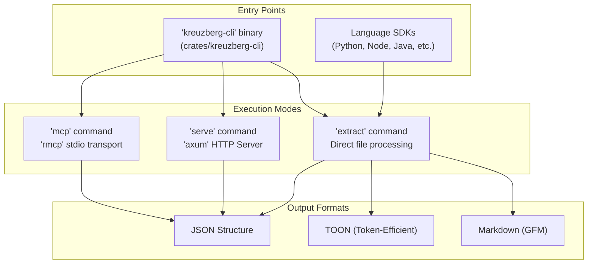

<!-- source: DeepWiki mcp.deepwiki.com · repo kreuzberg-dev/kreuzberg · page 1 Overview · fetched 2026-10-27 -->

# Overview

Relevant source files

The following files were used as context for generating this wiki page:

- [.gitignore](.gitignore)
- [.pre-commit-config.yaml](.pre-commit-config.yaml)
- [CHANGELOG.md](CHANGELOG.md)
- [CONTRIBUTING.md](CONTRIBUTING.md)
- [Cargo.lock](Cargo.lock)
- [Cargo.toml](Cargo.toml)
- [README.md](README.md)
- [crates/kreuzberg-node/README.md](crates/kreuzberg-node/README.md)
- [crates/kreuzberg-node/package.json](crates/kreuzberg-node/package.json)
- [crates/kreuzberg-wasm/README.md](crates/kreuzberg-wasm/README.md)
- [crates/kreuzberg-wasm/package.json](crates/kreuzberg-wasm/package.json)
- [crates/kreuzberg/Cargo.toml](crates/kreuzberg/Cargo.toml)
- [crates/kreuzberg/README.md](crates/kreuzberg/README.md)
- [crates/kreuzberg/tests/api_openweb.rs](crates/kreuzberg/tests/api_openweb.rs)
- [docs/contributing.md](docs/contributing.md)
- [docs/css/extra.css](docs/css/extra.css)
- [docs/features.md](docs/features.md)
- [docs/getting-started/installation.md](docs/getting-started/installation.md)
- [docs/guides/agent-skills.md](docs/guides/agent-skills.md)
- [docs/guides/docker.md](docs/guides/docker.md)
- [docs/guides/kubernetes.md](docs/guides/kubernetes.md)
- [docs/index.md](docs/index.md)
- [docs/integrations/index.md](docs/integrations/index.md)
- [docs/integrations/openwebui.md](docs/integrations/openwebui.md)
- [docs/integrations/surrealdb.md](docs/integrations/surrealdb.md)
- [package.json](package.json)
- [packages/csharp/README.md](packages/csharp/README.md)
- [packages/elixir/README.md](packages/elixir/README.md)
- [packages/go/v4/README.md](packages/go/v4/README.md)
- [packages/java/README.md](packages/java/README.md)
- [packages/php/README.md](packages/php/README.md)
- [packages/python/README.md](packages/python/README.md)
- [packages/ruby/Gemfile.lock](packages/ruby/Gemfile.lock)
- [packages/ruby/README.md](packages/ruby/README.md)
- [packages/ruby/ext/kreuzberg_rb/native/Cargo.lock](packages/ruby/ext/kreuzberg_rb/native/Cargo.lock)
- [packages/ruby/ext/kreuzberg_rb/native/Cargo.toml](packages/ruby/ext/kreuzberg_rb/native/Cargo.toml)
- [pnpm-lock.yaml](pnpm-lock.yaml)
- [pyproject.toml](pyproject.toml)
- [uv.lock](uv.lock)

This document provides a comprehensive introduction to Kreuzberg, a high-performance document intelligence platform built in Rust with native bindings for 15+ programming languages. It covers the system architecture, supported formats, deployment models, and language binding strategies.

For detailed information about specific subsystems:
- System architecture details → [System Architecture](#1.1)
- Format support and feature matrix → [Supported Formats and Features](#1.2)
- Installation procedures → [Installation](#2.1)
- Core processing pipeline → [Document Processing Pipeline](#3.1)

## What is Kreuzberg

Kreuzberg is a document intelligence library that extracts text, metadata, tables, and code intelligence from 90+ file formats including PDFs, Office documents, images, emails, archives, and academic formats. The system is built around a high-performance Rust core (`kreuzberg` crate) that provides document extraction, OCR, text processing, and metadata extraction capabilities.

The platform serves multiple use cases:
- **Library integration**: Import as a native dependency in application code (15+ languages supported).
- **Command-line processing**: Batch document extraction via `kreuzberg-cli`.
- **REST API server**: HTTP endpoints for microservice architectures using Axum.
- **MCP server**: Model Context Protocol integration for AI assistants like Claude Desktop.
- **Container deployment**: Docker images for portable deployments (Core and Full variants).

Sources: [README.md:1-92](), [crates/kreuzberg/Cargo.toml:1-15](), [Cargo.toml:1-23]()

## Core Architecture

```mermaid
graph TD
    subgraph "Rust Core (crates/kreuzberg)"
        Core["'kreuzberg' crate<br/>Document Extraction Pipeline<br/>Plugin Registry"]
        Tesseract["'kreuzberg-tesseract'<br/>Tesseract OCR Backend"]
        PaddleOCR["'kreuzberg-paddle-ocr'<br/>PaddleOCR (ONNX)"]
        LiterLLM["'liter-llm'<br/>VLM OCR & Embeddings"]
    end
    
    subgraph "Native Bindings Layer"
        PyO3["'kreuzberg-py'<br/>PyO3 → Python"]
        NAPI["'kreuzberg-node'<br/>NAPI-RS → Node.js"]
        Magnus["'kreuzberg_rb'<br/>Magnus → Ruby"]
        Rustler["'kreuzberg_nif'<br/>Rustler → Elixir"]
        Extendr["'kreuzberg' (R)<br/>extendr → R"]
        WASM["'kreuzberg-wasm'<br/>wasm-bindgen → JS/TS"]
    end
    
    subgraph "FFI Layer (crates/kreuzberg-ffi)"
        FFI["'kreuzberg-ffi'<br/>C FFI / cbindgen"]
        Go["Go (cgo)"]
        Java["Java (Panama FFM)"]
        CSharp["C# (P/Invoke)"]
        PHP["PHP (ext-ffi)"]
        Swift["Swift (swift-bridge)"]
        Dart["Dart (FRB)"]
    end
    
    Core --> Tesseract
    Core --> PaddleOCR
    Core --> LiterLLM
    
    Core --> PyO3
    Core --> NAPI
    Core --> Magnus
    Core --> Rustler
    Core --> Extendr
    Core --> WASM
    
    Core --> FFI
    FFI --> Go
    FFI --> Java
    FFI --> CSharp
    FFI --> PHP
    FFI --> Swift
    FFI --> Dart
```

**Architecture: Rust Core with Multi-Language Bindings**

The system uses two primary integration strategies:

1.  **Direct Rust integration** (`kreuzberg` → binding crate): PyO3 (Python), NAPI-RS (Node.js), Magnus (Ruby), Rustler (Elixir), extendr (R), wasm-bindgen (WebAssembly). These provide zero-copy APIs and maximum performance.
2.  **C FFI layer** (`kreuzberg` → `kreuzberg-ffi` → language): `cbindgen` generates C headers from Rust code, enabling interoperability with Go (cgo), Java (Panama FFM API), C# (P/Invoke), PHP (ext-ffi), Swift, and Dart.

The core `kreuzberg` crate at [crates/kreuzberg/Cargo.toml:1-15]() implements format-specific extractors, OCR backends, and post-processing. It leverages `tree-sitter-language-pack` for code intelligence across 300+ programming languages [README.md:94]().

Sources: [Cargo.toml:1-16](), [crates/kreuzberg/Cargo.toml:31-235](), [README.md:96]()

## Document Format Support

Kreuzberg supports 90+ file formats organized into major categories:

| Category | Formats | Implementation Highlights |
|----------|---------|---------------------------|
| **PDF** | `.pdf` | `pdf_oxide` for text, `ocr` for scans, heuristic table extraction |
| **Office** | `.docx`, `.xlsx`, `.pptx`, `.hwp`, `.hwpx` | `calamine` (Excel), `roxmltree`, `unhwp` [crates/kreuzberg/Cargo.toml:45-59]() |
| **Images** | `.png`, `.jpg`, `.tiff`, `.webp`, `.jp2` | `image` crate, `hayro-jpeg2000`, `hayro-jbig2` [crates/kreuzberg/Cargo.toml:91-99]() |
| **Email** | `.eml`, `.msg`, `.pst` | `mail-parser`, `outlook-pst`, `chardetng` encoding detection [crates/kreuzberg/Cargo.toml:68-74]() |
| **Web** | `.html`, `.xml` | `html-to-markdown-rs`, `quick-xml` [crates/kreuzberg/Cargo.toml:69-70]() |
| **Archives** | `.zip`, `.tar`, `.7z` | `zip`, `tar`, `sevenz-rust2` [crates/kreuzberg/Cargo.toml:77]() |
| **Code** | 300+ languages | `tree-sitter-language-pack` [README.md:94]() |

For details, see [Supported Formats and Features](#1.2).

Sources: [README.md:97](), [crates/kreuzberg/Cargo.toml:44-77](), [README.md:94]()

## Deployment Models

**Deployment Models and Execution Modes**

The system supports four distinct deployment patterns:

1.  **Library SDK**: Import into application code across 15+ languages.
2.  **CLI**: The `kreuzberg-cli` crate provides `extract`, `batch`, `detect`, and `cache` commands [README.md:109]().
3.  **REST API Server**: Enabled with `api` feature, uses `axum` for HTTP endpoints.
4.  **MCP Server**: Implements Model Context Protocol via `rmcp` for AI assistant integration.

Sources: [README.md:109-110](), [crates/kreuzberg/Cargo.toml:194]()

## Language Binding Strategy

Kreuzberg provides two integration paths:

**Direct Native Bindings**:
-   **Python**: PyO3-based with `maturin` build system [pyproject.toml:1-3]().
-   **Node.js**: NAPI-RS native bindings [crates/kreuzberg-node/package.json:30-42]().
-   **Ruby**: Magnus and `rb-sys` integration [packages/ruby/Gemfile.lock:4-5]().
-   **Elixir**: Rustler NIFs.
-   **WASM**: `wasm-bindgen` for browsers/Cloudflare Workers [crates/kreuzberg/Cargo.toml:103]().

**FFI Bridge** (`kreuzberg-ffi`):
-   Exports C ABI functions with `#[no_mangle]`.
-   Memory management uses arena allocation (Auto/Confined/Global) to prevent leaks across FFI boundaries.
-   Supports **Java** (Panama FFM), **Go** (cgo), **C#** (P/Invoke), **PHP** (ext-ffi), **Swift**, and **Dart**.

For details, see [System Architecture](#1.1) and the specific language binding pages.

Sources: [Cargo.toml:1-16](), [pyproject.toml:1-3](), [packages/ruby/Gemfile.lock:4-5](), [crates/kreuzberg-node/package.json:30-42](), [crates/kreuzberg/Cargo.toml:103]()

## Key System Components

-   **Document Processing Pipeline**: Multi-stage extraction with pluggable renderers (Markdown, HTML, Djot, Plain) [README.md:102-103]().
-   **Code Intelligence**: Semantic chunking and symbol extraction using `tree-sitter` [README.md:94]().
-   **OCR Backends**: Supports Tesseract, PaddleOCR (via ONNX Runtime), and VLM OCR (GPT-4o, Claude, etc.) via `liter-llm` [README.md:98-99]().
-   **Plugin System**: Cross-language trait bridges for custom `DocumentExtractor` and `Renderer` implementations.
-   **Build System**: Cargo workspace with feature flags like `pdf`, `ocr`, `embeddings`, `full`, `server`, `cli`, and platform-specific features [crates/kreuzberg/Cargo.toml:31-196]().

Sources: [README.md:94-106](), [crates/kreuzberg/Cargo.toml:31-196]()

---

