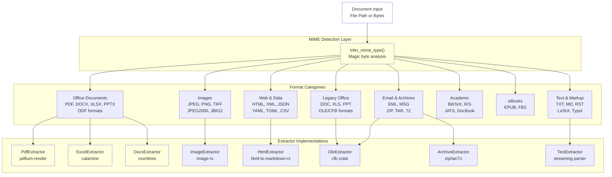
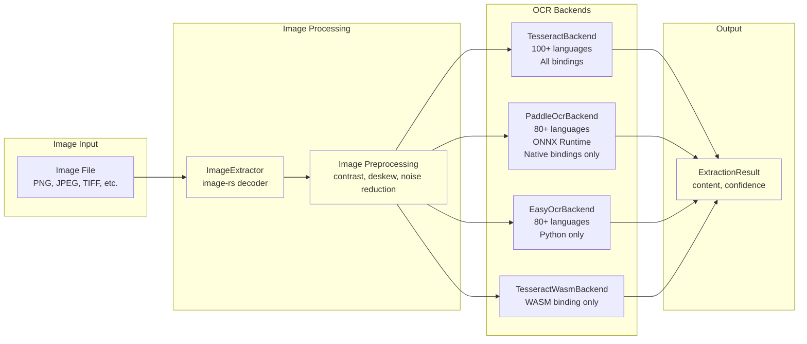
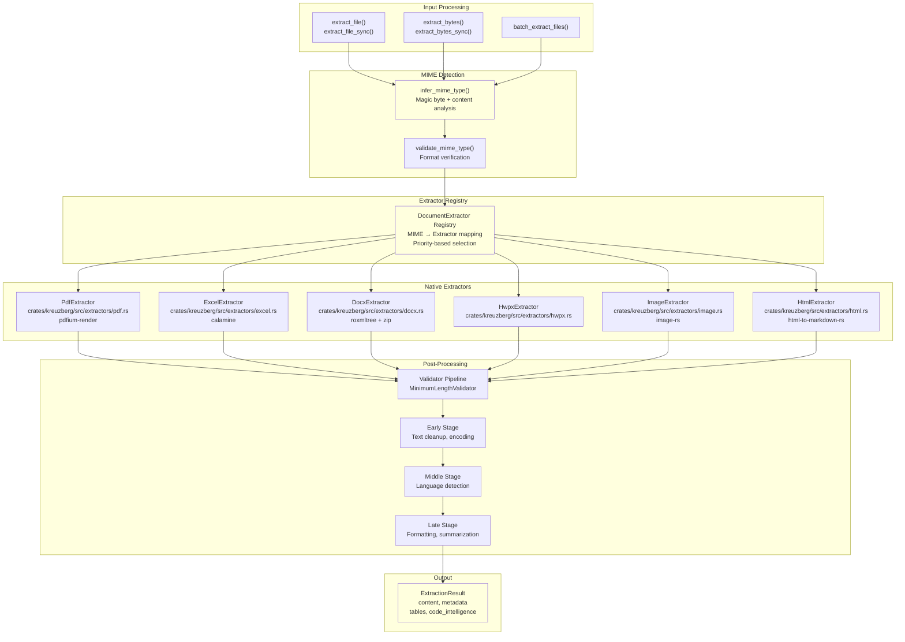

<!-- source: DeepWiki mcp.deepwiki.com · repo kreuzberg-dev/kreuzberg · page 1.2 Supported Formats and Features · fetched 2026-10-27 -->

# Supported Formats and Features

Relevant source files

The following files were used as context for generating this wiki page:

- [CONTRIBUTING.md](CONTRIBUTING.md)
- [README.md](README.md)
- [crates/kreuzberg-node/README.md](crates/kreuzberg-node/README.md)
- [crates/kreuzberg-wasm/README.md](crates/kreuzberg-wasm/README.md)
- [crates/kreuzberg/README.md](crates/kreuzberg/README.md)
- [crates/kreuzberg/src/extraction/mod.rs](crates/kreuzberg/src/extraction/mod.rs)
- [crates/kreuzberg/src/extractors/mod.rs](crates/kreuzberg/src/extractors/mod.rs)
- [crates/kreuzberg/src/extractors/security.rs](crates/kreuzberg/src/extractors/security.rs)
- [crates/kreuzberg/tests/api_openweb.rs](crates/kreuzberg/tests/api_openweb.rs)
- [docs/contributing.md](docs/contributing.md)
- [docs/css/extra.css](docs/css/extra.css)
- [docs/features.md](docs/features.md)
- [docs/getting-started/installation.md](docs/getting-started/installation.md)
- [docs/guides/agent-skills.md](docs/guides/agent-skills.md)
- [docs/guides/docker.md](docs/guides/docker.md)
- [docs/guides/kubernetes.md](docs/guides/kubernetes.md)
- [docs/index.md](docs/index.md)
- [docs/integrations/index.md](docs/integrations/index.md)
- [docs/integrations/openwebui.md](docs/integrations/openwebui.md)
- [docs/integrations/surrealdb.md](docs/integrations/surrealdb.md)
- [packages/csharp/README.md](packages/csharp/README.md)
- [packages/elixir/README.md](packages/elixir/README.md)
- [packages/go/v4/README.md](packages/go/v4/README.md)
- [packages/java/README.md](packages/java/README.md)
- [packages/php/README.md](packages/php/README.md)
- [packages/python/README.md](packages/python/README.md)
- [packages/ruby/README.md](packages/ruby/README.md)

This page documents all file formats supported by Kreuzberg and the feature availability across language bindings. Kreuzberg supports 90+ formats across 8 major categories through native Rust extractors. For architectural details about the extraction pipeline, see [Document Processing Pipeline](3.1). For OCR-specific configuration, see [OCR Backends](5.3).

## Format Categories Overview

Kreuzberg organizes supported formats into eight primary categories, each handled by specialized native extractors:

Sources: [README.md:83-91](), [docs/features.md:9-102](), [docs/index.md:32-35]()

## Office Documents

### Microsoft Office Formats

| Format | Extensions | MIME Type | Extractor | OCR Support | Special Features |
|--------|-----------|-----------|-----------|-------------|------------------|
| **PDF** | `.pdf` | `application/pdf` | `PdfExtractor` [crates/kreuzberg/src/extractors/pdf.rs]() | Yes | Text layer detection, metadata, image extraction, hierarchy detection |
| **Excel (Modern)** | `.xlsx`, `.xlsm`, `.xlsb` | `application/vnd.openxmlformats-officedocument.spreadsheetml.sheet` | `ExcelExtractor` [crates/kreuzberg/src/extractors/excel.rs]() | No | Multi-sheet, formulas, cell metadata |
| **Excel (Legacy)** | `.xls`, `.xla`, `.xlam`, `.xltm` | `application/vnd.ms-excel` | `ExcelExtractor` [crates/kreuzberg/src/extractors/excel.rs]() | No | Binary format support |
| **Word (Modern)** | `.docx` | `application/vnd.openxmlformats-officedocument.wordprocessingml.document` | `DocxExtractor` [crates/kreuzberg/src/extractors/docx.rs]() | No | Formatting, tables, metadata |
| **Word (Legacy)** | `.doc` | `application/msword` | `DocExtractor` [crates/kreuzberg/src/extractors/doc.rs]() | Yes | Native OLE/CFB parsing |
| **PowerPoint (Modern)** | `.pptx`, `.pptm`, `.ppsx` | `application/vnd.openxmlformats-officedocument.presentationml.presentation` | `PptxExtractor` [crates/kreuzberg/src/extractors/pptx.rs]() | Yes (images) | Slides, speaker notes, embedded images |
| **PowerPoint (Legacy)** | `.ppt` | `application/vnd.ms-powerpoint` | `PptExtractor` [crates/kreuzberg/src/extractors/ppt.rs]() | Yes | Native OLE/CFB parsing |

### OpenDocument and Apple Formats

| Format | Extensions | MIME Type | Extractor | Special Features |
|--------|-----------|-----------|-----------|------------------|
| **OpenDocument Text** | `.odt` | `application/vnd.oasis.opendocument.text` | `OdtExtractor` [crates/kreuzberg/src/extractors/odt.rs]() | Full ODF specification support |
| **OpenDocument Spreadsheet** | `.ods` | `application/vnd.oasis.opendocument.spreadsheet` | `ExcelExtractor` [crates/kreuzberg/src/extractors/excel.rs]() | Multi-sheet support |
| **Pages** | `.pages` | `application/x-iwork-pages-sffpages` | `PagesExtractor` [crates/kreuzberg/src/extractors/iwork/pages.rs]() | Native Apple iWork support |
| **Numbers** | `.numbers` | `application/x-iwork-numbers-sffnumbers` | `NumbersExtractor` [crates/kreuzberg/src/extractors/iwork/numbers.rs]() | Native Apple iWork support |
| **Keynote** | `.key` | `application/x-iwork-keynote-sffkey` | `KeynoteExtractor` [crates/kreuzberg/src/extractors/iwork/keynote.rs]() | Native Apple iWork support |
| **Hangul Word** | `.hwp`, `.hwpx` | `application/x-hwp` | `HwpExtractor` [crates/kreuzberg/src/extractors/hwp.rs]() / `HwpxExtractor` [crates/kreuzberg/src/extractors/hwpx.rs]() | Korean document support |
Sources: [docs/features.md:13-41](), [crates/kreuzberg/src/extractors/hwpx.rs:1-50](), [README.md:83-83]()

## Images

Kreuzberg supports comprehensive image format extraction with optional OCR capabilities through multiple backends.

### Image Format Support

| Category | Formats | MIME Types | Decoder | OCR Support | Features |
|----------|---------|-----------|---------|-------------|----------|
| **Common Raster** | `.png`, `.jpg`, `.jpeg`, `.gif`, `.webp`, `.bmp` | `image/png`, `image/jpeg`, etc. | `ImageExtractor` [crates/kreuzberg/src/extractors/image.rs]() | Yes | EXIF metadata, dimensions, color space |
| **TIFF** | `.tiff`, `.tif` | `image/tiff` | `ImageExtractor` [crates/kreuzberg/src/extractors/image.rs]() | Yes | Multi-page support, EXIF |
| **JPEG 2000** | `.jp2`, `.jpx`, `.jpm`, `.mj2` | `image/jp2` | `ImageExtractor` [crates/kreuzberg/src/extractors/image.rs]() | Yes | Advanced compression |
| **JBIG2** | `.jbig2` | `image/x-jbig2` | `ImageExtractor` [crates/kreuzberg/src/extractors/image.rs]() | Yes | Monochrome compression |
| **Portable Formats** | `.pnm`, `.pbm`, `.pgm`, `.ppm` | `image/x-portable-*` | `ImageExtractor` [crates/kreuzberg/src/extractors/image.rs]() | Yes | Simple formats |

### OCR Backend Integration

Sources: [docs/features.md:43-55](), [docs/features.md:137-150](), [README.md:85-85]()

## Web & Data Formats

### Markup and Web

| Format | Extensions | MIME Type | Extractor | Special Features |
|--------|-----------|-----------|-----------|------------------|
| **HTML** | `.html`, `.htm`, `.xhtml` | `text/html` | `HtmlExtractor` [crates/kreuzberg/src/extractors/html.rs]() | HTML-to-Markdown passthrough |
| **XML** | `.xml` | `application/xml` | `XmlExtractor` [crates/kreuzberg/src/extractors/xml.rs]() | Element tracking |
| **SVG** | `.svg` | `image/svg+xml` | `XmlExtractor` [crates/kreuzberg/src/extractors/xml.rs]() | DOM parsing, embedded text |

### Structured Data and Text

| Format | Extensions | MIME Type | Parser | Special Features |
|--------|-----------|-----------|--------|------------------|
| **JSON** | `.json` | `application/json` | `StructuredExtractor` [crates/kreuzberg/src/extractors/structured.rs]() | Schema detection |
| **YAML** | `.yaml` | `application/x-yaml` | `StructuredExtractor` [crates/kreuzberg/src/extractors/structured.rs]() | Multi-document support |
| **TOML** | `.toml` | `application/toml` | `StructuredExtractor` [crates/kreuzberg/src/extractors/structured.rs]() | Configuration parsing |
| **CSV / TSV** | `.csv`, `.tsv` | `text/csv` | `CsvExtractor` [crates/kreuzberg/src/extractors/csv.rs]() | Delimiter detection |
| **Markdown** | `.md`, `.mdx` | `text/markdown` | `MarkdownExtractor` [crates/kreuzberg/src/extractors/markdown.rs]() | GFM-quality output |
| **Djot** | `.djot` | `text/x-djot` | `DjotExtractor` [crates/kreuzberg/src/extractors/djot_format.rs]() | Modern markup |
| **reStructuredText**| `.rst` | `text/x-rst` | `RstExtractor` [crates/kreuzberg/src/extractors/rst.rs]() | Directive parsing |
Sources: [docs/features.md:64-80](), [README.md:89-90](), [docs/index.md:32-35]()

## Email & Archives

| Format | Extensions | MIME Type | Handler | Special Features |
|--------|-----------|-----------|---------|------------------|
| **EML** | `.eml` | `message/rfc822` | `EmailExtractor` [crates/kreuzberg/src/extractors/email.rs]() | Headers, body, attachments |
| **MSG** | `.msg` | `application/vnd.ms-outlook` | `PstExtractor` [crates/kreuzberg/src/extractors/pst.rs]() | Outlook binary format |
| **ZIP** | `.zip` | `application/zip` | `ZipExtractor` [crates/kreuzberg/src/extractors/archive.rs]() | Recursive extraction |
| **TAR** | `.tar`, `.tgz` | `application/x-tar` | `TarExtractor` [crates/kreuzberg/src/extractors/archive.rs]() | Streaming extraction |
| **7-Zip** | `.7z` | `application/x-7z-compressed` | `SevenZExtractor` [crates/kreuzberg/src/extractors/archive.rs]() | High compression support |
Sources: [docs/features.md:57-62](), [docs/features.md:81-88](), [README.md:83-83]()

## Academic & Scientific Formats

| Format | Extensions | MIME Type | Parser | Special Features |
|--------|-----------|-----------|--------|------------------|
| **EPUB** | `.epub` | `application/epub+zip` | `EpubExtractor` [crates/kreuzberg/src/extractors/epub.rs]() | eBook navigation |
| **BibTeX / RIS** | `.bib`, `.ris` | `application/x-bibtex` | `BibtexExtractor` [crates/kreuzberg/src/extractors/bibtex.rs]() / `CitationExtractor` [crates/kreuzberg/src/extractors/citation.rs]() | Structured citations |
| **LaTeX** | `.tex` | `text/x-tex` | `LatexExtractor` [crates/kreuzberg/src/extractors/latex.rs]() | Command extraction |
| **Typst** | `.typ` | `text/x-typst` | `TypstExtractor` [crates/kreuzberg/src/extractors/typst.rs]() | Modern typesetting |
| **JATS** | `.jats` | `application/jats+xml` | `JatsExtractor` [crates/kreuzberg/src/extractors/jats.rs]() | Journal article structure |
| **DocBook** | `.docbook` | `application/docbook+xml` | `DocbookExtractor` [crates/kreuzberg/src/extractors/docbook.rs]() | Technical documentation |
Sources: [docs/features.md:90-102](), [README.md:83-83]()

## Feature Matrix Across Language Bindings

### Core Extraction and OCR

| Feature | Python | Node.js | WASM | Ruby | Java | Go | C# | PHP | Elixir | Rust |
|---------|--------|---------|------|------|------|----|----|-----|--------|------|
| **Text Extraction** | ✅ | ✅ | ✅ | ✅ | ✅ | ✅ | ✅ | ✅ | ✅ | ✅ |
| **Table Extraction** | ✅ | ✅ | ✅ | ✅ | ✅ | ✅ | ✅ | ✅ | ✅ | ✅ |
| **Code Intelligence** | ✅ | ✅ | ✅ | ✅ | ✅ | ✅ | ✅ | ✅ | ✅ | ✅ |
| **Tesseract OCR** | ✅ | ✅ | ✅ | ✅ | ✅ | ✅ | ✅ | ✅ | ✅ | ✅ |
| **PaddleOCR** | ✅ | ✅ | ❌ | ✅ | ✅ | ✅ | ✅ | ✅ | ✅ | ✅ |
| **EasyOCR** | ✅ | ❌ | ❌ | ❌ | ❌ | ❌ | ❌ | ❌ | ❌ | ❌ |
| **VLM OCR** | ✅ | ✅ | ✅ | ✅ | ✅ | ✅ | ✅ | ✅ | ✅ | ✅ |

### Advanced Capabilities

| Feature | Python | Node.js | WASM | Ruby | Java | Go | C# | PHP | Elixir | Rust |
|---------|--------|---------|------|------|------|----|----|-----|--------|------|
| **Embeddings** | ✅ | ✅ | ❌ | ✅ | ✅ | ✅ | ✅ | ✅ | ✅ | ✅ |
| **Semantic Chunking** | ✅ | ✅ | ✅ | ✅ | ✅ | ✅ | ✅ | ✅ | ✅ | ✅ |
| **Layout Detection** | ✅ | ✅ | ❌ | ✅ | ✅ | ✅ | ✅ | ✅ | ✅ | ✅ |
| **Async API** | ✅ | ✅ | ✅ | ✅ | ✅ | ✅ | ✅ | ✅ | ✅ | ✅ |
| **Worker Pool** | ❌ | ✅ | ❌ | ❌ | ❌ | ❌ | ❌ | ❌ | ❌ | ❌ |

**Notes:**
- **WASM Constraints:** Only ORT-dependent features (PaddleOCR, layout detection, embeddings, auto-rotate) are unavailable in the WebAssembly binding [crates/kreuzberg-wasm/README.md:96-97]().
- **EasyOCR:** Exclusive to Python due to PyTorch dependency [docs/features.md:143-150]().
- **Code Intelligence:** Supports 300+ programming languages via tree-sitter across all bindings [README.md:94-95]().
- **Tesseract OCR:** Tesseract is supported in WASM via `Tesseract-WASM` [crates/kreuzberg-wasm/README.md:110-110]().

Sources: [README.md:80-85](), [docs/index.md:63-83](), [crates/kreuzberg-wasm/README.md:112-114](), [docs/features.md:143-150](), [crates/kreuzberg-wasm/README.md:110-110]()

## Extraction Method Architecture

Sources: [docs/features.md:112-121](), [crates/kreuzberg/src/extractors/mod.rs:1-100](), [crates/kreuzberg/src/extraction/mod.rs:1-100]()

## Performance and Deployment

### Throughput and Hardware

- **GPU Requirement:** None. Kreuzberg is optimized for CPU-bound performance using SIMD and Rust's safe parallelism [README.md:100-101]().
- **AVX/AVX2 Requirement:** Bundled ONNX Runtime (used for PaddleOCR, layout detection, and embeddings) requires AVX/AVX2 on x86_64 CPUs [docs/getting-started/installation.md:51-53]().
- **Memory Efficiency:** Uses streaming parsers to handle multi-GB files without loading entire documents into memory [README.md:105-105]().

### Deployment Variants

| Mode | Use Case | Implementation |
|------|----------|----------------|
| **Library** | Embedded in application | Native bindings (17 languages) [README.md:96-97]() |
| **CLI** | Shell scripts, batch jobs | `kreuzberg-cli` crate [docs/getting-started/installation.md:29-31]() |
| **REST API** | Microservice architecture | Actix-web based server [docs/index.md:128-129]() |
| **MCP Server** | AI Agent integration | Model Context Protocol [docs/index.md:128-129]() |
| **Docker** | Containerized workloads | `ghcr.io/kreuzberg-dev/kreuzberg` [docs/getting-started/installation.md:43-44]() |
Sources: [README.md:87-87](), [docs/index.md:28-56](), [docs/getting-started/installation.md:51-53](), [README.md:100-101](), [README.md:105-105](), [README.md:96-97](), [docs/getting-started/installation.md:29-31](), [docs/index.md:128-129](), [docs/getting-started/installation.md:43-44]()

---

