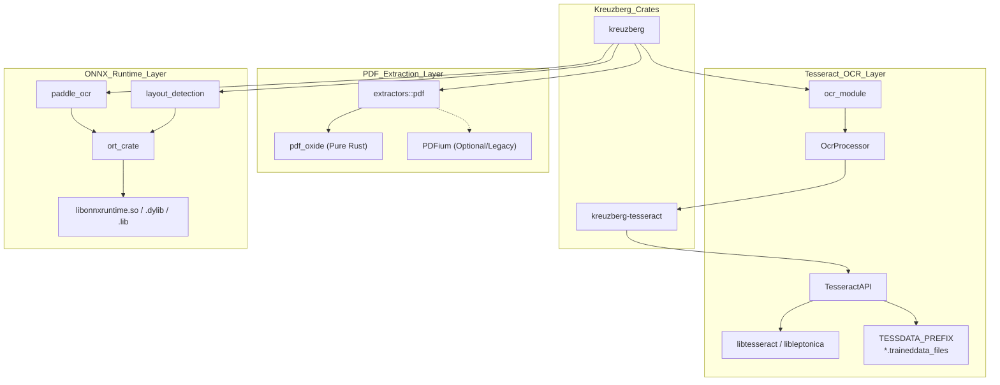
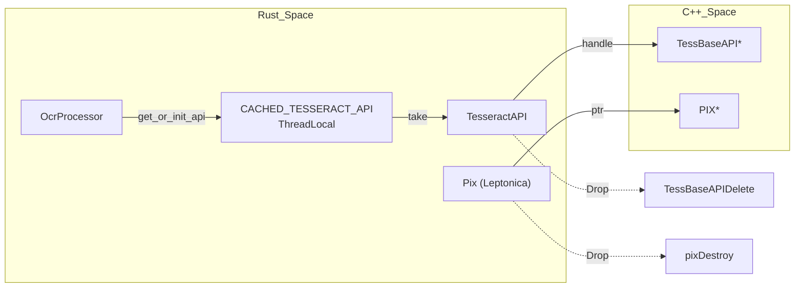

<!-- source: DeepWiki mcp.deepwiki.com · repo kreuzberg-dev/kreuzberg · page 10 Advanced Topics · fetched 2026-10-27 -->

# Advanced Topics

Relevant source files

The following files were used as context for generating this wiki page:

- [.github/actions/setup-tesseract-cache/action.yml](.github/actions/setup-tesseract-cache/action.yml)
- [crates/kreuzberg-tesseract/build.rs](crates/kreuzberg-tesseract/build.rs)
- [crates/kreuzberg-tesseract/src/api.rs](crates/kreuzberg-tesseract/src/api.rs)
- [crates/kreuzberg-tesseract/src/choice_iterator.rs](crates/kreuzberg-tesseract/src/choice_iterator.rs)
- [crates/kreuzberg-tesseract/src/leptonica.rs](crates/kreuzberg-tesseract/src/leptonica.rs)
- [crates/kreuzberg-tesseract/src/lib.rs](crates/kreuzberg-tesseract/src/lib.rs)
- [crates/kreuzberg-tesseract/src/monitor.rs](crates/kreuzberg-tesseract/src/monitor.rs)
- [crates/kreuzberg-tesseract/src/mutable_iterator.rs](crates/kreuzberg-tesseract/src/mutable_iterator.rs)
- [crates/kreuzberg-tesseract/src/page_iterator.rs](crates/kreuzberg-tesseract/src/page_iterator.rs)
- [crates/kreuzberg-tesseract/src/result_iterator.rs](crates/kreuzberg-tesseract/src/result_iterator.rs)
- [crates/kreuzberg-tesseract/src/result_renderer.rs](crates/kreuzberg-tesseract/src/result_renderer.rs)
- [crates/kreuzberg-tesseract/tests/integration_test.rs](crates/kreuzberg-tesseract/tests/integration_test.rs)
- [crates/kreuzberg/src/extraction/image.rs](crates/kreuzberg/src/extraction/image.rs)
- [crates/kreuzberg/src/extraction/pptx/content_builder.rs](crates/kreuzberg/src/extraction/pptx/content_builder.rs)
- [crates/kreuzberg/src/extractors/image.rs](crates/kreuzberg/src/extractors/image.rs)
- [crates/kreuzberg/src/extractors/pdf/extraction.rs](crates/kreuzberg/src/extractors/pdf/extraction.rs)
- [crates/kreuzberg/src/extractors/pdf/layout_runner.rs](crates/kreuzberg/src/extractors/pdf/layout_runner.rs)
- [crates/kreuzberg/src/extractors/pdf/mod.rs](crates/kreuzberg/src/extractors/pdf/mod.rs)
- [crates/kreuzberg/src/extractors/pdf/ocr.rs](crates/kreuzberg/src/extractors/pdf/ocr.rs)
- [crates/kreuzberg/src/ocr/processor/execution.rs](crates/kreuzberg/src/ocr/processor/execution.rs)
- [crates/kreuzberg/src/pdf/oxide/hierarchy.rs](crates/kreuzberg/src/pdf/oxide/hierarchy.rs)
- [crates/kreuzberg/src/pdf/oxide/images.rs](crates/kreuzberg/src/pdf/oxide/images.rs)
- [crates/kreuzberg/src/pdf/oxide/mod.rs](crates/kreuzberg/src/pdf/oxide/mod.rs)
- [crates/kreuzberg/src/pdf/oxide/table.rs](crates/kreuzberg/src/pdf/oxide/table.rs)
- [crates/kreuzberg/src/pdf/oxide/text.rs](crates/kreuzberg/src/pdf/oxide/text.rs)
- [crates/kreuzberg/src/pdf/oxide_text.rs](crates/kreuzberg/src/pdf/oxide_text.rs)
- [crates/kreuzberg/src/pdf/structure/mod.rs](crates/kreuzberg/src/pdf/structure/mod.rs)
- [crates/kreuzberg/src/pdf/structure/pipeline.rs](crates/kreuzberg/src/pdf/structure/pipeline.rs)
- [crates/kreuzberg/src/pdf/structure/regions/table_recognition.rs](crates/kreuzberg/src/pdf/structure/regions/table_recognition.rs)
- [crates/kreuzberg/tests/pdf_glyph_spacing_issue_962.rs](crates/kreuzberg/tests/pdf_glyph_spacing_issue_962.rs)
- [crates/kreuzberg/tests/pdf_heuristic_tables.rs](crates/kreuzberg/tests/pdf_heuristic_tables.rs)
- [crates/kreuzberg/tests/pdf_image_extraction_tests.rs](crates/kreuzberg/tests/pdf_image_extraction_tests.rs)

This page covers advanced integration topics including external dependency management, build caching strategies, and runtime configuration for PDF processing, ONNX Runtime, and Tesseract OCR.

**Related Pages:**
- [Development Environment Setup](#6.1): Prerequisites and initial setup
- [Building from Source](#6.3): Compiling Rust core and language bindings
- [Platform-Specific Considerations](#9): Cross-platform build configuration
- [CI Pipeline Overview](#8.1): Automated testing and release workflows

---

## External Dependencies

Kreuzberg integrates major external libraries that require platform-specific binaries and careful build configuration: PDFium (optional), Tesseract for OCR, and ONNX Runtime for embeddings and layout detection.

### Dependency Overview

| Library | Purpose | Size | Linking Strategy | Platforms |
|---------|---------|------|------------------|-----------|
| **PDFium** | High-fidelity PDF rendering (optional) | ~30-50MB | Bundled, Static, or System | Linux, macOS, Windows, WASM |
| **Tesseract** | OCR text recognition | ~20MB + language data | System installation / Built from source | Linux, macOS, Windows, WASM |
| **ONNX Runtime** | Neural network inference | ~200MB | Dynamic linking to prebuilt binaries | Linux, macOS, Windows (MSVC only) |

### Build-Time vs Runtime Dependencies

**Build-Time Dependencies:**
- **Tesseract**: Headers required for native OCR backend compilation; `kreuzberg-tesseract` can compile Tesseract and Leptonica from source [crates/kreuzberg-tesseract/build.rs:10-25]().
- **System Libraries**: `pkg-config` is used to discover system-level dependencies for Tesseract and Leptonica when not building from source.

**Runtime Dependencies:**
- **Tesseract**: Requires a `tessdata/` directory containing `*.traineddata` files, typically resolved via `TESSDATA_PREFIX` or standard system paths [crates/kreuzberg/src/ocr/processor/execution.rs:30-35]().
- **ONNX Models**: Required for PaddleOCR or layout detection; these are cached in `KREUZBERG_CACHE_DIR` or system-specific application data folders.

### External Dependency Architecture

**Diagram: External Dependency Integration Flow**

**Sources:** [crates/kreuzberg/src/extractors/pdf/mod.rs:1-12](), [crates/kreuzberg/src/ocr/processor/execution.rs:53-85](), [crates/kreuzberg-tesseract/src/api.rs:80-118]()

---

## PDFium Integration

While Kreuzberg has migrated primarily to `pdf_oxide` (pure Rust) for PDF text and metadata extraction [crates/kreuzberg/src/extractors/pdf/mod.rs:91-93](), PDFium remains an optional integration for high-fidelity rendering and legacy support. For details, see [PDFium Integration](#10.2).

### Thread-Safety and Locking
PDFium is **not thread-safe**. Kreuzberg manages this by ensuring that all PDFium-based operations are serialized or handled through a singleton pattern if the feature is enabled. In the modern pipeline, PDFium is primarily used as a fallback for page rasterization during OCR if pure-Rust rendering is insufficient.

**Sources:** [crates/kreuzberg/src/extractors/pdf/mod.rs:36-48](), [crates/kreuzberg/src/extractors/pdf/extraction.rs:38-46]()

---

## ONNX Runtime Integration

ONNX Runtime (v1.24.1) powers layout detection, PaddleOCR, and local embeddings. For details, see [ONNX Runtime Integration](#10.3).

### Layout and OCR Backends
The system uses ONNX for `PaddleOcrBackend` and layout-aware extraction. It supports hardware acceleration (CUDA, CoreML, TensorRT) which is configured via the `ExtractionConfig` and passed down to the `ort` session builders.

**Sources:** [crates/kreuzberg/src/extractors/image.rs:165-172](), [crates/kreuzberg/src/extractors/pdf/mod.rs:52-53]()

---

## Tesseract OCR Build System

The `kreuzberg-tesseract` crate provides safe Rust bindings for Tesseract OCR. For details, see [Tesseract OCR Build System](#10.4).

### Compilation and WASM
The build system handles complex C++ compilation for Leptonica and Tesseract [crates/kreuzberg-tesseract/build.rs:10-25](). For WebAssembly, it includes specific patches to `__cxa_atexit` to prevent crashes during static initialization in WASI environments [crates/kreuzberg-tesseract/src/lib.rs:165-175]().

### Thread-Local API Caching
To optimize performance, `OcrProcessor` maintains a thread-local cache of `TesseractAPI` instances [crates/kreuzberg/src/ocr/processor/execution.rs:37-42](). This avoids the significant overhead of initializing the engine and loading language data for every image in a batch [crates/kreuzberg/src/ocr/processor/execution.rs:53-85]().

**Sources:** [crates/kreuzberg-tesseract/build.rs:3-5](), [crates/kreuzberg/src/ocr/processor/execution.rs:31-42](), [crates/kreuzberg-tesseract/src/api.rs:150-162]()

---

## Build Caching Strategy

Kreuzberg uses a multi-layered caching strategy to optimize build times across platforms. For details, see [Build Caching Strategy](#10.5).

The `kreuzberg-tesseract` crate implements a workspace-level cache to store compiled C++ artifacts, preventing redundant Tesseract/Leptonica builds [crates/kreuzberg-tesseract/build.rs:27-36](). This is integrated into GitHub Actions via specialized setup scripts [.github/actions/setup-tesseract-cache/action.yml:41-51]().

**Sources:** [crates/kreuzberg-tesseract/build.rs:38-50](), [.github/actions/setup-tesseract-cache/action.yml:1-10]()

---

## Memory Management Across FFI

Safe memory management is critical when bridging Rust and C++. For details, see [Memory Management Across FFI](#10.6).

### Tesseract FFI Patterns
The `TesseractAPI` uses `Arc<Mutex<*mut c_void>>` to manage the underlying C handle safely [crates/kreuzberg-tesseract/src/api.rs:80-84](). The `OcrProcessor` implements a "take-and-put-back" pattern with thread-locals to ensure exclusive access to the non-thread-safe Tesseract engine [crates/kreuzberg/src/ocr/processor/execution.rs:53-67]().

**Diagram: Memory Ownership across Tesseract FFI**

**Sources:** [crates/kreuzberg/src/ocr/processor/execution.rs:53-85](), [crates/kreuzberg-tesseract/src/api.rs:102-118](), [crates/kreuzberg-tesseract/src/lib.rs:186-198]()

---

