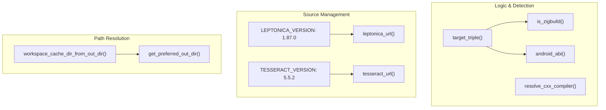
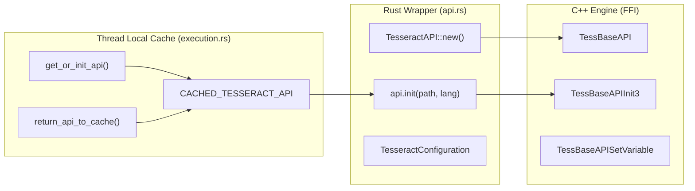

<!-- source: DeepWiki mcp.deepwiki.com · repo kreuzberg-dev/kreuzberg · page 10.4 Tesseract OCR Build System · fetched 2026-10-27 -->

# Tesseract OCR Build System

Relevant source files

The following files were used as context for generating this wiki page:

- [.github/actions/setup-tesseract-cache/action.yml](.github/actions/setup-tesseract-cache/action.yml)
- [crates/kreuzberg-tesseract/Cargo.toml](crates/kreuzberg-tesseract/Cargo.toml)
- [crates/kreuzberg-tesseract/build.rs](crates/kreuzberg-tesseract/build.rs)
- [crates/kreuzberg-tesseract/src/api.rs](crates/kreuzberg-tesseract/src/api.rs)
- [crates/kreuzberg-tesseract/src/choice_iterator.rs](crates/kreuzberg-tesseract/src/choice_iterator.rs)
- [crates/kreuzberg-tesseract/src/leptonica.rs](crates/kreuzberg-tesseract/src/leptonica.rs)
- [crates/kreuzberg-tesseract/src/lib.rs](crates/kreuzberg-tesseract/src/lib.rs)
- [crates/kreuzberg-tesseract/src/monitor.rs](crates/kreuzberg-tesseract/src/monitor.rs)
- [crates/kreuzberg-tesseract/src/mutable_iterator.rs](crates/kreuzberg-tesseract/src/mutable_iterator.rs)
- [crates/kreuzberg-tesseract/src/page_iterator.rs](crates/kreuzberg-tesseract/src/page_iterator.rs)
- [crates/kreuzberg-tesseract/src/result_iterator.rs](crates/kreuzberg-tesseract/src/result_iterator.rs)
- [crates/kreuzberg-tesseract/src/result_renderer.rs](crates/kreuzberg-tesseract/src/result_renderer.rs)
- [crates/kreuzberg-tesseract/tests/integration_test.rs](crates/kreuzberg-tesseract/tests/integration_test.rs)
- [crates/kreuzberg/src/ocr/processor/execution.rs](crates/kreuzberg/src/ocr/processor/execution.rs)

## Purpose and Scope

This page documents the build system for `kreuzberg-tesseract`, which compiles Tesseract OCR 5.5.2 and Leptonica 1.87.0 from source. The system handles complex C++ compilation requirements, including cross-platform support (Linux, macOS, Windows, Android) and WebAssembly (WASM) targets via the WASI SDK. It manages dependency fetching, patching, and caching to ensure reproducible builds across diverse environments.

For information about using Tesseract OCR at runtime, see [5.3 OCR Backends](). For WASM-specific OCR integration, see [4.10 WebAssembly Bindings]().

## Build System Architecture

The build system is implemented in `crates/kreuzberg-tesseract/build.rs` [crates/kreuzberg-tesseract/build.rs:1-4]() and utilizes the `cmake` crate to orchestrate the compilation of Leptonica and Tesseract.

### Build Modes and Features

The system behavior is controlled by Cargo features and target detection logic.

| Feature | Purpose | Implementation Detail |
|---------|---------|-----------------------|
| `build-tesseract` | Native compilation | Compiles C++ for the host or target triple [crates/kreuzberg-tesseract/Cargo.toml:32]() |
| `build-tesseract-wasm` | WASM compilation | Uses WASI SDK and applies source patches [crates/kreuzberg-tesseract/Cargo.toml:33]() |
| `static-linking` | Default mode | Links statically to the compiled artifacts [crates/kreuzberg-tesseract/Cargo.toml:37]() |
| `bundle-tessdata-eng` | WASM optimization | Bundles `eng.traineddata` into the binary [crates/kreuzberg-tesseract/Cargo.toml:36]() |

**Sources:** [crates/kreuzberg-tesseract/Cargo.toml:30-39]()

### Natural Language to Code Entity Space: Build Configuration

This diagram maps build concepts to the specific functions and variables in the build script.

**Sources:** [crates/kreuzberg-tesseract/build.rs:10-12](), [crates/kreuzberg-tesseract/build.rs:27-36](), [crates/kreuzberg-tesseract/build.rs:73-75](), [crates/kreuzberg-tesseract/build.rs:110-120](), [crates/kreuzberg-tesseract/build.rs:152-164]()

## Source Download and Caching

### Cache Directory Strategy
The build system avoids redundant compilations by caching artifacts in a hierarchy of locations:
1. **Environment Override:** `TESSERACT_RS_CACHE_DIR` [crates/kreuzberg-tesseract/build.rs:39-41]().
2. **Windows:** `C:\tess` [crates/kreuzberg-tesseract/build.rs:43-45]().
3. **Workspace-relative:** A `kreuzberg-tesseract-cache` folder inside the Cargo target directory [crates/kreuzberg-tesseract/build.rs:47-49]().
4. **OS Defaults:** `~/Library/Application Support/` (macOS) or `~/.kreuzberg-tesseract` (Linux) [crates/kreuzberg-tesseract/build.rs:51-67]().

**Sources:** [crates/kreuzberg-tesseract/build.rs:38-71]()

### GitHub Action Integration
The `.github/actions/setup-tesseract-cache/action.yml` coordinates caching in CI pipelines, using keys based on the `Cargo.toml` and `build.rs` hash [ .github/actions/setup-tesseract-cache/action.yml:41-51]().

## Compilation Pipeline

### Leptonica Integration
Leptonica is compiled first as it is a mandatory dependency for Tesseract.
- **Native:** Configured with `-fPIC` and `BUILD_SHARED_LIBS=OFF` to ensure static linking compatibility [crates/kreuzberg-tesseract/build.rs:331-340]().
- **Android:** Uses the NDK `clang++` toolchain resolved via `ndk_clangxx()` [crates/kreuzberg-tesseract/build.rs:124-145]().

### Tesseract Compilation
The Tesseract build depends on the Leptonica install prefix.
- **Zigbuild Support:** If `is_zigbuild()` returns true, the system applies workarounds for `std::filesystem` and AVX512 intrinsics which are known to fail with the Zig C++ shim [crates/kreuzberg-tesseract/build.rs:152-164]().
- **WASM Patches:** When building for WASM, the system applies patches to disable incompatible modules like `LibArchive`, `CURL`, and `TIFF` [crates/kreuzberg-tesseract/build.rs:522-661]().

## WASM and WASI SDK Setup

Tesseract requires a C++ standard library, which is provided by the WASI SDK for WebAssembly targets.

### WASI Compatibility
- **atexit override:** WASM modules never "exit" in the traditional sense. The build system overrides `__cxa_atexit` to a no-op to prevent crashes during C++ static initialization in environments where the heap isn't fully ready [crates/kreuzberg-tesseract/src/lib.rs:165-175]().
- **FFI Unwinding:** Native targets use `extern "C-unwind"` to safely catch C++ exceptions, while WASM targets fall back to `extern "C"` as the LLVM WASM backend does not support C++ unwinding [crates/kreuzberg-tesseract/src/lib.rs:133-156]().

## Tessdata Management

Tesseract requires "traineddata" files to perform recognition.

### Resolution Logic
The system resolves the `tessdata` path in a specific order:
1. `TESSDATA_PREFIX` environment variable [crates/kreuzberg-tesseract/src/lib.rs:51-57]().
2. Platform-specific application support directories [crates/kreuzberg-tesseract/src/lib.rs:28-48]().

### Runtime Execution Entity Map
This diagram shows how the Rust `TesseractAPI` interacts with the compiled C++ state and the tessdata filesystem.

**Sources:** [crates/kreuzberg/src/ocr/processor/execution.rs:37-42](), [crates/kreuzberg/src/ocr/processor/execution.rs:53-85](), [crates/kreuzberg-tesseract/src/api.rs:80-84](), [crates/kreuzberg-tesseract/src/api.rs:102-122](), [crates/kreuzberg-tesseract/src/api.rs:150-177]()

## Implementation Details

### Memory Management
The system uses `Arc<Mutex<*mut c_void>>` to manage the Tesseract engine handle, ensuring thread-safe access to the non-thread-safe C++ API [crates/kreuzberg-tesseract/src/api.rs:82-84](). Deallocation is handled via the `Drop` trait calling `TessBaseAPIDelete`.

### Image Processing (Leptonica)
The `Pix` struct provides a safe wrapper around Leptonica's image objects [crates/kreuzberg-tesseract/src/leptonica.rs:155-165](). It handles:
- **DPI Normalization:** via `pixSetResolution` [crates/kreuzberg-tesseract/src/leptonica.rs:45]().
- **Binarization:** via `pixOtsuAdaptiveThreshold` [crates/kreuzberg-tesseract/src/leptonica.rs:83-92]().
- **Deskewing:** via `pixDeskew` [crates/kreuzberg-tesseract/src/leptonica.rs:69]().

**Sources:** [crates/kreuzberg-tesseract/src/leptonica.rs:1-165](), [crates/kreuzberg-tesseract/src/api.rs:71-119]()

---

