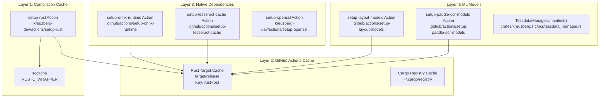
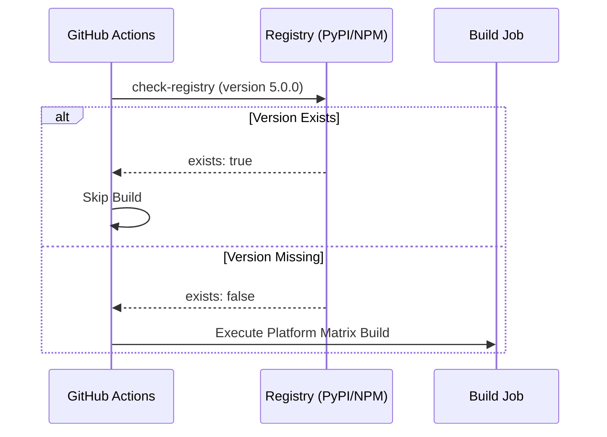

<!-- source: DeepWiki mcp.deepwiki.com · repo kreuzberg-dev/kreuzberg · page 10.5 Build Caching Strategy · fetched 2026-10-27 -->

# Build Caching Strategy

<details>
<summary>Relevant source files</summary>

The following files were used as context for generating this wiki page:

- [.github/workflows/benchmarks.yaml](.github/workflows/benchmarks.yaml)
- [.github/workflows/ci-docker.yaml](.github/workflows/ci-docker.yaml)
- [.github/workflows/ci-rust.yaml](.github/workflows/ci-rust.yaml)
- [.github/workflows/profiling.yaml](.github/workflows/profiling.yaml)
- [.github/workflows/publish.yaml](.github/workflows/publish.yaml)
- [crates/kreuzberg-cli/src/commands/cache.rs](crates/kreuzberg-cli/src/commands/cache.rs)
- [crates/kreuzberg/src/core/config/extraction/file_config.rs](crates/kreuzberg/src/core/config/extraction/file_config.rs)
- [crates/kreuzberg/src/core/config/extraction/loaders.rs](crates/kreuzberg/src/core/config/extraction/loaders.rs)
- [crates/kreuzberg/src/core/io.rs](crates/kreuzberg/src/core/io.rs)
- [crates/kreuzberg/src/error.rs](crates/kreuzberg/src/error.rs)
- [crates/kreuzberg/src/extractors/code.rs](crates/kreuzberg/src/extractors/code.rs)
- [crates/kreuzberg/src/keywords/config.rs](crates/kreuzberg/src/keywords/config.rs)
- [crates/kreuzberg/src/ocr/tessdata_manager.rs](crates/kreuzberg/src/ocr/tessdata_manager.rs)
- [docker/Dockerfile.cli](docker/Dockerfile.cli)
- [docker/Dockerfile.musl-build](docker/Dockerfile.musl-build)
- [docker/Dockerfile.musl-ffi](docker/Dockerfile.musl-ffi)
- [docker/Dockerfile.musl-rustler](docker/Dockerfile.musl-rustler)
- [e2e/java/pom.xml](e2e/java/pom.xml)
- [packages/csharp/Kreuzberg/Kreuzberg.csproj](packages/csharp/Kreuzberg/Kreuzberg.csproj)
- [packages/java/pom.xml](packages/java/pom.xml)
- [packages/python/pyproject.toml](packages/python/pyproject.toml)
- [scripts/ci/r/vendor-kreuzberg-core.py](scripts/ci/r/vendor-kreuzberg-core.py)
- [scripts/ci/ruby/vendor-kreuzberg-core.py](scripts/ci/ruby/vendor-kreuzberg-core.py)
- [scripts/install.sh](scripts/install.sh)

</details>


This document describes the multi-layered caching strategy used across Kreuzberg's CI/CD pipelines and local development workflows. The caching system accelerates Rust compilation, native dependency downloads, language binding builds, and machine learning model acquisition across 16 language targets and multiple platforms.

---

## Overview

Kreuzberg's build caching strategy operates at five distinct layers:

1.  **Compilation Cache** — `sccache` distributed cache for Rust object files.
2.  **Artifact Cache** — GitHub Actions cache for compiled binaries and libraries.
3.  **Native Dependency Cache** — PDFium, ONNX Runtime, and Tesseract binaries.
4.  **Language Binding Cache** — Platform-specific compiled bindings (NAPI, wheels, gems).
5.  **Model Cache** — ONNX models for layout detection, PaddleOCR, and `tessdata` files.

The system aims to minimize redundant compilation while maintaining cache coherence across platform matrix builds and preventing GitHub API rate limits during concurrent cache writes.

**Sources:** [.github/workflows/publish.yaml:5-13](), [.github/workflows/ci-rust.yaml:40-52]()

---

## Cache Architecture

### Cache Hierarchy and Code Entity Mapping

The following diagram bridges the high-level caching layers to the specific GitHub Actions and scripts that implement them.



**Diagram: Mapping of caching layers to specific code entities and actions.**

**Sources:** [.github/workflows/ci-rust.yaml:64-85](), [.github/workflows/benchmarks.yaml:68-85](), [.github/workflows/profiling.yaml:53-72]()

---

## Rust Compilation Cache (sccache)

### Configuration and Environment

Kreuzberg uses `sccache` to provide a distributed compilation cache. This is particularly effective for the large workspace which includes the core library and numerous FFI wrappers.

| Variable | Value | Purpose |
|----------|-------|---------|
| `RUSTC_WRAPPER` | `sccache` | Wraps the compiler to cache object files. |
| `CARGO_INCREMENTAL` | `0` | Disabled to ensure compatibility with `sccache`. |
| `CARGO_PROFILE_DEV_DEBUG` | `0` | Reduces cache size by stripping debug symbols in CI. |

**Sources:** [.github/workflows/ci-rust.yaml:28-29](), [.github/workflows/benchmarks.yaml:22-23](), [.github/workflows/profiling.yaml:12]()

### Usage in Workflows

The `setup-rust` action is invoked with `use-sccache: "true"` across all major pipelines, including CI, Benchmarks, and Profiling.

```yaml
      - name: Setup Rust
        uses: kreuzberg-dev/actions/setup-rust@v1
        with:
          cache-key-prefix: benchmarks-setup
          use-sccache: "true"
          report-stats: "true"
```

**Sources:** [.github/workflows/benchmarks.yaml:71-76](), [.github/workflows/ci-rust.yaml:64-69]()

---

## Native Dependency and Model Caching

### ONNX Runtime (ORT) Cache

The system standardizes on ONNX Runtime version `1.24.2`. The `setup-onnx-runtime` action handles platform-specific binary acquisition and caching.

*   **Linux/macOS:** Standardizes on shared library paths via `LD_LIBRARY_PATH` or `DYLD_LIBRARY_PATH`.
*   **Musl/Docker:** In `Dockerfile.musl-build`, ORT is linked dynamically from Alpine's community repositories and bundled into the final artifact.

**Sources:** [.github/workflows/ci-rust.yaml:32](), [.github/workflows/ci-docker.yaml:11](), [docker/Dockerfile.musl-build:27-29]()

### Model Manifests and Warming

The `kreuzberg-cli` provides a `cache` command to manage and inspect model artifacts. The `manifest` command lists expected models, their sizes, and SHA256 checksums for validation.

```rust
// crates/kreuzberg-cli/src/commands/cache.rs:161-174
    #[cfg(feature = "paddle-ocr")]
    {
        entries.extend(kreuzberg::paddle_ocr::ModelManager::manifest());
    }

    #[cfg(feature = "layout-detection")]
    {
        entries.extend(kreuzberg::layout::LayoutModelManager::manifest());
    }
```

**Sources:** [crates/kreuzberg-cli/src/commands/cache.rs:136-174]()

### Model Storage Locations

| Model Type | Default Cache Directory |
|------------|-------------------------|
| Layout Models | `~/.cache/kreuzberg/models/layout` |
| PaddleOCR | `~/.cache/kreuzberg/models/paddle` |
| Tesseract | `~/.cache/kreuzberg/tessdata` |

**Sources:** [crates/kreuzberg-cli/src/commands/cache.rs:15-17](), [crates/kreuzberg-cli/src/commands/cache.rs:87-89]()

---

## Language Binding Caching

### Multi-Platform Release Matrix

The release pipeline (`publish.yaml`) orchestrates builds for 16 targets. It uses `kreuzberg-dev/actions/check-registry` to skip builds if the version already exists in the target registry (PyPI, npm, RubyGems, etc.), acting as a high-level "release cache".



**Diagram: Release skip logic based on registry state.**

**Sources:** [.github/workflows/publish.yaml:141-173](), [.github/workflows/publish.yaml:175-190]()

### Binding-Specific Strategies

*   **Python:** Uses `maturin` with `abi3-py310` to produce a single wheel per platform that works across Python 3.10+, reducing the matrix size.
*   **Java:** Configures `maven-surefire-plugin` to point to the Rust `target/release` directory via `java.library.path`, allowing E2E tests to reuse the workspace build.
*   **Ruby:** Employs a vendoring script (`vendor-kreuzberg-core.py`) to bundle the core Rust crates into the Ruby package, ensuring the Rust code is "cached" within the gem source.

**Sources:** [packages/python/pyproject.toml:31-33](), [packages/java/pom.xml:156](), [scripts/ci/ruby/vendor-kreuzberg-core.py:7-11]()

---

## Docker Build Caching

### Layer Caching in CI

The Docker CI workflow uses GitHub Actions as a backend for Docker layer caching (`type=gha`). This is applied per variant (`core`, `full`, `cli`).

```yaml
          cache-from: type=gha,scope=ci-docker-${{ matrix.variant }}
          cache-to: type=gha,mode=max,scope=ci-docker-${{ matrix.variant }}
```

**Sources:** [.github/workflows/ci-docker.yaml:45-46]()

### Musl Self-Contained Bundle

The `Dockerfile.musl-build` implements a recursive `ldd`-walk to bundle all transitive dependencies (musl libc, libstdc++, ONNX Runtime) into a `lib/` directory. This ensures that the cached binary is portable across any Linux distribution.

**Sources:** [docker/Dockerfile.musl-build:78-108]()

---

## Cache Management CLI

The `kreuzberg` CLI provides built-in tools for cache maintenance.

| Command | Function | Code Pointer |
|---------|----------|--------------|
| `cache stats` | Displays directory size, file counts, and age. | [crates/kreuzberg-cli/src/commands/cache.rs:14]() |
| `cache clear` | Removes all cached models and freed space. | [crates/kreuzberg-cli/src/commands/cache.rs:86]() |
| `cache manifest` | Outputs JSON/Text manifest of required models. | [crates/kreuzberg-cli/src/commands/cache.rs:136]() |

**Sources:** [crates/kreuzberg-cli/src/commands/cache.rs:14-133]()

---

