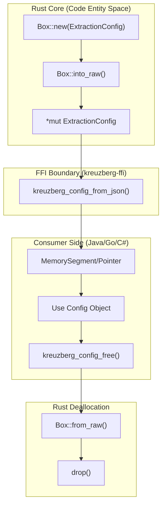
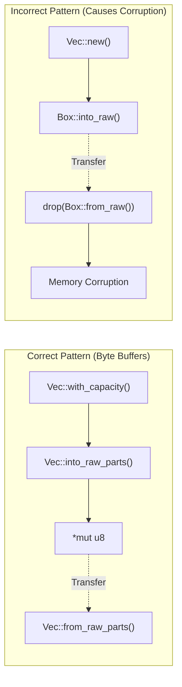
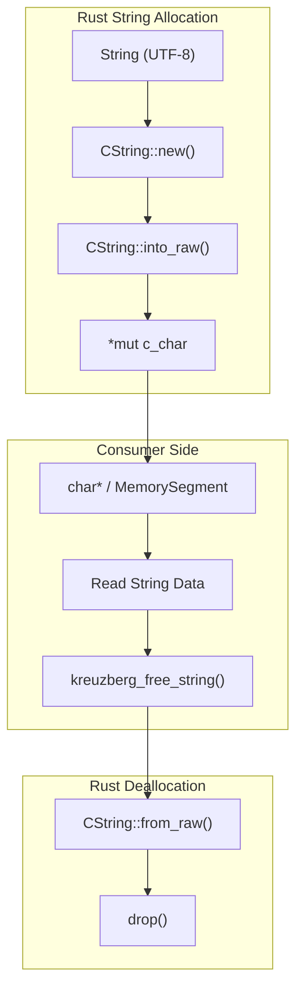
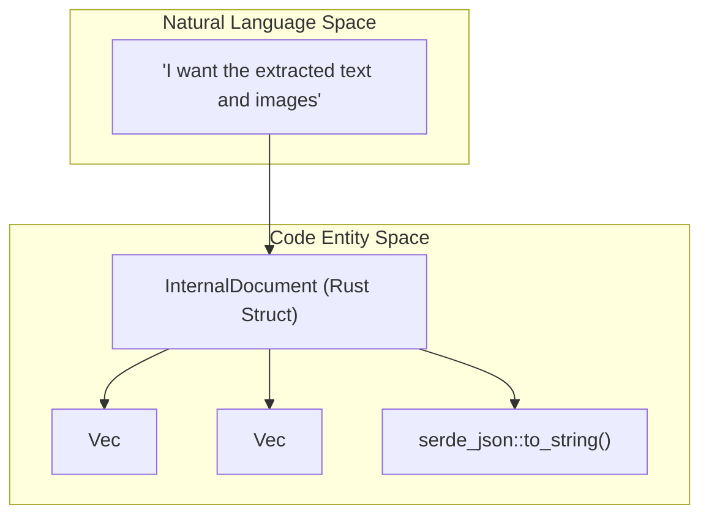

<!-- source: DeepWiki mcp.deepwiki.com · repo kreuzberg-dev/kreuzberg · page 10.6 Memory Management Across FFI · fetched 2026-10-27 -->

# Memory Management Across FFI

<details>
<summary>Relevant source files</summary>

The following files were used as context for generating this wiki page:

- [crates/kreuzberg-ffi/Cargo.toml](crates/kreuzberg-ffi/Cargo.toml)
- [crates/kreuzberg-node/Cargo.toml](crates/kreuzberg-node/Cargo.toml)
- [crates/kreuzberg-py/Cargo.toml](crates/kreuzberg-py/Cargo.toml)
- [crates/kreuzberg/src/core/extractor/bytes.rs](crates/kreuzberg/src/core/extractor/bytes.rs)
- [crates/kreuzberg/src/core/extractor/file.rs](crates/kreuzberg/src/core/extractor/file.rs)
- [crates/kreuzberg/src/types/internal.rs](crates/kreuzberg/src/types/internal.rs)
- [crates/kreuzberg/src/types/uri.rs](crates/kreuzberg/src/types/uri.rs)
- [crates/kreuzberg/tests/extraction_timeout_tests.rs](crates/kreuzberg/tests/extraction_timeout_tests.rs)

</details>


## Purpose and Scope

This document describes memory management patterns and lifecycle rules for data crossing the FFI boundary between Rust (`kreuzberg-ffi`) and language bindings. It covers allocation strategies, ownership transfer, deallocation contracts, and arena lifecycle patterns that ensure memory safety across Python, Node.js, Java, Go, C#, PHP, and other FFI consumers.

For FFI layer architecture and `cbindgen` header generation, see [FFI Layer (kreuzberg-ffi)](#4.11). For thread-safety details regarding PDFium, see [PDFium Integration](#10.2).

---

## Core Ownership Transfer Pattern

### Box::into_raw and Symmetric Deallocation

Kreuzberg uses `Box::into_raw()` to transfer ownership of heap-allocated data from Rust to FFI consumers. The consumer must later call the corresponding `kreuzberg_free_*` function to restore the `Box` and deallocate properly.



**Sources:** [crates/kreuzberg-ffi/Cargo.toml:37-43](), [crates/kreuzberg/src/core/extractor/file.rs:162-171]()

### Allocation and Deallocation Must Match

The critical invariant is that the allocation method must match the deallocation method. For example, byte buffers produced by `Vec::into_raw_parts` must be reclaimed using `Vec::from_raw_parts`. This is particularly important for the `extract_bytes` and `extract_file` operations which handle large binary buffers.



**Sources:** [crates/kreuzberg/src/core/extractor/bytes.rs:66-105](), [crates/kreuzberg/src/core/extractor/file.rs:67-95]()

---

## String Memory Management

### CString Allocation Pattern

Strings crossing the FFI boundary (such as MIME types, metadata, or extracted content) are converted to null-terminated C strings via `CString::new()` and transferred with `into_raw()`. The consumer must call the library's provided free functions to deallocate.



**Critical Safety Rule:** All `*mut c_char` pointers returned by Kreuzberg FFI functions MUST be freed with the appropriate deallocator to avoid memory leaks in the host process.

**Sources:** [crates/kreuzberg/src/types/internal.rs:43-47](), [crates/kreuzberg/src/types/uri.rs:150-158]()

### Metadata and Internal Document Transfer

The `InternalDocument` structure is designed for FFI compatibility by implementing `Serialize`/`Deserialize`. This allows foreign-language plugin implementations (Python, TypeScript, Ruby, etc.) to construct and return document data via JSON at the FFI/trait-bridge boundary.

| Entity | Role | Memory Behavior |
|----------|------|-----------------|
| `InternalDocument` | Flat DTO | Serialized to JSON for cross-boundary transfer [crates/kreuzberg/src/types/internal.rs:132-133]() |
| `InternalElementId` | Deterministic ID | Serialized as plain string `"ie-{hex}"` [crates/kreuzberg/src/types/internal.rs:43-47]() |
| `ExtractedImage` | Binary Data | Managed as `Vec<u8>` within the internal structure [crates/kreuzberg/src/types/internal.rs:148-148]() |

**Sources:** [crates/kreuzberg/src/types/internal.rs:122-133](), [crates/kreuzberg/src/types/internal.rs:148-154]()

---

## FFI Struct Memory Layout

### Data Transfer Objects (DTOs)

All FFI-exposed types use deterministic serialization or stable memory layouts. The `InternalDocument` is the primary DTO that all extractors output, optimized for extraction performance with a flat `Vec<InternalElement>`.

#### InternalDocument Handling

The `InternalDocument` is treated as a unified structure that bridges the gap between raw extraction and the public API.



**Sources:** [crates/kreuzberg/src/types/internal.rs:10-15](), [crates/kreuzberg/src/types/internal.rs:132-155]()

---

## Arena Lifecycle Patterns

### Binding-Specific Memory Handling

Each language binding (Python, Node.js) implements its own memory management strategy to bridge Rust's ownership model with the host language's Garbage Collector (GC).

| Binding | Framework | Implementation |
|-----------|-----------|----------------|
| Python | `PyO3` | Uses `pyo3::extension-module` for automatic reference counting [crates/kreuzberg-py/Cargo.toml:25-30]() |
| Node.js | `NAPI-RS` | Uses `napi` async features for non-blocking extraction [crates/kreuzberg-node/Cargo.toml:25-26]() |
| Rust Core | `Tokio` | Manages async task memory and timeouts [crates/kreuzberg/src/core/extractor/bytes.rs:134-151]() |

**Sources:** [crates/kreuzberg-py/Cargo.toml:25-31](), [crates/kreuzberg-node/Cargo.toml:25-26](), [crates/kreuzberg/src/core/extractor/bytes.rs:134-151]()

---

## Thread Safety and Global State

### Timeout and Cancellation
Extraction tasks are managed by the `tokio-runtime`. When a timeout is configured via `ExtractionConfig`, the runtime handles the cancellation and cleanup of associated memory.

```rust
// [crates/kreuzberg/src/core/extractor/bytes.rs:135-148]
if let Some(secs) = config.extraction_timeout_secs {
    let start = std::time::Instant::now();
    match tokio::time::timeout(std::time::Duration::from_secs(secs), extraction_future).await {
        Ok(inner) => inner,
        Err(_elapsed) => {
            if let Some(ref token) = config.cancel_token {
                token.cancel();
            }
            // ... Error handling
        }
    }
}
```

**Sources:** [crates/kreuzberg/src/core/extractor/bytes.rs:134-151](), [crates/kreuzberg/tests/extraction_timeout_tests.rs:12-30]()

---

## Common Pitfalls and Solutions

### Pitfall: Missing Runtime Feature
Setting an `extraction_timeout_secs` without the `tokio-runtime` feature enabled results in a validation error rather than a silent failure.

**Solution:** Ensure the `tokio-runtime` feature is enabled in `Cargo.toml` when using timeout capabilities.

**Sources:** [crates/kreuzberg/src/core/extractor/bytes.rs:155-161](), [crates/kreuzberg/tests/extraction_timeout_tests.rs:99-115]()

### Pitfall: Manual ID Manipulation
The `InternalElementId` is a deterministic 15-byte hash. Manually creating IDs with incorrect lengths will cause panics or deserialization errors.

**Solution:** Use the `InternalElementId::generate` method which uses `blake3` to ensure collision resistance and correct formatting.

**Sources:** [crates/kreuzberg/src/types/internal.rs:69-83](), [crates/kreuzberg/src/types/internal.rs:89-99]()

---

