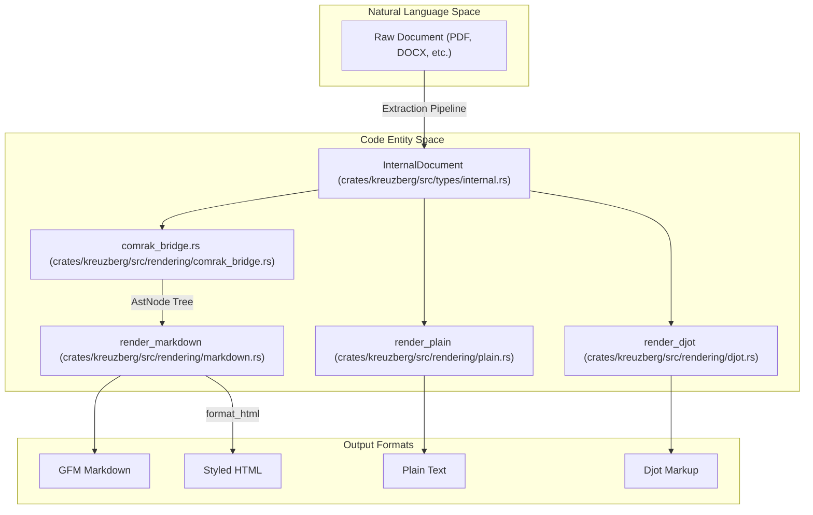
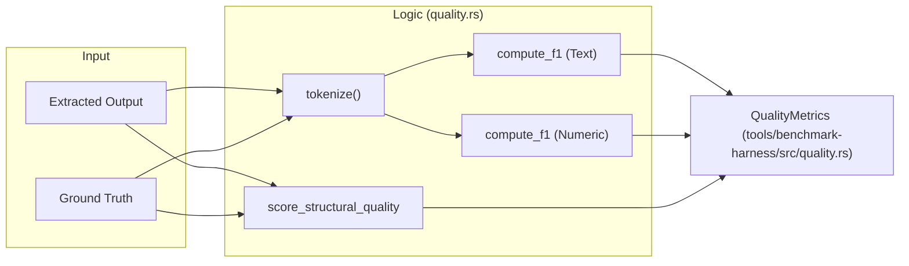

<!-- source: DeepWiki mcp.deepwiki.com · repo kreuzberg-dev/kreuzberg · page 10.7 Output Formats and Rendering · fetched 2026-10-27 -->

# Output Formats and Rendering

Relevant source files

The following files were used as context for generating this wiki page:

- [crates/kreuzberg/src/api/error.rs](crates/kreuzberg/src/api/error.rs)
- [crates/kreuzberg/src/api/handlers.rs](crates/kreuzberg/src/api/handlers.rs)
- [crates/kreuzberg/src/api/mod.rs](crates/kreuzberg/src/api/mod.rs)
- [crates/kreuzberg/src/api/openapi.rs](crates/kreuzberg/src/api/openapi.rs)
- [crates/kreuzberg/src/api/openweb.rs](crates/kreuzberg/src/api/openweb.rs)
- [crates/kreuzberg/src/api/router.rs](crates/kreuzberg/src/api/router.rs)
- [crates/kreuzberg/src/api/types.rs](crates/kreuzberg/src/api/types.rs)
- [crates/kreuzberg/src/chunking/validation.rs](crates/kreuzberg/src/chunking/validation.rs)
- [crates/kreuzberg/src/core/config_validation/dependencies.rs](crates/kreuzberg/src/core/config_validation/dependencies.rs)
- [crates/kreuzberg/src/core/server_config/mod.rs](crates/kreuzberg/src/core/server_config/mod.rs)
- [crates/kreuzberg/src/rendering/comrak_bridge.rs](crates/kreuzberg/src/rendering/comrak_bridge.rs)
- [crates/kreuzberg/src/rendering/djot.rs](crates/kreuzberg/src/rendering/djot.rs)
- [crates/kreuzberg/src/rendering/markdown.rs](crates/kreuzberg/src/rendering/markdown.rs)
- [crates/kreuzberg/src/rendering/plain.rs](crates/kreuzberg/src/rendering/plain.rs)
- [crates/kreuzberg/tests/api_chunk.rs](crates/kreuzberg/tests/api_chunk.rs)
- [crates/kreuzberg/tests/api_embed.rs](crates/kreuzberg/tests/api_embed.rs)
- [crates/kreuzberg/tests/api_large_pdf_extraction.rs](crates/kreuzberg/tests/api_large_pdf_extraction.rs)
- [crates/kreuzberg/tests/api_large_pdf_extraction_diagnostics.rs](crates/kreuzberg/tests/api_large_pdf_extraction_diagnostics.rs)
- [crates/kreuzberg/tests/api_tests.rs](crates/kreuzberg/tests/api_tests.rs)
- [docs/reference/file-size-limits.md](docs/reference/file-size-limits.md)
- [tools/benchmark-harness/src/markdown_quality.rs](tools/benchmark-harness/src/markdown_quality.rs)
- [tools/benchmark-harness/src/noise_detection.rs](tools/benchmark-harness/src/noise_detection.rs)
- [tools/benchmark-harness/src/quality.rs](tools/benchmark-harness/src/quality.rs)

This page details the rendering subsystem of Kreuzberg, which transforms the `InternalDocument` intermediate representation into various output formats. The system is designed to provide high-fidelity structural preservation (headings, tables, lists) while ensuring cross-format parity through a unified rendering pipeline.

## System Architecture

The rendering pipeline consumes an `InternalDocument` [crates/kreuzberg/src/types/internal.rs:7-12]() and uses specialized modules to generate specific formats. For Markdown and HTML, it utilizes a bridge to the `comrak` AST to ensure GFM compliance.

### Rendering Data Flow

The following diagram illustrates how an `InternalDocument` is processed into different output formats.

**Diagram: Rendering Pipeline Architecture**

Sources: [crates/kreuzberg/src/rendering/markdown.rs:138-142](), [crates/kreuzberg/src/rendering/comrak_bridge.rs:1-6](), [crates/kreuzberg/src/rendering/plain.rs:11-13](), [crates/kreuzberg/src/rendering/djot.rs:12-16]()

## Markdown (GFM/Comrak)

Markdown rendering is performed by converting the flat `InternalDocument` elements into a `comrak` AST [crates/kreuzberg/src/rendering/comrak_bridge.rs:1-5](). This ensures that complex structures like nested lists and tables are valid GitHub Flavored Markdown.

### Implementation Details
- **AST Construction**: The `build_comrak_ast` function iterates through elements, handling `ElementKind` variants to create `AstNode` objects [crates/kreuzberg/src/rendering/comrak_bridge.rs:28-31]().
- **Whitespace Normalization**: Mid-paragraph line breaks (common in PDF extraction) are collapsed into spaces to prevent `comrak` from escaping them as `&#10;` [crates/kreuzberg/src/rendering/comrak_bridge.rs:42-65]().
- **Post-processing**: After `comrak` formatting, the output undergoes several cleanup passes:
    - **Unescaping**: Reversing `comrak`'s aggressive escaping of `_`, `[`, `]`, `(`, `)`, `*`, and `=` [crates/kreuzberg/src/rendering/markdown.rs:177-188]().
    - **Newline Collapsing**: Runs of 3+ newlines are reduced to 2 to maintain standard paragraph spacing [crates/kreuzberg/src/rendering/markdown.rs:105-128]().
    - **Entity Replacement**: Manual replacement of remaining `&#10;` and `&#2;` entities [crates/kreuzberg/src/rendering/markdown.rs:66-99]().

Sources: [crates/kreuzberg/src/rendering/markdown.rs:1-128](), [crates/kreuzberg/src/rendering/comrak_bridge.rs:28-65]()

## Plain Text Rendering

The `render_plain` function generates a text-only representation by stripping all annotations and formatting [crates/kreuzberg/src/rendering/plain.rs:11-13]().

| Feature | Plain Text Implementation |
| :--- | :--- |
| **Headings** | Rendered as text with indentation based on `depth` [crates/kreuzberg/src/rendering/plain.rs:45-51](). |
| **Tables** | Rendered as space-separated columns via `render_table_plain` [crates/kreuzberg/src/rendering/plain.rs:96-109](). |
| **Lists** | Bullet points are preserved but complex nesting is flattened [crates/kreuzberg/src/rendering/plain.rs:81-84](). |
| **Images** | Rendered as `[Image: description]` followed by OCR text if available [crates/kreuzberg/src/rendering/plain.rs:110-128](). |

Sources: [crates/kreuzberg/src/rendering/plain.rs:11-128]()

## Djot Rendering

Djot is supported as a modern, lightweight alternative to Markdown. The `render_djot` function handles structural elements using Djot-specific syntax [crates/kreuzberg/src/rendering/djot.rs:12-16]().

- **Admonitions**: Uses Djot block attributes (e.g., `::: note`) [crates/kreuzberg/src/rendering/djot.rs:165-170]().
- **Mathematics**: Formulas are wrapped in `$$` blocks [crates/kreuzberg/src/rendering/djot.rs:75-82]().
- **Metadata**: Document-level metadata is parsed and rendered at the start or end of the document [crates/kreuzberg/src/rendering/djot.rs:18-19]().

Sources: [crates/kreuzberg/src/rendering/djot.rs:1-170]()

## Quality and Parity Guarantees

Kreuzberg implements strict quality metrics to ensure that extraction is accurate across all formats. This is managed by the `benchmark-harness`.

### Quality Scoring Model
The system uses a weighted F1-score approach to evaluate rendering quality:
- **Text Score (0.6)**: Standard bag-of-words F1 score [tools/benchmark-harness/src/quality.rs:8-12]().
- **Numeric Score (0.4)**: High-weight scoring for numbers to ensure financial/scientific accuracy [tools/benchmark-harness/src/quality.rs:14-17]().
- **Layout Score**: When Markdown ground truth is available, structural fidelity (headings, tables) accounts for 30% of the total score [tools/benchmark-harness/src/quality.rs:22-26]().

**Diagram: Quality Metric Calculation**

Sources: [tools/benchmark-harness/src/quality.rs:8-98](), [tools/benchmark-harness/src/markdown_quality.rs:1-17]()

## HTML Styling Contract

While the core produces raw HTML via `comrak`, Kreuzberg provides a "styled output" contract. This involves:
1. **Container Mapping**: Elements are wrapped in semantic tags (`
`, `<h1>`, `<table>`).
2. **Metadata Injection**: Page markers are inserted as HTML comments (e.g., `<!-- PAGE 1 -->`) [crates/kreuzberg/src/rendering/markdown.rs:155-158]().
3. **Parity**: The HTML output is guaranteed to contain the exact same text and hierarchy as the Markdown output because both share the same `comrak` AST generation logic in `comrak_bridge.rs` [crates/kreuzberg/src/rendering/comrak_bridge.rs:1-6]().

Sources: [crates/kreuzberg/src/rendering/markdown.rs:155-168](), [crates/kreuzberg/src/rendering/comrak_bridge.rs:1-6]()

---

