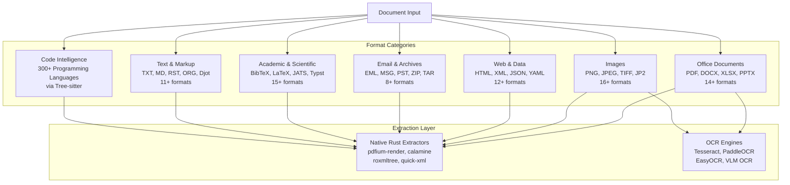
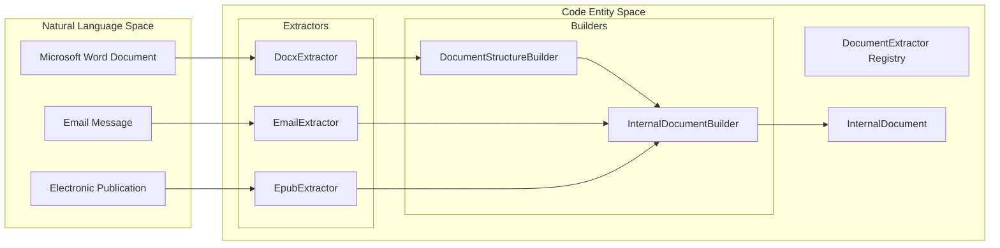

<!-- source: DeepWiki mcp.deepwiki.com · repo kreuzberg-dev/kreuzberg · page 11.2 Supported Document Formats · fetched 2026-10-27 -->

# Supported Document Formats

Relevant source files

The following files were used as context for generating this wiki page:

- [crates/kreuzberg/src/extraction/email.rs](crates/kreuzberg/src/extraction/email.rs)
- [crates/kreuzberg/src/extraction/excel.rs](crates/kreuzberg/src/extraction/excel.rs)
- [crates/kreuzberg/src/extraction/html/converter.rs](crates/kreuzberg/src/extraction/html/converter.rs)
- [crates/kreuzberg/src/extraction/pptx/elements.rs](crates/kreuzberg/src/extraction/pptx/elements.rs)
- [crates/kreuzberg/src/extraction/pptx/mod.rs](crates/kreuzberg/src/extraction/pptx/mod.rs)
- [crates/kreuzberg/src/extraction/pptx/parser.rs](crates/kreuzberg/src/extraction/pptx/parser.rs)
- [crates/kreuzberg/src/extraction/xml.rs](crates/kreuzberg/src/extraction/xml.rs)
- [crates/kreuzberg/src/extractors/archive.rs](crates/kreuzberg/src/extractors/archive.rs)
- [crates/kreuzberg/src/extractors/bibtex.rs](crates/kreuzberg/src/extractors/bibtex.rs)
- [crates/kreuzberg/src/extractors/csv.rs](crates/kreuzberg/src/extractors/csv.rs)
- [crates/kreuzberg/src/extractors/djot_format/extractor.rs](crates/kreuzberg/src/extractors/djot_format/extractor.rs)
- [crates/kreuzberg/src/extractors/docbook.rs](crates/kreuzberg/src/extractors/docbook.rs)
- [crates/kreuzberg/src/extractors/docx.rs](crates/kreuzberg/src/extractors/docx.rs)
- [crates/kreuzberg/src/extractors/email.rs](crates/kreuzberg/src/extractors/email.rs)
- [crates/kreuzberg/src/extractors/epub/content.rs](crates/kreuzberg/src/extractors/epub/content.rs)
- [crates/kreuzberg/src/extractors/epub/metadata.rs](crates/kreuzberg/src/extractors/epub/metadata.rs)
- [crates/kreuzberg/src/extractors/epub/mod.rs](crates/kreuzberg/src/extractors/epub/mod.rs)
- [crates/kreuzberg/src/extractors/epub/parsing.rs](crates/kreuzberg/src/extractors/epub/parsing.rs)
- [crates/kreuzberg/src/extractors/excel.rs](crates/kreuzberg/src/extractors/excel.rs)
- [crates/kreuzberg/src/extractors/fictionbook.rs](crates/kreuzberg/src/extractors/fictionbook.rs)
- [crates/kreuzberg/src/extractors/html.rs](crates/kreuzberg/src/extractors/html.rs)
- [crates/kreuzberg/src/extractors/jats/mod.rs](crates/kreuzberg/src/extractors/jats/mod.rs)
- [crates/kreuzberg/src/extractors/jupyter.rs](crates/kreuzberg/src/extractors/jupyter.rs)
- [crates/kreuzberg/src/extractors/latex/metadata.rs](crates/kreuzberg/src/extractors/latex/metadata.rs)
- [crates/kreuzberg/src/extractors/latex/mod.rs](crates/kreuzberg/src/extractors/latex/mod.rs)
- [crates/kreuzberg/src/extractors/markdown.rs](crates/kreuzberg/src/extractors/markdown.rs)
- [crates/kreuzberg/src/extractors/mdx.rs](crates/kreuzberg/src/extractors/mdx.rs)
- [crates/kreuzberg/src/extractors/odt.rs](crates/kreuzberg/src/extractors/odt.rs)
- [crates/kreuzberg/src/extractors/orgmode.rs](crates/kreuzberg/src/extractors/orgmode.rs)
- [crates/kreuzberg/src/extractors/pptx.rs](crates/kreuzberg/src/extractors/pptx.rs)
- [crates/kreuzberg/src/extractors/rst.rs](crates/kreuzberg/src/extractors/rst.rs)
- [crates/kreuzberg/src/extractors/rtf/mod.rs](crates/kreuzberg/src/extractors/rtf/mod.rs)
- [crates/kreuzberg/src/extractors/structured.rs](crates/kreuzberg/src/extractors/structured.rs)
- [crates/kreuzberg/src/extractors/text.rs](crates/kreuzberg/src/extractors/text.rs)
- [crates/kreuzberg/src/extractors/typst.rs](crates/kreuzberg/src/extractors/typst.rs)
- [crates/kreuzberg/src/extractors/xml.rs](crates/kreuzberg/src/extractors/xml.rs)
- [crates/kreuzberg/tests/csv_embedding_quality.rs](crates/kreuzberg/tests/csv_embedding_quality.rs)
- [crates/kreuzberg/tests/docx_formatting_test.rs](crates/kreuzberg/tests/docx_formatting_test.rs)
- [crates/kreuzberg/tests/epub_spine_semantics_tests.rs](crates/kreuzberg/tests/epub_spine_semantics_tests.rs)
- [crates/kreuzberg/tests/issue_671_pptx_image_config_regression.rs](crates/kreuzberg/tests/issue_671_pptx_image_config_regression.rs)
- [crates/kreuzberg/tests/typst_behavioral_tests.rs](crates/kreuzberg/tests/typst_behavioral_tests.rs)
- [crates/kreuzberg/tests/xml_embedding_quality.rs](crates/kreuzberg/tests/xml_embedding_quality.rs)

## Purpose and Scope

This page provides a comprehensive reference of the 75+ file formats supported by Kreuzberg, organized by category. For each format, you'll find extraction methods, capabilities, and technical implementation details.

This document covers **format support and capabilities only**. For information about:
- Extraction configuration options → see [Configuration Reference](11.1)
- OCR engine setup and configuration → see [OCR Backends](5.3)
- MIME type detection mechanics → see [MIME Type Detection](3.3)

All formats listed are supported across all language bindings. Image formats and PDFs support optional OCR when configured through `OcrConfig`.

---

## Format Categories Overview

Kreuzberg organizes supported formats into major categories based on document type and processing requirements.

**Sources:** [crates/kreuzberg/src/extractors/docx.rs:23-28](), [crates/kreuzberg/src/extractors/excel.rs:112-114](), [crates/kreuzberg/src/extractors/pptx.rs:16-18]()

---

## Office Documents

Office documents represent the core category, covering modern Microsoft Office formats and OpenDocument standards.

| Format | Extensions | Extractor Class | Capabilities |
|--------|-----------|-------------------|-------------|
| **Word** | `.docx` | `DocxExtractor` | Headings, Lists, Tables, Images, Metadata |
| **Excel** | `.xlsx`, `.xls`, `.ods` | `ExcelExtractor` | Sheets as Tables, Sheet Headings, DDE Security Scanning |
| **PowerPoint** | `.pptx`, `.ppsx` | `PptxExtractor` | Slide Structure, Notes, Images, Hyperlinks |
| **OpenDocument Text**| `.odt` | `OdtExtractor` | Tracked Changes, Tables, Formatting, Metadata |

### Word Processing (DOCX)
The `DocxExtractor` [crates/kreuzberg/src/extractors/docx.rs:28-28]() provides high-performance text extraction via streaming XML parsing. It uses `DocumentStructureBuilder` [crates/kreuzberg/src/extractors/docx.rs:50-50]() to construct a hierarchical tree.
- **Data Flow**: XML Stream → Paragraph/Table Parser → `DocumentStructureBuilder` → `InternalDocument`.
- **Key Function**: `build_document_structure()` [crates/kreuzberg/src/extractors/docx.rs:49-49]() handles section properties, heading levels, and math formulas.

### Spreadsheet Processing (Excel)
The `ExcelExtractor` [crates/kreuzberg/src/extractors/excel.rs:123-123]() uses the `calamine` crate.
- **Security**: It includes a specialized `scan_for_dde_warnings()` [crates/kreuzberg/src/extractors/excel.rs:59-59]() function to detect DDE, WEBSERVICE, and HYPERLINK injection vectors.
- **Implementation**: `build_internal_document()` [crates/kreuzberg/src/extractors/excel.rs:172-172]() converts each sheet into a Markdown table preceded by an H2 heading.

### Presentation Processing (PPTX)
The `PptxExtractor` [crates/kreuzberg/src/extractors/pptx.rs:19-19]() processes Office Open XML presentations.
- **Features**: Extracts slide titles, body content, and speaker notes [crates/kreuzberg/src/extraction/pptx/mod.rs:156-157]().
- **Logic**: `build_internal_document()` [crates/kreuzberg/src/extractors/pptx.rs:62-62]() splits content into slide-like blocks and identifies Markdown-style tables.

**Sources:** [crates/kreuzberg/src/extractors/docx.rs:1-104](), [crates/kreuzberg/src/extractors/excel.rs:1-175](), [crates/kreuzberg/src/extractors/pptx.rs:1-183]()

---

## Email & Messaging

Kreuzberg supports standard email formats with full header and attachment metadata extraction.

| Format | Extensions | Extractor Class | Method |
|--------|-----------|-------------------|--------|
| **Email** | `.eml`, `.msg` | `EmailExtractor` | `mail-parser` + HTML structural walk |

- **Header Extraction**: Captures Subject, From, To, CC, and Date [crates/kreuzberg/src/extractors/email.rs:42-61]().
- **Encoding**: Includes `maybe_transcode_utf16()` [crates/kreuzberg/src/extraction/email.rs:68-68]() to handle legacy EML encodings.
- **Content**: Uses `process_node()` [crates/kreuzberg/src/extractors/email.rs:99-99]() to recursively walk HTML bodies for richer structure than plain text.

**Sources:** [crates/kreuzberg/src/extractors/email.rs:1-100](), [crates/kreuzberg/src/extraction/email.rs:1-180]()

---

## Web & Markup Formats

These formats are processed to preserve structural meaning (headings, lists, code blocks).

| Format | Extensions | Extractor Class | Notes |
|--------|-----------|-------------------|-------|
| **HTML** | `.html` | `HtmlExtractor` | Maps `html-to-markdown-rs` structure to `InternalDocument` |
| **EPUB** | `.epub` | `EpubExtractor` | Processes spine items in order, handles EPUB2/3 |
| **reStructuredText**| `.rst` | `RstExtractor` | Field list metadata, directives, and table support |
| **DocBook** | `.xml` | `DocbookExtractor` | Supports 4.x and 5.x namespaces |
| **FictionBook** | `.fb2` | `FictionBookExtractor` | Popular e-book format, extracts base64 images |

### EPUB Details
The `EpubExtractor` [crates/kreuzberg/src/extractors/epub/mod.rs:42-42]() performs a native Rust extraction without GPL dependencies.
- **Data Flow**: `ZipArchive` → `parse_container_xml` → `parse_opf` → `render_spine_document` [crates/kreuzberg/src/extractors/epub/mod.rs:98-98]().
- **Structure**: It rebuilds the document structure by concatenating individual chapter trees [crates/kreuzberg/src/extractors/epub/mod.rs:160-160]().

### reStructuredText (RST)
The `RstExtractor` [crates/kreuzberg/src/extractors/rst.rs:52-52]() provides a native parser for scientific documentation.
- **Metadata**: Extracts standard fields like `:Author:` and `:Date:` into typed metadata [crates/kreuzberg/src/extractors/rst.rs:71-80]().
- **Logic**: Handles complex overline/underline heading styles [crates/kreuzberg/src/extractors/rst.rs:122-135]().

**Sources:** [crates/kreuzberg/src/extractors/html.rs:23-51](), [crates/kreuzberg/src/extractors/epub/mod.rs:1-185](), [crates/kreuzberg/src/extractors/rst.rs:1-146]()

---

## Technical Extraction Flow

The following diagram illustrates how the system associates natural language document types with specific code entities and data structures.

### Data Structure Mapping
Every extractor eventually targets the `InternalDocument` [crates/kreuzberg/src/types/internal.rs:1-10]() via the `InternalDocumentBuilder` [crates/kreuzberg/src/types/internal_builder.rs:1-10]().

- **Docx**: Maps streaming XML events to `push_paragraph`, `push_table`, and `push_heading` [crates/kreuzberg/src/extractors/docx.rs:129-151]().
- **Odt**: Resolves `OdtStyleProps` [crates/kreuzberg/src/extractors/odt.rs:75-75]() (bold, italic) to `TextAnnotation` types.
- **DocBook**: Uses `ParsingState` [crates/kreuzberg/src/extractors/docbook.rs:48-48]() to track nested XML tags and section depth.

**Sources:** [crates/kreuzberg/src/extractors/docx.rs:43-151](), [crates/kreuzberg/src/extractors/odt.rs:1-82](), [crates/kreuzberg/src/extractors/docbook.rs:1-158]()

---

## Summary Table of Capabilities

| Category | Extractor | Tables | Images | Metadata |
|----------|-----------|--------|--------|----------|
| **Office** | `DocxExtractor` | ✅ | ✅ | ✅ |
| **Office** | `ExcelExtractor` | ✅ | ❌ | ✅ |
| **Office** | `PptxExtractor` | ✅ | ✅ | ✅ |
| **Office** | `OdtExtractor` | ✅ | ✅ | ✅ |
| **Email** | `EmailExtractor` | ✅ | ❌ | ✅ |
| **E-book** | `EpubExtractor` | ✅ | ✅ | ✅ |
| **E-book** | `FictionBookExtractor` | ✅ | ✅ | ✅ |
| **Web** | `HtmlExtractor` | ✅ | ✅ | ✅ |
| **Scientific** | `RstExtractor` | ✅ | ✅ | ✅ |
| **Technical** | `DocbookExtractor` | ✅ | ✅ | ✅ |

**Sources:** [crates/kreuzberg/src/extractors/docx.rs:23-28](), [crates/kreuzberg/src/extractors/excel.rs:112-114](), [crates/kreuzberg/src/extractors/email.rs:18-21](), [crates/kreuzberg/src/extractors/odt.rs:23-30]()

---

