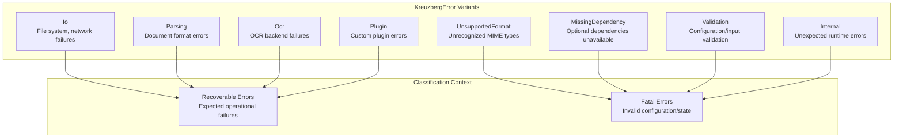
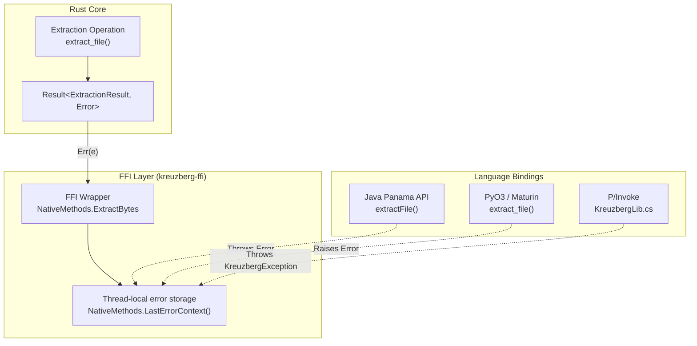
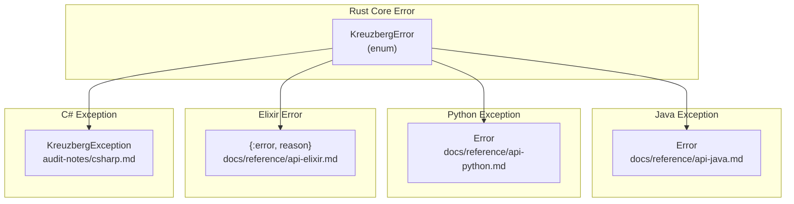

<!-- source: DeepWiki mcp.deepwiki.com · repo kreuzberg-dev/kreuzberg · page 11.4 Error Codes and Types · fetched 2026-10-27 -->

# Error Codes and Types

Relevant source files

The following files were used as context for generating this wiki page:

- [audit-notes/csharp.md](audit-notes/csharp.md)
- [audit-notes/dart.md](audit-notes/dart.md)
- [audit-notes/elixir.md](audit-notes/elixir.md)
- [audit-notes/go.md](audit-notes/go.md)
- [audit-notes/java.md](audit-notes/java.md)
- [audit-notes/kotlin-android.md](audit-notes/kotlin-android.md)
- [audit-notes/node.md](audit-notes/node.md)
- [audit-notes/other-bindings.md](audit-notes/other-bindings.md)
- [audit-notes/php.md](audit-notes/php.md)
- [audit-notes/python.md](audit-notes/python.md)
- [audit-notes/r.md](audit-notes/r.md)
- [audit-notes/ruby.md](audit-notes/ruby.md)
- [audit-notes/swift.md](audit-notes/swift.md)
- [audit-notes/zig.md](audit-notes/zig.md)
- [crates/kreuzberg-ffi/tests/email_attachment_data_len.rs](crates/kreuzberg-ffi/tests/email_attachment_data_len.rs)
- [docs/reference/api-c.md](docs/reference/api-c.md)
- [docs/reference/api-csharp.md](docs/reference/api-csharp.md)
- [docs/reference/api-elixir.md](docs/reference/api-elixir.md)
- [docs/reference/api-go.md](docs/reference/api-go.md)
- [docs/reference/api-java.md](docs/reference/api-java.md)
- [docs/reference/api-php.md](docs/reference/api-php.md)
- [docs/reference/api-python.md](docs/reference/api-python.md)
- [docs/reference/api-r.md](docs/reference/api-r.md)
- [docs/reference/api-ruby.md](docs/reference/api-ruby.md)
- [docs/reference/api-rust.md](docs/reference/api-rust.md)
- [docs/reference/api-typescript.md](docs/reference/api-typescript.md)
- [docs/reference/api-wasm.md](docs/reference/api-wasm.md)
- [docs/reference/configuration.md](docs/reference/configuration.md)
- [docs/reference/errors.md](docs/reference/errors.md)
- [docs/reference/types.md](docs/reference/types.md)

This page documents Kreuzberg's comprehensive error handling system, including error code enumeration, classification, FFI boundary handling, and language-specific exception mapping. The system ensures consistent error reporting across all 12+ language bindings while preserving detailed diagnostic information.

---

## Error Code Enumeration

Kreuzberg defines a structured hierarchy of error codes that classify failures by their root cause. Error codes are defined at the core and consistently mapped to language-specific exceptions.

### Core Error Code Types

The system uses `KreuzbergError` as the primary error container.

**Sources:** [docs/reference/api-rust.md:27-28](), [docs/reference/api-csharp.md:27-28](), [docs/reference/api-go.md:27-28]()

### Error Code Usage by Operation

| Error Code | Extraction | OCR | Plugins | Config | Batch |
|------------|-----------|-----|---------|--------|-------|
| **Io** | File not found, read errors [api-csharp.md:68]() | Image loading | - | Config file access | Per-file failures |
| **Parsing** | Corrupted document structure | - | - | JSON parse errors | Per-file parse errors |
| **UnsupportedFormat** | Unknown MIME type [api-go.md:28]() | - | - | - | Skipped files |
| **MissingDependency** | PDFium unavailable | OCR engine not found | - | - | Feature unavailable |
| **Ocr** | - | Backend failures | - | - | OCR-specific per-file |
| **Plugin** | - | - | Exception in plugin callback | - | Plugin failures |
| **Validation** | Invalid MIME type [api-java.md:27]() | Invalid DPI | - | Out-of-range values | Invalid batch input |
| **Internal** | Panic, assertion failure | - | - | - | Unexpected state |

**Sources:** [docs/reference/api-csharp.md:68-69](), [docs/reference/api-go.md:27-28](), [docs/reference/api-java.md:27-28]()

---

## Error Classification System

Kreuzberg provides semantic classification beyond numeric codes, grouping errors by operational characteristics to enable intelligent retry logic and user-facing error messages.

### Classification Decision Matrix

The classification system maps error messages and context to semantic categories:

| Pattern Matching | Classification | Retry-able | User Action |
|-----------------|----------------|-----------|-------------|
| "file not found", "permission denied" | `IoError` | ✓ | Check file path and permissions |
| "invalid", "malformed", "corrupted" | `ParsingError` | ✗ | Verify document is not corrupted |
| "unsupported", "unknown mime type" | `UnsupportedFormat` | ✗ | Check supported formats list |
| "missing dependency", "not installed" | `MissingDependency` | ✗ | Install required feature |
| "ocr failed", "low confidence" | `OcrError` | ✓ | Adjust OCR configuration |
| "plugin", "callback" | `PluginError` | ✗ | Fix plugin implementation |
| "invalid config", "out of range" | `ValidationError` | ✗ | Correct configuration values |
| "panic", "assertion", "unexpected" | `InternalError` | ✗ | Report bug with context |

**Sources:** [docs/reference/api-csharp.md:27-28](), [docs/reference/api-java.md:27-28](), [docs/reference/api-python.md:27-28]()

---

## Error Propagation Across FFI Boundaries

Kreuzberg's error handling system must preserve detailed error information while crossing from Rust (native code) through the FFI boundary to managed language bindings.

### Error Flow Architecture

**Sources:** [docs/reference/api-rust.md:33-33](), [audit-notes/csharp.md:24-29](), [audit-notes/csharp.md:44-48]()

---

## Language-Specific Error Types

Each language binding maps Kreuzberg's error codes to idiomatic exception types, preserving error semantics while following language conventions.

### Exception Hierarchy Mapping

**Sources:** [docs/reference/api-java.md:33-33](), [docs/reference/api-python.md:45-45](), [docs/reference/api-elixir.md:46-46](), [audit-notes/csharp.md:29-29]()

### Error Code to Exception Type Mapping

| ErrorCode | Java | Python | Elixir | C# | Go |
|-----------|------|--------|--------|----|----|
| **Io** | `Error` | `Error` | `{:error, reason}` | `KreuzbergException` | `error` |
| **Parsing** | `Error` | `Error` | `{:error, reason}` | `KreuzbergException` | `error` |
| **Validation** | `Error` | `Error` | `{:error, reason}` | `KreuzbergException` | `error` |
| **UnsupportedFormat** | `Error` | `Error` | `{:error, reason}` | `KreuzbergException` | `error` |

**Sources:** [docs/reference/api-java.md:45-45](), [docs/reference/api-python.md:45-45](), [docs/reference/api-elixir.md:46-46](), [docs/reference/api-go.md:45-45](), [audit-notes/csharp.md:29-29]()

---

## Panic Handling

Kreuzberg employs a panic shield at the FFI boundary to catch Rust panics and convert them to structured errors. This prevents undefined behavior when panics cross FFI boundaries.

### Panic Shield Architecture

1. **Catch Unwind**: The FFI layer wraps core calls in `std::panic::catch_unwind`.
2. **Payload Extraction**: If a panic occurs, the payload (message) and location are extracted.
3. **Thread-Local Storage**: The panic context is stored in a thread-local variable, accessible via `NativeMethods.LastErrorContext()` [audit-notes/csharp.md:27-28]().
4. **Binding Notification**: The FFI function returns a failure code/null (IntPtr.Zero), signaling the binding to check for panic details [audit-notes/csharp.md:25-29]().

**Sources:** [audit-notes/csharp.md:24-30](), [audit-notes/csharp.md:75-79]()

---

## Configuration Validation Errors

The `ExtractionConfig` and its sub-configs have specific constraints that trigger `Validation` errors if violated.

| Config Field | Constraint | Error Condition |
|--------------|------------|-----------------|
| `force_ocr_pages` | `int >= 1` | Any value < 1 [configuration.md:92]() |
| `disable_ocr` | `bool` | Cannot be true with `force_ocr` [configuration.md:93]() |
| `device_id` | `int` | Ignored for CPU/CoreML, but required for CUDA [configuration.md:19]() |
| `labels` | `list[str]` | Must contain at least one entry [configuration.md:42]() |

**Sources:** [docs/reference/configuration.md:18-19](), [docs/reference/configuration.md:42-43](), [docs/reference/configuration.md:92-93]()

---

## Batch Processing Error Handling

In batch operations (`BatchExtractFiles`, `BatchExtractBytes`), error handling follows a "partial success" model.

* **Individual File Errors**: Captured in the `ExtractionResult` processing warnings or result metadata. The batch continues processing other files [docs/reference/types.md:45-45]().
* **System Errors**: IO or Runtime failures (e.g., file doesn't exist) will bubble up and fail the entire batch operation in certain bindings [docs/reference/api-csharp.md:227-228]().
* **Concurrency Limits**: Concurrency is managed to prevent resource exhaustion; exceeding limits or failing to acquire resources results in system-level errors [docs/reference/api-csharp.md:207-210]().

**Sources:** [docs/reference/api-csharp.md:227-228](), [docs/reference/api-rust.md:227-228](), [docs/reference/types.md:45-45]()

---

