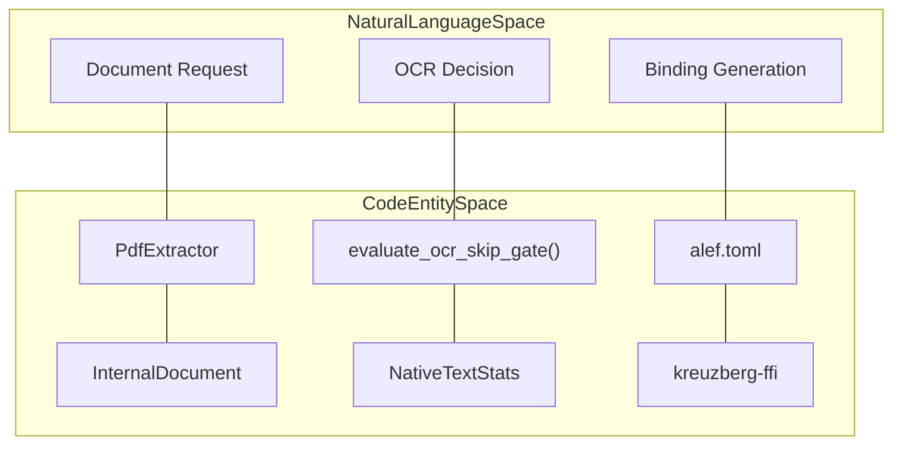
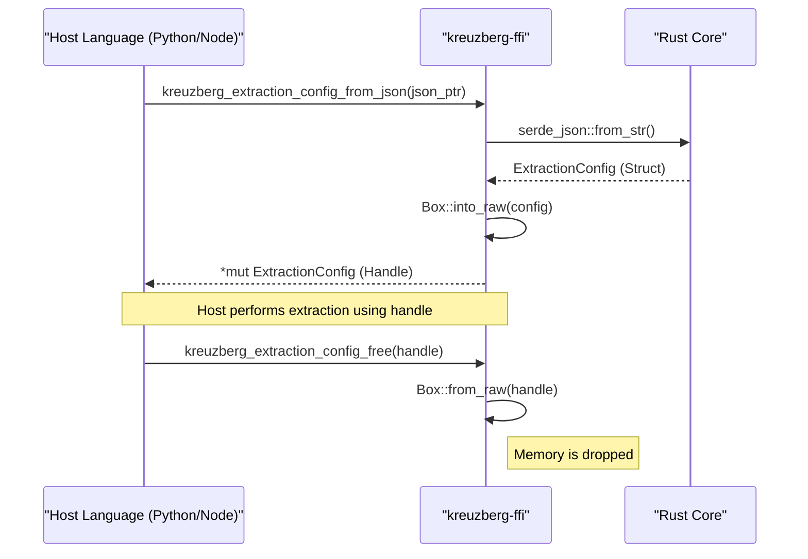

<!-- source: DeepWiki mcp.deepwiki.com · repo kreuzberg-dev/kreuzberg · page 12 Glossary · fetched 2026-10-27 -->

# Glossary

Relevant source files

The following files were used as context for generating this wiki page:

- [.gitignore](.gitignore)
- [.pre-commit-config.yaml](.pre-commit-config.yaml)
- [CHANGELOG.md](CHANGELOG.md)
- [Cargo.lock](Cargo.lock)
- [Cargo.toml](Cargo.toml)
- [README.md](README.md)
- [alef.toml](alef.toml)
- [crates/kreuzberg-ffi/include/kreuzberg.h](crates/kreuzberg-ffi/include/kreuzberg.h)
- [crates/kreuzberg-ffi/src/lib.rs](crates/kreuzberg-ffi/src/lib.rs)
- [crates/kreuzberg-node/README.md](crates/kreuzberg-node/README.md)
- [crates/kreuzberg-node/index.d.ts](crates/kreuzberg-node/index.d.ts)
- [crates/kreuzberg-node/package.json](crates/kreuzberg-node/package.json)
- [crates/kreuzberg-node/src/lib.rs](crates/kreuzberg-node/src/lib.rs)
- [crates/kreuzberg-php/src/lib.rs](crates/kreuzberg-php/src/lib.rs)
- [crates/kreuzberg-py/src/lib.rs](crates/kreuzberg-py/src/lib.rs)
- [crates/kreuzberg-wasm/README.md](crates/kreuzberg-wasm/README.md)
- [crates/kreuzberg-wasm/package.json](crates/kreuzberg-wasm/package.json)
- [crates/kreuzberg-wasm/src/lib.rs](crates/kreuzberg-wasm/src/lib.rs)
- [crates/kreuzberg/Cargo.toml](crates/kreuzberg/Cargo.toml)
- [crates/kreuzberg/README.md](crates/kreuzberg/README.md)
- [crates/kreuzberg/src/core/pipeline/tests.rs](crates/kreuzberg/src/core/pipeline/tests.rs)
- [crates/kreuzberg/src/extraction/image.rs](crates/kreuzberg/src/extraction/image.rs)
- [crates/kreuzberg/src/extraction/pptx/content_builder.rs](crates/kreuzberg/src/extraction/pptx/content_builder.rs)
- [crates/kreuzberg/src/extractors/djot_format/conversion.rs](crates/kreuzberg/src/extractors/djot_format/conversion.rs)
- [crates/kreuzberg/src/extractors/image.rs](crates/kreuzberg/src/extractors/image.rs)
- [crates/kreuzberg/src/extractors/pdf/extraction.rs](crates/kreuzberg/src/extractors/pdf/extraction.rs)
- [crates/kreuzberg/src/extractors/pdf/layout_runner.rs](crates/kreuzberg/src/extractors/pdf/layout_runner.rs)
- [crates/kreuzberg/src/extractors/pdf/mod.rs](crates/kreuzberg/src/extractors/pdf/mod.rs)
- [crates/kreuzberg/src/extractors/pdf/ocr.rs](crates/kreuzberg/src/extractors/pdf/ocr.rs)
- [crates/kreuzberg/src/pdf/oxide/hierarchy.rs](crates/kreuzberg/src/pdf/oxide/hierarchy.rs)
- [crates/kreuzberg/src/pdf/oxide/images.rs](crates/kreuzberg/src/pdf/oxide/images.rs)
- [crates/kreuzberg/src/pdf/oxide/mod.rs](crates/kreuzberg/src/pdf/oxide/mod.rs)
- [crates/kreuzberg/src/pdf/oxide/table.rs](crates/kreuzberg/src/pdf/oxide/table.rs)
- [crates/kreuzberg/src/pdf/oxide/text.rs](crates/kreuzberg/src/pdf/oxide/text.rs)
- [crates/kreuzberg/src/pdf/oxide_text.rs](crates/kreuzberg/src/pdf/oxide_text.rs)
- [crates/kreuzberg/src/pdf/structure/mod.rs](crates/kreuzberg/src/pdf/structure/mod.rs)
- [crates/kreuzberg/src/pdf/structure/pipeline.rs](crates/kreuzberg/src/pdf/structure/pipeline.rs)
- [crates/kreuzberg/src/pdf/structure/regions/table_recognition.rs](crates/kreuzberg/src/pdf/structure/regions/table_recognition.rs)
- [crates/kreuzberg/src/plugins/embedding.rs](crates/kreuzberg/src/plugins/embedding.rs)
- [crates/kreuzberg/src/plugins/extractor/mod.rs](crates/kreuzberg/src/plugins/extractor/mod.rs)
- [crates/kreuzberg/src/plugins/extractor/registry.rs](crates/kreuzberg/src/plugins/extractor/registry.rs)
- [crates/kreuzberg/src/plugins/extractor/trait.rs](crates/kreuzberg/src/plugins/extractor/trait.rs)
- [crates/kreuzberg/src/plugins/mod.rs](crates/kreuzberg/src/plugins/mod.rs)
- [crates/kreuzberg/src/plugins/ocr.rs](crates/kreuzberg/src/plugins/ocr.rs)
- [crates/kreuzberg/src/plugins/processor/mod.rs](crates/kreuzberg/src/plugins/processor/mod.rs)
- [crates/kreuzberg/src/plugins/registry/extractor.rs](crates/kreuzberg/src/plugins/registry/extractor.rs)
- [crates/kreuzberg/src/plugins/registry/ocr.rs](crates/kreuzberg/src/plugins/registry/ocr.rs)
- [crates/kreuzberg/src/plugins/registry/renderer.rs](crates/kreuzberg/src/plugins/registry/renderer.rs)
- [crates/kreuzberg/src/plugins/renderer.rs](crates/kreuzberg/src/plugins/renderer.rs)
- [crates/kreuzberg/src/plugins/validator/mod.rs](crates/kreuzberg/src/plugins/validator/mod.rs)
- [crates/kreuzberg/tests/pdf_glyph_spacing_issue_962.rs](crates/kreuzberg/tests/pdf_glyph_spacing_issue_962.rs)
- [crates/kreuzberg/tests/pdf_heuristic_tables.rs](crates/kreuzberg/tests/pdf_heuristic_tables.rs)
- [crates/kreuzberg/tests/pdf_image_extraction_tests.rs](crates/kreuzberg/tests/pdf_image_extraction_tests.rs)
- [e2e/rust/Cargo.toml](e2e/rust/Cargo.toml)
- [package.json](package.json)
- [packages/csharp/README.md](packages/csharp/README.md)
- [packages/elixir/README.md](packages/elixir/README.md)
- [packages/elixir/native/kreuzberg_nif/src/lib.rs](packages/elixir/native/kreuzberg_nif/src/lib.rs)
- [packages/go/v4/README.md](packages/go/v4/README.md)
- [packages/java/README.md](packages/java/README.md)
- [packages/php/README.md](packages/php/README.md)
- [packages/php/src/Kreuzberg.php](packages/php/src/Kreuzberg.php)
- [packages/php/stubs/kreuzberg_extension.php](packages/php/stubs/kreuzberg_extension.php)
- [packages/python/README.md](packages/python/README.md)
- [packages/python/kreuzberg/__init__.py](packages/python/kreuzberg/__init__.py)
- [packages/python/kreuzberg/_kreuzberg.pyi](packages/python/kreuzberg/_kreuzberg.pyi)
- [packages/python/kreuzberg/api.py](packages/python/kreuzberg/api.py)
- [packages/python/kreuzberg/options.py](packages/python/kreuzberg/options.py)
- [packages/r/src/rust/src/lib.rs](packages/r/src/rust/src/lib.rs)
- [packages/ruby/Gemfile.lock](packages/ruby/Gemfile.lock)
- [packages/ruby/README.md](packages/ruby/README.md)
- [packages/ruby/ext/kreuzberg_rb/native/Cargo.lock](packages/ruby/ext/kreuzberg_rb/native/Cargo.lock)
- [packages/ruby/ext/kreuzberg_rb/native/Cargo.toml](packages/ruby/ext/kreuzberg_rb/native/Cargo.toml)
- [packages/ruby/ext/kreuzberg_rb/src/lib.rs](packages/ruby/ext/kreuzberg_rb/src/lib.rs)
- [packages/ruby/kreuzberg.gemspec](packages/ruby/kreuzberg.gemspec)
- [packages/swift/rust/src/lib.rs](packages/swift/rust/src/lib.rs)
- [packages/typescript/src/index.ts](packages/typescript/src/index.ts)
- [pnpm-lock.yaml](pnpm-lock.yaml)
- [pyproject.toml](pyproject.toml)
- [uv.lock](uv.lock)

This page provides a comprehensive reference of domain-specific terminology, architectural jargon, and technical abbreviations used throughout the Kreuzberg codebase. It is intended to help onboarding engineers navigate the multi-language ecosystem and understand the underlying Rust core.

## Core Architectural Terms

### Alef (א)
The code generation and multi-language binding engine that powers Kreuzberg. It automates the creation of FFI layers, DTOs (Data Transfer Objects), and async wrappers across 16+ target languages.
*   **Implementation**: Controlled via `alef.toml` which defines workspace tools, DTO styles (e.g., `dataclass` for Python, `record` for Java), and source files for binding generation [alef.toml:1-60]().
*   **Language Support**: Generates bindings for Python, Node, Ruby, PHP, FFI, Go, Java, C#, Elixir, WASM, R, Dart, Kotlin/Android, Swift, and Zig [alef.toml:3-19]().
*   **Version Sync**: Manages versioning across `Cargo.toml`, `package.json`, `go.mod`, and Ruby version files [alef.toml:76-85]().

### InternalDocument
The intermediate, structured representation of a document used within the Rust core before it is rendered into a final format (like Markdown or TOON).
*   **Structure**: Contains `InternalElement` nodes, `ElementKind`, and `Relationship` maps [crates/kreuzberg/src/extractors/pdf/mod.rs:17-18]().
*   **FFI Utility**: It is "serde-bridgeable," meaning it can be serialized to JSON to pass through FFI boundaries for foreign-language plugins [CHANGELOG.md:27-34]().

### Trait Bridge
A mechanism enabling foreign languages (Python, Node.js, etc.) to implement Rust traits. This allows users to write custom `DocumentExtractor` or `Renderer` logic in their host language that the Rust core can execute.
*   **Key Traits**: `DocumentExtractor`, `Renderer`, `OcrBackend`, `PostProcessor`, and `Validator` [alef.toml:129-166]().

## Document Processing & PDF Jargon

### OCR Fallback / Skip Gate
A logic gate that decides whether to run expensive Optical Character Recognition (OCR) on a PDF page or stick with the native text layer.
*   **Logic**: Evaluates "substantive" text vs. "scanned" content based on character counts and alphanumeric ratios [crates/kreuzberg/src/extractors/pdf/ocr.rs:46-55]().
*   **Decision Metrics**: Uses `NativeTextStats` (word count, garbage character count, fragmented word ratio) to judge quality [crates/kreuzberg/src/extractors/pdf/ocr.rs:15-32]().

### pdf_oxide
The primary, pure-Rust PDF parsing engine used by Kreuzberg. It is used for text extraction, metadata retrieval, and layout analysis without requiring external C libraries like PDFium by default.
*   **Usage**: Orchestrated in the PDF extraction pipeline to handle rendering and text layer retrieval [crates/kreuzberg/Cargo.toml:77-80](), [crates/kreuzberg/src/extractors/pdf/mod.rs:182-204]().

### Layout Detection
The process of identifying structural regions (headers, tables, columns) in a document, often using ONNX-based models.
*   **Integration**: Provides `layout_hints` to the PDF extractor to improve the reading order of multi-column documents [crates/kreuzberg/src/extractors/pdf/mod.rs:172-180]().
*   **Models**: Uses YOLO or RT-DETR via ONNX Runtime [crates/kreuzberg/Cargo.toml:148-157]().

## System Entity Mapping

The following diagram maps high-level concepts to specific code entities and file locations.

**Entity Map: Extraction Pipeline to Code**

**Sources**: [crates/kreuzberg/src/extractors/pdf/mod.rs:80-110](), [crates/kreuzberg/src/extractors/pdf/ocr.rs:15-55](), [alef.toml:1-19]()

## Technical Abbreviations

| Abbreviation | Full Term | Context in Kreuzberg |
| :--- | :--- | :--- |
| **FFI** | Foreign Function Interface | The C-compatible layer in `crates/kreuzberg-ffi` used by all language bindings [crates/kreuzberg-ffi/src/lib.rs:1-100](). |
| **DTO** | Data Transfer Object | Language-specific structures (e.g., Python `dataclass`) generated by Alef [alef.toml:34-45](). |
| **VLM** | Vision Language Model | Used for advanced OCR via providers like GPT-4o or Gemini through `liter-llm` [crates/kreuzberg/Cargo.toml:80-86](). |
| **ORT** | ONNX Runtime | The engine used for layout detection, PaddleOCR, and embeddings [crates/kreuzberg/Cargo.toml:123-147](). |
| **TOON** | Token-efficient Format | A proprietary wire format designed to minimize token usage in LLM contexts [README.md:102-103](). |

## FFI & Memory Management

### Handle / Opaque Pointer
A pointer to a Rust object (e.g., `*mut ExtractionConfig`) that is passed to foreign languages. The host language holds the pointer but cannot see the internal structure.
*   **Implementation**: Created using `Box::into_raw` [crates/kreuzberg-ffi/src/lib.rs:124]().
*   **Lifecycle**: Must be explicitly freed using a matching `_free` function (e.g., `kreuzberg_extraction_config_free`) which calls `Box::from_raw` to drop the object [crates/kreuzberg-ffi/src/lib.rs:166-173]().

### Out-Parameters
A C-style pattern where the library writes data into pointers provided by the caller, used frequently for byte buffers.
*   **Pattern**: Functions like `kreuzberg_free_bytes` manage the deallocation of buffers created this way [crates/kreuzberg-ffi/src/lib.rs:82-90]().

**Data Flow: Memory Management Across FFI**

**Sources**: [crates/kreuzberg-ffi/src/lib.rs:107-130](), [crates/kreuzberg-ffi/src/lib.rs:166-173]()

## Benchmarking & Quality Terms

### Harness
The `benchmark-harness` is a dedicated tool for measuring extraction performance and quality across different frameworks (e.g., comparing Kreuzberg to Docling or Unstructured).
*   **Components**: Adapters for subprocess execution, quality measurement logic using metrics like Edit Distance, and result consolidation [Cargo.toml:15](), [uv.lock:46-62]().

### Code Intelligence
Extraction of structural data (functions, classes, imports) from source code using `tree-sitter`.
*   **Implementation**: Uses `tree-sitter-language-pack` to support 300+ languages [crates/kreuzberg/Cargo.toml:88-90](), [crates/kreuzberg/Cargo.toml:102]().
*   **Output**: Results in `ExtractionResult.code_intelligence` with semantic chunking capabilities [README.md:94-95]().

**Sources**: [crates/kreuzberg/Cargo.toml:88-102](), [README.md:90-105](), [uv.lock:1-62]()