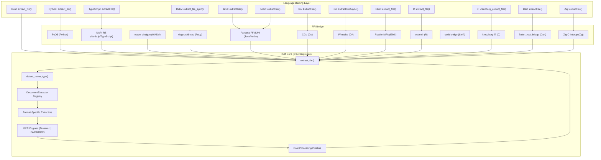
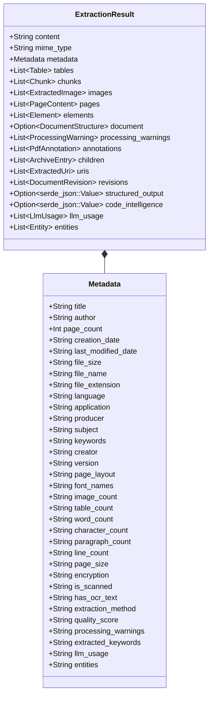
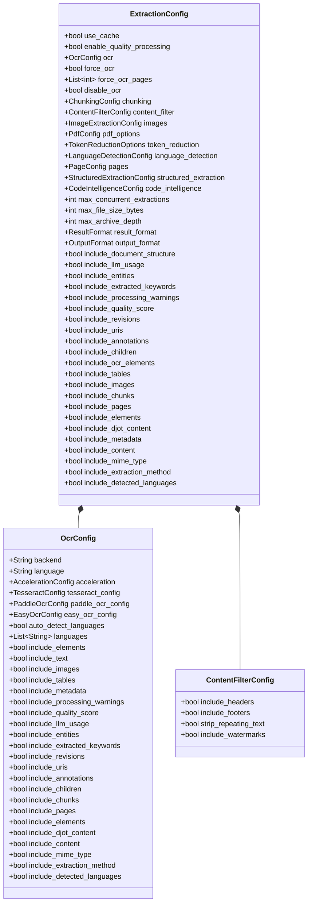

<!-- source: DeepWiki mcp.deepwiki.com · repo kreuzberg-dev/kreuzberg · page 2.2 Quick Start Examples · fetched 2026-10-27 -->

# Quick Start Examples

<details>
<summary>Relevant source files</summary>

The following files were used as context for generating this wiki page:

- [crates/kreuzberg-cli/README.md](crates/kreuzberg-cli/README.md)
- [docs/cli/usage.md](docs/cli/usage.md)
- [docs/getting-started/quickstart.md](docs/getting-started/quickstart.md)
- [docs/guides/advanced.md](docs/guides/advanced.md)
- [docs/guides/api-server.md](docs/guides/api-server.md)
- [docs/guides/configuration.md](docs/guides/configuration.md)
- [docs/guides/extraction.md](docs/guides/extraction.md)
- [docs/guides/layout-detection.md](docs/guides/layout-detection.md)
- [docs/guides/ocr.md](docs/guides/ocr.md)
- [docs/guides/plugins.md](docs/guides/plugins.md)
- [docs/reference/api-c.md](docs/reference/api-c.md)
- [docs/reference/api-csharp.md](docs/reference/api-csharp.md)
- [docs/reference/api-elixir.md](docs/reference/api-elixir.md)
- [docs/reference/api-go.md](docs/reference/api-go.md)
- [docs/reference/api-java.md](docs/reference/api-java.md)
- [docs/reference/api-php.md](docs/reference/api-php.md)
- [docs/reference/api-python.md](docs/reference/api-python.md)
- [docs/reference/api-r.md](docs/reference/api-r.md)
- [docs/reference/api-ruby.md](docs/reference/api-ruby.md)
- [docs/reference/api-rust.md](docs/reference/api-rust.md)
- [docs/reference/api-typescript.md](docs/reference/api-typescript.md)
- [docs/reference/api-wasm.md](docs/reference/api-wasm.md)
- [docs/reference/configuration.md](docs/reference/configuration.md)
- [docs/reference/environment-variables.md](docs/reference/environment-variables.md)
- [docs/reference/errors.md](docs/reference/errors.md)
- [docs/reference/formats.md](docs/reference/formats.md)
- [docs/reference/types.md](docs/reference/types.md)
- [docs/snippets/cli/batch_basic.md](docs/snippets/cli/batch_basic.md)
- [docs/snippets/cli/extract_basic.md](docs/snippets/cli/extract_basic.md)
- [docs/snippets/cli/ocr_basic.md](docs/snippets/cli/ocr_basic.md)

</details>


This page provides minimal working examples for extracting text from documents in each supported language binding. These examples demonstrate the simplest path from installation to first extraction, using the most common entry points in each language's API.

For detailed installation instructions and system requirements, see [Installation](#2.1). For comprehensive API documentation and advanced features, see the language-specific API reference pages under section 11.

## Overview of Extraction Entry Points

All language bindings expose the same core extraction functionality through language-idiomatic APIs. The following table maps the primary extraction functions across bindings:

| Language | Entry Point Function | Sync/Async |
|----------|---------------------|------------|
| Python | `extract_file()` | Async [docs/reference/api-python.md:49-49]() |
| Python | `extract_file_sync()` | Sync [docs/reference/api-python.md:90-90]() |
| TypeScript/Node.js | `extractFile()` | Async [docs/reference/api-typescript.md:49-49]() |
| TypeScript/Node.js | `extractFileSync()` | Sync [docs/reference/api-typescript.md:90-90]() |
| WASM | `extractFile()` | Async [docs/reference/api-wasm.md:49-49]() |
| Ruby | `extract_file_sync()` | Sync [docs/reference/api-ruby.md:90-90]() |
| Java | `extractFile()` | Sync [docs/reference/api-java.md:50-50]() |
| Go | `ExtractFile()` | Sync [docs/reference/api-go.md:50-50]() |
| C# | `ExtractFileAsync()` | Async [docs/reference/api-csharp.md:50-50]() |
| C# | `ExtractFileSync()` | Sync [docs/reference/api-csharp.md:106-106]() |
| Elixir | `extract_file()` | Async [docs/reference/api-elixir.md:75-75]() |
| Elixir | `extract_file_sync()` | Sync [docs/reference/api-elixir.md:109-109]() |
| R | `extract_file()` | Async [docs/reference/api-r.md:49-49]() |
| R | `extract_file_sync()` | Sync [docs/reference/api-r.md:90-90]() |
| Rust | `extract_file()` | Async [docs/reference/api-rust.md:74-74]() |
| Rust | `extract_file_sync()` | Sync [docs/reference/api-rust.md:106-106]() |
| C | `kreuzberg_extract_file()` | Sync [docs/reference/api-c.md:50-50]() |
| Dart | `extractFile()` | Async [docs/reference/api-dart.md:49-49]() |
| Dart | `extractFileSync()` | Sync [docs/reference/api-dart.md:90-90]() |
| Kotlin | `extractFile()` | Sync [docs/reference/api-kotlin.md:50-50]() |
| Zig | `extractFile()` | Sync [docs/reference/api-zig.md:50-50]() |

Sources: [docs/getting-started/quickstart.md:9-76](), [docs/reference/api-c.md:50-50](), [docs/reference/api-csharp.md:50-50](), [docs/reference/api-csharp.md:106-106](), [docs/reference/api-dart.md:49-49](), [docs/reference/api-dart.md:90-90](), [docs/reference/api-elixir.md:75-75](), [docs/reference/api-elixir.md:109-109](), [docs/reference/api-go.md:50-50](), [docs/reference/api-java.md:50-50](), [docs/reference/api-kotlin.md:50-50](), [docs/reference/api-python.md:49-49](), [docs/reference/api-python.md:90-90](), [docs/reference/api-r.md:49-49](), [docs/reference/api-r.md:90-90](), [docs/reference/api-ruby.md:90-90](), [docs/reference/api-rust.md:74-74](), [docs/reference/api-rust.md:106-106](), [docs/reference/api-typescript.md:49-49](), [docs/reference/api-typescript.md:90-90](), [docs/reference/api-wasm.md:49-49](), [docs/reference/api-zig.md:50-50]()

## Extraction Flow Architecture

The diagram below bridges the "Natural Language Space" (User Intent) to the "Code Entity Space" (Core Rust logic and FFI bindings).

### Language Binding to Rust Core Data Flow

Sources: [docs/reference/api-c.md:10-20](), [docs/reference/api-csharp.md:10-20](), [docs/reference/api-dart.md:10-20](), [docs/reference/api-elixir.md:10-20](), [docs/reference/api-go.md:10-20](), [docs/reference/api-java.md:10-20](), [docs/reference/api-kotlin.md:10-20](), [docs/reference/api-python.md:10-20](), [docs/reference/api-r.md:10-20](), [docs/reference/api-ruby.md:10-20](), [docs/reference/api-rust.md:10-20](), [docs/reference/api-typescript.md:10-20](), [docs/reference/api-wasm.md:10-20](), [docs/reference/api-zig.md:10-20]()

## Your First Extraction

This section demonstrates the basic usage of `extract_file_sync` (or its async equivalent) in various languages. This function takes a file path and an optional `ExtractionConfig` and returns an `ExtractionResult`.

### Python
```python
import asyncio
from kreuzberg import extract_file_sync, ExtractionConfig

# Create a dummy file for demonstration
with open("document.pdf", "w") as f:
    f.write("This is a dummy PDF content.")

# Basic synchronous extraction
result = extract_file_sync("document.pdf", config=ExtractionConfig())
print(result.content)
print(f"MIME: {result.mime_type}")
```
Sources: [docs/getting-started/quickstart.md:39-41](), [docs/reference/api-python.md:90-90]()

### TypeScript
```typescript
import { extractFileSync, ExtractionConfig } from '@kreuzberg/node';
import * as fs from 'fs';

// Create a dummy file for demonstration
fs.writeFileSync("document.docx", "This is a dummy DOCX content.");

// Basic synchronous extraction
const result = extractFileSync('document.docx', null, new ExtractionConfig());
console.log(result.content);
console.log(`MIME: ${result.mimeType}`);
```
Sources: [docs/getting-started/quickstart.md:63-63](), [docs/reference/api-typescript.md:90-90]()

### C#
```csharp
using Kreuzberg;
using System;
using System.IO;
using System.Threading.Tasks;

public class QuickStart
{
    public static async Task Main(string[] args)
    {
        // Create a dummy file for demonstration
        await File.WriteAllTextAsync("document.pdf", "This is a dummy PDF content.");

        // Basic synchronous extraction
        ExtractionResult result = KreuzbergClient.ExtractFileSync("document.pdf", null, new ExtractionConfig());
        Console.WriteLine(result.Content);
        Console.WriteLine($"MIME: {result.MimeType}");
    }
}
```
Sources: [docs/getting-started/quickstart.md:19-19](), [docs/reference/api-csharp.md:106-106]()

### Go
```go
package main

import (
	"fmt"
	"os"
	"github.com/kreuzberg/kreuzberg-go"
)

func main() {
	// Create a dummy file for demonstration
	os.WriteFile("document.pdf", []byte("This is a dummy PDF content."), 0644)

	// Basic synchronous extraction
	config := kreuzberg.ExtractionConfig{}
	result, err := kreuzberg.ExtractFileSync("document.pdf", nil, config)
	if err != nil {
		fmt.Printf("Error extracting file: %v\n", err)
		return
	}
	fmt.Println(result.Content)
	fmt.Printf("MIME: %s\n", result.MimeType)
}
```
Sources: [docs/getting-started/quickstart.md:27-27](), [docs/reference/api-go.md:106-106]()

### Java
```java
import dev.kreuzberg.Kreuzberg;
import dev.kreuzberg.ExtractionConfig;
import dev.kreuzberg.ExtractionResult;
import java.io.IOException;
import java.nio.file.Files;
import java.nio.file.Paths;

public class QuickStart {
    public static void main(String[] args) throws IOException {
        // Create a dummy file for demonstration
        Files.write(Paths.get("document.pdf"), "This is a dummy PDF content.".getBytes());

        // Basic synchronous extraction
        ExtractionResult result = Kreuzberg.extractFileSync("document.pdf", null, new ExtractionConfig());
        System.out.println(result.getContent());
        System.out.println("MIME: " + result.getMimeType());
    }
}
```
Sources: [docs/getting-started/quickstart.md:31-31](), [docs/reference/api-java.md:106-106]()

### Ruby
```ruby
require 'kreuzberg'

# Create a dummy file for demonstration
File.write("document.pdf", "This is a dummy PDF content.")

# Basic synchronous extraction
result = Kreuzberg.extract_file_sync("document.pdf", nil, Kreuzberg::ExtractionConfig.new)
puts result.content
puts "MIME: #{result.mime_type}"
```
Sources: [docs/getting-started/quickstart.md:43-43](), [docs/reference/api-ruby.md:90-90]()

### Rust
```rust
use kreuzberg::{extract_file_sync, ExtractionConfig};
use std::fs;
use std::path::PathBuf;

fn main() -> anyhow::Result<()> {
    // Create a dummy file for demonstration
    fs::write("document.pdf", "This is a dummy PDF content.")?;

    // Basic synchronous extraction
    let result = extract_file_sync(PathBuf::from("document.pdf"), None, ExtractionConfig::default())?;
    println!("Extracted: {}", result.content);
    println!("MIME: {}", result.mime_type);
    Ok(())
}
```
Sources: [docs/getting-started/quickstart.md:51-51](), [docs/reference/api-rust.md:106-106]()

### Elixir
```elixir
# Create a dummy file for demonstration
File.write!("document.pdf", "This is a dummy PDF content.")

# Basic synchronous extraction
{:ok, result} = Kreuzberg.extract_file_sync("document.pdf", nil, %Kreuzberg.ExtractionConfig{})
IO.puts(result.content)
IO.puts("MIME: #{result.mime_type}")
```
Sources: [docs/getting-started/quickstart.md:59-59](), [docs/reference/api-elixir.md:109-109]()

### R
```r
# Create a dummy file for demonstration
writeLines("This is a dummy PDF content.", "document.pdf")

# Basic synchronous extraction
result <- kreuzberg::extract_file_sync("document.pdf", NULL, kreuzberg::ExtractionConfig$new())
print(result$content)
print(paste("MIME:", result$mime_type))
```
Sources: [docs/getting-started/quickstart.md:47-47](), [docs/reference/api-r.md:90-90]()

### CLI
```bash
# Create a dummy file for demonstration
echo "This is a dummy PDF content." > document.pdf

# Extract text content to stdout
kreuzberg extract document.pdf
```
Sources: [docs/cli/usage.md:74-74](), [docs/snippets/cli/extract_basic.md:1-6]()

## Handle Errors

Robust applications should always include error handling. Kreuzberg provides specific error types for common issues like missing files, parse failures, or OCR problems.

### Python
```python
from kreuzberg import extract_file_sync, ExtractionConfig, Error

try:
    result = extract_file_sync("non_existent.pdf", config=ExtractionConfig())
    print(result.content)
except Error as e:
    print(f"Error during extraction: {e.error_type} - {e.message}")
```
Sources: [docs/getting-started/quickstart.md:109-109](), [docs/reference/api-python.md:45-46]()

### TypeScript
```typescript
import { extractFileSync, ExtractionConfig, Error } from '@kreuzberg/node';

try {
    const result = extractFileSync('non_existent.pdf', null, new ExtractionConfig());
    console.log(result.content);
} catch (e: any) {
    if (e instanceof Error) {
        console.error(`Error during extraction: ${e.errorType} - ${e.message}`);
    } else {
        console.error(`Unknown error: ${e}`);
    }
}
```
Sources: [docs/getting-started/quickstart.md:132-132](), [docs/reference/api-typescript.md:45-46]()

### C#
```csharp
using Kreuzberg;
using System;
using System.IO;
using System.Threading.Tasks;

public class ErrorHandling
{
    public static async Task Main(string[] args)
    {
        try
        {
            ExtractionResult result = KreuzbergClient.ExtractFileSync("non_existent.pdf", null, new ExtractionConfig());
            Console.WriteLine(result.Content);
        }
        catch (KreuzbergError e)
        {
            Console.WriteLine($"Error during extraction: {e.ErrorType} - {e.Message}");
        }
        catch (Exception e)
        {
            Console.WriteLine($"Unknown error: {e.Message}");
        }
    }
}
```
Sources: [docs/getting-started/quickstart.md:89-89](), [docs/reference/api-csharp.md:45-46]()

### Go
```go
package main

import (
	"fmt"
	"github.com/kreuzberg/kreuzberg-go"
)

func main() {
	config := kreuzberg.ExtractionConfig{}
	_, err := kreuzberg.ExtractFileSync("non_existent.pdf", nil, config)
	if err != nil {
		fmt.Printf("Error during extraction: %v\n", err)
	}
}
```
Sources: [docs/getting-started/quickstart.md:96-96](), [docs/reference/api-go.md:45-46]()

### Java
```java
import dev.kreuzberg.Kreuzberg;
import dev.kreuzberg.ExtractionConfig;
import dev.kreuzberg.ErrorException;

public class ErrorHandling {
    public static void main(String[] args) {
        try {
            Kreuzberg.extractFileSync("non_existent.pdf", null, new ExtractionConfig());
        } catch (ErrorException e) {
            System.err.println("Error during extraction: " + e.getErrorType() + " - " + e.getMessage());
        } catch (Exception e) {
            System.err.println("Unknown error: " + e.getMessage());
        }
    }
}
```
Sources: [docs/getting-started/quickstart.md:100-100](), [docs/reference/api-java.md:45-46]()

### Ruby
```ruby
require 'kreuzberg'

begin
  result = Kreuzberg.extract_file_sync("non_existent.pdf", nil, Kreuzberg::ExtractionConfig.new)
  puts result.content
rescue Kreuzberg::Error => e
  puts "Error during extraction: #{e.error_type} - #{e.message}"
rescue StandardError => e
  puts "Unknown error: #{e.message}"
end
```
Sources: [docs/getting-started/quickstart.md:112-112](), [docs/reference/api-ruby.md:45-46]()

### Rust
```rust
use kreuzberg::{extract_file_sync, ExtractionConfig, Error};
use std::path::PathBuf;

fn main() {
    let result = extract_file_sync(PathBuf::from("non_existent.pdf"), None, ExtractionConfig::default());
    match result {
        Ok(res) => println!("Extracted: {}", res.content),
        Err(Error::Io(e)) => println!("IO Error: {}", e),
        Err(e) => println!("Other Error: {:?}", e),
    }
}
```
Sources: [docs/getting-started/quickstart.md:120-120](), [docs/reference/api-rust.md:45-46]()

### Elixir
```elixir
case Kreuzberg.extract_file_sync("non_existent.pdf", nil, %Kreuzberg.ExtractionConfig{}) do
  {:ok, result} ->
    IO.puts(result.content)
  {:error, %Kreuzberg.Error{error_type: type, message: msg}} ->
    IO.puts("Error during extraction: #{type} - #{msg}")
  {:error, reason} ->
    IO.puts("Unknown error: #{inspect(reason)}")
end
```
Sources: [docs/getting-started/quickstart.md:128-128](), [docs/reference/api-elixir.md:45-46]()

### R
```r
tryCatch({
  result <- kreuzberg::extract_file_sync("non_existent.pdf", NULL, kreuzberg::ExtractionConfig$new())
  print(result$content)
}, error = function(e) {
  if (inherits(e, "KreuzbergError")) {
    print(paste("Error during extraction:", e$error_type, "-", e$message))
  } else {
    print(paste("Unknown error:", e$message))
  }
})
```
Sources: [docs/getting-started/quickstart.md:116-116](), [docs/reference/api-r.md:45-46]()

## OCR for Scanned Documents

Kreuzberg automatically performs OCR when it detects an image or a scanned PDF. You can also explicitly enable or force OCR using the `OcrConfig` within `ExtractionConfig`.

### Python
```python
from kreuzberg import extract_file_sync, ExtractionConfig, OcrConfig

# Create a dummy image file for demonstration
with open("scanned_document.png", "w") as f:
    f.write("This is a dummy image content.")

config = ExtractionConfig(
    ocr=OcrConfig(backend="tesseract", language="eng"),
    force_ocr=True
)

result = extract_file_sync("scanned_document.png", config=config)
print(result.content)
```
Sources: [docs/getting-started/quickstart.md:171-174](), [docs/guides/configuration.md:131-133](), [docs/reference/configuration.md:89-92]()

### TypeScript
```typescript
import { extractFileSync, ExtractionConfig, OcrConfig } from '@kreuzberg/node';
import * as fs from 'fs';

// Create a dummy image file for demonstration
fs.writeFileSync("scanned_document.png", "This is a dummy image content.");

const config = new ExtractionConfig({
    ocr: new OcrConfig({ backend: "tesseract", language: "eng" }),
    forceOcr: true
});

const result = extractFileSync('scanned_document.png', null, config);
console.log(result.content);
```
Sources: [docs/getting-started/quickstart.md:197-197](), [docs/guides/configuration.md:134-136]()

### C#
```csharp
using Kreuzberg;
using System;
using System.IO;
using System.Threading.Tasks;

public class OcrExtraction
{
    public static async Task Main(string[] args)
    {
        // Create a dummy image file for demonstration
        await File.WriteAllTextAsync("scanned_document.png", "This is a dummy image content.");

        var config = new ExtractionConfig
        {
            Ocr = new OcrConfig { Backend = "tesseract", Language = "eng" },
            ForceOcr = true
        };

        ExtractionResult result = KreuzbergClient.ExtractFileSync("scanned_document.png", null, config);
        Console.WriteLine(result.Content);
    }
}
```
Sources: [docs/getting-started/quickstart.md:153-153](), [docs/guides/configuration.md:29-29]()

### Go
```go
package main

import (
	"fmt"
	"os"
	"github.com/kreuzberg/kreuzberg-go"
)

func main() {
	// Create a dummy image file for demonstration
	os.WriteFile("scanned_document.png", []byte("This is a dummy image content."), 0644)

	config := kreuzberg.ExtractionConfig{
		Ocr: &kreuzberg.OcrConfig{Backend: "tesseract", Language: "eng"},
		ForceOcr: true,
	}

	result, err := kreuzberg.ExtractFileSync("scanned_document.png", nil, config)
	if err != nil {
		fmt.Printf("Error extracting file: %v\n", err)
		return
	}
	fmt.Println(result.Content)
}
```
Sources: [docs/getting-started/quickstart.md:161-161](), [docs/guides/configuration.md:22-24]()

### Java
```java
import dev.kreuzberg.Kreuzberg;
import dev.kreuzberg.ExtractionConfig;
import dev.kreuzberg.OcrConfig;
import dev.kreuzberg.ExtractionResult;
import java.io.IOException;
import java.nio.file.Files;
import java.nio.file.Paths;

public class OcrExtraction {
    public static void main(String[] args) throws IOException {
        // Create a dummy image file for demonstration
        Files.write(Paths.get("scanned_document.png"), "This is a dummy image content.".getBytes());

        ExtractionConfig config = new ExtractionConfig();
        config.setOcr(new OcrConfig("tesseract", "eng"));
        config.setForceOcr(true);

        ExtractionResult result = Kreuzberg.extractFileSync("scanned_document.png", null, config);
        System.out.println(result.getContent());
    }
}
```
Sources: [docs/getting-started/quickstart.md:165-165](), [docs/guides/configuration.md:25-27]()

### Ruby
```ruby
require 'kreuzberg'

# Create a dummy image file for demonstration
File.write("scanned_document.png", "This is a dummy image content.")

config = Kreuzberg::ExtractionConfig.new(
  ocr: Kreuzberg::OcrConfig.new(backend: "tesseract", language: "eng"),
  force_ocr: true
)

result = Kreuzberg.extract_file_sync("scanned_document.png", nil, config)
puts result.content
```
Sources: [docs/getting-started/quickstart.md:175-175](), [docs/guides/configuration.md:32-34]()

### Rust
```rust
use kreuzberg::{extract_file_sync, ExtractionConfig, OcrConfig};
use std::fs;
use std::path::PathBuf;

fn main() -> anyhow::Result<()> {
    // Create a dummy image file for demonstration
    fs::write("scanned_document.png", "This is a dummy image content.")?;

    let config = ExtractionConfig {
        ocr: Some(OcrConfig {
            backend: Some("tesseract".to_string()),
            language: Some("eng".to_string()),
            ..Default::default()
        }),
        force_ocr: true,
        ..Default::default()
    };

    let result = extract_file_sync(PathBuf::from("scanned_document.png"), None, config)?;
    println!("Extracted: {}", result.content);
    Ok(())
}
```
Sources: [docs/getting-started/quickstart.md:183-183](), [docs/guides/configuration.md:18-20]()

### Elixir
```elixir
# Create a dummy image file for demonstration
File.write!("scanned_document.png", "This is a dummy image content.")

config = %Kreuzberg.ExtractionConfig{
  ocr: %Kreuzberg.OcrConfig{backend: "tesseract", language: "eng"},
  force_ocr: true
}

{:ok, result} = Kreuzberg.extract_file_sync("scanned_document.png", nil, config)
IO.puts(result.content)
```
Sources: [docs/getting-started/quickstart.md:192-192]()

### R
```r
# Create a dummy image file for demonstration
writeLines("This is a dummy image content.", "scanned_document.png")

config <- kreuzberg::ExtractionConfig$new(
  ocr = kreuzberg::OcrConfig$new(backend = "tesseract", language = "eng"),
  force_ocr = TRUE
)

result <- kreuzberg::extract_file_sync("scanned_document.png", NULL, config)
print(result$content)
```
Sources: [docs/getting-started/quickstart.md:179-179](), [docs/guides/configuration.md:35-37]()

### CLI
```bash
# Create a dummy image file for demonstration
echo "This is a dummy image content." > scanned_document.png

# Enable OCR and force it to run
kreuzberg extract scanned_document.png --ocr true --force-ocr true
```
Sources: [docs/cli/usage.md:164-178](), [docs/snippets/cli/ocr_basic.md:1-6]()

## Process Multiple Files

The `batch_extract_files_sync` function allows processing multiple files concurrently, optimizing performance by managing concurrency automatically.

### Python
```python
from kreuzberg import batch_extract_files_sync, BatchFileItem, ExtractionConfig

# Create dummy files
with open("doc1.pdf", "w") as f: f.write("Content of document 1.")
with open("doc2.txt", "w") as f: f.write("Content of document 2.")

items = [
    BatchFileItem(path="doc1.pdf"),
    BatchFileItem(path="doc2.txt")
]

results = batch_extract_files_sync(items, ExtractionConfig())
for result in results:
    print(result.content)
```
Sources: [docs/getting-started/quickstart.md:240-240](), [docs/reference/api-python.md:152-152]()

### TypeScript
```typescript
import { batchExtractFilesSync, BatchFileItem, ExtractionConfig } from '@kreuzberg/node';
import * as fs from 'fs';

// Create dummy files
fs.writeFileSync("doc1.pdf", "Content of document 1.");
fs.writeFileSync("doc2.txt", "Content of document 2.");

const items = [
    new BatchFileItem({ path: "doc1.pdf" }),
    new BatchFileItem({ path: "doc2.txt" })
];

const results = batchExtractFilesSync(items, new ExtractionConfig());
results.forEach(result => console.log(result.content));
```
Sources: [docs/getting-started/quickstart.md:265-265](), [docs/reference/api-typescript.md:152-152]()

### C#
```csharp
using Kreuzberg;
using System;
using System.Collections.Generic;
using System.IO;
using System.Threading.Tasks;

public class BatchExtraction
{
    public static async Task Main(string[] args)
    {
        // Create dummy files
        await File.WriteAllTextAsync("doc1.pdf", "Content of document 1.");
        await File.WriteAllTextAsync("doc2.txt", "Content of document 2.");

        var items = new List<BatchFileItem>
        {
            new BatchFileItem { Path = "doc1.pdf" },
            new BatchFileItem { Path = "doc2.txt" }
        };

        List<ExtractionResult> results = KreuzbergClient.BatchExtractFilesSync(items, new ExtractionConfig());
        foreach (var result in results)
        {
            Console.WriteLine(result.Content);
        }
    }
}
```
Sources: [docs/getting-started/quickstart.md:221-221](), [docs/reference/api-csharp.md:161-161]()

### Go
```go
package main

import (
	"fmt"
	"os"
	"github.com/kreuzberg/kreuzberg-go"
)

func main() {
	// Create dummy files
	os.WriteFile("doc1.pdf", []byte("Content of document 1."), 0644)
	os.WriteAllText("doc2.txt", "Content of document 2.")

	items := []kreuzberg.BatchFileItem{
		{Path: "doc1.pdf"},
		{Path: "doc2.txt"},
	}

	results, err := kreuzberg.BatchExtractFilesSync(items, kreuzberg.ExtractionConfig{})
	if err != nil {
		fmt.Printf("Error batch extracting files: %v\n", err)
		return
	}
	for _, result := range results {
		fmt.Println(result.Content)
	}
}
```
Sources: [docs/getting-started/quickstart.md:229-229](), [docs/reference/api-go.md:161-161]()

### Java
```java
import dev.kreuzberg.Kreuzberg;
import dev.kreuzberg.ExtractionConfig;
import dev.kreuzberg.BatchFileItem;
import dev.kreuzberg.ExtractionResult;
import java.io.IOException;
import java.nio.file.Files;
import java.nio.file.Paths;
import java.util.Arrays;
import java.util.List;

public class BatchExtraction {
    public static void main(String[] args) throws IOException {
        // Create dummy files
        Files.write(Paths.get("doc1.pdf"), "Content of document 1.".getBytes());
        Files.write(Paths.get("doc2.txt"), "Content of document 2.".getBytes());

        List<BatchFileItem> items = Arrays.asList(
            new BatchFileItem("doc1.pdf", null),
            new BatchFileItem("doc2.txt", null)
        );

        List<ExtractionResult> results = Kreuzberg.batchExtractFilesSync(items, new ExtractionConfig());
        for (ExtractionResult result : results) {
            System.out.println(result.getContent());
        }
    }
}
```
Sources: [docs/getting-started/quickstart.md:233-233](), [docs/reference/api-java.md:161-161]()

### Ruby
```ruby
require 'kreuzberg'

# Create dummy files
File.write("doc1.pdf", "Content of document 1.")
File.write("doc2.txt", "Content of document 2.")

items = [
  Kreuzberg::BatchFileItem.new(path: "doc1.pdf"),
  Kreuzberg::BatchFileItem.new(path: "doc2.txt")
]

results = Kreuzberg.batch_extract_files_sync(items, Kreuzberg::ExtractionConfig.new)
results.each do |result|
  puts result.content
end
```
Sources: [docs/getting-started/quickstart.md:244-244](), [docs/reference/api-ruby.md:161-161]()

### Rust
```rust
use kreuzberg::{batch_extract_files_sync, BatchFileItem, ExtractionConfig};
use std::fs;
use std::path::PathBuf;

fn main() -> anyhow::Result<()> {
    // Create dummy files
    fs::write("doc1.pdf", "Content of document 1.")?;
    fs::write("doc2.txt", "Content of document 2.")?;

    let items = vec![
        BatchFileItem { path: PathBuf::from("doc1.pdf"), config: None },
        BatchFileItem { path: PathBuf::from("doc2.txt"), config: None },
    ];

    let results = batch_extract_files_sync(items, ExtractionConfig::default())?;
    for result in results {
        println!("{}", result.content);
    }
    Ok(())
}
```
Sources: [docs/getting-started/quickstart.md:252-252](), [docs/reference/api-rust.md:161-161]()

### Elixir
```elixir
# Create dummy files
File.write!("doc1.pdf", "Content of document 1.")
File.write!("doc2.txt", "Content of document 2.")

items = [
  %Kreuzberg.BatchFileItem{path: "doc1.pdf"},
  %Kreuzberg.BatchFileItem{path: "doc2.txt"}
]

{:ok, results} = Kreuzberg.batch_extract_files_sync(items, %Kreuzberg.ExtractionConfig{})
Enum.each(results, fn result -> IO.puts(result.content) end)
```
Sources: [docs/getting-started/quickstart.md:261-261](), [docs/reference/api-elixir.md:161-161]()

### R
```r
# Create dummy files
writeLines("Content of document 1.", "doc1.pdf")
writeLines("Content of document 2.", "doc2.txt")

items <- list(
  kreuzberg::BatchFileItem$new(path = "doc1.pdf"),
  kreuzberg::BatchFileItem$new(path = "doc2.txt")
)

results <- kreuzberg::batch_extract_files_sync(items, kreuzberg::ExtractionConfig$new())
lapply(results, function(result) print(result$content))
```
Sources: [docs/getting-started/quickstart.md:248-248](), [docs/reference/api-r.md:161-161]()

### CLI
```bash
# Create dummy files
echo "Content of document 1." > doc1.pdf
echo "Content of document 2." > doc2.txt

# Batch extract from multiple files
kreuzberg batch doc1.pdf doc2.txt
```
Sources: [docs/cli/usage.md:83-83](), [docs/snippets/cli/batch_basic.md:1-7]()

## Read Document Metadata

Every `ExtractionResult` includes format-specific metadata, such as page count for PDFs, sheet names for Excel, or dimensions for images.

### Python
```python
from kreuzberg import extract_file_sync, ExtractionConfig

# Create a dummy file for demonstration
with open("document.pdf", "w") as f:
    f.write("This is a dummy PDF content.")

result = extract_file_sync("document.pdf", config=ExtractionConfig())
print(f"Page Count: {result.metadata.get('page_count')}")
print(f"Author: {result.metadata.get('author')}")
```
Sources: [docs/getting-started/quickstart.md:310-310](), [docs/reference/types.md:32-32]()

### TypeScript
```typescript
import { extractFileSync, ExtractionConfig } from '@kreuzberg/node';
import * as fs from 'fs';

// Create a dummy file for demonstration
fs.writeFileSync("document.pdf", "This is a dummy PDF content.");

const result = extractFileSync('document.pdf', null, new ExtractionConfig());
console.log(`Page Count: ${result.metadata.pageCount}`);
console.log(`Author: ${result.metadata.author}`);
```
Sources: [docs/getting-started/quickstart.md:335-335](), [docs/reference/types.md:32-32]()

### C#
```csharp
using Kreuzberg;
using System;
using System.IO;
using System.Threading.Tasks;

public class MetadataExtraction
{
    public static async Task Main(string[] args)
    {
        // Create a dummy file for demonstration
        await File.WriteAllTextAsync("document.pdf", "This is a dummy PDF content.");

        ExtractionResult result = KreuzbergClient.ExtractFileSync("document.pdf", null, new ExtractionConfig());
        Console.WriteLine($"Page Count: {result.Metadata.PageCount}");
        Console.WriteLine($"Author: {result.Metadata.Author}");
    }
}
```
Sources: [docs/getting-started/quickstart.md:291-291](), [docs/reference/types.md:32-32]()

### Go
```go
package main

import (
	"fmt"
	"os"
	"github.com/kreuzberg/kreuzberg-go"
)

func main() {
	// Create a dummy file for demonstration
	os.WriteFile("document.pdf", []byte("This is a dummy PDF content."), 0644)

	config := kreuzberg.ExtractionConfig{}
	result, err := kreuzberg.ExtractFileSync("document.pdf", nil, config)
	if err != nil {
		fmt.Printf("Error extracting file: %v\n", err)
		return
	}
	fmt.Printf("Page Count: %d\n", result.Metadata.PageCount)
	fmt.Printf("Author: %s\n", result.Metadata.Author)
}
```
Sources: [docs/getting-started/quickstart.md:298-298](), [docs/reference/types.md:32-32]()

### Java
```java
import dev.kreuzberg.Kreuzberg;
import dev.kreuzberg.ExtractionConfig;
import dev.kreuzberg.ExtractionResult;
import java.io.IOException;
import java.nio.file.Files;
import java.nio.file.Paths;

public class MetadataExtraction {
    public static void main(String[] args) throws IOException {
        // Create a dummy file for demonstration
        Files.write(Paths.get("document.pdf"), "This is a dummy PDF content.".getBytes());

        ExtractionResult result = Kreuzberg.extractFileSync("document.pdf", null, new ExtractionConfig());
        System.out.println("Page Count: " + result.getMetadata().getPageCount());
        System.out.println("Author: " + result.getMetadata().getAuthor());
    }
}
```
Sources: [docs/getting-started/quickstart.md:302-302](), [docs/reference/types.md:32-32]()

### Ruby
```ruby
require 'kreuzberg'

# Create a dummy file for demonstration
File.write("document.pdf", "This is a dummy PDF content.")

result = Kreuzberg.extract_file_sync("document.pdf", nil, Kreuzberg::ExtractionConfig.new)
puts "Page Count: #{result.metadata.page_count}"
puts "Author: #{result.metadata.author}"
```
Sources: [docs/getting-started/quickstart.md:313-313](), [docs/reference/types.md:32-32]()

### Rust
```rust
use kreuzberg::{extract_file_sync, ExtractionConfig};
use std::fs;
use std::path::PathBuf;

fn main() -> anyhow::Result<()> {
    // Create a dummy file for demonstration
    fs::write("document.pdf", "This is a dummy PDF content.")?;

    let result = extract_file_sync(PathBuf::from("document.pdf"), None, ExtractionConfig::default())?;
    println!("Page Count: {:?}", result.metadata.page_count);
    println!("Author: {:?}", result.metadata.author);
    Ok(())
}
```
Sources: [docs/getting-started/quickstart.md:322-322](), [docs/reference/types.md:32-32]()

### Elixir
```elixir
# Create a dummy file for demonstration
File.write!("document.pdf", "This is a dummy PDF content.")

{:ok, result} = Kreuzberg.extract_file_sync("document.pdf", nil, %Kreuzberg.ExtractionConfig{})
IO.puts("Page Count: #{result.metadata.page_count}")
IO.puts("Author: #{result.metadata.author}")
```
Sources: [docs/getting-started/quickstart.md:330-330](), [docs/reference/types.md:32-32]()

### R
```r
# Create a dummy file for demonstration
writeLines("This is a dummy PDF content.", "document.pdf")

result <- kreuzberg::extract_file_sync("document.pdf", NULL, kreuzberg::ExtractionConfig$new())
print(paste("Page Count:", result$metadata$page_count))
print(paste("Author:", result$metadata$author))
```
Sources: [docs/getting-started/quickstart.md:317-317](), [docs/reference/types.md:32-32]()

### CLI
```bash
# Create a dummy file for demonstration
echo "This is a dummy PDF content." > document.pdf

# Extract with metadata (JSON format includes metadata)
kreuzberg extract document.pdf --format json
```
Sources: [docs/getting-started/quickstart.md:348-349](), [docs/cli/usage.md:127-131]()

## Result Structure Pattern

Every language binding returns a standardized result object derived from the core `ExtractionResult`. This object contains the extracted content, MIME type, and various metadata fields.

### ExtractionResult Structure

Sources: [docs/reference/types.md:23-53](), [docs/reference/types.md:13-19]()

## Common Configuration Pattern

Configuration objects are used to control OCR, caching, and filtering. The `ExtractionConfig` is the primary configuration object, containing nested configurations for specific features like OCR, chunking, and content filtering.

### Configuration Fields and Their Purpose

Sources: [docs/reference/configuration.md:80-100](), [docs/reference/configuration.md:48-66](), [docs/reference/configuration.md:10-20]()

---

